# Handbeat-Anleitung

[Anleitung](#guide) · [Geräte](#devices) · [Kontakt](#contact) · [Unterstützen](#support)

Handbeat ist eine Groovebox für dein iPhone und dein iPad: sechzehn Pads, ein ganzer Haufen Geräte, ein Tempo, ein Transport. Du tippst, zeichnest einen Beat und kettest die Takte zu einem Song aneinander. Das war's schon. Keine Accounts, kein falsches Spielen.

Diese Seite ist die lange Version. Du musst sie nicht von oben bis unten lesen: Tipp dich erst mal durch die App und komm wieder, wenn dich etwas ratlos macht.

---

# Anleitung

## Das Display

Oben auf dem Bildschirm sitzt das **Display**. Alles darauf darfst du anfassen.

| | |
|---|---|
|  | **Mikrofon.** Nimm eigene Sounds auf, siehe [Eigene Sounds](#your-own-sounds). |
|  | **Export.** Speichert das ganze Projekt als Audiodatei. |
|  | **Menü.** Deine Projekte und die Einstellungen. |
|  | **TAP.** Tippe im Takt eines Songs darauf, und Handbeat findet das Tempo. Es pulsiert außerdem auf jedem Schlag. |
|  | **ACC.** Akzent, siehe [Einen Beat zeichnen](#drawing-a-beat-step). |
|  | **Pfeile.** Schalten durch die Sounds (oder Noten) eines Geräts. |

- **Die Namensleiste** zeigt den Namen des Geräts (im Mixer den des Projekts). Tippe auf den Stift, um ihn umzubenennen, bis zu 8 Zeichen.
- **BPM** ist das Tempo: Zieh es nach oben oder unten (64 bis 256). **SWG** ist Swing, dazu gleich mehr.
- **Die zwei Ziffernspalten** zeigen zwei Zahlen; was sie bedeuten, hängt von der Seite ab, zum Beispiel *SOUND* und *PATTERN* bei einem Drumkit.
- **Zwei Regler.** Zieh sie nach oben oder unten. **Doppeltippe auf einen Regler**, um ihn auf seinen Standardwert zurückzusetzen. Solange du an einem drehst, zeigt das Display seinen genauen Wert und seinen Namen.

Jedes Pad, jede Taste und jeder Regler antwortet mit einem winzigen Tipser deines Handys (in den Einstellungen unter *Vibration* abschaltbar). Je mehr ein Bedienelement die Musik verändert, desto kräftiger der Tipser.

Jede Seite hat eine dezente **Textur** auf ihren Pads und auf der Taste, die sie öffnet, damit du auf einen Blick siehst, wo du bist: Linien für LIVE FX, Punkte für SOUND, Spalten für STEP und Quadrate für PATTERN. Die Seite DEVICE hat keine, ihre Pads tragen stattdessen ein kleines Zeichen für jedes Gerät. Schalte das alles in den Einstellungen unter *Visuelle Hinweise* aus.

Mehr wissen?

**Tempo und Swing**

**BPM** heißt *Beats per Minute*, Schläge pro Minute. 60 ist ein Schlag pro Sekunde, ein gemütlicher Spaziergang. House liegt bei 120 bis 130, Drum and Bass bei etwa 170. Handbeat startet bei 128, weil das zu fast allem passt.

**Swing** lässt den Beat absichtlich „humpeln“. Normalerweise liegen die 16 Steps eines Takts gleichmäßig verteilt. Mit Swing kommt jeder zweite Step ein bisschen zu spät, und der Groove federt, statt zu marschieren. SWG reicht von **500** (gerade) bis **750** (das Extrem); um **667** herum bekommst du den klassischen Triolen-Shuffle. Probier ihn an den Hi-Hats aus.

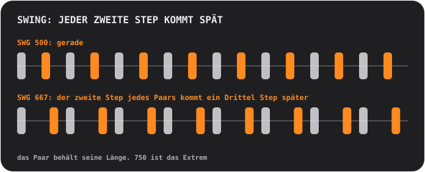

## Pads und Seiten

Die Pads sind immer ein 4×4-Raster, nummeriert von 01 bis 16. Die obere Tastenreihe wechselt die **Seite**, und die entscheidet, was die Pads tun:

<table>
<tr>
<td align="center"> <b>SOUND</b> spielen: jedes Pad spielt seinen eigenen Sound</td>
<td align="center"> <b>STEP</b> zeichnen: jedes Pad ist einer von 16 Steps</td>
<td align="center"> <b>PATTERN</b> wählen: jedes Pad ist ein Pattern</td>
</tr>
</table>

### Einen Beat zeichnen (STEP)

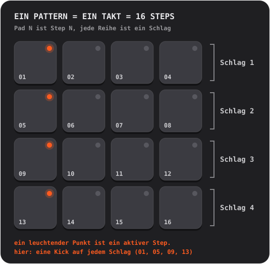

1. Tippe auf **SOUND** auf das Pad, das du programmieren willst. Es wird zum gewählten Sound.
2. Drücke **STEP** und tippe auf Pads, um Steps ein- und auszuschalten. Ein leuchtender Punkt heißt: Der Step ist an.
3. Drücke **PLAY**. Ein sanftes Aufblitzen läuft über die Pads: der Playhead. Du kannst weiterbearbeiten, während es läuft.

**Akzente.** Drücke **ACC** und tippe dann auf einen Step: Er wird zum Akzent, einem lauteren, betonteren Schlag. ACC schaltet sich nach einem Tipp von selbst wieder aus. Tippst du einen Akzent-Step noch einmal an, wird er gelöscht.

Mehr wissen?

**Was ein Step-Sequencer ist**

Die Zeit wird in gleich große Scheiben zerlegt, die **Steps**. Für jeden Sound legst du fest, auf welchen Steps er spielt. Vier Steps ergeben einen **Schlag** (ein Fußwippen), vier Schläge einen **Takt**. Jedes Pattern in Handbeat ist genau ein Takt, und ein Takt läuft in der Schleife. Der Großteil von Pop, House und Hip-Hop ist aus solchen Takten gebaut, gestapelt und variiert.

### Live aufnehmen (REC)

Drücke **REC** und spiele auf der Seite SOUND Pads. Handbeat startet den Transport, falls er nicht lief, und setzt deine Schläge auf den *nächstgelegenen* 16tel-Step, sodass auch ein leicht schlampiger Finger im Takt landet. Es **überdubbt**: Was schon da ist, bleibt. Mit **STOP** (der PLAY-Taste) beendest du die Aufnahme. Ein Rückgängig gibt es nicht: Schalte ungewollte Steps in STEP einfach aus.

Bei Geräten, die Noten halten (Bass, Acid, Pad, Chip), wird auch die Länge deiner Berührung aufgenommen.

### Die Lichter lesen

- Der **Punkt** eines Pads sagt, was das Pad *ist*: aus bedeutet leer, gedimmt heißt „hier ist etwas“, an heißt aktiv (der gewählte Sound, ein eingeschalteter Step, das aktuelle Pattern), hell hebt sich ab (ein Akzent, der neueste Takt einer Chain). Ein **blinkender** Punkt heißt „wartet auf das Taktende“.
- Der **Ring** eines Pads sagt, was *gerade jetzt* spielt.
- Ein **abgedunkeltes** Pad ist stumm (gemutet, oder ein anderes ist auf Solo). Es spielt trotzdem, wenn du es berührst.
- Ein **Ring um eine Taste** bedeutet, dass ein Modus aktiv ist.

## Tasten

| | |
|---|---|
|   | **S und M** sind die beiden *Kontexttasten*; sie wechseln mit Gerät und Seite. Beim Drumkit sind sie **Solo** und **Mute** für den gewählten Sound. Andere Geräte legen hier ihre eigenen Tasten hin, siehe [Geräte](#devices). |
|   | Auf der Seite PATTERN werden sie zu **COPY** und **ERASE**. |
|  | **REC** nimmt live auf. |
|  | **PLAY** startet alles mit einer gemeinsamen Uhr. Während des Spielens ist es ein Stopp-Quadrat: Es stoppt *und spult zurück*. Ein Anruf, ein Wecker oder herausgezogene Kopfhörer stoppen die Musik ebenfalls; drücke dann wieder PLAY. |
|  | **CHAIN** verbindet Patterns zu einem Song. Blau umrandet, solange sie an ist. |
|  | **RACK** wechselt zwischen dem Gerät, in dem du bist, und dem Mixer. |

Mute und Solo wirken nur auf das, was der *Sequencer* spielt. Ein Pad, das du selbst berührst, macht immer Ton.

## Patterns und Chains

Ein **Pattern** ist ein Takt, 16 Steps. Du hast **16 Patterns**, und *jedes Pattern enthält die Steps aller Geräte*: Drums, Bass und Melodie von Pattern 03 liegen alle in 03.

Tippe auf der Seite **PATTERN** auf ein Pad, um ein Pattern zu wählen. Während die Musik läuft, wartet der Wechsel bis zum Taktende, und das Pad **blinkt**, bis es so weit ist.

- **COPY**, dann ein Pad: kopiert das laufende Pattern dorthin.
- **ERASE**, dann ein Pad: löscht dieses Pattern.
- Drücke die Taste noch einmal oder verlasse die Seite, um abzubrechen.

### Chain: Ein Pattern ist ein Takt, eine Chain ist ein Song

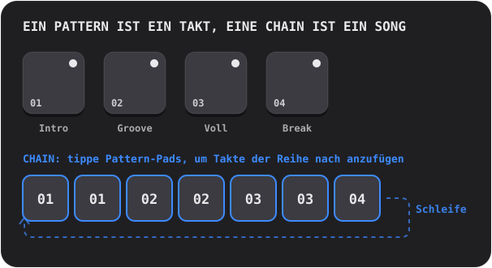

Schalte **CHAIN** ein und tippe auf Pattern-Pads: Jeder Tipp **hängt einen Takt** ans Ende der Chain (bis zu 99 Takte, Wiederholungen erlaubt). Die Wiedergabe folgt der Chain Takt für Takt und beginnt dann von vorn. Schalte CHAIN aus, um sie zu beenden; das zuletzt berührte Pattern spielt dann für sich allein.

Mehr wissen?

**Wie Songs aus Loops gebaut werden**

Die meiste Tanzmusik ist **Wiederholung mit Veränderung**. Du nimmst einen Loop, der funktioniert, und fügst Schichten hinzu oder nimmst sie weg, damit der Hörer spürt, wie es wächst und atmet: ein sparsames **Intro**, ein stabiler **Groove**, ein **voller** Abschnitt mit allem an, ein **Break**, in dem Dinge wegfallen, und ein Drum-**Fill** im letzten Schlag, der den Ohren sagt: „Gleich kommt etwas Neues.“ In Handbeat ist jedes davon ein Pattern, und CHAIN bringt sie in die richtige Reihenfolge.

## Der Mixer (RACK)

Die letzte Taste schaltet zwischen deinem Gerät und dem **Mixer** um, demselben 4×4-Feld mit anderem Hut. Ein Projekt **öffnet sich immer im Mixer**.

<table>
<tr>
<td align="center"> <b>DEVICE</b> deine Geräte</td>
<td align="center"> <b>Leeres Pad</b> ein neues Gerät wählen</td>
<td align="center"> <b>PATTERN</b> ganze Patterns kopieren und löschen</td>
</tr>
</table>

Auf der Seite **DEVICE** ist jedes Pad ein Platz: bis zu **16 Geräte** pro Projekt.

- **Tippe auf ein Pad mit einem Plus**, um ein Gerät hinzuzufügen (die Pads verwandeln sich in die Arten, die du wählen kannst, jede mit ihrem Zeichen).
- **Zeichen.** Jedes Pad trägt ein kleines Zeichen seines Geräts: ein Trommelfell (Drums), eine Wellenform (Sampler), eine langsame Welle (Bass), eine Säge (Acid), ein Mikrofon (Vocal), eine verklingende Saite (Pluck), eine anschwellende Hüllkurve (Pad) oder eine Rechteckwelle (Chip).
- **Tippe auf ein belegtes Pad**, um es auszuwählen. Sein Ring leuchtet, solange es spielt. **RACK** springt in seinen eigenen Bildschirm.
- **SOLO / MUTE** wirken auf das gewählte Gerät.  **TRASH** löscht eines: drücken, auf das Pad des Geräts tippen, bestätigen.
- **DEV VOL** ist der Pegel des gewählten Geräts, **MAIN VOL** die Lautstärke des gesamten Mixes. 5 ist die neutrale Mitte.
- Auf der Seite **PATTERN** des Mixers wirken COPY und ERASE auf das ganze Pattern *mit allen Geräten darin*.

## Live-Effekte

Die Seite **LIVE FX** hat sechzehn Effekte auf den Pads, vier Reihen mit je vier. **Halte ein Pad gedrückt, um den Effekt zu spielen, lass los, um ihn zu stoppen.** Effekte blenden in einer zehntel Sekunde ein und in einer viertel aus, nichts knackt also. Halte so viele, wie du willst. Sie sind zum **Performen** gedacht: Nichts auf dieser Seite wird gespeichert, und Effekte sind **nicht im Export enthalten**.

**Klang**
- **LP**: dämpft den Sound (Tiefpass).
- **HP**: macht ihn dünner (Hochpass).
- **SWEEP**: ein Filter, der von den Bässen zu den Höhen klettert und genau am Taktende ankommt.
- **ROBOT**: der ganze Mix klingt auf einer einzigen Tonhöhe.

**Raum** (sie klingen nach, wenn du loslässt)
- **ECHO**: wiederholt in punktierten Achteln.
- **DUB**: wiederholt auf jedem Schlag, dunkler und schmutziger.
- **VOID**: ein Raum.
- **FLANGE**: ein kreisendes Düsenjet-Rauschen.

**Loop und Halten**
- **STUT 1/8**, **STUT 1/16**, **STUT 1/32**: Stotterer. Der gerade spielende Step wiederholt sich.
- **FREEZE**: hält den Sound als weiche, gleichmäßige Textur fest.

**DJ-Übergänge**
- **SCRATCH**: eine Nadel, die über den letzten halben Schlag hin- und hergezogen wird.
- **REVERSE**: die Musik, einen Schlag zurück, rückwärts.
- **HALF SPEED**: bremst alles um eine Oktave ab.
- **RISER**: ein Rauschen im Anstieg, das genau am Taktende seinen Höhepunkt erreicht und abreißt, sobald du loslässt: der „Drop“.

Mehr wissen?

**Effekte in einem Song einsetzen**

Effekte sind das Gewürz, nicht das Essen. Die klassischen Griffe: Halte **RISER** durch den letzten Takt eines Abschnitts und lass auf dem ersten Schlag des nächsten los; halte **LP**, während ein Abschnitt endet, und lass los, damit der neue explodiert; tippe einen **STUT** einen Schlag lang an, um aus dem, was gerade läuft, einen stotternden Drumwirbel zu machen; setze ein kurzes **ECHO** auf den letzten Schlag einer Phrase, damit sie in den nächsten Takt hineinklingt.

**Innenleben**

Die Effekte arbeiten auf dem ganzen Mix, nachdem alle Geräte addiert sind und vor Hauptlautstärke und Limiter. Ein Stotterer nimmt den Step, auf dem der Sequencer steht, wenn du das Pad berührst, sodass du die *Note* wiederholt hörst und nicht die Stille davor.

## Eigene Sounds

Du kannst **deine eigenen** Sounds spielen: Nimm sie mit dem Mikrofon auf oder lade Audiodateien. Jedes Gerät kann sie haben, außer Chip und Acid, die auf ihren eigenen Wellenformen aufbauen.

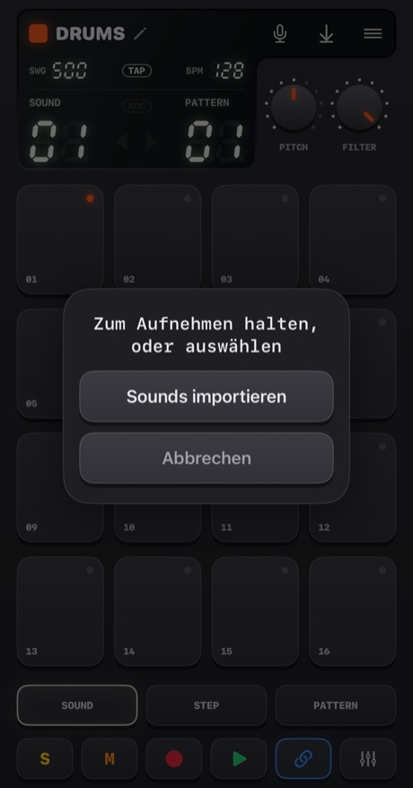

- **Halte das Mikrofon** gedrückt (etwas länger als eine Viertelsekunde), um aufzunehmen. Lass los, um zu beenden. Die Pads werden rot, die Musik stoppt (das Mikro würde sie hören) und das Display zählt die Sekunden.
- **Tippe es an**, um zu wählen: **Sounds importieren** oder **Integrierte Sounds** (zurück zu den Originalen; erscheint, wenn das Gerät eigene Sounds hat).

Wohin der Sound geht, hängt vom Gerät ab:
- **Drums**: ein Sound pro Pad. **Wähle erst das Pad, dann halte die Taste gedrückt.**
- **Sampler**: ein Sound mit bis zu **30 Sekunden**, in 16 gleiche Slices geschnitten.
- **Pluck, Pad, Bass, Vocal**: ein Sound mit bis zu **10 Sekunden**, der auf jedem Pad in anderer Tonhöhe gespielt wird. Was du aufnimmst, ist der *Grundton*, Pad 05.

Handbeat schneidet die Stille um deinen Sound herum ab. Eine stille Aufnahme wird nicht behalten.

**Dateien importieren** funktioniert mit WAV, AIFF, M4A, MP3 und Ähnlichem. Ein Drumkit nimmt mehrere, eine pro Pad in der Reihenfolge ihrer Namen, ab dem gewählten Pad. Eine lange Datei wird **an ihren Pausen zerschnitten** (eine Viertelsekunde Stille beginnt den nächsten Sound). Jedes andere Gerät nimmt die erste Datei. Sounds werden im Projekt gespeichert und reisen mit ihm.

Beim ersten Mal fragt iOS, ob Handbeat das Mikrofon benutzen darf. Wenn du Nein gesagt hast, führt dich die Taste in die Einstellungen.

Mehr wissen?

**Was Sampling ist**

Ein **Sample** ist eine Aufnahme, die als Instrument benutzt wird. Sampling ist das Herz von Hip-Hop, House und tausend anderen Dingen: Du nimmst einen Sound auf, löst ihn aus, machst ihn schneller, langsamer, hackst ihn in Stücke. Spielst du ein Sample **schneller**, wird es höher und kürzer, **langsamer**, wird es tiefer und länger, genau wie beim Beschleunigen eines Tonbands. So wird aus einer Aufnahme eine ganze Tastatur.

## Projekte, Teilen und Export

Die **Menü**-Taste öffnet die **Projekte** (sie stoppt die Musik und speichert).

<table>
<tr>
<td align="center">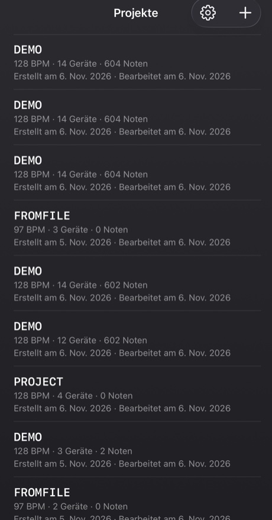</td>
<td align="center">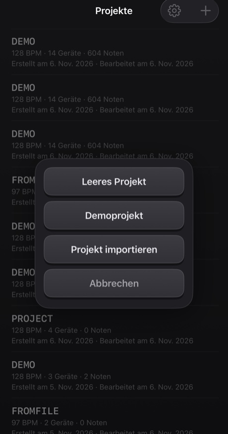</td>
</tr>
</table>

- Tippe auf ein Projekt, um es zu öffnen. **Wische** über eine Zeile (oder halte sie gedrückt), um sie zu **teilen** oder zu **löschen**; Löschen fragt immer nach.
- Mit dem **+** legst du ein *Leeres Projekt* oder ein *Demoprojekt* an oder **importierst** eines aus einer Datei. Die Demo ist ein guter Startpunkt: vierzehn Geräte, die ein 40-taktiges Mashup spielen.
- Alles wird **automatisch gespeichert**.

**Teilen** schreibt ein Projekt samt seinen eigenen Sounds in eine einzige `.handbeat`-Datei und öffnet das Teilen-Menü: Schick sie per AirDrop oder Mail oder leg sie als Backup in Dateien ab. Öffnest du eine solche Datei in Handbeat, wird sie als neues Projekt **hinzugefügt** und berührt deine nie.

**Audio exportieren** ist die Speichern-Taste im Display. Sie rendert das **ganze Projekt, alle Geräte gemischt**, als **WAV** oder **M4A** (in den Einstellungen wählbar), schneller als in Echtzeit. Mit eingeschalteter CHAIN bekommst du die ganze Chain, sonst einen Durchlauf des aktuellen Patterns. Die Taste ist ausgegraut, wenn es nichts zu hören gibt.

## Einstellungen

Projekte → das Zahnrad. **Sprache** schaltet die Menüs sofort um (die Groovebox selbst mit ihren Tasten, Reglern und Gerätenamen bleibt überall auf Englisch, wie die Beschriftungen auf einem Hardwaregerät). Es gibt vier **Designs**, jedes in Dunkel, Hell oder *System*: **Classic**, **iClassic** (glänzender Kunststoff und ein Click Wheel), **Contrast** (flach, reines Schwarz oder Weiß) und **Aero** (Gel und Glas). Jedes Design hat außerdem sein eigenes **App-Symbol**. **Vibration** und **Visuelle Hinweise** schalten die Taps sowie die Texturen und Zeichen der Seiten ein oder aus. **Einführung** startet die geführte Tour noch einmal in einem neuen Demoprojekt. Beim ersten Öffnen von Handbeat beginnt die Tour von selbst in einer Demo, und das Kreuz in ihrer Ecke beendet sie.

---

# Geräte

Ein **Gerät** ist ein Instrument in deinem Projekt. Füge eines hinzu, indem du im Mixer auf ein leeres Pad tippst. Sie stehen hier in derselben Reihenfolge wie in der Auswahl. Alle sind 16 Spuren × 16 Steps, deshalb funktionieren STEP, REC, Patterns, Chains und Export überall gleich. Unterschiedlich sind der Sound, die Pads, die zwei Regler und die zwei Tasten neben **REC**.

**Notengeräte** (Bass, Acid, Vocal, Pluck, Pad, Chip) teilen sich ein Pad-Layout wie eine Piano Roll: **Pad 05 ist der Grundton** (der „Heimatton“), Pads darüber sind höher, Pads darunter tiefer. Der Regler **SCALE** bestimmt, was die Steps *sind* (siehe [Tonleitern](#scales)). Die Steps, die du zeichnest, werden als Pad-Nummern gespeichert, daher spielt ein Wechsel der Tonleiter *dieselbe Melodie in einer neuen Tonleiter*.

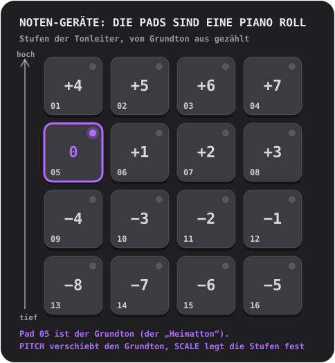

## Drums

Ein komplettes Drumkit: **16 Sounds, einer pro Pad**.

- **Regler:** **PITCH** (−6 bis +6 Halbtöne, das ganze Kit) und **FILTER** (ein Tiefpass: 10 ist ganz offen, niedriger macht das Kit dumpfer).
- **Tasten:** **S** und **M** (Solo und Mute) für den gewählten Sound.
- **Eigene Sounds:** einer pro Pad.

**Probier das:** Tippe auf SOUND die Pads an, um zu finden, was wo liegt. Such die Kick, drücke STEP und schalte 01, 05, 09 und 13 ein: eine Kick auf jedem Schlag, der Herzschlag von House. Setz eine Clap auf 05 und 13 und Hi-Hats auf die Steps dazwischen.

Eine **geschlossene Hi-Hat** schneidet eine **offene Hi-Hat** ab, wie beim echten Vorbild, sodass sie nie übereinander klingen.

Mehr wissen?

**Die drei Drums, auf die es ankommt**

Die **Kick** ist der tiefe Wumms, bei dem du nickst. Die **Snare** oder **Clap** ist der Knall, meist auf den Schlägen 2 und 4 (Steps 05 und 13), der **Backbeat**. Die **Hi-Hat** ist das Tick-Tick-Tick, das das Tempo des Grooves vorgibt: Achtel (jeder zweite Step) oder Sechzehntel (jeder Step). Eine Kick auf jedem Schlag heißt **Four on the Floor**; Kick auf 01 und 11 mit Snare auf 05 und 13 ist ein klassischer Breakbeat.

**Innenleben**

Jeder mitgelieferte Sound ist von Grund auf für Handbeat gemacht: von einem Skript erzeugt, nichts von irgendwem geborgt.

## Sampler

**Ein Sound, in 16 gleiche Slices geschnitten**, einer pro Pad. Leg die Slices der Reihe nach, und der Sound spielt so, wie er war; mischst du sie um, hast du ihn geremixt.

- **Regler:** **PITCH** (beschleunigt oder verlangsamt jeden Slice) und **FILTER**.
- **Tasten:** **MONO / POLY** (MONO: Ein neuer Slice schneidet die noch klingenden ab) und **REVERSE** (jeder Slice rückwärts).
- **Eigener Sound:** nimm bis zu **30 Sekunden** auf oder importiere eine Datei. Die erste Spalte im Display heißt **SLICE**.

Ohne eigenen Sound spielt er einen **integrierten Break**: vier Takte Breakbeat bei 128 BPM, sodass jeder Slice ein Schlag ist. Um ihn wie im Original zu hören, leg die Slices 1 bis 4 auf die Steps 01, 05, 09, 13 von Pattern 1, die Slices 5 bis 8 in Pattern 2 und so weiter durch vier aneinandergekettete Patterns.

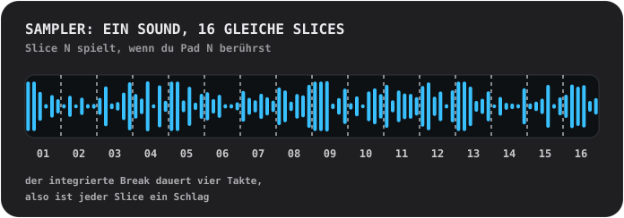

Mehr wissen?

**Einen Break zerhacken**

Ein **Break** ist ein Stück Drums für sich allein. Ihn in Teile zu schneiden und neu zu ordnen ist einer der ältesten Beat-Tricks: So wird aus einem einzigen Loop ein Hundert Beats. Probier, Slice 3 auf den ersten Step zu legen, Slice 2 zu verdoppeln, ein paar rückwärts laufen zu lassen.

**Innenleben**

Ein Slice wird *so wie er ist* gespielt: nie auf das Tempo gedehnt, deshalb passt der Break bei 128. Jeder Slice blendet in 4 ms ein und in 10 ms aus, daher knacken Slices nie.

## Bass

Ein tiefer, runder Bass. **Eine Note nach der anderen**; Noten werden *gehalten* (siehe unten).

- **Regler:** **PITCH** und **SCALE**.
- **Tasten:** **FILTER** (rundet den Klang ab) und **SUB** (eine zweite Stimme eine Oktave tiefer, nie gefiltert, damit der Tiefgang bleibt, wenn der Filter zugeht).

**Gehaltene Noten.** Bei den Geräten, die halten (Bass, Acid, Pad, Chip), sind aufeinanderfolgende normale Steps auf einem Pad **eine lange Note**. Eine Lücke beendet sie, ein **Akzent-Step startet sie neu**, und ein **Taktstrich beendet jede Note**. Berührst du ein Pad, dauert die Note so lange wie dein Finger.

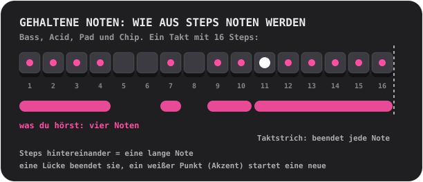

Mehr wissen?

**Was der Bass tut**

Der Bass spielt den **Grundton**: die Note, auf der ein Akkord aufgebaut ist, das harmonische Fundament eines Songs. Er verzahnt sich mit der Kick. Fang einfach an: eine lange tiefe Note auf dem ersten Step, dann eine zweite Note, ein bisschen Rhythmus, ein Oktavsprung.

**Warum ein Bass auf dem Handylautsprecher laut klingen kann**

Ein Handylautsprecher kann keine echten tiefen Töne spielen; der 110-Hz-Grundton des Bass kommt kaum heraus. Aber dein Ohr ergänzt eine fehlende tiefe Note, wenn es ihre Obertöne hört („der fehlende Grundton“). Der Bass ist eine kräftige Sinuswelle mit weichen tiefen Obertönen, genau deshalb: ein richtiger Bass auf Kopfhörern *und* auf dem Lautsprecher.

## Acid

<table>
<tr>
<td align="center"> PITCH und SCALE</td>
<td align="center"> drücke 2ND: CUTOFF und RESO</td>
</tr>
</table>

Die quakende, blubbernde Basslinie des Acid House der späten 80er: eine Sägezahnwelle durch einen **Resonanzfilter**, der sich bei jeder Note öffnet und schließt.

- **Tasten:** **2ND** (schaltet die Regler um) und **ARP**.
- **Regler, erste Seite:** **PITCH** und **SCALE**. **Zweite Seite (2ND):** **CUTOFF** (wie dunkel der Filter anfängt) und **RESO** (wie stark er schwingt; mehr Resonanz, mehr Quaken).
- Noten werden **gehalten**, wie beim Bass.

Zwei Dinge sind immer an: der **Slide** (jede Note gleitet von der vorigen Note zu ihrer Tonhöhe) und der **Akzent**. Ein **Akzent-Step** (ACC in STEP) öffnet den Filter weiter und spielt lauter. Der Trick an diesem Sound: **Kette Steps mit ein paar Akzenten aneinander und dreh CUTOFF, während es läuft.**

**ARP** lässt eine gehaltene Note durch ihre eigene Tonhöhe, die Terz, die Quinte und die Oktave wandern, ein Sechzehntel nach dem anderen.

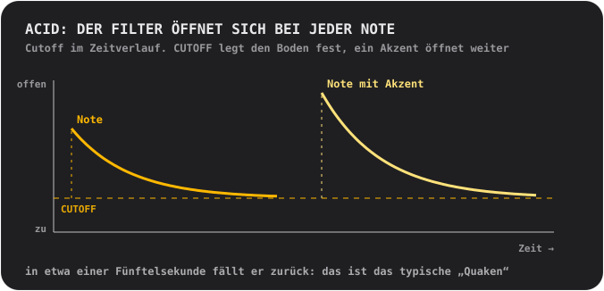

Mehr wissen?

**Was ein Filter ist**

Ein **Filter** lässt manche Frequenzen durch und sperrt andere. Ein **Tiefpass**-Filter sperrt die Höhen: Geschlossen klingt ein Sound dumpf und gedämpft, offen ist er hell. **Cutoff** ist die Stelle, an der das Sperren beginnt. **Resonanz** hebt genau die Frequenzen am Cutoff an, was dieses stimmartige „Wow“ ergibt. Den Cutoff bei hoher Resonanz zu fahren, ist der Klang sehr vieler elektronischer Musik.

**Woher dieser Sound kommt**

Acid ist eine Verbeugung vor einer kleinen silbernen Bassbox, die in den 1980ern aus Versehen ein ganzes Genre prägte. Sie war gedacht, einsamen Gitarristen eine Bassgitarre vorzugaukeln, und dafür hat sie niemand gekauft. Wer sie trotzdem kaufte, entdeckte, dass eine Sägezahnwelle, ein Resonanzfilter und eine gleitende Note nach nichts anderem klangen.

**Innenleben**

Der Filter öffnet sich am Beginn jeder Note um zweieinhalb Oktaven und fällt in etwa 0,18 Sekunden zurück (das Quaken); ein Akzent öffnet ihn um weitere anderthalb Oktaven; der Slide dauert 80 Millisekunden.

## Vocal

Eine aufgenommene Stimme, die auf den Pads in verschiedenen Tonhöhen gespielt wird, durch einen von **zehn Stilen**. Sing, sag ein Wort, klatsch, pfeif: Was du aufnimmst, wird das Instrument.

- **Regler:** **STYLE** (das Display zeigt den Namen des Stils, solange du drehst) und **SCALE**. Einen PITCH-Regler gibt es nicht: Die Tonleiter und das Grundton-Pad bestimmen die Tonhöhe.
- **Tasten:** **MONO / POLY** (MONO ist der Standard, damit Wörter nicht ineinanderlaufen) und **REVERSE**.
- **Deine Stimme:** nimm bis zu **10 Sekunden** auf. Bis dahin spielt sie eine kurze **integrierte Phrase**: eine Aufnahme der Stimme des Autors.

Die Stile:
- **01 NATURAL**: wie aufgenommen.
- **02 ROBOT**: metallisch, mit eigener Tonhöhe.
- **03 VOCODER**: ein Roboter, der *singt*, in der Tonart des Pads, das du spielst.
- **04 CHOIR**: vier langsam schwankende Kopien von dir.
- **05 RADIO**: schmal und knusprig, wie ein kleiner alter Lautsprecher.
- **06 LO-FI**: zerquetscht und körnig, wie ein alter Sampler.
- **07 CAVE**: ein großer hallender Raum mit langem Nachklang.
- **08 GLITCH**: in Körner zerschnitten und gestottert. **Jeder Schlag spielt einen anderen zufälligen Schnitt**.
- **09 ALIEN**: ein schwankender metallischer Klang.
- **10 CHORD**: deine Stimme plus eine große Terz und eine Quinte darüber: Jedes Pad spielt einen Akkord.

Ein Stil wird im Hintergrund einen Moment nach dem Stoppen des Reglers angewendet; drehst du schnell durch mehrere, wird nur der berechnet, auf dem du stehen bleibst.

Mehr wissen?

**Tonhöhe, und warum eine hohe Stimme klein klingt**

Die Stimme wird **schneller abgespielt, um höher zu werden**, und **langsamer, um tiefer zu werden**, wie beim Beschleunigen eines Tonbands. Eine Stimme auf einem hohen Pad wird dünn und piepsig, auf einem tiefen Pad tief und langsam. Das ist der Klang des Samplings. Für Melodien nimm etwas Kurzes auf und lass SCALE dich in der Tonart halten.

**Die Stile im Innern**

**VOCODER** teilt die Stimme in zehn Bänder, misst, wie laut jedes ist, und formt damit eine brummende Sägezahnwelle: eine Technik der 1970er für Platten mit Roboterstimmen. **ROBOT** und **ALIEN** nutzen **Ringmodulation**, also das Multiplizieren der Stimme mit einem Ton, den alten Trick hinter den Roboterstimmen der Science-Fiction. **CHORD** ist ein *Dur*-Akkord, egal welche Tonleiter: In Moll-Tonleitern reiben sich manche Pads damit, was auch ein Feature sein kann.

## Pluck

Ein kurzer gezupfter Sound, in sechzehn Tonhöhen gespielt. Das einfachste und direkteste Melodiegerät.

- **Regler:** **PITCH** (du wählst die Tonart) und **SCALE** (12 Tonleitern, siehe [Tonleitern](#scales); der Name erscheint im Display, solange du drehst).
- **Tasten:** **MONO / POLY** (MONO: Eine neue Note schneidet die anderen ab) und **REVERSE** (das erste Drittel einer Sekunde spielt rückwärts, sodass eine Note in ihren Anschlag hineinschwillt).
- **Eigener Sound:** einer, in jeder Tonhöhe gespielt, bis zu 10 Sekunden.

Tipp: Schalte auf eine **Pentatonik** (05 oder 06) und tippe wild auf Pads. Es ist sehr schwer, einen falschen Ton zu treffen.

Mehr wissen?

**Tonleitern**

Eine **Tonleiter** ist eine Auswahl von Noten, die gut zusammenklingen. Ein Klavier hat zwölf Töne pro Oktave; eine Tonleiter wählt eine Handvoll davon aus. **Dur** klingt hell und fröhlich, **Moll** traurig oder ernst. **Pentatonische** Tonleitern haben nur fünf Töne, daher gibt es keinen schlechten. **Chromatisch** gibt dir *jeden* Halbton: frei, und leicht schief zu klingen. Der **Grundton** ist der Heimatton der Tonleiter; in Handbeat ist es Pad 05, und PITCH verschiebt ihn in eine andere Tonart.

**Innenleben**

Der Pluck ist ein einziges Sample, schneller oder langsamer gespielt, um die Tonhöhe zu ändern, und ändert dabei seine Länge, wie bei alten Sample-Keyboards. Die Pads gehen mit Absicht nicht zu weit vom Grundton weg: Ein viel schneller gespieltes Sample wird dünn, ein viel langsameres dröhnend.

## Pad

Die Pads, Tonleitern und Regler des Pluck, aber eine Note wird **gehalten**: ein weicher, langsam schimmernder Klang, der so lange weitergeht, wie du willst.

- **Regler:** **PITCH** und **SCALE**.
- **Tasten:** **MONO / CHORD** (CHORD spielt auf jedem Pad einen Dreiklang) und **STEADY / RISE** (RISE lässt eine gehaltene Note von leise zu voll anschwellen).
- Noten werden **gehalten**, wie beim Bass. Eigener Sound: einer, nahtlos geloopt, bis zu 10 Sekunden.

Fülle mehrere Steps hintereinander auf einem Pad für einen langen Akkord, lass eine Lücke, um ihn zu beenden, setz einen Akzent, um einen neuen zu starten. RISE auf einer Note über mehrere Steps ist ein schneller Aufbau.

Mehr wissen?

**Was ein Akkord ist**

Ein **Akkord** sind drei oder mehr Noten, die zusammen gespielt werden. Der einfachste, ein **Dreiklang**, besteht aus dem Grundton, der Note zwei Stufen darüber in der Tonleiter und der Note vier Stufen darüber. Schalte CHORD ein, und jedes Pad wird zu einem Dreiklang der gewählten Tonleiter: Du brauchst keine Theorie, um passende Akkorde zu bekommen.

**Innenleben**

Der Sound des Pad ist eine Sekunde lang und läuft nahtlos in der Schleife. Zwei leise Teiltöne, ein Hertz über und unter jedem der anderen, machen das langsame Schimmern.

## Chip

Der Sound der 8-Bit-Ära: die Wellenformen alter Spielkonsolen und Heimcomputer.

- **Regler:** **PITCH** und **SCALE**.
- **Tasten:** **TRI / PULSE** (die Wellenform) und **VIB** (ein sanftes Vibrato).
- Noten werden **gehalten**, wie beim Bass. Keine eigenen Sounds: Die Wellenformen *sind* das Instrument.

Die **Dreieckwelle** ist eine weiche, hohle, flötenartige Welle, in groben Stufen gezeichnet. Die **Pulswelle** ist ein schmales, nasales Brummen, der klassische Lead-Sound. Das Grundton-Pad des Chip liegt mit Absicht einen **ganzen Ton höher** als bei den anderen Geräten.

**Akkorde auf dem Chip brummen und flattern, und das ist authentisch.** Halte zwei Pads, und sie trillern; halte drei, und sie flattern. Öffne die Box, um zu erfahren, warum.

Mehr wissen?

**Polyphonie durch schnelle Reihum-Wechsel**

Die Soundchips alter Spielkonsolen und Heimcomputer spielten **pro Kanal immer nur eine Note**. Um aus einem Kanal Akkorde zu holen, schalteten Programmierer ihn *sehr schnell* zwischen den Noten des Akkords um, sodass dein Ohr sie zusammen hört, mit einer brummenden, arpeggierten Färbung. Das ist der Sound der 80er.

Der Chip macht genau das: Alle Pads, die du auf einem Step hältst, teilen sich **eine Stimme**, die jeder Note eine **Runde von 1/60 Sekunde** gibt. Eine **einzelne Note** spielt gleichmäßig, ganz ohne Wechsel.

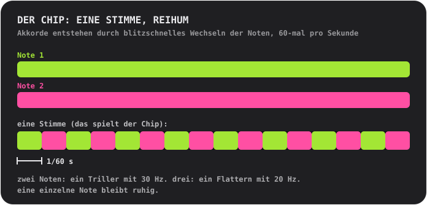

**Die Wellenformen**

Die **Dreieckwelle** ist gebaut wie das Original: 4 Bit (16 Stufen), 32 Stufen pro Zyklus, die in Treppen ansteigt. Die **Pulswelle** ist ein Viertel des Zyklus an („25 % Duty“).

## Tonleitern

Für Pluck, Pad, Bass, Acid, Vocal und Chip. Dreh **SCALE**, und das Display zeigt Nummer und Name.

- **01 Chromatic**: jeder Halbton. Der Standard.
- **02 Major**: hell, fröhlich.
- **03 Natural minor**: traurig, ernst, der Großteil von Pop und elektronischer Musik.
- **04 Harmonic minor**: dramatisch, ein wenig orientalisch.
- **05 Minor pentatonic**: fünf Töne. Rock, Blues, die sichere Wahl.
- **06 Major pentatonic**: fünf helle Töne. Folk, Glocken.
- **07 Blues**: Moll-Pentatonik plus die „Blue Note“.
- **08 Dorian**: Moll mit Schwung. Funky, jazzig.
- **09 Phrygian**: dunkel, spanisch.
- **10 Lydian**: verträumt und schwebend.
- **11 Mixolydian**: Dur mit bluesiger Kante.
- **12 Whole tone**: schwebend, unaufgelöst, ganz ohne Heimatton.

---

# Kontakt

Einen Fehler gefunden? Eine Idee, eine Frage oder etwas dazu zu sagen, wie es klingt? Ich freue mich darauf. Handbeat wird von einer einzelnen Person gemacht, deshalb kann eine Antwort etwas dauern, aber deine Nachricht wird gelesen.

📩 **[handbeat.contact@gmail.com](mailto:handbeat.contact@gmail.com)**

**Du meldest einen Fehler?** Sehr hilfreich ist:

1. **Was passiert ist** und was du stattdessen erwartet hast.
2. **Wie man es wieder auslöst**: die Schritte, die du gemacht hast.
3. **Deine App-Version** (Einstellungen → *Version*), dein iPhone- oder iPad-Modell und deine iOS-Version.
4. **Dein Projekt**, wenn es um einen bestimmten Sound oder ein bestimmtes Pattern geht: Projekte → Zeile wischen → *Teilen*, und die `.handbeat`-Datei anhängen. So kann ich genau das öffnen, was du hattest.

Ideen für Funktionen und „Ich wünschte, es könnte ...“-Mails sind genauso willkommen.

---

# Unterstützen

Handbeat wird von einer einzelnen Person gemacht. Wenn es dich glücklich macht und du Danke sagen möchtest, kannst du:

**Oder stell mich ein.** Ich habe diese App gebaut, und wenn du etwas Ähnliches gebaut haben willst, können wir reden: [www.linkedin.com/in/fofonovav](https://www.linkedin.com/in/fofonovav)

---

*Dieser Text wurde von einer KI übersetzt und kann Fehler enthalten.*
