# Handbeat guide

[Guide](#guide) · [Devices](#devices) · [Contact](#contact) · [Support](#support)

Handbeat is a groove box for your iPhone and iPad: sixteen pads, a pile of devices, one tempo, one transport. You tap, you draw a beat, you chain the bars into a song. That's it. No accounts, no wrong way to play.

This page is the long version. You don't have to read it top to bottom: poke the app first, come back when something puzzles you.

---

# Guide

## The screen

The top of the screen is the **display**. Everything on it is yours to touch.

| | |
|---|---|
|  | **Microphone.** Record your own sounds, see [Your own sounds](#your-own-sounds). |
|  | **Export.** Save the whole project as an audio file. |
|  | **Menu.** Your projects and the settings. |
|  | **TAP.** Tap it along with a song and Handbeat finds the tempo. It also pulses on every beat. |
|  | **ACC.** Accent, see [Drawing a beat](#drawing-a-beat-step). |
|  | **Arrows.** Step through the sounds (or notes) of a device. |

- **The name band** carries the device name (the project name on the mixer). Tap the pencil to rename it, up to 8 characters.
- **BPM** is the tempo: drag it up and down (64 to 256). **SWG** is swing, see below.
- **Two columns of digits** show two numbers; what they say depends on the page, for example *SOUND* and *PATTERN* on a drum kit.
- **Two knobs.** Drag them up and down. **Double-tap a knob** to put it back to its default. While you turn one, the display shows its exact value and name.

Every pad, key and knob answers with a tiny tap from your phone (switch it off in Settings under *Vibration*). The more a control changes the music, the harder the tap.

Each page has a faint **texture** on its pads and on the key that opens it, so you can tell where you are at a glance: lines for LIVE FX, dots for SOUND, columns for STEP and squares for PATTERN. The DEVICE page has none, its pads carry a small sign of each device instead. Switch all of this off in Settings under *Visual hints*.

Want to know more?

**Tempo and swing**

**BPM** means *beats per minute*. 60 is one beat a second, a slow walk. House music sits around 120 to 130, drum and bass near 170. Handbeat starts at 128 because it suits almost everything.

**Swing** makes the beat "limp" on purpose. Normally the 16 steps of a bar are evenly spaced. With swing, every second step arrives a little late, and the groove bounces instead of marching. SWG goes from **500** (straight) to **750** (the extreme); around **667** you get the classic triplet shuffle. Try it on hi-hats.

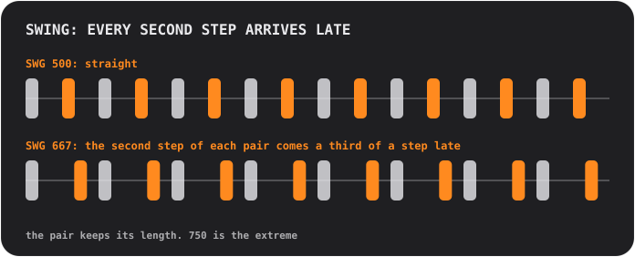

## Pads and pages

The pads are always a 4×4 grid, numbered 01 to 16. The top row of keys switches the **page**, which decides what the pads do:

<table>
<tr>
<td align="center"> <b>SOUND</b> play: each pad plays its own sound</td>
<td align="center"> <b>STEP</b> draw: each pad is one of 16 steps</td>
<td align="center"> <b>PATTERN</b> choose: each pad is a pattern</td>
</tr>
</table>

### Drawing a beat (STEP)

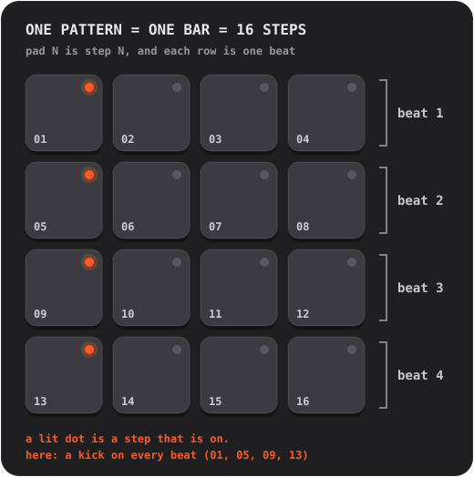

1. On **SOUND**, tap the pad you want to program. It becomes the selected sound.
2. Press **STEP** and tap pads to switch steps on and off. A lit dot means a step is on.
3. Press **PLAY**. A soft flash runs across the pads: that's the playhead. Keep editing while it plays.

**Accents.** Press **ACC**, then tap a step: it becomes an accent, a louder, more emphatic hit. ACC switches itself off after one tap. Tap an accented step again to clear it.

Want to know more?

**What a step sequencer is**

Time is chopped into equal slices called **steps**. For each sound you decide which steps it plays on. Four steps make a **beat** (one tap of your foot), four beats make a **bar**. Each pattern in Handbeat is exactly one bar, and a bar loops. Most pop, house and hip-hop is built from bars like that, stacked and varied.

### Recording live (REC)

Press **REC** and play pads on the SOUND page. Handbeat starts the transport if it wasn't running and drops your hits on the *nearest* 16th step, so a slightly sloppy finger still lands in time. It **overdubs**: what's already there stays. Press **STOP** (the PLAY key) to end. There's no undo: switch unwanted steps off on STEP.

On devices that hold notes (Bass, Acid, Pad, Chip) the length of your touch is recorded too.

### Reading the lights

- A pad's **dot** says what the pad *is*: off is empty, dim means "something's here", on means active (the selected sound, a step that's on, the current pattern), bright stands out (an accent, the newest bar of a chain). A **blinking** dot means "waiting for the end of the bar".
- A pad's **ring** says what's playing *right now*.
- A **faded** pad is silent (muted, or something else is soloed). It still plays when you touch it.
- A **ring around a key** means a mode is on.

## Keys

| | |
|---|---|
|   | **S and M** are the two *context keys*; they change with the device and the page. On a drum kit they're **solo** and **mute** for the selected sound. Other devices put their own keys here, see [Devices](#devices). |
|   | On the PATTERN page they become **COPY** and **ERASE**. |
|  | **REC** records live. |
|  | **PLAY** starts everything on one clock. While playing it's a stop square: it stops *and rewinds*. A call, an alarm or unplugged headphones also stop the music; press PLAY again. |
|  | **CHAIN** links patterns into a song. Ringed in blue while on. |
|  | **RACK** switches between the device you're on and the mixer. |

Mute and solo only affect what the *sequencer* plays. A pad you touch always makes sound.

## Patterns and chains

A **pattern** is one bar, 16 steps. You get **16 patterns**, and *every pattern holds the steps of every device*: the drums, bass and melody of pattern 03 are all in 03.

On the **PATTERN** page, tap a pad to choose a pattern. While the music plays the change waits for the end of the bar, and the pad **blinks** until it happens.

- **COPY**, then a pad: copies the playing pattern onto it.
- **ERASE**, then a pad: clears that pattern.
- Press the key again, or leave the page, to cancel.

### Chain: a pattern is a bar, a chain is a song

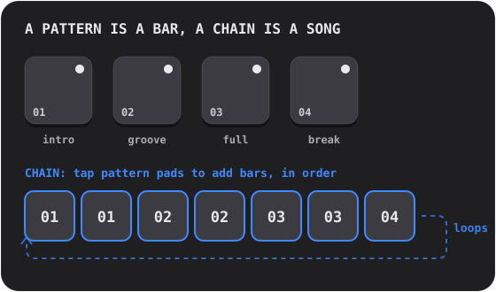

Switch **CHAIN** on and tap pattern pads: each tap **adds a bar** to the end of the chain (up to 99 bars, repeats allowed). Playback follows the chain bar after bar and loops. Switch CHAIN off to end it; the pattern you touched last plays on its own.

Want to know more?

**How songs are built from loops**

Most dance music is **repetition with changes**. You take a loop that works, then add and remove layers so the listener feels it grow and breathe: a sparse **intro**, a steady **groove**, a **full** section with everything on, a **break** where things drop out, and a drum **fill** in the last beat that tells your ears "something new is coming". In Handbeat each of those is one pattern and CHAIN puts them in order.

## The mixer (RACK)

The last key flips between your device and the **mixer**, the same 4×4 board in a different hat. A project **always opens on the mixer**.

<table>
<tr>
<td align="center"> <b>DEVICE</b> your devices</td>
<td align="center"> <b>Empty pad</b> pick a new device</td>
<td align="center"> <b>PATTERN</b> copy and erase whole patterns</td>
</tr>
</table>

On the **DEVICE** page every pad is a slot: up to **16 devices** in a project.

- **Tap a pad with a plus** to add a device (the pads turn into the kinds you can pick, each with its sign).
- **Signs.** Each pad wears a small sign of its device: a drum head (Drums), a waveform (Sampler), a slow wave (Bass), a saw (Acid), a microphone (Vocal), a fading string (Pluck), a swelling envelope (Pad) or a square wave (Chip).
- **Tap a used pad** to select it. Its ring lights while it plays. **RACK** jumps into its own screen.
- **SOLO / MUTE** work on the selected device.  **TRASH** deletes one: press it, tap the device's pad, confirm.
- **DEV VOL** is the level of the selected device, **MAIN VOL** the volume of the whole mix. 5 is the neutral middle.
- On the mixer's **PATTERN** page, COPY and ERASE work on the whole pattern *with every device in it*.

## Live effects

The **LIVE FX** page has sixteen effects on the pads, four rows of four. **Hold a pad to play the effect, let go to stop.** Effects fade in over a tenth of a second and out over a quarter, so nothing clicks. Hold as many as you like. They're for **performing**: nothing on this page is saved, and effects are **not included in an export**.

**Tone**
- **LP**: dulls the sound (low-pass).
- **HP**: thins it out (high-pass).
- **SWEEP**: a filter that climbs from bass to treble and arrives exactly when the bar ends.
- **ROBOT**: the whole mix rings at one pitch.

**Space** (they keep ringing after you let go)
- **ECHO**: repeats on a dotted eighth.
- **DUB**: repeats every beat, darker and fuzzier.
- **VOID**: a room.
- **FLANGE**: a swirling jet-plane whoosh.

**Loop and hold**
- **STUT 1/8**, **STUT 1/16**, **STUT 1/32**: stutters. The step that's playing repeats.
- **FREEZE**: holds the sound as a smooth, steady texture.

**DJ transitions**
- **SCRATCH**: a needle dragged back and forth over the last half beat.
- **REVERSE**: the music, one beat behind, backwards.
- **HALF SPEED**: slows everything an octave down.
- **RISER**: a noise build-up that peaks exactly at the end of the bar and cuts off when you let go: the "drop".

Want to know more?

**Using effects in a song**

Effects are seasoning, not the meal. The classic moves: hold **RISER** through the last bar of a section and let go on the first beat of the next; hold **LP** while a section ends and release for the new one to burst out; tap a **STUT** for a beat to turn whatever's playing into a stuttering drum roll; add a short **ECHO** on the last hit of a phrase so it rings into the next bar.

**Inside**

The effects work on the whole mix, after every device is added and before the main volume and the limiter. A stutter takes the step the sequencer is on when you touch the pad, so you hear the *note* repeat and not the silence before it.

## Your own sounds

You can play **your own** sounds: record them with the microphone or load audio files. Every device can have them except the Chip and the Acid, which are built on their own waves.

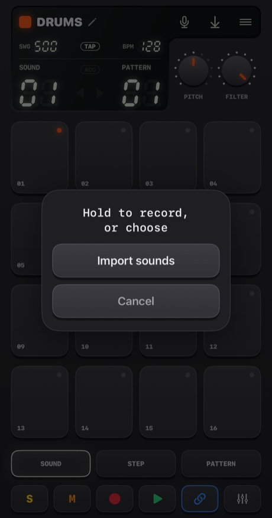

- **Hold the microphone** button (a bit over a quarter of a second) to record. Let go to finish. The pads turn red, the music stops (the mic would hear it) and the display counts the seconds.
- **Tap it** for a choice: **Import sounds**, or **Built-in sounds** (go back to the originals; shown when the device has sounds of its own).

Where the sound goes depends on the device:
- **Drums**: one sound per pad. **Pick the pad first, then hold the button.**
- **Sampler**: one sound, up to **30 seconds**, cut into 16 equal slices.
- **Pluck, Pad, Bass, Vocal**: one sound, up to **10 seconds**, played on every pad at a different pitch. What you record is the *root*, pad 05.

Handbeat trims the silence around your sound. A silent recording is not kept.

**Importing files** takes WAV, AIFF, M4A, MP3 and the like. A drum kit takes several, one per pad in the order of their names, starting at the selected pad. One long file is **chopped at its pauses** (a quarter-second of silence starts the next sound). Any other device takes the first file. Sounds are saved inside the project and travel with it.

The first time, iOS asks whether Handbeat may use the microphone. If you said no, the button takes you to Settings.

Want to know more?

**What sampling is**

A **sample** is a recording used as an instrument. Sampling is the heart of hip-hop, house and a thousand other things: record a sound, then trigger it, speed it up, slow it down, chop it up. Play a sample **faster** and it gets higher and shorter, **slower** and it gets lower and longer, exactly like speeding up a tape. That's how one recording becomes a whole keyboard.

## Projects, sharing and export

The **menu** button opens **Projects** (it stops the music and saves).

<table>
<tr>
<td align="center">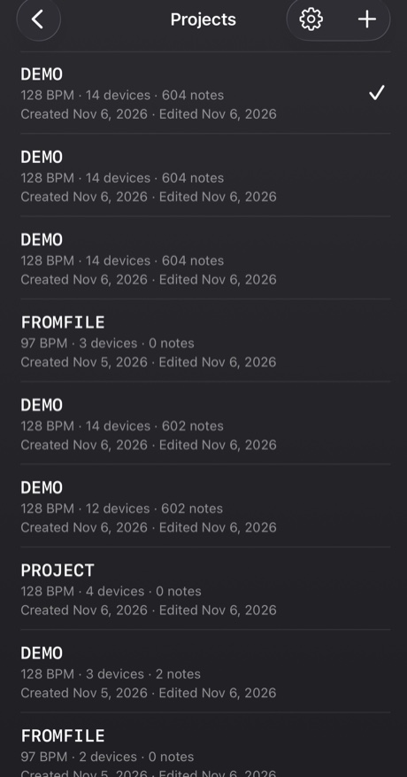</td>
<td align="center">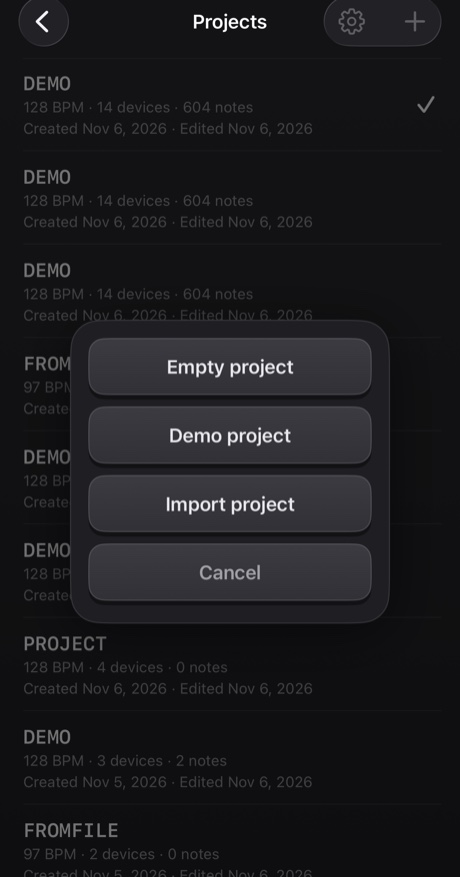</td>
</tr>
</table>

- Tap a project to open it. **Swipe** a row (or press and hold) to **share** or **delete** it; deleting always asks.
- The **+** makes an *Empty project* or a *Demo project*, or **imports** one from a file. The demo is a good place to start: fourteen devices playing a 40-bar mashup.
- Everything is **saved automatically**.

**Sharing** writes a project, with its own sounds, to one `.handbeat` file and opens the share sheet: AirDrop it, mail it, or keep it in Files as a backup. Opening such a file in Handbeat **adds** it as a new project and never touches yours.

**Exporting audio** is the save button on the display. It renders the **whole project, every device mixed**, to **WAV** or **M4A** (choose in Settings), faster than real time. With CHAIN on you get the whole chain, otherwise one play of the current pattern. The button is greyed out when there's nothing to hear.

## Settings

Projects → the gear. **Language** switches the menus at once (the groove box itself, with its keys, knobs and device names, stays in English everywhere, like the labels on a hardware box). There are four **themes**, each in Dark, Light or *System*: **Classic**, **iClassic** (glossy plastic and a click wheel), **Contrast** (flat, pure black or white) and **Aero** (gel and glass). Each theme also has its own **app icon**. **Vibration** and **Visual hints** switch the taps and the page textures and signs on or off. **Onboarding** takes the guided tour again on a new demo project. The first time you open Handbeat the tour starts by itself on a demo, and the cross in its corner leaves it.

---

# Devices

A **device** is an instrument in your project. Add one by tapping an empty pad on the mixer. They're listed in the same order as the picker. All of them are 16 tracks × 16 steps, so STEP, REC, patterns, chains and export work the same everywhere. What differs is the sound, the pads, the two knobs and the two keys next to **REC**.

**Note devices** (Bass, Acid, Vocal, Pluck, Pad, Chip) share one pad layout, like a piano roll: **pad 05 is the root** (the home note), pads above it are higher, pads below are lower. The **SCALE** knob decides what the steps *are* (see [Scales](#scales)). The steps you draw are stored as pad numbers, so changing the scale plays the *same melody in a new scale*.

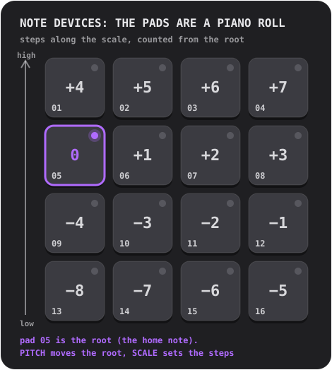

## Drums

A complete drum kit: **16 sounds, one per pad**.

- **Knobs:** **PITCH** (−6 to +6 semitones, the whole kit) and **FILTER** (a low-pass: 10 is wide open, lower dulls the kit).
- **Keys:** **S** and **M** (solo and mute) for the selected sound.
- **Own sounds:** one per pad.

**Try this:** tap the pads on SOUND to find what's where. Pick the kick, press STEP and switch on 01, 05, 09 and 13: a kick on every beat, the heartbeat of house music. Add a clap on 05 and 13, hi-hats on the steps in between.

A **closed hat** cuts off an **open hat**, as on the real thing, so they never ring over each other.

Want to know more?

**The three drums that matter**

The **kick** is the low thump that makes you nod. The **snare** or **clap** is the crack, usually on beats 2 and 4 (steps 05 and 13), the **backbeat**. The **hi-hat** is the tick-tick-tick that sets the speed of the groove: eighth notes (every other step) or sixteenths (every step). Kick on every beat is **four on the floor**; kick on 01 and 11 with a snare on 05 and 13 is a classic breakbeat.

**Inside**

Every built-in sound is made from scratch for Handbeat: generated by a script, nothing borrowed from anyone.

## Sampler

**One sound cut into 16 equal slices**, one per pad. Put the slices in order and the sound plays back as it was; rearrange them and you've remixed it.

- **Knobs:** **PITCH** (speeds up or slows down every slice) and **FILTER**.
- **Keys:** **MONO / POLY** (MONO: a new slice cuts off the ones still ringing) and **REVERSE** (every slice backwards).
- **Own sound:** record up to **30 seconds**, or import a file. The first display column is **SLICE**.

Without a sound of your own it plays a **built-in break**: four bars of breakbeat at 128 BPM, so each slice is one beat. To hear it as it was, put slices 1 to 4 on steps 01, 05, 09, 13 of pattern 1, slices 5 to 8 in pattern 2, and so on through four chained patterns.

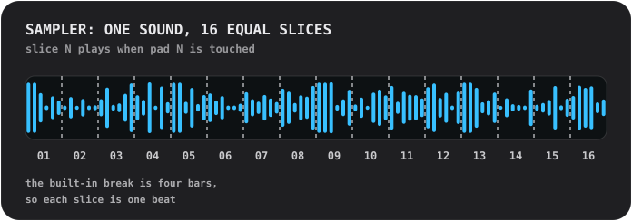

Want to know more?

**Chopping a break**

A **break** is a stretch of drums on their own. Cutting one into pieces and re-ordering them is one of the oldest tricks in beat-making: it's how a single loop becomes a hundred beats. Try moving slice 3 to the first step, doubling slice 2, reversing a few.

**Inside**

A slice is played *as it is*: never stretched to fit the tempo, so the break fits at 128. Each slice fades in over 4 ms and out over 10 ms, so slices never click.

## Bass

A deep, round bass. **One note at a time**; notes are *held* (below).

- **Knobs:** **PITCH** and **SCALE**.
- **Keys:** **FILTER** (rounds the tone off) and **SUB** (a second voice an octave below, never filtered, so the low end stays when the filter closes).

**Held notes.** On the devices that hold (Bass, Acid, Pad, Chip) consecutive plain steps on a pad are **one long note**. A gap ends it, an **accented step starts it again**, and a **bar line ends every note**. Touch a pad and the note lasts as long as your finger.

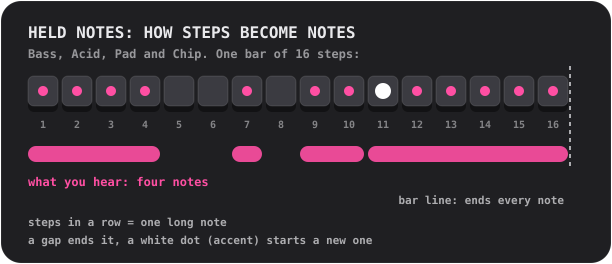

Want to know more?

**What the bass does**

The bass plays the **root**: the note a chord is built on, the harmonic floor of a song. It locks with the kick. Start simple: one long low note on the first step, then add a second note, a little rhythm, an octave jump.

**Why a bass can be loud on a phone speaker**

A phone speaker can't play real low notes; the Bass's 110 Hz root barely comes out. But your ear fills in a missing low note when it hears its overtones ("the missing fundamental"). The Bass is a strong sine with soft low overtones for exactly this reason: a proper bass on headphones *and* on a speaker.

## Acid

<table>
<tr>
<td align="center"> PITCH and SCALE</td>
<td align="center"> press 2ND: CUTOFF and RESO</td>
</tr>
</table>

The squelchy, bubbling bass line of late-80s acid house: a sawtooth wave through a **resonant filter** that opens and closes on every note.

- **Keys:** **2ND** (flips the knobs) and **ARP**.
- **Knobs, page one:** **PITCH** and **SCALE**. **Page two (2ND):** **CUTOFF** (how dark the filter starts) and **RESO** (how hard it rings; more resonance, more squelch).
- Notes are **held** as on the Bass.

Two things are always on: the **slide** (each note glides to its pitch from the note before) and the **accent**. An **accented** step (ACC on STEP) opens the filter wider and plays louder. The trick of the sound: **chain steps with a few accents, and turn CUTOFF while it plays.**

**ARP** makes a held note walk through its own pitch, the third, the fifth and the octave, one sixteenth at a time.

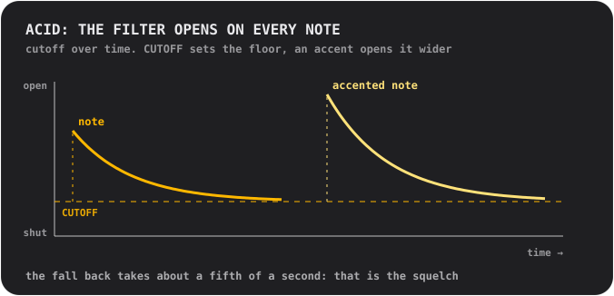

Want to know more?

**What a filter is**

A **filter** lets some frequencies through and blocks others. A **low-pass** filter blocks the highs: closed, a sound is dull and muffled; open, it's bright. **Cutoff** is where it starts blocking. **Resonance** boosts the frequencies right at the cutoff, which gives the vocal "wow". Sweeping the cutoff with high resonance is the sound of a lot of electronic music.

**Where this sound comes from**

Acid is a tribute to a little silver bass box that, by accident, defined a whole genre in the 1980s. It was made to play fake bass guitar for lonely guitarists, and nobody bought it for that. The people who did buy it found that a saw wave, a resonant filter and a sliding note sounded like nothing else.

**Inside**

The filter opens by two and a half octaves at the start of every note and falls back in about 0.18 seconds (the squelch); an accent opens it another octave and a half; the slide is 80 milliseconds.

## Vocal

One recorded voice played on the pads at different pitches, through one of **ten styles**. Sing, say a word, clap, whistle: whatever you record becomes the instrument.

- **Knobs:** **STYLE** (the display shows the style's name while you turn it) and **SCALE**. There's no PITCH knob: the scale and the root pad choose the pitch.
- **Keys:** **MONO / POLY** (MONO is the default, so words don't run over each other) and **REVERSE**.
- **Your voice:** record up to **10 seconds**. Until you do, it plays a short **built-in phrase**: a recording of the author's own voice.

The styles:
- **01 NATURAL**: as recorded.
- **02 ROBOT**: metallic, with a pitch of its own.
- **03 VOCODER**: a robot that *sings*, in the key of the pad you play.
- **04 CHOIR**: four slowly swaying copies of you.
- **05 RADIO**: narrow and crunchy, like a small old speaker.
- **06 LO-FI**: crushed and gritty, like an old sampler.
- **07 CAVE**: a big echoing room with a long tail.
- **08 GLITCH**: cut into grains and stuttered. **Every hit plays a different random cut**.
- **09 ALIEN**: a wobbling metallic ring.
- **10 CHORD**: your voice plus a major third and a fifth above it: every pad plays a chord.

A style is applied in the background a moment after the knob stops, so spinning through several only makes the one you stop on.

Want to know more?

**Pitch and why a high voice sounds small**

The voice is played **faster to go higher** and **slower to go lower**, like speeding up a tape. A voice on a high pad gets thin and squeaky, on a low pad deep and slow. That's the sound of sampling. For melodies, record something short and let SCALE keep you in key.

**The styles inside**

**VOCODER** splits the voice into ten bands, measures how loud each is, and uses that to shape a buzzing saw wave: a technique from the 1970s for robot-voice records. **ROBOT** and **ALIEN** use **ring modulation**, multiplying the voice by a tone, the old trick behind sci-fi robot voices. **CHORD** is a *major* chord whatever the scale: in minor scales some pads will clash, which can be a feature.

## Pluck

One short plucked sound played at sixteen pitches. The simplest and most direct melodic device.

- **Knobs:** **PITCH** (you choose the key) and **SCALE** (12 scales, see [Scales](#scales); the name shows on the display while you turn it).
- **Keys:** **MONO / POLY** (MONO: a new note cuts off the others) and **REVERSE** (the first third of a second plays backwards, so a note swells into its attack).
- **Own sound:** one, played at every pitch, up to 10 seconds.

Tip: switch to a **pentatonic** scale (05 or 06) and tap pads at random. It's very hard to play a wrong note.

Want to know more?

**Scales**

A **scale** is a menu of notes that sound good together. A piano has twelve notes per octave; a scale picks a handful of them. **Major** sounds bright and happy, **minor** sad or serious. **Pentatonic** scales have only five notes, so there's no bad one. **Chromatic** gives you *every* semitone: free, and easy to sound wrong with. The **root** is the scale's home note; in Handbeat it's pad 05, and PITCH moves it to another key.

**Inside**

The pluck is one sample, played faster or slower to change pitch, so it changes length with it, as on old sample-based keyboards. The pads don't reach too far from the root on purpose: a sample played much faster turns thin, much slower boomy.

## Pad

The Pluck's pads, scales and knobs, but a note is **held**: a soft, slowly shimmering sound that goes on as long as you want.

- **Knobs:** **PITCH** and **SCALE**.
- **Keys:** **MONO / CHORD** (CHORD plays a triad on every pad) and **STEADY / RISE** (RISE makes a held note swell from quiet to full).
- Notes are **held** as on the Bass. Own sound: one, looped without a seam, up to 10 seconds.

Fill several steps in a row on one pad for a long chord, leave a gap to end it, add an accent to start a new one. RISE on a note across several steps is a quick build-up.

Want to know more?

**What a chord is**

A **chord** is three or more notes played together. The simplest, a **triad**, is the root, the note two steps up the scale and the note four steps up. Switch CHORD on and every pad becomes a triad of the scale you chose: no theory needed to get chords that fit.

**Inside**

The pad's sound is one second long and loops with no seam. Two quiet partials, a hertz either side of each of the others, make the slow shimmer.

## Chip

The sound of the 8-bit era: the waves of old game consoles and home computers.

- **Knobs:** **PITCH** and **SCALE**.
- **Keys:** **TRI / PULSE** (the wave) and **VIB** (a gentle vibrato).
- Notes are **held** as on the Bass. No sounds of your own: the waves *are* the instrument.

The **triangle** is a soft, hollow, flute-like wave drawn in coarse steps. The **pulse** is a narrow, nasal buzz, the classic lead sound. The Chip's root pad is a **whole tone higher** than the other devices', on purpose.

**Chords on the Chip buzz and flutter, and that's authentic.** Hold two pads and they trill; hold three and they flutter. Open the box to find out why.

Want to know more?

**Polyphony by quick turns**

The sound chips of old game consoles and home computers played **one note at a time on each channel**. To get chords out of one channel, programmers switched it between the notes of the chord *very fast*, so your ear hears them together, with a buzzing, arpeggiated colour. It's the sound of the 80s.

The Chip does exactly that: all the pads you hold on one step share **one voice** that gives each note a **turn of 1/60 of a second**. A **single note** plays steadily, with no turns at all.

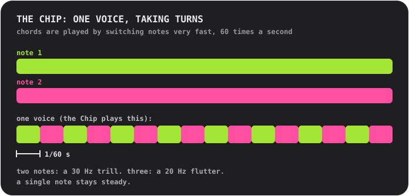

**The waves**

The **triangle** is built like the real thing: 4 bits (16 levels), 32 steps per cycle, climbing in stairs. The **pulse** is on for a quarter of the cycle (a "25% duty" wave).

## Scales

For the Pluck, Pad, Bass, Acid, Vocal and Chip. Turn **SCALE** and the display shows the number and the name.

- **01 Chromatic**: every semitone. The default.
- **02 Major**: bright, happy.
- **03 Natural minor**: sad, serious, most pop and electronic music.
- **04 Harmonic minor**: dramatic, a little eastern.
- **05 Minor pentatonic**: five notes. Rock, blues, the safe choice.
- **06 Major pentatonic**: five bright notes. Folk, bells.
- **07 Blues**: minor pentatonic plus the "blue note".
- **08 Dorian**: minor with a lift. Funky, jazzy.
- **09 Phrygian**: dark, Spanish.
- **10 Lydian**: dreamy and floating.
- **11 Mixolydian**: major with a bluesy edge.
- **12 Whole tone**: floaty, unresolved, no home note at all.

---

# Contact

Found a bug? Got an idea, a question, or something to say about how it sounds? I'd love to hear it. Handbeat is made by one person, so a reply may take a little while, but your message will be read.

📩 **[handbeat.contact@gmail.com](mailto:handbeat.contact@gmail.com)**

**Reporting a bug?** It helps a lot if you include:

1. **What happened**, and what you expected instead.
2. **How to make it happen again**: the steps you took.
3. **Your app version** (Settings → *Version*), your iPhone or iPad model, and your iOS version.
4. **Your project**, if it's about a specific sound or pattern: Projects → swipe the row → *Share*, and attach the `.handbeat` file. That lets me open exactly what you had.

Feature ideas and "I wish it could..." mails are just as welcome.

---

# Support

Handbeat is made by one person. If it makes you happy and you want to say thanks, you can:

**Or hire me.** [www.linkedin.com/in/fofonovav](https://www.linkedin.com/in/fofonovav)
