# Guía de Handbeat

[Guía](#guide) · [Dispositivos](#devices) · [Contacto](#contact) · [Apoyo](#support)

Handbeat es una groovebox para tu iPhone y tu iPad: dieciséis pads, un montón de dispositivos, un único tempo y un único transporte. Tocas, dibujas un ritmo y encadenas los compases hasta tener una canción. Y ya está. Sin cuentas ni formas equivocadas de jugar.

Esta página es la versión larga. No hace falta leerla de arriba abajo: toquetea la app primero y vuelve cuando algo te intrigue.

---

# Guía

## La pantalla

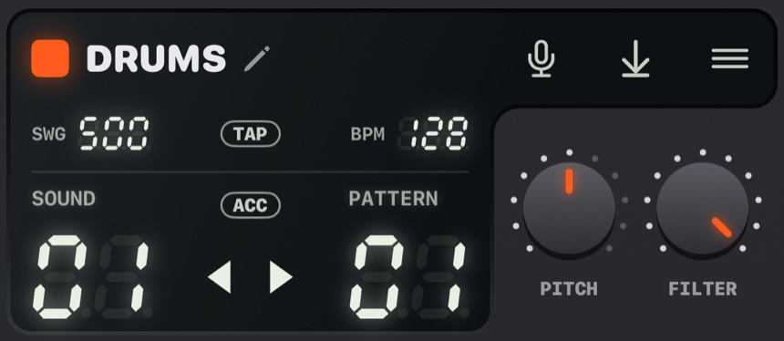

La parte de arriba de la pantalla es el **display**. Todo lo que hay en él se toca.

| | |
|---|---|
| 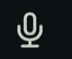 | **Micrófono.** Graba tus propios sonidos, mira [Tus propios sonidos](#your-own-sounds). |
| 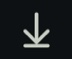 | **Exportar.** Guarda todo el proyecto como archivo de audio. |
|  | **Menú.** Tus proyectos y los ajustes. |
|  | **TAP.** Púlsalo al ritmo de una canción y Handbeat calcula el tempo. También late en cada pulso. |
| 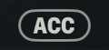 | **ACC.** Acento, mira [Dibujar un ritmo](#drawing-a-beat-step). |
|  | **Flechas.** Recorren los sonidos (o las notas) de un dispositivo. |

- **La banda del nombre** muestra el nombre del dispositivo (en el mezclador, el del proyecto). Toca el lápiz para cambiarlo, hasta 8 caracteres.
- **BPM** es el tempo: arrástralo arriba y abajo (de 64 a 256). **SWG** es el swing, más abajo te lo cuento.
- **Las dos columnas de dígitos** muestran dos números; lo que dicen depende de la página, por ejemplo *SOUND* y *PATTERN* en una batería.
- **Dos perillas.** Arrástralas arriba y abajo. **Toca dos veces una perilla** para devolverla a su valor por defecto. Mientras giras una, el display muestra su valor exacto y su nombre.

Cada pad, tecla y perilla responde con una pequeña vibración del móvil (puedes desactivarla en Ajustes, en *Vibración*). Cuanto más cambia la música un control, más fuerte es el toque.

Cada página tiene una **textura** tenue en sus pads y en la tecla que la abre, para que sepas dónde estás de un vistazo: líneas para LIVE FX, puntos para SOUND, columnas para STEP y cuadrados para PATTERN. La página DEVICE no tiene ninguna, sus pads llevan en cambio un pequeño signo de cada dispositivo. Desactiva todo esto en Ajustes, en *Pistas visuales*.

¿Quieres saber más?

**Tempo y swing**

**BPM** significa *beats por minuto* (pulsos por minuto). 60 es un pulso por segundo, un paseo tranquilo. El house suena entre 120 y 130, el drum and bass ronda los 170. Handbeat arranca en 128 porque le va bien a casi todo.

El **swing** hace que el ritmo «cojee» a propósito. Normalmente los 16 pasos de un compás están a la misma distancia. Con swing, uno de cada dos llega un poquito tarde y el groove rebota en vez de marchar. SWG va de **500** (recto) a **750** (el extremo); hacia **667** tienes el clásico shuffle de tresillo. Pruébalo con los hi-hats.

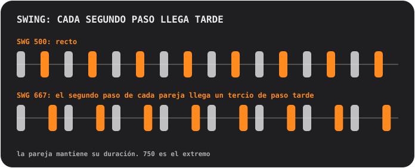

## Pads y páginas

Los pads son siempre una cuadrícula de 4×4, numerada del 01 al 16. La fila superior de teclas cambia la **página**, que decide lo que hacen los pads:

<table>
<tr>
<td align="center">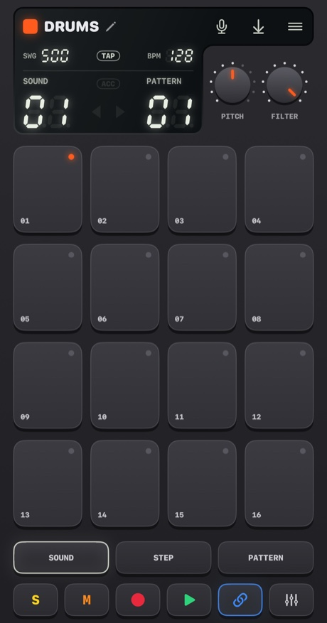 <b>SOUND</b> tocar: cada pad suena a su manera</td>
<td align="center">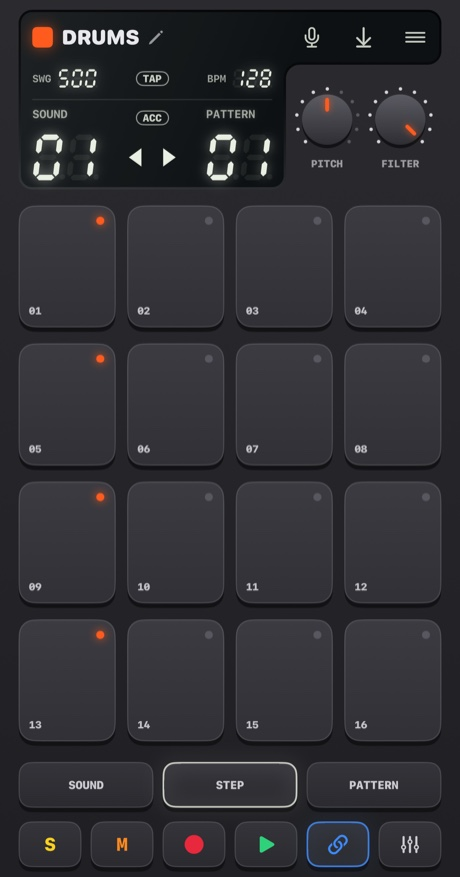 <b>STEP</b> dibujar: cada pad es uno de los 16 pasos</td>
<td align="center">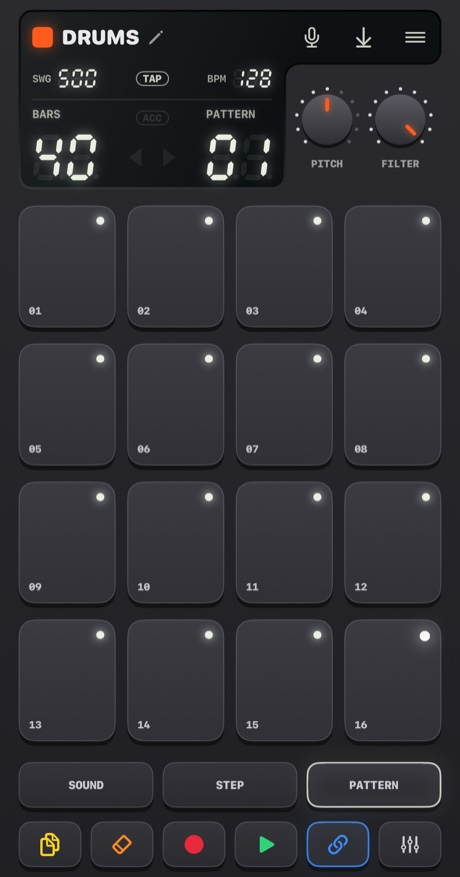 <b>PATTERN</b> elegir: cada pad es un patrón</td>
</tr>
</table>

### Dibujar un ritmo (STEP)

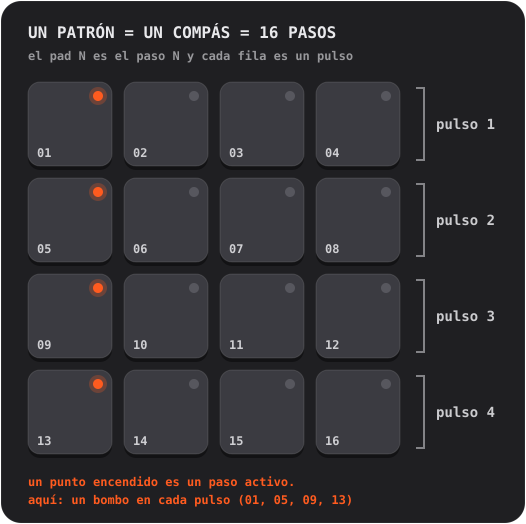

1. En **SOUND**, toca el pad que quieras programar. Pasa a ser el sonido seleccionado.
2. Pulsa **STEP** y toca pads para activar y desactivar pasos. Un punto encendido significa que el paso está activo.
3. Pulsa **PLAY**. Un destello suave recorre los pads: es el cabezal de reproducción. Puedes seguir editando mientras suena.

**Acentos.** Pulsa **ACC** y luego toca un paso: se convierte en un acento, un golpe más fuerte y marcado. ACC se apaga solo tras un toque. Toca otra vez un paso con acento para quitarlo.

¿Quieres saber más?

**Qué es un secuenciador de pasos**

El tiempo se corta en porciones iguales llamadas **pasos**. Para cada sonido decides en qué pasos suena. Cuatro pasos forman un **pulso** (un golpe de pie), y cuatro pulsos forman un **compás**. Cada patrón de Handbeat es exactamente un compás, y un compás se repite en bucle. Casi todo el pop, el house y el hip-hop se construye con compases así, apilados y variados.

### Grabar en directo (REC)

Pulsa **REC** y toca pads en la página SOUND. Handbeat arranca el transporte si estaba parado y coloca tus golpes en el paso de 16ª *más cercano*, así que un dedo algo torpe sigue cayendo a tiempo. Hace **overdub**: lo que ya hay se queda. Pulsa **STOP** (la tecla PLAY) para terminar. No hay deshacer: desactiva en STEP los pasos que no quieras.

En los dispositivos que sostienen notas (Bass, Acid, Pad, Chip) también se graba cuánto dura tu toque.

### Leer las luces

- El **punto** de un pad dice lo que *es* el pad: apagado es vacío, tenue significa «aquí hay algo», encendido significa activo (el sonido seleccionado, un paso activado, el patrón actual) y brillante destaca (un acento, el compás más reciente de una cadena). Un punto **parpadeando** significa «esperando al final del compás».
- El **anillo** de un pad dice lo que suena *ahora mismo*.
- Un pad **atenuado** está en silencio (silenciado, o hay otro en solo). Aun así suena si lo tocas.
- Un **anillo alrededor de una tecla** significa que hay un modo activado.

## Teclas

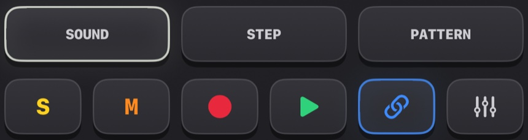

| | |
|---|---|
|   | **S y M** son las dos *teclas de contexto*; cambian según el dispositivo y la página. En una batería son **solo** y **mute** del sonido seleccionado. Otros dispositivos ponen aquí sus propias teclas, mira [Dispositivos](#devices). |
| 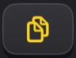 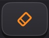 | En la página PATTERN se convierten en **COPY** y **ERASE**. |
| 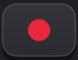 | **REC** graba en directo. |
| 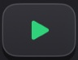 | **PLAY** pone todo en marcha con un mismo reloj. Mientras suena es un cuadrado de stop: para *y rebobina*. Una llamada, una alarma o desenchufar los auriculares también paran la música; vuelve a pulsar PLAY. |
|  | **CHAIN** une patrones en una canción. Lleva un anillo azul mientras está activa. |
| 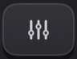 | **RACK** alterna entre el dispositivo en el que estás y el mezclador. |

Mute y solo solo afectan a lo que toca el *secuenciador*. Un pad que tocas tú siempre suena.

## Patrones y cadenas

Un **patrón** es un compás, 16 pasos. Tienes **16 patrones**, y *cada patrón contiene los pasos de todos los dispositivos*: la batería, el bajo y la melodía del patrón 03 están todos en el 03.

En la página **PATTERN**, toca un pad para elegir un patrón. Si la música está sonando, el cambio espera al final del compás y el pad **parpadea** hasta que ocurre.

- **COPY**, luego un pad: copia el patrón que suena sobre él.
- **ERASE**, luego un pad: borra ese patrón.
- Vuelve a pulsar la tecla, o sal de la página, para cancelar.

### Cadena: un patrón es un compás, una cadena es una canción

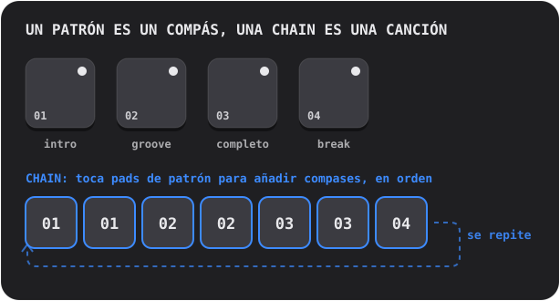

Activa **CHAIN** y toca pads de patrón: cada toque **añade un compás** al final de la cadena (hasta 99 compases, se pueden repetir). La reproducción sigue la cadena compás a compás y vuelve a empezar. Desactiva CHAIN para terminarla; el último patrón que tocaste suena solo.

¿Quieres saber más?

**Cómo se construyen las canciones con bucles**

Casi toda la música de baile es **repetición con cambios**. Tomas un bucle que funciona y vas añadiendo y quitando capas para que quien escucha note cómo crece y respira: una **intro** ligera, un **groove** constante, una sección **llena** con todo encendido, un **break** donde todo se va cayendo y un **fill** de batería en el último pulso que le dice al oído «viene algo nuevo». En Handbeat cada uno de esos es un patrón, y CHAIN los pone en orden.

## El mezclador (RACK)

La última tecla alterna entre tu dispositivo y el **mezclador**, el mismo tablero de 4×4 con otro sombrero. Un proyecto **siempre se abre en el mezclador**.

<table>
<tr>
<td align="center">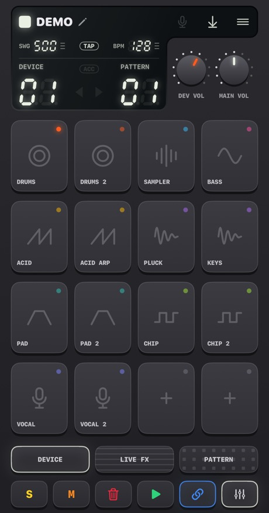 <b>DEVICE</b> tus dispositivos</td>
<td align="center">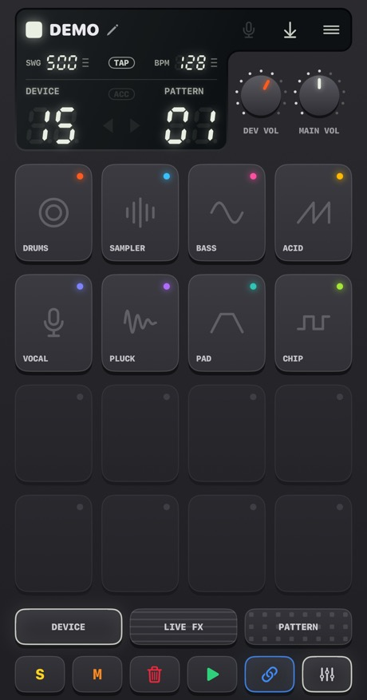 <b>Pad vacío</b> elige un dispositivo nuevo</td>
<td align="center">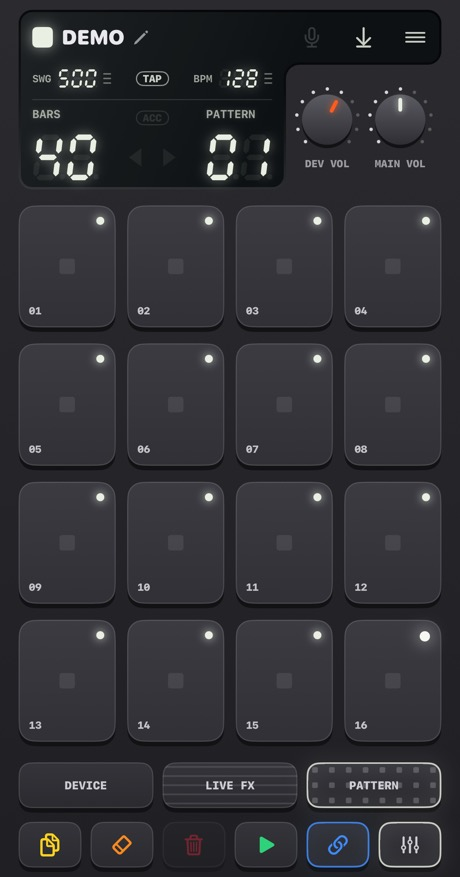 <b>PATTERN</b> copiar y borrar patrones enteros</td>
</tr>
</table>

En la página **DEVICE** cada pad es un hueco: hasta **16 dispositivos** por proyecto.

- **Toca un pad con un plus** para añadir un dispositivo (los pads se convierten en los tipos que puedes elegir, cada uno con su signo).
- **Signos.** Cada pad lleva un pequeño signo de su dispositivo: un parche de tambor (Drums), una forma de onda (Sampler), una onda lenta (Bass), una sierra (Acid), un micrófono (Vocal), una cuerda que se apaga (Pluck), una envolvente que crece (Pad) o una onda cuadrada (Chip).
- **Toca un pad ocupado** para seleccionarlo. Su anillo se enciende mientras suena. **RACK** salta a su pantalla.
- **SOLO / MUTE** actúan sobre el dispositivo seleccionado.  **TRASH** borra uno: púlsalo, toca el pad del dispositivo y confirma.
- **DEV VOL** es el nivel del dispositivo seleccionado y **MAIN VOL** el volumen de toda la mezcla. 5 es el punto neutro.
- En la página **PATTERN** del mezclador, COPY y ERASE actúan sobre el patrón entero *con todos los dispositivos dentro*.

## Efectos en vivo

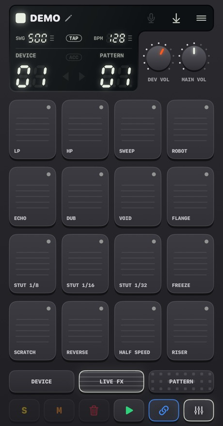

La página **LIVE FX** tiene dieciséis efectos en los pads, cuatro filas de cuatro. **Mantén pulsado un pad para tocar el efecto y suéltalo para pararlo.** Los efectos entran en una décima de segundo y salen en un cuarto, así que nada hace clic. Mantén los que quieras a la vez. Son para **actuar en directo**: nada de esta página se guarda y los efectos **no se incluyen al exportar**.

**Tono**
- **LP**: apaga el sonido (paso bajo).
- **HP**: lo adelgaza (paso alto).
- **SWEEP**: un filtro que sube de graves a agudos y llega justo cuando acaba el compás.
- **ROBOT**: toda la mezcla suena a un solo tono.

**Espacio** (siguen sonando cuando sueltas)
- **ECHO**: repite con una corchea con puntillo.
- **DUB**: repite en cada pulso, más oscuro y más sucio.
- **VOID**: una sala.
- **FLANGE**: un silbido de reactor que gira.

**Bucle y retención**
- **STUT 1/8**, **STUT 1/16**, **STUT 1/32**: tartamudeos. Se repite el paso que está sonando.
- **FREEZE**: congela el sonido en una textura suave y constante.

**Transiciones de DJ**
- **SCRATCH**: una aguja arrastrada hacia delante y hacia atrás sobre la última media pulsación.
- **REVERSE**: la música, un pulso por detrás, al revés.
- **HALF SPEED**: baja todo una octava y lo ralentiza.
- **RISER**: una subida de ruido que alcanza su cima justo al acabar el compás y se corta al soltar: el «drop».

¿Quieres saber más?

**Usar los efectos en una canción**

Los efectos son el condimento, no el plato. Los movimientos clásicos: mantén **RISER** durante el último compás de una sección y suéltalo en el primer pulso de la siguiente; mantén **LP** mientras acaba una sección y suéltalo para que la nueva estalle; toca un **STUT** durante un pulso para convertir lo que suene en un redoble tartamudo; añade un **ECHO** corto en el último golpe de una frase para que resuene en el compás siguiente.

**Por dentro**

Los efectos actúan sobre toda la mezcla, después de sumar todos los dispositivos y antes del volumen principal y del limitador. Un STUT toma el paso en el que está el secuenciador cuando tocas el pad, así que oyes repetirse la *nota* y no el silencio de antes.

## Tus propios sonidos

Puedes tocar **tus propios** sonidos: grábalos con el micrófono o carga archivos de audio. Todos los dispositivos pueden tenerlos salvo el Chip y el Acid, que se basan en sus propias ondas.

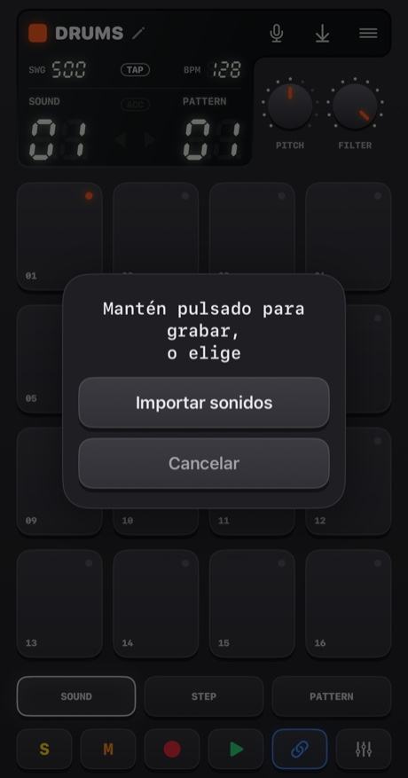

- **Mantén pulsado el micrófono** (algo más de un cuarto de segundo) para grabar. Suelta para terminar. Los pads se ponen rojos, la música se para (el micro la oiría) y el display cuenta los segundos.
- **Tócalo** para elegir: **Importar sonidos**, o **Sonidos integrados** (volver a los originales; aparece cuando el dispositivo tiene sonidos propios).

Adónde va el sonido depende del dispositivo:
- **Drums**: un sonido por pad. **Elige primero el pad y luego mantén pulsado el botón.**
- **Sampler**: un sonido de hasta **30 segundos**, cortado en 16 porciones iguales.
- **Pluck, Pad, Bass, Vocal**: un sonido de hasta **10 segundos**, que suena en cada pad con una altura distinta. Lo que grabas es la *nota raíz*, el pad 05.

Handbeat recorta el silencio alrededor de tu sonido. Una grabación en silencio no se guarda.

**Importar archivos** admite WAV, AIFF, M4A, MP3 y similares. Una batería acepta varios, uno por pad en el orden de sus nombres, empezando por el pad seleccionado. Un archivo largo se **trocea en sus pausas** (un cuarto de segundo de silencio da paso al sonido siguiente). Cualquier otro dispositivo toma el primer archivo. Los sonidos se guardan dentro del proyecto y viajan con él.

La primera vez, iOS te pregunta si Handbeat puede usar el micrófono. Si dijiste que no, el botón te lleva a Ajustes.

¿Quieres saber más?

**Qué es el sampling**

Un **sample** es una grabación usada como instrumento. El sampling es el corazón del hip-hop, del house y de mil cosas más: grabas un sonido y luego lo disparas, lo aceleras, lo frenas, lo cortas en pedazos. Si reproduces un sample **más rápido**, suena más agudo y más corto; **más lento**, más grave y más largo, igual que al acelerar una cinta. Así una sola grabación se convierte en un teclado entero.

## Proyectos, compartir y exportar

El botón de **menú** abre **Proyectos** (para la música y guarda).

<table>
<tr>
<td align="center">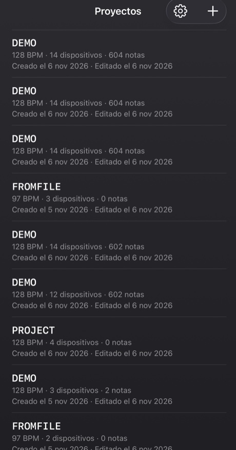</td>
<td align="center">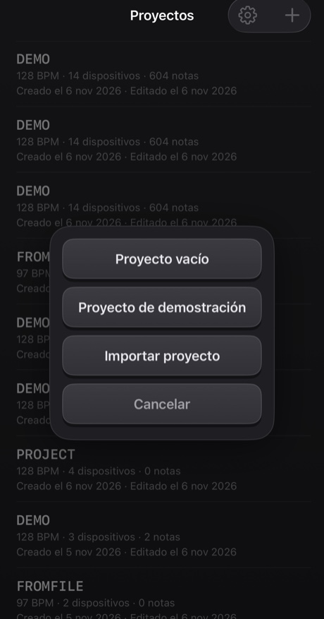</td>
</tr>
</table>

- Toca un proyecto para abrirlo. **Desliza** una fila (o mantenla pulsada) para **compartirla** o **eliminarla**; eliminar siempre pide confirmación.
- El **+** crea un *Proyecto vacío* o un *Proyecto de demostración*, o **importa** uno desde un archivo. La demo es un buen sitio para empezar: catorce dispositivos tocando un mashup de 40 compases.
- Todo se **guarda solo**.

**Compartir** escribe un proyecto, con sus sonidos propios, en un único archivo `.handbeat` y abre la hoja de compartir: mándalo por AirDrop o correo, o guárdalo en Archivos como copia de seguridad. Si abres uno de esos archivos en Handbeat, se **añade** como proyecto nuevo y nunca toca los tuyos.

**Exportar audio** es el botón de guardar del display. Renderiza el **proyecto entero, con todos los dispositivos mezclados**, a **WAV** o **M4A** (lo eliges en Ajustes), más rápido que en tiempo real. Con CHAIN activada obtienes toda la cadena; si no, una vuelta del patrón actual. El botón se apaga cuando no hay nada que oír.

## Ajustes

Proyectos → el engranaje. **Idioma** cambia los menús al instante (la groovebox en sí, con sus teclas, perillas y nombres de dispositivo, se queda en inglés en todos los idiomas, como las etiquetas de un aparato de hardware). Hay cuatro **temas**, cada uno en Oscuro, Claro o *Sistema*: **Classic**, **iClassic** (plástico brillante y una rueda táctil), **Contrast** (plano, negro o blanco puro) y **Aero** (gel y cristal). Cada tema tiene además su propio **icono de la app**. **Vibración** y **Pistas visuales** activan o desactivan los toques y las texturas y signos de las páginas. **Introducción** repite el tutorial guiado en un proyecto de demostración nuevo. La primera vez que abres Handbeat, el tutorial empieza solo en una demo, y la cruz de su esquina lo cierra.

---

# Dispositivos

Un **dispositivo** es un instrumento de tu proyecto. Añade uno tocando un pad vacío en el mezclador. Aparecen en el mismo orden que en el selector. Todos son 16 pistas × 16 pasos, así que STEP, REC, los patrones, las cadenas y la exportación funcionan igual en todos. Lo que cambia es el sonido, los pads, las dos perillas y las dos teclas junto a **REC**.

Los **dispositivos de notas** (Bass, Acid, Vocal, Pluck, Pad, Chip) comparten una misma distribución de pads, como un piano roll: **el pad 05 es la nota raíz** (la nota «de casa»), los pads de arriba son más agudos y los de abajo, más graves. La perilla **SCALE** decide qué *son* los pasos (mira [Escalas](#scales)). Los pasos que dibujas se guardan como números de pad, así que cambiar la escala toca la *misma melodía en una escala nueva*.

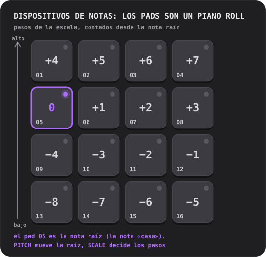

## Drums

Una batería completa: **16 sonidos, uno por pad**.

- **Perillas:** **PITCH** (de −6 a +6 semitonos, toda la batería) y **FILTER** (un paso bajo: 10 es abierto del todo, más abajo apaga la batería).
- **Teclas:** **S** y **M** (solo y mute) del sonido seleccionado.
- **Sonidos propios:** uno por pad.

**Prueba esto:** toca los pads en SOUND para descubrir qué hay dónde. Elige el bombo, pulsa STEP y activa 01, 05, 09 y 13: un bombo en cada pulso, el latido del house. Añade una palmada en 05 y 13 y hi-hats en los pasos intermedios.

Un **hi-hat cerrado** corta a un **hi-hat abierto**, como en la realidad, así que nunca suenan uno encima del otro.

¿Quieres saber más?

**Los tres tambores que importan**

El **bombo** (kick) es el golpe grave que te hace mover la cabeza. La **caja** (snare) o la **palmada** (clap) es el chasquido, normalmente en los pulsos 2 y 4 (pasos 05 y 13): el **backbeat**. El **hi-hat** es el tic-tic-tic que marca la velocidad del groove: corcheas (un paso sí y otro no) o semicorcheas (todos los pasos). Un bombo en cada pulso es el **four on the floor**; un bombo en 01 y 11 con caja en 05 y 13 es un breakbeat clásico.

**Por dentro**

Todos los sonidos incluidos están hechos desde cero para Handbeat: generados por un script, sin tomar nada prestado de nadie.

## Sampler

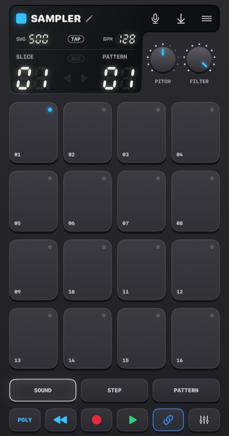

**Un sonido cortado en 16 porciones iguales**, una por pad. Pon las porciones en orden y el sonido suena como era; reordénalas y lo has remezclado.

- **Perillas:** **PITCH** (acelera o frena todas las porciones) y **FILTER**.
- **Teclas:** **MONO / POLY** (MONO: una porción nueva corta las que aún suenan) y **REVERSE** (cada porción al revés).
- **Sonido propio:** graba hasta **30 segundos** o importa un archivo. La primera columna del display es **SLICE**.

Si no tienes un sonido propio, toca un **break integrado**: cuatro compases de breakbeat a 128 BPM, así que cada porción es un pulso. Para oírlo como era, pon las porciones 1 a 4 en los pasos 01, 05, 09, 13 del patrón 1, las porciones 5 a 8 en el patrón 2, y así a lo largo de cuatro patrones encadenados.

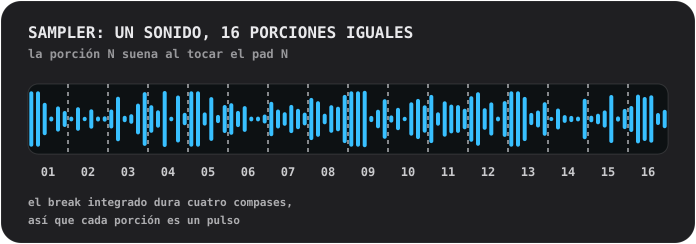

¿Quieres saber más?

**Trocear un break**

Un **break** es un tramo de batería sola. Cortarlo en pedazos y reordenarlos es uno de los trucos más viejos para hacer beats: así un solo bucle se convierte en cien ritmos. Prueba a mover la porción 3 al primer paso, a duplicar la 2, a poner algunas al revés.

**Por dentro**

Una porción suena *tal cual*: nunca se estira para ajustarse al tempo, por eso el break encaja a 128. Cada porción entra en 4 ms y sale en 10 ms, así que nunca hacen clic.

## Bass

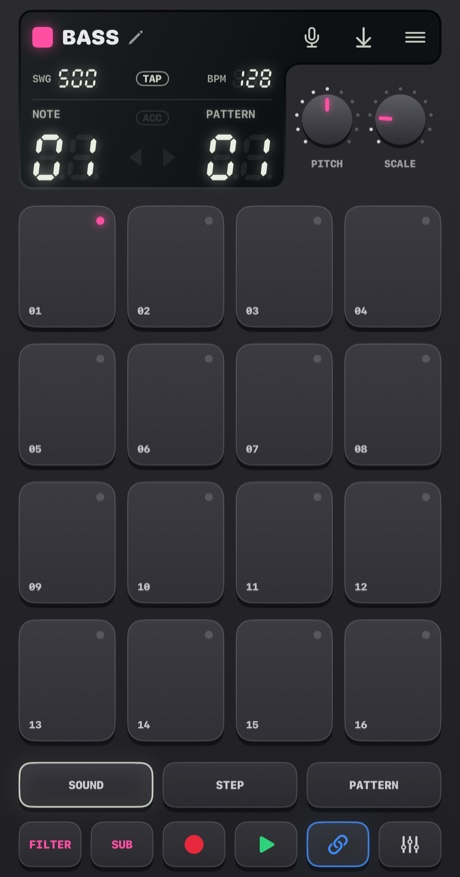

Un bajo profundo y redondo. **Una nota a la vez**; las notas son *sostenidas* (más abajo).

- **Perillas:** **PITCH** y **SCALE**.
- **Teclas:** **FILTER** (redondea el timbre) y **SUB** (una segunda voz una octava más grave, nunca filtrada, así los graves se quedan cuando el filtro se cierra).

**Notas sostenidas.** En los dispositivos que sostienen (Bass, Acid, Pad, Chip), varios pasos normales seguidos en un pad son **una sola nota larga**. Un hueco la termina, un **paso con acento la empieza de nuevo** y una **línea de compás termina todas las notas**. Si tocas un pad, la nota dura lo que dure tu dedo.

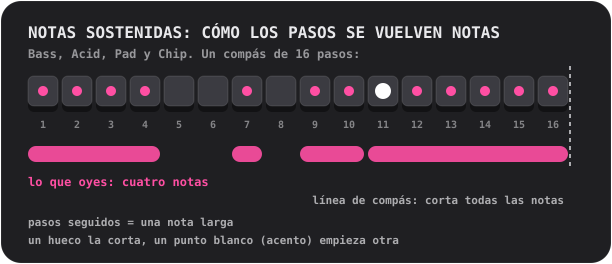

¿Quieres saber más?

**Qué hace el bajo**

El bajo toca la **nota raíz**: la nota sobre la que se construye un acorde, el suelo armónico de una canción. Se encaja con el bombo. Empieza por lo simple: una nota larga y grave en el primer paso; luego añade una segunda nota, un poco de ritmo, un salto de octava.

**Por qué un bajo puede sonar fuerte en el altavoz del móvil**

El altavoz de un móvil no puede reproducir notas graves de verdad; la raíz de 110 Hz del Bass apenas sale. Pero tu oído completa una nota grave que falta cuando oye sus armónicos («la fundamental ausente»). El Bass es una onda senoidal potente con armónicos graves suaves justo por eso: un bajo de verdad con auriculares *y* con altavoz.

## Acid

<table>
<tr>
<td align="center">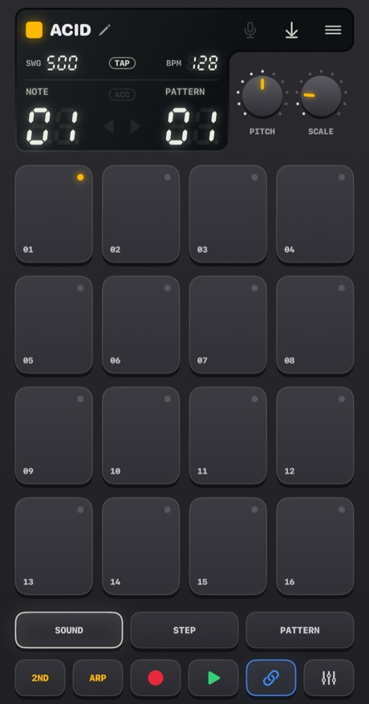 PITCH y SCALE</td>
<td align="center">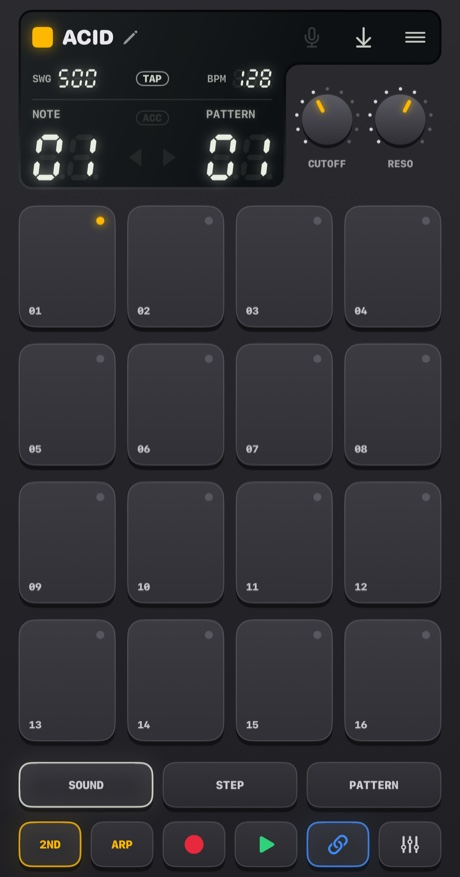 pulsa 2ND: CUTOFF y RESO</td>
</tr>
</table>

La línea de bajo burbujeante y chillona del acid house de finales de los 80: una onda de diente de sierra a través de un **filtro resonante** que se abre y se cierra en cada nota.

- **Teclas:** **2ND** (cambia las perillas) y **ARP**.
- **Perillas, primera página:** **PITCH** y **SCALE**. **Segunda página (2ND):** **CUTOFF** (cuán oscuro empieza el filtro) y **RESO** (cuánto resuena; más resonancia, más «squelch»).
- Las notas son **sostenidas**, como en el Bass.

Dos cosas están siempre activas: el **slide** (cada nota se desliza hasta su altura desde la nota anterior) y el **acento**. Un paso **con acento** (ACC en STEP) abre más el filtro y suena más fuerte. El truco de este sonido: **encadena pasos con unos cuantos acentos y gira CUTOFF mientras suena.**

**ARP** hace que una nota sostenida recorra su propia altura, la tercera, la quinta y la octava, una semicorchea cada vez.

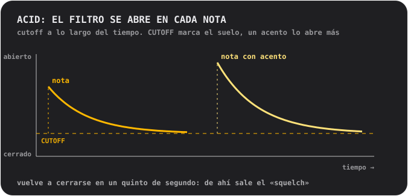

¿Quieres saber más?

**Qué es un filtro**

Un **filtro** deja pasar unas frecuencias y bloquea otras. Un filtro **paso bajo** bloquea los agudos: cerrado, el sonido es apagado y amortiguado; abierto, es brillante. El **cutoff** es el punto donde empieza a bloquear. La **resonancia** realza las frecuencias justo en el cutoff, lo que da ese «wow» casi vocal. Barrer el cutoff con mucha resonancia es el sonido de media música electrónica.

**De dónde viene este sonido**

Acid es un homenaje a una cajita plateada de bajos que, sin querer, definió un género entero en los años 80. Se hizo para imitar un bajo eléctrico a guitarristas solitarios, y nadie la compró para eso. Quienes sí la compraron descubrieron que una onda de sierra, un filtro resonante y una nota que se desliza sonaban como nada más.

**Por dentro**

El filtro se abre dos octavas y media al empezar cada nota y vuelve a caer en unos 0,18 segundos (el «squelch»); un acento lo abre otra octava y media más; el slide dura 80 milisegundos.

## Vocal

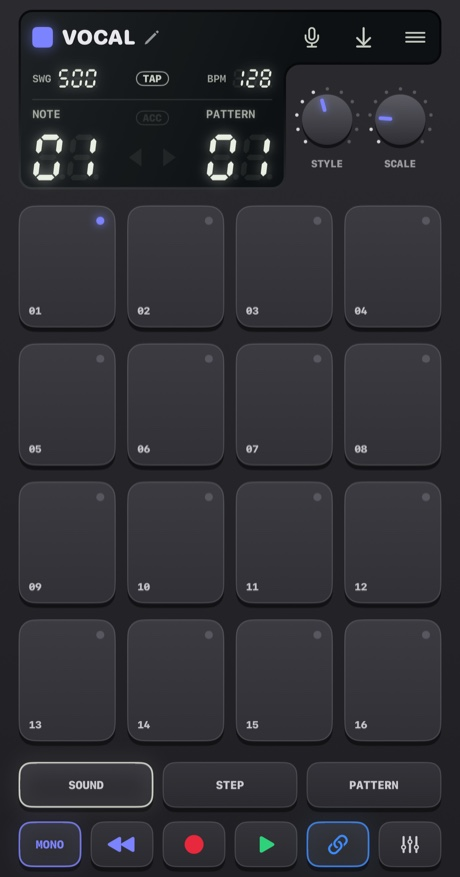

Una voz grabada que suena en los pads a distintas alturas, a través de uno de **diez estilos**. Canta, di una palabra, da una palmada, silba: lo que grabes se convierte en el instrumento.

- **Perillas:** **STYLE** (el display muestra el nombre del estilo mientras lo giras) y **SCALE**. No hay perilla PITCH: la escala y el pad raíz deciden la altura.
- **Teclas:** **MONO / POLY** (MONO es el valor por defecto, para que las palabras no se pisen) y **REVERSE**.
- **Tu voz:** graba hasta **10 segundos**. Hasta entonces suena una breve **frase integrada**: una grabación de la propia voz del autor.

Los estilos:
- **01 NATURAL**: tal como se grabó.
- **02 ROBOT**: metálico, con una altura propia.
- **03 VOCODER**: un robot que *canta*, en la tonalidad del pad que tocas.
- **04 CHOIR**: cuatro copias tuyas que se mecen despacio.
- **05 RADIO**: estrecho y crujiente, como un altavoz pequeño y viejo.
- **06 LO-FI**: aplastado y granuloso, como un sampler antiguo.
- **07 CAVE**: una sala enorme con eco y una cola larga.
- **08 GLITCH**: cortado en granos y entrecortado. **Cada golpe suena con un corte aleatorio distinto**.
- **09 ALIEN**: un anillo metálico que oscila.
- **10 CHORD**: tu voz más una tercera mayor y una quinta por encima: cada pad toca un acorde.

Un estilo se aplica en segundo plano un instante después de que la perilla se detenga, así que si lo giras por varios solo se calcula aquel en el que paras.

¿Quieres saber más?

**La altura y por qué una voz aguda suena pequeña**

La voz se reproduce **más rápido para subir** y **más lento para bajar**, como al acelerar una cinta. Una voz en un pad agudo se vuelve fina y chillona; en un pad grave, profunda y lenta. Es el sonido del sampling. Para hacer melodías, graba algo corto y deja que SCALE te mantenga en tono.

**Los estilos por dentro**

**VOCODER** divide la voz en diez bandas, mide cuánto suena cada una y lo usa para moldear una onda de sierra zumbante: una técnica de los años 70 para discos con voces de robot. **ROBOT** y **ALIEN** usan **modulación en anillo**: multiplican la voz por un tono, el viejo truco de las voces de robot de la ciencia ficción. **CHORD** es un acorde *mayor* sea cual sea la escala: en escalas menores algunos pads chocarán, lo que puede ser una virtud.

## Pluck

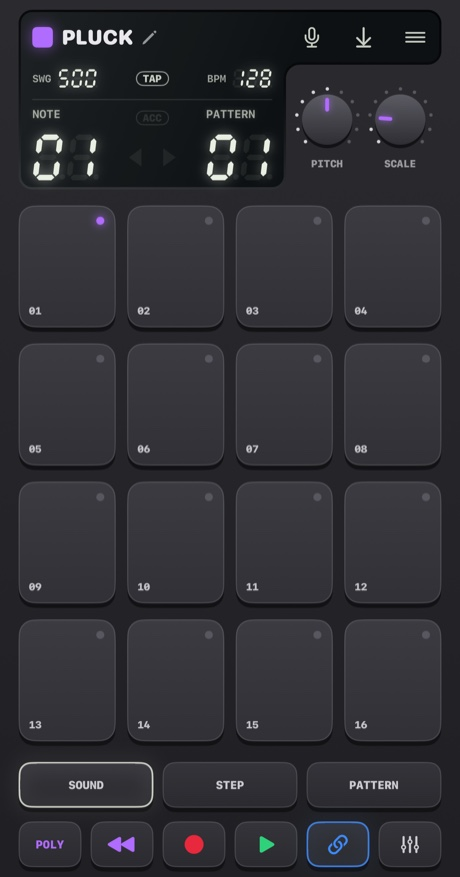

Un sonido corto de cuerda pulsada que suena en dieciséis alturas. El dispositivo melódico más simple y directo.

- **Perillas:** **PITCH** (tú eliges la tonalidad) y **SCALE** (12 escalas, mira [Escalas](#scales); el nombre aparece en el display mientras giras).
- **Teclas:** **MONO / POLY** (MONO: una nota nueva corta las demás) y **REVERSE** (el primer tercio de segundo suena al revés, así que la nota se hincha hasta su ataque).
- **Sonido propio:** uno, que suena en todas las alturas, de hasta 10 segundos.

Un consejo: cambia a una escala **pentatónica** (05 o 06) y toca pads al azar. Es muy difícil tocar una nota que suene mal.

¿Quieres saber más?

**Escalas**

Una **escala** es un menú de notas que suenan bien juntas. Un piano tiene doce notas por octava; una escala elige unas cuantas. **Mayor** suena brillante y alegre, **menor**, triste o serio. Las escalas **pentatónicas** tienen solo cinco notas, así que no hay ninguna mala. La **cromática** te da *todos* los semitonos: libertad total, y fácil de desafinar. La **nota raíz** es la nota de casa de la escala; en Handbeat es el pad 05, y PITCH la lleva a otra tonalidad.

**Por dentro**

El pluck es un solo sample, reproducido más rápido o más lento para cambiar la altura, así que cambia también de duración, como en los viejos teclados con samples. Los pads no se alejan mucho de la raíz a propósito: un sample mucho más rápido se vuelve fino y mucho más lento, retumbante.

## Pad

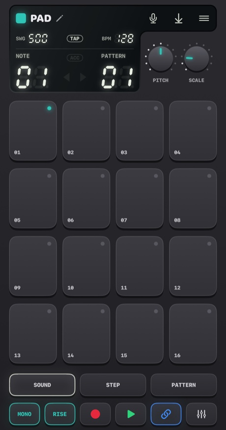

Los pads, escalas y perillas del Pluck, pero con la nota **sostenida**: un sonido suave que brilla despacio y dura todo lo que quieras.

- **Perillas:** **PITCH** y **SCALE**.
- **Teclas:** **MONO / CHORD** (CHORD toca una tríada en cada pad) y **STEADY / RISE** (RISE hace que una nota sostenida crezca de suave a plena).
- Las notas son **sostenidas**, como en el Bass. Sonido propio: uno, en bucle sin costuras, de hasta 10 segundos.

Llena varios pasos seguidos en un pad para un acorde largo, deja un hueco para terminarlo, añade un acento para empezar otro. RISE en una nota que abarca varios pasos es una subida rápida.

¿Quieres saber más?

**Qué es un acorde**

Un **acorde** son tres o más notas tocadas a la vez. El más simple, una **tríada**, es la nota raíz, la nota dos pasos más arriba en la escala y la nota cuatro pasos más arriba. Activa CHORD y cada pad se convierte en una tríada de la escala que elegiste: no hace falta teoría para tener acordes que encajen.

**Por dentro**

El sonido del pad dura un segundo y entra en bucle sin costuras. Dos parciales suaves, a un hercio por encima y por debajo de cada uno de los demás, crean el brillo lento.

## Chip

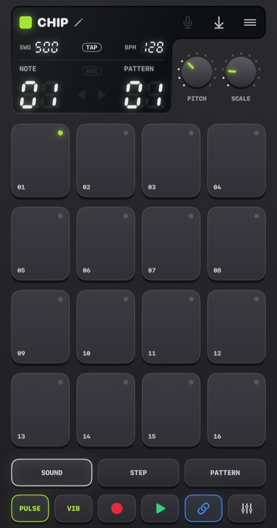

El sonido de la era de los 8 bits: las ondas de las viejas consolas y ordenadores domésticos.

- **Perillas:** **PITCH** y **SCALE**.
- **Teclas:** **TRI / PULSE** (la onda) y **VIB** (un vibrato suave).
- Las notas son **sostenidas**, como en el Bass. Sin sonidos propios: las ondas *son* el instrumento.

La **onda triangular** es suave, hueca, parecida a una flauta y dibujada en escalones gruesos. La **onda de pulso** es un zumbido estrecho y nasal, el clásico sonido de melodía principal. El pad raíz del Chip está **un tono entero más alto** que el de los demás dispositivos, a propósito.

**Los acordes del Chip zumban y aletean, y eso es auténtico.** Mantén dos pads y trinan; mantén tres y aletean. Abre la caja para saber por qué.

¿Quieres saber más?

**Polifonía por turnos rápidos**

Los chips de sonido de las viejas consolas y ordenadores domésticos tocaban **una sola nota a la vez por canal**. Para sacar acordes de un canal, los programadores lo cambiaban entre las notas del acorde *muy rápido*, de modo que el oído las oye juntas, con un color zumbón y arpegiado. Es el sonido de los 80.

El Chip hace exactamente eso: todos los pads que mantienes en un paso comparten **una sola voz** que da a cada nota un **turno de 1/60 de segundo**. Una **nota sola** suena estable, sin turnos.

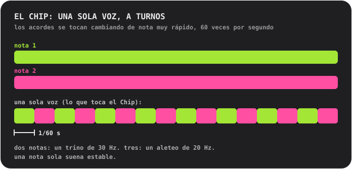

**Las ondas**

La **triangular** está construida como la de verdad: 4 bits (16 niveles), 32 escalones por ciclo, que sube en peldaños. La **de pulso** está activa un cuarto del ciclo (una onda con «ciclo de trabajo del 25 %»).

## Escalas

Para Pluck, Pad, Bass, Acid, Vocal y Chip. Gira **SCALE** y el display muestra el número y el nombre.

- **01 Chromatic**: todos los semitonos. La predeterminada.
- **02 Major**: brillante, alegre.
- **03 Natural minor**: triste, seria, la mayor parte del pop y la música electrónica.
- **04 Harmonic minor**: dramática, con un aire oriental.
- **05 Minor pentatonic**: cinco notas. Rock, blues, la opción segura.
- **06 Major pentatonic**: cinco notas brillantes. Folk, campanas.
- **07 Blues**: pentatónica menor más la «blue note».
- **08 Dorian**: menor con un empujón. Funky, jazzera.
- **09 Phrygian**: oscura, española.
- **10 Lydian**: soñadora y flotante.
- **11 Mixolydian**: mayor con un toque de blues.
- **12 Whole tone**: flotante, sin resolver, sin ninguna nota de casa.

---

# Contacto

¿Has encontrado un fallo? ¿Tienes una idea, una pregunta o algo que decir sobre cómo suena? Me encantará oírlo. Handbeat lo hace una sola persona, así que la respuesta puede tardar un poco, pero tu mensaje se leerá.

📩 **[handbeat.contact@gmail.com](mailto:handbeat.contact@gmail.com)**

**¿Vas a informar de un fallo?** Ayuda mucho que incluyas:

1. **Qué pasó** y qué esperabas que pasara.
2. **Cómo hacer que vuelva a ocurrir**: los pasos que seguiste.
3. **La versión de la app** (Ajustes → *Versión*), el modelo de tu iPhone o iPad y tu versión de iOS.
4. **Tu proyecto**, si se trata de un sonido o un patrón concreto: Proyectos → desliza la fila → *Compartir* y adjunta el archivo `.handbeat`. Así puedo abrir exactamente lo que tenías.

Las ideas de funciones y los correos de «ojalá pudiera...» son igual de bienvenidos.

---

# Apoyo

Handbeat lo hace una sola persona. Si te hace feliz y quieres dar las gracias, puedes:

**O contrátame.** Yo hice esta app y, si necesitas que te hagan algo parecido, podemos hablar: [www.linkedin.com/in/fofonovav](https://www.linkedin.com/in/fofonovav)

---

*Este texto ha sido traducido por IA y puede contener errores.*
