# Guide de Handbeat

[Guide](#guide) · [Appareils](#devices) · [Contact](#contact) · [Soutien](#support)

Handbeat est une groovebox pour ton iPhone et ton iPad : seize pads, une ribambelle d’appareils, un seul tempo, un seul transport. Tu tapes, tu dessines un beat, tu enchaînes les mesures pour en faire un morceau. C’est tout. Pas de compte, pas de mauvaise façon de jouer.

Cette page est la version longue. Inutile de la lire de haut en bas : bidouille d’abord l’appli, et reviens quand quelque chose te laisse perplexe.

---

# Guide

## L’écran

Le haut de l’écran, c’est l’**afficheur**. Tout ce qu’il montre se touche.

| | |
|---|---|
|  | **Micro.** Enregistre tes propres sons, voir [Tes propres sons](#your-own-sounds). |
|  | **Export.** Enregistre tout le projet dans un fichier audio. |
|  | **Menu.** Tes projets et les réglages. |
|  | **TAP.** Tape dessus en suivant un morceau et Handbeat trouve le tempo. Il pulse aussi à chaque temps. |
|  | **ACC.** Accent, voir [Dessiner un beat](#drawing-a-beat-step). |
|  | **Flèches.** Font défiler les sons (ou les notes) d’un appareil. |

- **Le bandeau du nom** affiche le nom de l’appareil (celui du projet dans le mixeur). Touche le crayon pour le renommer, 8 caractères au maximum.
- **BPM** est le tempo : fais-le glisser vers le haut ou le bas (de 64 à 256). **SWG** est le swing, plus bas.
- **Les deux colonnes de chiffres** affichent deux nombres ; ce qu’ils disent dépend de la page, par exemple *SOUND* et *PATTERN* sur une batterie.
- **Deux boutons.** Fais-les glisser vers le haut ou le bas. **Double-touche un bouton** pour le remettre à sa valeur par défaut. Pendant que tu en tournes un, l’afficheur montre sa valeur exacte et son nom.

Chaque pad, touche et bouton répond par un petit tapotement du téléphone (tu peux le couper dans les Réglages, sous *Vibration*). Plus une commande change la musique, plus le tapotement est fort.

Envie d’en savoir plus ?

**Tempo et swing**

**BPM** veut dire *beats par minute*, battements par minute. 60, c’est un battement par seconde, une promenade tranquille. La house tourne autour de 120 à 130, la drum and bass vers 170. Handbeat démarre à 128 parce que ça convient à presque tout.

Le **swing** fait « boiter » le beat exprès. Normalement, les 16 pas d’une mesure sont régulièrement espacés. Avec du swing, un pas sur deux arrive un peu en retard, et le groove rebondit au lieu de marcher au pas. SWG va de **500** (droit) à **750** (l’extrême) ; autour de **667**, tu obtiens le classique shuffle ternaire. Essaie-le sur les hi-hats.

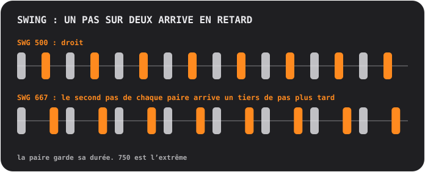

## Pads et pages

Les pads forment toujours une grille de 4×4, numérotée de 01 à 16. La rangée de touches du haut change de **page**, ce qui décide de ce que font les pads :

<table>
<tr>
<td align="center"> <b>SOUND</b> jouer : chaque pad joue son propre son</td>
<td align="center"> <b>STEP</b> dessiner : chaque pad est l’un des 16 pas</td>
<td align="center"> <b>PATTERN</b> choisir : chaque pad est un pattern</td>
</tr>
</table>

### Dessiner un beat (STEP)

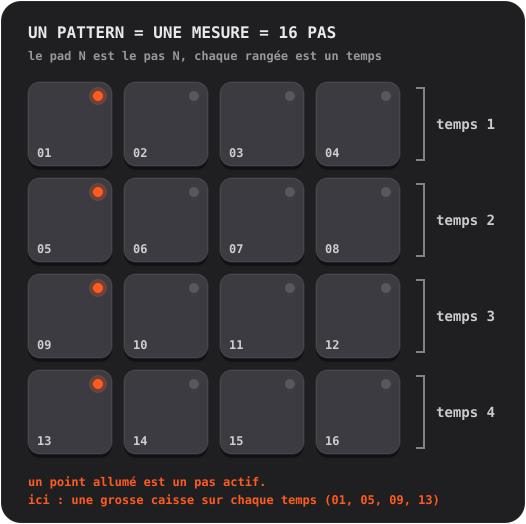

1. Sur **SOUND**, touche le pad que tu veux programmer. Il devient le son sélectionné.
2. Appuie sur **STEP** et touche des pads pour activer et désactiver des pas. Un point allumé signifie que le pas est actif.
3. Appuie sur **PLAY**. Un doux éclair parcourt les pads : c’est la tête de lecture. Tu peux continuer à modifier pendant la lecture.

**Accents.** Appuie sur **ACC**, puis touche un pas : il devient un accent, un coup plus fort et plus marqué. ACC s’éteint tout seul après une touche. Touche de nouveau un pas accentué pour l’effacer.

Envie d’en savoir plus ?

**Ce qu’est un séquenceur pas à pas**

Le temps est découpé en tranches égales appelées **pas**. Pour chaque son, tu décides sur quels pas il joue. Quatre pas font un **temps** (un battement de pied), quatre temps font une **mesure**. Chaque pattern de Handbeat est exactement une mesure, et une mesure boucle. La plupart de la pop, de la house et du hip-hop est construite avec des mesures comme celles-là, empilées et variées.

### Enregistrer en direct (REC)

Appuie sur **REC** et joue des pads sur la page SOUND. Handbeat lance le transport s’il était arrêté et pose tes coups sur le pas de double croche *le plus proche*, si bien qu’un doigt un peu approximatif tombe quand même en rythme. Il fait de l’**overdub** : ce qui existe déjà reste. Appuie sur **STOP** (la touche PLAY) pour finir. Pas d’annulation : désactive les pas indésirables dans STEP.

Sur les appareils qui tiennent les notes (Bass, Acid, Pad, Chip), la durée de ta pression est enregistrée aussi.

### Lire les voyants

- Le **point** d’un pad dit ce qu’est le pad : éteint, il est vide ; atténué, « il y a quelque chose » ; allumé, il est actif (le son sélectionné, un pas activé, le pattern en cours) ; brillant, il ressort (un accent, la mesure la plus récente d’une chaîne). Un point qui **clignote** signifie « attend la fin de la mesure ».
- L’**anneau** d’un pad dit ce qui joue *en ce moment*.
- Un pad **estompé** est silencieux (en mute, ou un autre est en solo). Il joue quand même quand tu le touches.
- Un **anneau autour d’une touche** signifie qu’un mode est actif.

## Touches

| | |
|---|---|
|   | **S et M** sont les deux *touches de contexte* ; elles changent avec l’appareil et la page. Sur une batterie, ce sont **solo** et **mute** pour le son sélectionné. D’autres appareils y mettent leurs propres touches, voir [Appareils](#devices). |
|   | Sur la page PATTERN, elles deviennent **COPY** et **ERASE**. |
|  | **REC** enregistre en direct. |
|  | **PLAY** lance tout sur la même horloge. Pendant la lecture, c’est un carré d’arrêt : il arrête *et rembobine*. Un appel, une alarme ou des écouteurs débranchés arrêtent aussi la musique ; rappuie sur PLAY. |
|  | **CHAIN** relie des patterns pour en faire un morceau. Cerclée de bleu quand elle est active. |
|  | **RACK** bascule entre l’appareil où tu es et le mixeur. |

Mute et solo n’agissent que sur ce que joue le *séquenceur*. Un pad que tu touches fait toujours du son.

## Patterns et chaînes

Un **pattern**, c’est une mesure, 16 pas. Tu disposes de **16 patterns**, et *chaque pattern contient les pas de tous les appareils* : la batterie, la basse et la mélodie du pattern 03 sont toutes dans le 03.

Sur la page **PATTERN**, touche un pad pour choisir un pattern. Pendant la lecture, le changement attend la fin de la mesure, et le pad **clignote** jusqu’à ce qu’il ait lieu.

- **COPY**, puis un pad : copie le pattern en cours dessus.
- **ERASE**, puis un pad : efface ce pattern.
- Rappuie sur la touche, ou quitte la page, pour annuler.

### Chain : un pattern est une mesure, une chaîne est un morceau

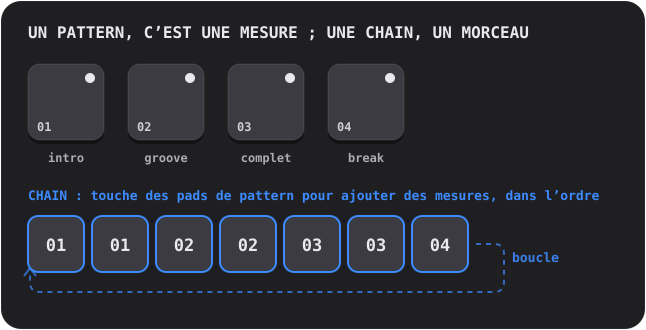

Active **CHAIN** et touche des pads de pattern : chaque touche **ajoute une mesure** à la fin de la chaîne (jusqu’à 99 mesures, répétitions permises). La lecture suit la chaîne mesure après mesure, puis recommence. Désactive CHAIN pour y mettre fin ; le dernier pattern touché joue alors seul.

Envie d’en savoir plus ?

**Comment on construit un morceau avec des boucles**

Presque toute la musique de danse, c’est de la **répétition avec des changements**. Tu prends une boucle qui marche, puis tu ajoutes et retires des couches pour que l’auditeur sente le morceau grandir et respirer : une **intro** clairsemée, un **groove** régulier, une section **complète** où tout joue, un **break** où tout se retire, et un **fill** de batterie au dernier temps qui dit aux oreilles « il se passe du nouveau ». Dans Handbeat, chacun est un pattern, et CHAIN les met dans l’ordre.

## Le mixeur (RACK)

La dernière touche bascule entre ton appareil et le **mixeur**, le même plateau de 4×4 avec un autre chapeau. Un projet **s’ouvre toujours sur le mixeur**.

<table>
<tr>
<td align="center"> <b>DEVICE</b> tes appareils</td>
<td align="center"> <b>Pad vide</b> choisir un nouvel appareil</td>
<td align="center"> <b>PATTERN</b> copier et effacer des patterns entiers</td>
</tr>
</table>

Sur la page **DEVICE**, chaque pad est un emplacement : jusqu’à **16 appareils** par projet.

- **Touche un pad vide** pour ajouter un appareil (les pads deviennent les types que tu peux choisir).
- **Touche un pad occupé** pour le sélectionner. Son anneau s’allume pendant qu’il joue. **RACK** saute vers son propre écran.
- **SOLO / MUTE** agissent sur l’appareil sélectionné.  **TRASH** en supprime un : appuie dessus, touche le pad de l’appareil, confirme.
- **DEV VOL** est le niveau de l’appareil sélectionné, **MAIN VOL** le volume de tout le mix. 5 est le milieu neutre.
- Sur la page **PATTERN** du mixeur, COPY et ERASE agissent sur le pattern entier *avec tous les appareils dedans*.

## Effets en direct

La page **LIVE FX** propose seize effets sur les pads, quatre rangées de quatre. **Maintiens un pad pour jouer l’effet, relâche pour l’arrêter.** Les effets entrent en un dixième de seconde et sortent en un quart, donc rien ne claque. Maintiens-en autant que tu veux. Ils sont faits pour **jouer en live** : rien sur cette page n’est enregistré, et les effets **ne sont pas inclus dans un export**.

**Tonalité**
- **LP** : étouffe le son (passe-bas).
- **HP** : l’amincit (passe-haut).
- **SWEEP** : un filtre qui monte des graves aux aigus et arrive pile à la fin de la mesure.
- **ROBOT** : tout le mix résonne sur une seule hauteur.

**Espace** (ils continuent de résonner quand tu relâches)
- **ECHO** : répète sur une croche pointée.
- **DUB** : répète à chaque temps, plus sombre et plus sale.
- **VOID** : une salle.
- **FLANGE** : un souffle tourbillonnant d’avion à réaction.

**Boucle et maintien**
- **STUT 1/8**, **STUT 1/16**, **STUT 1/32** : bégaiements. Le pas qui joue se répète.
- **FREEZE** : fige le son en une texture douce et régulière.

**Transitions de DJ**
- **SCRATCH** : une aiguille tirée d’avant en arrière sur le dernier demi-temps.
- **REVERSE** : la musique, un temps en retard, à l’envers.
- **HALF SPEED** : ralentit tout d’une octave.
- **RISER** : une montée de bruit qui culmine pile à la fin de la mesure et se coupe quand tu relâches : le « drop ».

Envie d’en savoir plus ?

**Utiliser les effets dans un morceau**

Les effets, c’est l’assaisonnement, pas le plat. Les gestes classiques : maintiens **RISER** pendant la dernière mesure d’une section et relâche sur le premier temps de la suivante ; maintiens **LP** pendant qu’une section se termine puis relâche pour que la nouvelle explose ; touche un **STUT** pendant un temps pour transformer ce qui joue en roulement de batterie bégayant ; ajoute un court **ECHO** sur le dernier coup d’une phrase pour qu’elle résonne dans la mesure suivante.

**À l’intérieur**

Les effets agissent sur tout le mix, une fois tous les appareils additionnés et avant le volume principal et le limiteur. Un STUT prend le pas où se trouve le séquenceur quand tu touches le pad, si bien que tu entends la *note* se répéter et pas le silence qui la précède.

## Tes propres sons

Tu peux jouer **tes propres** sons : enregistre-les avec le micro ou charge des fichiers audio. Chaque appareil peut en avoir, sauf le Chip et l’Acid, qui reposent sur leurs propres ondes.

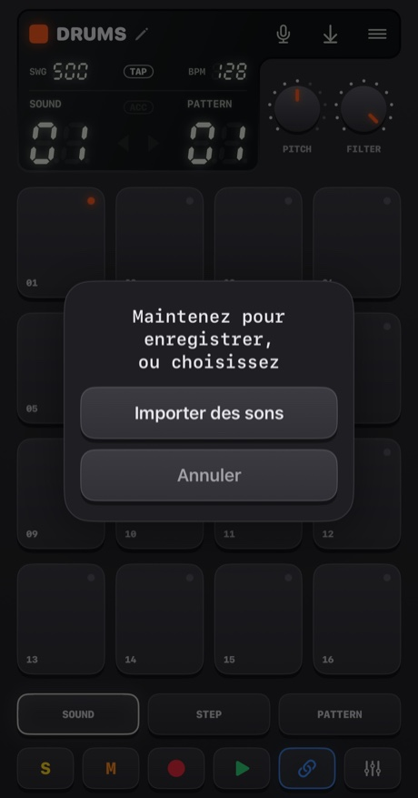

- **Maintiens le micro** (un peu plus d’un quart de seconde) pour enregistrer. Relâche pour terminer. Les pads deviennent rouges, la musique s’arrête (le micro l’entendrait) et l’afficheur compte les secondes.
- **Touche-le** pour choisir : **Importer des sons**, ou **Sons intégrés** (revenir aux originaux ; affiché quand l’appareil a des sons à lui).

La destination du son dépend de l’appareil :
- **Drums** : un son par pad. **Choisis d’abord le pad, puis maintiens le bouton.**
- **Sampler** : un son d’au plus **30 secondes**, coupé en 16 tranches égales.
- **Pluck, Pad, Bass, Vocal** : un son d’au plus **10 secondes**, joué sur chaque pad à une hauteur différente. Ce que tu enregistres est la *fondamentale*, le pad 05.

Handbeat rogne le silence autour de ton son. Un enregistrement silencieux n’est pas conservé.

**Importer des fichiers** accepte WAV, AIFF, M4A, MP3 et consorts. Une batterie en accepte plusieurs, un par pad dans l’ordre de leurs noms, à partir du pad sélectionné. Un long fichier est **découpé à ses pauses** (un quart de seconde de silence lance le son suivant). Tout autre appareil prend le premier fichier. Les sons sont enregistrés dans le projet et le suivent partout.

La première fois, iOS demande si Handbeat peut utiliser le micro. Si tu as refusé, le bouton t’emmène dans les Réglages.

Envie d’en savoir plus ?

**Ce qu’est le sampling**

Un **sample** est un enregistrement utilisé comme instrument. Le sampling est le cœur du hip-hop, de la house et de mille autres choses : tu enregistres un son, puis tu le déclenches, tu l’accélères, tu le ralentis, tu le découpes. Joue un sample **plus vite** et il devient plus aigu et plus court, **plus lentement** et il devient plus grave et plus long, exactement comme en accélérant une bande magnétique. C’est comme ça qu’un enregistrement devient un clavier entier.

## Projets, partage et export

Le bouton **menu** ouvre les **Projets** (il arrête la musique et enregistre).

<table>
<tr>
<td align="center">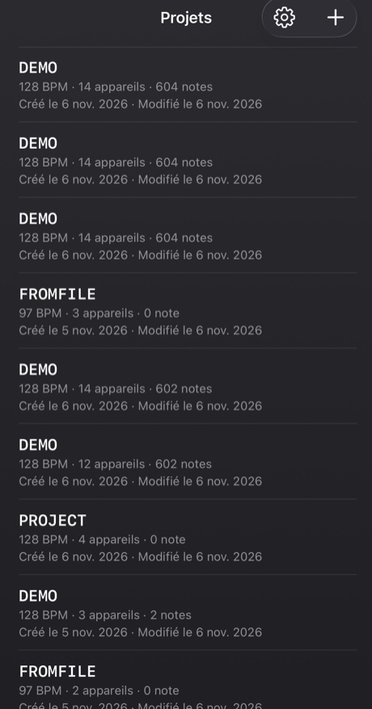</td>
<td align="center">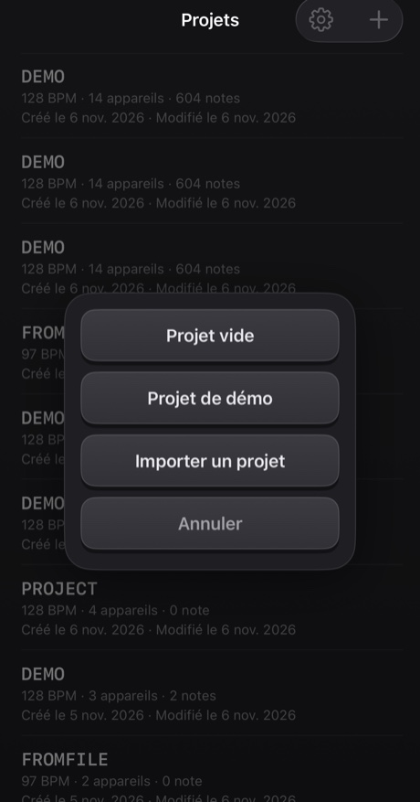</td>
</tr>
</table>

- Touche un projet pour l’ouvrir. **Balaye** une ligne (ou maintiens-la) pour la **partager** ou la **supprimer** ; la suppression demande toujours confirmation.
- Le **+** crée un *Projet vide* ou un *Projet de démo*, ou **importe** un projet depuis un fichier. La démo est un bon endroit pour commencer : quatorze appareils qui jouent un mashup de 40 mesures.
- Tout est **enregistré automatiquement**.

**Partager** écrit un projet, avec ses propres sons, dans un unique fichier `.handbeat` et ouvre la feuille de partage : envoie-le par AirDrop ou par mail, ou garde-le dans Fichiers comme sauvegarde. Ouvrir un tel fichier dans Handbeat l’**ajoute** comme nouveau projet sans jamais toucher aux tiens.

**Exporter l’audio**, c’est le bouton d’enregistrement de l’afficheur. Il génère **tout le projet, tous les appareils mixés**, en **WAV** ou **M4A** (au choix dans les Réglages), plus vite que le temps réel. Avec CHAIN actif, tu obtiens toute la chaîne ; sinon, un passage du pattern en cours. Le bouton est grisé quand il n’y a rien à entendre.

## Réglages

Projets → la roue dentée. **Langue** change les menus instantanément (la groovebox elle-même, avec ses touches, ses boutons et les noms d’appareils, reste en anglais partout, comme les étiquettes d’une machine matérielle). Il y a quatre **thèmes**, chacun en Sombre, Clair ou *Système* : **Classic**, **iClassic** (plastique brillant et une molette), **Contrast** (à plat, noir ou blanc pur) et **Aero** (gel et verre). Chaque thème a aussi sa propre **icône de l’app**.

---

# Appareils

Un **appareil** est un instrument de ton projet. Ajoutes-en un en touchant un pad vide dans le mixeur. Ils sont listés dans le même ordre que dans le sélecteur. Tous sont 16 pistes × 16 pas, donc STEP, REC, les patterns, les chaînes et l’export fonctionnent partout de la même façon. Ce qui change, c’est le son, les pads, les deux boutons et les deux touches à côté de **REC**.

Les **appareils à notes** (Bass, Acid, Vocal, Pluck, Pad, Chip) partagent une même disposition de pads, comme un piano roll : **le pad 05 est la fondamentale** (la note « maison »), les pads du dessus sont plus aigus, ceux du dessous plus graves. Le bouton **SCALE** décide de ce que *sont* les pas (voir [Gammes](#scales)). Les pas que tu dessines sont enregistrés comme des numéros de pad, donc changer de gamme joue la *même mélodie dans une nouvelle gamme*.

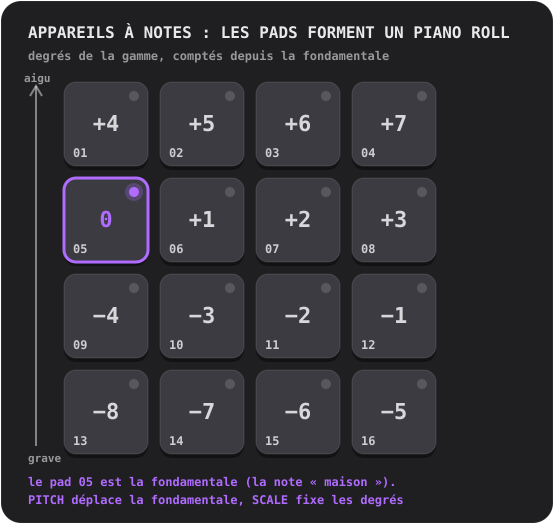

## Drums

Une batterie complète : **16 sons, un par pad**.

- **Boutons :** **PITCH** (de −6 à +6 demi-tons, toute la batterie) et **FILTER** (un passe-bas : 10 est grand ouvert, plus bas assombrit la batterie).
- **Touches :** **S** et **M** (solo et mute) pour le son sélectionné.
- **Sons personnels :** un par pad.

**Essaie ça :** touche les pads sur SOUND pour trouver ce qui est où. Choisis la grosse caisse, appuie sur STEP et active 01, 05, 09 et 13 : une grosse caisse sur chaque temps, le battement de cœur de la house. Ajoute un clap sur 05 et 13, des hi-hats sur les pas intermédiaires.

Un **charleston fermé** coupe un **charleston ouvert**, comme dans la réalité, si bien qu’ils ne résonnent jamais l’un sur l’autre.

Envie d’en savoir plus ?

**Les trois percussions qui comptent**

La **grosse caisse** (kick) est le choc grave qui te fait hocher la tête. La **caisse claire** (snare) ou le **clap** est le claquement, en général sur les temps 2 et 4 (pas 05 et 13), le **backbeat**. Le **charleston** (hi-hat) est le tic-tic-tic qui règle la vitesse du groove : croches (un pas sur deux) ou doubles croches (chaque pas). Une grosse caisse sur chaque temps, c’est le **four on the floor** ; une grosse caisse sur 01 et 11 avec une caisse claire sur 05 et 13, c’est un breakbeat classique.

**À l’intérieur**

Chaque son intégré est fait de A à Z pour Handbeat : généré par un script, rien d’emprunté à personne.

## Sampler

**Un son coupé en 16 tranches égales**, une par pad. Mets les tranches dans l’ordre et le son se rejoue tel qu’il était ; réarrange-les et tu l’as remixé.

- **Boutons :** **PITCH** (accélère ou ralentit chaque tranche) et **FILTER**.
- **Touches :** **MONO / POLY** (MONO : une nouvelle tranche coupe celles qui résonnent encore) et **REVERSE** (chaque tranche à l’envers).
- **Son personnel :** enregistre jusqu’à **30 secondes** ou importe un fichier. La première colonne de l’afficheur est **SLICE**.

Sans son à toi, il joue un **break intégré** : quatre mesures de breakbeat à 128 BPM, donc chaque tranche vaut un temps. Pour l’entendre tel qu’il était, mets les tranches 1 à 4 sur les pas 01, 05, 09, 13 du pattern 1, les tranches 5 à 8 dans le pattern 2, et ainsi de suite sur quatre patterns enchaînés.

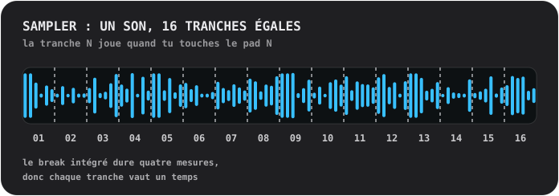

Envie d’en savoir plus ?

**Découper un break**

Un **break**, c’est un passage de batterie seule. Le couper en morceaux et les remettre dans un autre ordre est l’un des plus vieux trucs du beatmaking : c’est ainsi qu’une seule boucle devient cent beats. Essaie de mettre la tranche 3 sur le premier pas, de doubler la tranche 2, d’en passer quelques-unes à l’envers.

**À l’intérieur**

Une tranche est jouée *telle quelle* : jamais étirée pour coller au tempo, c’est pourquoi le break colle à 128. Chaque tranche entre en 4 ms et sort en 10 ms, donc elles ne claquent jamais.

## Bass

Une basse profonde et ronde. **Une seule note à la fois** ; les notes sont *tenues* (voir plus bas).

- **Boutons :** **PITCH** et **SCALE**.
- **Touches :** **FILTER** (arrondit le timbre) et **SUB** (une seconde voix une octave plus bas, jamais filtrée, pour que le grave reste quand le filtre se ferme).

**Notes tenues.** Sur les appareils qui tiennent (Bass, Acid, Pad, Chip), des pas ordinaires consécutifs sur un pad forment **une seule longue note**. Un trou la termine, un **pas accentué la relance**, et une **barre de mesure termine toutes les notes**. Touche un pad et la note dure aussi longtemps que ton doigt.

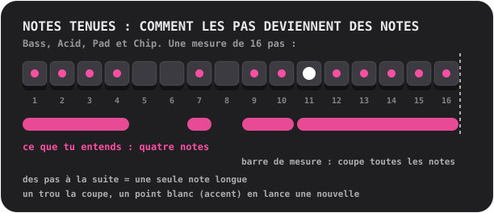

Envie d’en savoir plus ?

**Ce que fait la basse**

La basse joue la **fondamentale** : la note sur laquelle un accord est construit, le plancher harmonique d’un morceau. Elle s’emboîte avec la grosse caisse. Commence simple : une longue note grave sur le premier pas, puis ajoute une deuxième note, un peu de rythme, un saut d’octave.

**Pourquoi une basse peut sonner fort sur le haut-parleur d’un téléphone**

Le haut-parleur d’un téléphone ne sait pas jouer de vraies notes graves ; la fondamentale à 110 Hz de la Bass ne sort presque pas. Mais ton oreille reconstitue une note grave manquante quand elle entend ses harmoniques (« la fondamentale absente »). La Bass est une sinusoïde puissante avec de doux harmoniques graves, précisément pour cette raison : une vraie basse au casque *et* au haut-parleur.

## Acid

<table>
<tr>
<td align="center"> PITCH et SCALE</td>
<td align="center"> appuie sur 2ND : CUTOFF et RESO</td>
</tr>
</table>

La ligne de basse qui glougloute et claque de l’acid house de la fin des années 80 : une onde en dents de scie à travers un **filtre résonant** qui s’ouvre et se ferme à chaque note.

- **Touches :** **2ND** (inverse les boutons) et **ARP**.
- **Boutons, première page :** **PITCH** et **SCALE**. **Deuxième page (2ND) :** **CUTOFF** (à quel point le filtre démarre sombre) et **RESO** (à quel point il résonne ; plus de résonance, plus de « squelch »).
- Les notes sont **tenues**, comme sur la Bass.

Deux choses sont toujours actives : le **slide** (chaque note glisse jusqu’à sa hauteur depuis la note précédente) et l’**accent**. Un pas **accentué** (ACC dans STEP) ouvre le filtre plus grand et joue plus fort. Le secret de ce son : **enchaîne des pas avec quelques accents, et tourne CUTOFF pendant que ça joue.**

**ARP** fait parcourir à une note tenue sa propre hauteur, la tierce, la quinte et l’octave, une double croche à la fois.

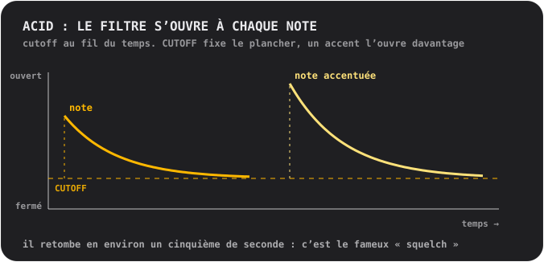

Envie d’en savoir plus ?

**Ce qu’est un filtre**

Un **filtre** laisse passer certaines fréquences et en bloque d’autres. Un filtre **passe-bas** bloque les aigus : fermé, un son est terne et étouffé ; ouvert, il est brillant. Le **cutoff** est l’endroit où il commence à bloquer. La **résonance** renforce les fréquences juste au niveau du cutoff, ce qui donne ce « wow » presque vocal. Balayer le cutoff avec beaucoup de résonance, c’est le son d’une grande partie de la musique électronique.

**D’où vient ce son**

Acid est un hommage à une petite boîte argentée de basses qui, par accident, a défini tout un genre dans les années 1980. Elle avait été conçue pour faire croire à une basse à des guitaristes solitaires, et personne ne l’a achetée pour ça. Ceux qui l’ont achetée ont découvert qu’une onde en dents de scie, un filtre résonant et une note qui glisse ne sonnaient comme rien d’autre.

**À l’intérieur**

Le filtre s’ouvre de deux octaves et demie au début de chaque note et retombe en environ 0,18 seconde (le « squelch ») ; un accent l’ouvre d’une octave et demie de plus ; le slide dure 80 millisecondes.

## Vocal

Une voix enregistrée jouée sur les pads à différentes hauteurs, à travers l’un des **dix styles**. Chante, dis un mot, claque des mains, siffle : ce que tu enregistres devient l’instrument.

- **Boutons :** **STYLE** (l’afficheur montre le nom du style pendant que tu tournes) et **SCALE**. Il n’y a pas de bouton PITCH : la gamme et le pad fondamental décident de la hauteur.
- **Touches :** **MONO / POLY** (MONO est le réglage par défaut, pour que les mots ne se chevauchent pas) et **REVERSE**.
- **Ta voix :** enregistre jusqu’à **10 secondes**. Jusque-là, elle joue une courte **phrase intégrée** : un enregistrement de la propre voix de l’auteur.

Les styles :
- **01 NATURAL** : tel qu’enregistré.
- **02 ROBOT** : métallique, avec une hauteur propre.
- **03 VOCODER** : un robot qui *chante*, dans la tonalité du pad que tu joues.
- **04 CHOIR** : quatre copies de toi qui se balancent lentement.
- **05 RADIO** : étroit et croustillant, comme un petit vieux haut-parleur.
- **06 LO-FI** : écrasé et granuleux, comme un vieux sampler.
- **07 CAVE** : une grande salle qui résonne, avec une longue traîne.
- **08 GLITCH** : découpé en grains et bégayé. **Chaque coup joue une découpe aléatoire différente**.
- **09 ALIEN** : un anneau métallique qui ondule.
- **10 CHORD** : ta voix plus une tierce majeure et une quinte au-dessus : chaque pad joue un accord.

Un style est appliqué en arrière-plan un instant après l’arrêt du bouton, donc en tournant vite à travers plusieurs, seul celui où tu t’arrêtes est calculé.

Envie d’en savoir plus ?

**La hauteur, et pourquoi une voix aiguë paraît petite**

La voix est jouée **plus vite pour monter** et **plus lentement pour descendre**, comme en accélérant une bande magnétique. Une voix sur un pad aigu devient fine et pointue, sur un pad grave elle devient profonde et lente. C’est le son du sampling. Pour les mélodies, enregistre quelque chose de court et laisse SCALE te garder dans la tonalité.

**Les styles de l’intérieur**

**VOCODER** découpe la voix en dix bandes, mesure l’intensité de chacune et s’en sert pour façonner une onde en dents de scie vrombissante : une technique des années 1970 pour les disques à voix de robot. **ROBOT** et **ALIEN** utilisent la **modulation en anneau**, qui multiplie la voix par une tonalité, le vieux truc derrière les voix de robot de la science-fiction. **CHORD** est un accord *majeur* quelle que soit la gamme : dans les gammes mineures, certains pads vont frotter, ce qui peut être un avantage.

## Pluck

Un court son pincé joué à seize hauteurs. L’appareil mélodique le plus simple et le plus direct.

- **Boutons :** **PITCH** (tu choisis la tonalité) et **SCALE** (12 gammes, voir [Gammes](#scales) ; le nom s’affiche pendant que tu tournes).
- **Touches :** **MONO / POLY** (MONO : une nouvelle note coupe les autres) et **REVERSE** (le premier tiers de seconde est joué à l’envers, si bien qu’une note gonfle jusqu’à son attaque).
- **Son personnel :** un seul, joué à chaque hauteur, jusqu’à 10 secondes.

Astuce : passe sur une gamme **pentatonique** (05 ou 06) et tape des pads au hasard. Il est très difficile de jouer une fausse note.

Envie d’en savoir plus ?

**Les gammes**

Une **gamme** est un menu de notes qui sonnent bien ensemble. Un piano a douze notes par octave ; une gamme en choisit une poignée. **Majeur** sonne clair et joyeux, **mineur** triste ou sérieux. Les gammes **pentatoniques** n’ont que cinq notes, donc aucune n’est mauvaise. La **chromatique** te donne *chaque* demi-ton : libre, et facile à faire sonner faux. La **fondamentale** est la note maison de la gamme ; dans Handbeat, c’est le pad 05, et PITCH la déplace vers une autre tonalité.

**À l’intérieur**

Le pluck est un seul sample, joué plus vite ou plus lentement pour changer de hauteur, donc il change de durée avec elle, comme sur les vieux claviers à samples. Les pads ne s’éloignent pas trop de la fondamentale, exprès : un sample joué bien plus vite devient mince, bien plus lentement, caverneux.

## Pad

Les pads, gammes et boutons du Pluck, mais la note est **tenue** : un son doux, qui scintille lentement et dure aussi longtemps que tu veux.

- **Boutons :** **PITCH** et **SCALE**.
- **Touches :** **MONO / CHORD** (CHORD joue une triade sur chaque pad) et **STEADY / RISE** (RISE fait gonfler une note tenue du faible au plein).
- Les notes sont **tenues**, comme sur la Bass. Son personnel : un seul, bouclé sans raccord, jusqu’à 10 secondes.

Remplis plusieurs pas d’affilée sur un pad pour un long accord, laisse un trou pour le finir, ajoute un accent pour en lancer un nouveau. RISE sur une note qui couvre plusieurs pas, c’est une montée rapide.

Envie d’en savoir plus ?

**Ce qu’est un accord**

Un **accord**, ce sont trois notes ou plus jouées ensemble. Le plus simple, une **triade**, est la fondamentale, la note deux degrés plus haut dans la gamme et la note quatre degrés plus haut. Active CHORD et chaque pad devient une triade de la gamme choisie : pas besoin de théorie pour avoir des accords qui s’accordent.

**À l’intérieur**

Le son du pad dure une seconde et boucle sans raccord. Deux partiels discrets, à un hertz au-dessus et au-dessous de chacun des autres, produisent le scintillement lent.

## Chip

Le son de l’ère 8 bits : les ondes des vieilles consoles de jeu et des ordinateurs familiaux.

- **Boutons :** **PITCH** et **SCALE**.
- **Touches :** **TRI / PULSE** (l’onde) et **VIB** (un doux vibrato).
- Les notes sont **tenues**, comme sur la Bass. Pas de sons à toi : les ondes *sont* l’instrument.

L’**onde triangle** est douce, creuse, proche d’une flûte, dessinée en gros paliers. L’**onde pulsée** est un bourdonnement étroit et nasal, le son de lead classique. Le pad fondamental du Chip est **un ton entier plus haut** que celui des autres appareils, exprès.

**Les accords sur le Chip bourdonnent et vibrent, et c’est authentique.** Maintiens deux pads et ils trillent ; maintiens-en trois et ils frémissent. Ouvre la boîte pour savoir pourquoi.

Envie d’en savoir plus ?

**La polyphonie par tours rapides**

Les puces sonores des vieilles consoles de jeu et des ordinateurs familiaux jouaient **une seule note à la fois par canal**. Pour tirer des accords d’un canal, les programmeurs le faisaient passer d’une note de l’accord à l’autre *très vite*, si bien que ton oreille les entend ensemble, avec une couleur bourdonnante et arpégée. C’est le son des années 80.

Le Chip fait exactement ça : tous les pads que tu maintiens sur un pas partagent **une seule voix** qui donne à chaque note un **tour de 1/60 de seconde**. Une **note seule** joue de façon stable, sans aucun tour.

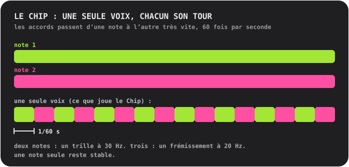

**Les ondes**

Le **triangle** est construit comme le vrai : 4 bits (16 niveaux), 32 paliers par cycle, qui monte par escaliers. L’**onde pulsée** est active un quart du cycle (un « rapport cyclique de 25 % »).

## Gammes

Pour Pluck, Pad, Bass, Acid, Vocal et Chip. Tourne **SCALE** et l’afficheur montre le numéro et le nom.

- **01 Chromatic** : chaque demi-ton. La valeur par défaut.
- **02 Major** : claire, joyeuse.
- **03 Natural minor** : triste, sérieuse, la plus grande partie de la pop et de la musique électronique.
- **04 Harmonic minor** : dramatique, un peu orientale.
- **05 Minor pentatonic** : cinq notes. Rock, blues, le choix sûr.
- **06 Major pentatonic** : cinq notes claires. Folk, cloches.
- **07 Blues** : pentatonique mineure plus la « blue note ».
- **08 Dorian** : mineure avec un coup de pouce. Funky, jazzy.
- **09 Phrygian** : sombre, espagnole.
- **10 Lydian** : rêveuse et flottante.
- **11 Mixolydian** : majeure avec un côté bluesy.
- **12 Whole tone** : flottante, non résolue, sans aucune note maison.

---

# Contact

Tu as trouvé un bug ? Une idée, une question, ou quelque chose à dire sur le son ? J’aimerais le savoir. Handbeat est fait par une seule personne, donc une réponse peut prendre un peu de temps, mais ton message sera lu.

📩 **[handbeat.contact@gmail.com](mailto:handbeat.contact@gmail.com)**

**Tu signales un bug ?** Ça aide beaucoup si tu précises :

1. **Ce qui s’est passé**, et ce que tu attendais à la place.
2. **Comment le reproduire** : les étapes que tu as suivies.
3. **La version de ton app** (Réglages → *Version*), le modèle de ton iPhone ou iPad et ta version d’iOS.
4. **Ton projet**, si cela concerne un son ou un pattern précis : Projets → balaye la ligne → *Partager*, et joins le fichier `.handbeat`. Cela me permet d’ouvrir exactement ce que tu avais.

Les idées de fonctionnalités et les mails du genre « j’aimerais que ça puisse... » sont tout aussi bienvenus.

---

# Soutien

Handbeat est fait par une seule personne. Si ça te rend heureux et que tu veux dire merci, tu peux :

**Ou embauche-moi.** J’ai construit cette app, et si tu as besoin de quelque chose de comparable, on peut en parler : [www.linkedin.com/in/fofonovav](https://www.linkedin.com/in/fofonovav)

---

*Ce texte a été traduit par une IA et peut contenir des erreurs.*
