# Guida di Handbeat

[Guida](#guide) · [Dispositivi](#devices) · [Contatti](#contact) · [Supporto](#support)

Handbeat è una groovebox per il tuo iPhone e il tuo iPad: sedici pad, un bel po’ di dispositivi, un solo tempo, un solo trasporto. Tocchi, disegni un beat, concateni le battute fino a farne un brano. Tutto qui. Niente account, nessun modo sbagliato di suonare.

Questa pagina è la versione lunga. Non devi leggerla dall’inizio alla fine: smanetta prima con l’app e torna quando qualcosa ti lascia perplesso.

---

# Guida

## Lo schermo

La parte alta dello schermo è il **display**. Tutto quello che c’è sopra si tocca.

| | |
|---|---|
|  | **Microfono.** Registra i tuoi suoni, vedi [I tuoi suoni](#your-own-sounds). |
|  | **Esporta.** Salva l’intero progetto come file audio. |
|  | **Menu.** I tuoi progetti e le impostazioni. |
|  | **TAP.** Toccalo a tempo con un brano e Handbeat trova il tempo. Pulsa anche a ogni beat. |
|  | **ACC.** Accento, vedi [Disegnare un beat](#drawing-a-beat-step). |
|  | **Frecce.** Scorrono i suoni (o le note) di un dispositivo. |

- **La fascia del nome** mostra il nome del dispositivo (nel mixer, quello del progetto). Tocca la matita per rinominarlo, fino a 8 caratteri.
- **BPM** è il tempo: trascinalo su e giù (da 64 a 256). **SWG** è lo swing, più sotto.
- **Le due colonne di cifre** mostrano due numeri; cosa dicono dipende dalla pagina, per esempio *SOUND* e *PATTERN* su una batteria.
- **Due manopole.** Trascinale su e giù. **Tocca due volte una manopola** per riportarla al valore predefinito. Mentre ne giri una, il display mostra il suo valore esatto e il suo nome.

Ogni pad, tasto e manopola risponde con un minuscolo colpetto del telefono (puoi spegnerlo nelle Impostazioni, sotto *Vibrazione*). Più un controllo cambia la musica, più forte è il colpetto.

Ogni pagina ha una **texture** tenue sui suoi pad e sul tasto che la apre, così capisci a colpo d’occhio dove sei: linee per LIVE FX, punti per SOUND, colonne per STEP e quadrati per PATTERN. La pagina DEVICE non ne ha, i suoi pad portano invece un piccolo segno di ogni dispositivo. Disattiva tutto questo nelle Impostazioni, in *Suggerimenti visivi*.

Vuoi saperne di più?

**Tempo e swing**

**BPM** significa *beats per minute*, battiti al minuto. 60 è un battito al secondo, una passeggiata tranquilla. La house sta intorno a 120–130, la drum and bass vicino a 170. Handbeat parte da 128 perché va bene per quasi tutto.

Lo **swing** fa «zoppicare» il beat di proposito. Di solito i 16 step di una battuta sono equidistanti. Con lo swing, uno step su due arriva un po’ in ritardo, e il groove rimbalza invece di marciare. SWG va da **500** (dritto) a **750** (l’estremo); intorno a **667** ottieni il classico shuffle in terzine. Provalo sugli hi-hat.

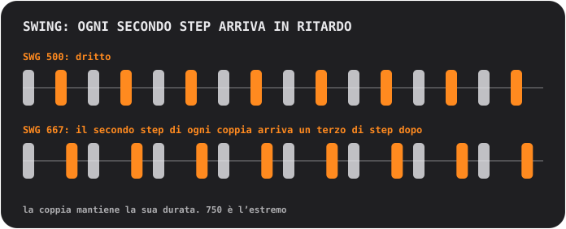

## Pad e pagine

I pad sono sempre una griglia 4×4, numerata da 01 a 16. La fila di tasti in alto cambia **pagina**, che decide cosa fanno i pad:

<table>
<tr>
<td align="center"> <b>SOUND</b> suonare: ogni pad suona il suo suono</td>
<td align="center"> <b>STEP</b> disegnare: ogni pad è uno dei 16 step</td>
<td align="center"> <b>PATTERN</b> scegliere: ogni pad è un pattern</td>
</tr>
</table>

### Disegnare un beat (STEP)

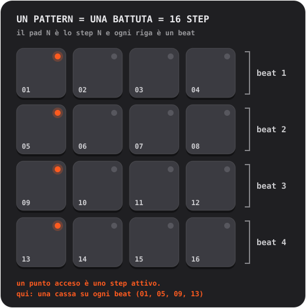

1. Su **SOUND**, tocca il pad che vuoi programmare. Diventa il suono selezionato.
2. Premi **STEP** e tocca i pad per accendere e spegnere gli step. Un punto acceso significa che lo step è attivo.
3. Premi **PLAY**. Un morbido lampo corre sui pad: è la testina di riproduzione. Puoi continuare a modificare mentre suona.

**Accenti.** Premi **ACC**, poi tocca uno step: diventa un accento, un colpo più forte e marcato. ACC si spegne da solo dopo un tocco. Tocca di nuovo uno step con accento per cancellarlo.

Vuoi saperne di più?

**Cos’è un sequencer a step**

Il tempo viene tagliato in fette uguali chiamate **step**. Per ogni suono decidi su quali step suona. Quattro step fanno un **beat** (un battito del piede), quattro beat fanno una **battuta**. Ogni pattern di Handbeat è esattamente una battuta, e una battuta va in loop. Gran parte del pop, della house e dell’hip-hop è costruita con battute così, impilate e variate.

### Registrare dal vivo (REC)

Premi **REC** e suona i pad nella pagina SOUND. Handbeat avvia il trasporto se era fermo e mette i tuoi colpi sullo step di sedicesimo *più vicino*, così anche un dito un po’ sbadato cade a tempo. Fa **overdub**: quello che c’è già resta. Premi **STOP** (il tasto PLAY) per finire. Non c’è annulla: spegni in STEP gli step che non vuoi.

Sui dispositivi che tengono le note (Bass, Acid, Pad, Chip) viene registrata anche la durata del tuo tocco.

### Leggere le luci

- Il **punto** di un pad dice cosa *è* il pad: spento è vuoto, tenue vuol dire «qui c’è qualcosa», acceso vuol dire attivo (il suono selezionato, uno step acceso, il pattern corrente), brillante risalta (un accento, la battuta più recente di una chain). Un punto che **lampeggia** significa «aspetta la fine della battuta».
- L’**anello** di un pad dice cosa suona *proprio adesso*.
- Un pad **attenuato** è muto (in mute, o un altro è in solo). Suona comunque se lo tocchi.
- Un **anello attorno a un tasto** significa che una modalità è attiva.

## Tasti

| | |
|---|---|
|   | **S e M** sono i due *tasti di contesto*; cambiano con il dispositivo e la pagina. Su una batteria sono **solo** e **mute** del suono selezionato. Altri dispositivi ci mettono i propri tasti, vedi [Dispositivi](#devices). |
|   | Nella pagina PATTERN diventano **COPY** e **ERASE**. |
|  | **REC** registra dal vivo. |
|  | **PLAY** fa partire tutto sullo stesso orologio. Mentre suona è un quadrato di stop: ferma *e riavvolge*. Anche una chiamata, una sveglia o le cuffie scollegate fermano la musica; premi di nuovo PLAY. |
|  | **CHAIN** collega i pattern in un brano. Cerchiato di blu finché è attivo. |
|  | **RACK** passa dal dispositivo in cui ti trovi al mixer. |

Mute e solo influenzano solo ciò che suona il *sequencer*. Un pad che tocchi tu fa sempre suono.

## Pattern e chain

Un **pattern** è una battuta, 16 step. Hai **16 pattern**, e *ogni pattern contiene gli step di tutti i dispositivi*: batteria, basso e melodia del pattern 03 stanno tutti nel 03.

Nella pagina **PATTERN**, tocca un pad per scegliere un pattern. Mentre la musica suona, il cambio aspetta la fine della battuta, e il pad **lampeggia** finché non avviene.

- **COPY**, poi un pad: copia il pattern in riproduzione su quel pad.
- **ERASE**, poi un pad: cancella quel pattern.
- Premi di nuovo il tasto, o lascia la pagina, per annullare.

### Chain: un pattern è una battuta, una chain è un brano

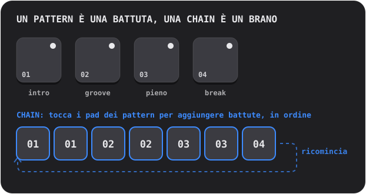

Attiva **CHAIN** e tocca i pad dei pattern: ogni tocco **aggiunge una battuta** in fondo alla chain (fino a 99 battute, ripetizioni ammesse). La riproduzione segue la chain battuta dopo battuta e riparte da capo. Spegni CHAIN per terminarla; l’ultimo pattern toccato suona da solo.

Vuoi saperne di più?

**Come si costruiscono i brani con i loop**

Quasi tutta la musica da ballo è **ripetizione con variazioni**. Prendi un loop che funziona, poi aggiungi e togli strati perché chi ascolta senta il brano crescere e respirare: un’**intro** scarna, un **groove** costante, una parte **piena** con tutto acceso, un **break** dove le cose spariscono, e un **fill** di batteria nell’ultimo beat che dice alle orecchie «sta per arrivare qualcosa di nuovo». In Handbeat ognuno di questi è un pattern, e CHAIN li mette in ordine.

## Il mixer (RACK)

L’ultimo tasto passa dal tuo dispositivo al **mixer**, la stessa tavola 4×4 con un cappello diverso. Un progetto **si apre sempre sul mixer**.

<table>
<tr>
<td align="center"> <b>DEVICE</b> i tuoi dispositivi</td>
<td align="center"> <b>Pad vuoto</b> scegli un nuovo dispositivo</td>
<td align="center"> <b>PATTERN</b> copia e cancella pattern interi</td>
</tr>
</table>

Nella pagina **DEVICE** ogni pad è uno slot: fino a **16 dispositivi** in un progetto.

- **Tocca un pad con un più** per aggiungere un dispositivo (i pad diventano i tipi che puoi scegliere, ognuno con il suo segno).
- **Segni.** Ogni pad porta un piccolo segno del suo dispositivo: una pelle di tamburo (Drums), una forma d’onda (Sampler), un’onda lenta (Bass), un dente di sega (Acid), un microfono (Vocal), una corda che si spegne (Pluck), un inviluppo che cresce (Pad) o un’onda quadra (Chip).
- **Tocca un pad occupato** per selezionarlo. Il suo anello si accende mentre suona. **RACK** salta alla sua schermata.
- **SOLO / MUTE** agiscono sul dispositivo selezionato.  **TRASH** ne elimina uno: premilo, tocca il pad del dispositivo, conferma.
- **DEV VOL** è il livello del dispositivo selezionato, **MAIN VOL** il volume dell’intero mix. 5 è il centro neutro.
- Nella pagina **PATTERN** del mixer, COPY e ERASE agiscono sull’intero pattern *con tutti i dispositivi dentro*.

## Effetti dal vivo

La pagina **LIVE FX** ha sedici effetti sui pad, quattro file da quattro. **Tieni premuto un pad per suonare l’effetto, rilascia per fermarlo.** Gli effetti entrano in un decimo di secondo e escono in un quarto, quindi nulla scatta. Tienine premuti quanti vuoi. Sono fatti per **esibirsi**: nulla in questa pagina viene salvato, e gli effetti **non sono inclusi nell’esportazione**.

**Timbro**
- **LP**: attutisce il suono (passa-basso).
- **HP**: lo assottiglia (passa-alto).
- **SWEEP**: un filtro che sale dai bassi agli acuti e arriva esattamente quando finisce la battuta.
- **ROBOT**: l’intero mix risuona su una sola altezza.

**Spazio** (continuano a risuonare dopo che rilasci)
- **ECHO**: ripete a ottavi puntati.
- **DUB**: ripete a ogni beat, più scuro e più sporco.
- **VOID**: una stanza.
- **FLANGE**: un soffio vorticoso da jet.

**Loop e tenuta**
- **STUT 1/8**, **STUT 1/16**, **STUT 1/32**: balbettii. Lo step che sta suonando si ripete.
- **FREEZE**: congela il suono in una texture morbida e costante.

**Transizioni da DJ**
- **SCRATCH**: una puntina trascinata avanti e indietro sull’ultimo mezzo beat.
- **REVERSE**: la musica, un beat indietro, al contrario.
- **HALF SPEED**: rallenta tutto di un’ottava.
- **RISER**: una salita di rumore che raggiunge il culmine esattamente a fine battuta e si interrompe quando rilasci: il «drop».

Vuoi saperne di più?

**Usare gli effetti in un brano**

Gli effetti sono il condimento, non il piatto. Le mosse classiche: tieni premuto **RISER** per l’ultima battuta di una sezione e rilascia sul primo beat della successiva; tieni premuto **LP** mentre una sezione finisce e rilascia perché la nuova esploda; tocca uno **STUT** per un beat per trasformare ciò che suona in un rullo balbettante; aggiungi un breve **ECHO** sull’ultimo colpo di una frase perché risuoni nella battuta successiva.

**Dentro la macchina**

Gli effetti lavorano sull’intero mix, dopo che tutti i dispositivi sono sommati e prima del volume principale e del limiter. Uno STUT prende lo step su cui si trova il sequencer quando tocchi il pad, così senti ripetersi la *nota* e non il silenzio che la precede.

## I tuoi suoni

Puoi suonare **i tuoi** suoni: registrali con il microfono o carica file audio. Ogni dispositivo può averli, tranne Chip e Acid, che si basano sulle proprie onde.

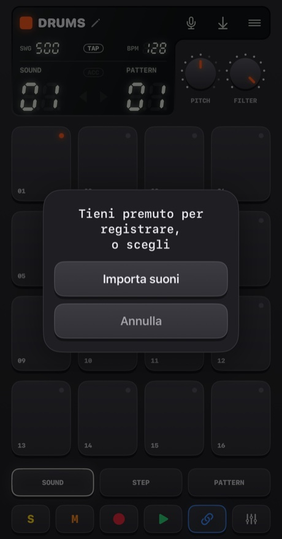

- **Tieni premuto il microfono** (poco più di un quarto di secondo) per registrare. Rilascia per finire. I pad diventano rossi, la musica si ferma (il microfono la sentirebbe) e il display conta i secondi.
- **Toccalo** per scegliere: **Importa suoni**, oppure **Suoni integrati** (tornare agli originali; compare quando il dispositivo ha suoni propri).

Dove va il suono dipende dal dispositivo:
- **Drums**: un suono per pad. **Scegli prima il pad, poi tieni premuto il pulsante.**
- **Sampler**: un suono fino a **30 secondi**, tagliato in 16 slice uguali.
- **Pluck, Pad, Bass, Vocal**: un suono fino a **10 secondi**, suonato su ogni pad a un’altezza diversa. Quello che registri è la *tonica*, il pad 05.

Handbeat taglia il silenzio attorno al tuo suono. Una registrazione silenziosa non viene conservata.

**Importare file** accetta WAV, AIFF, M4A, MP3 e simili. Una batteria ne accetta diversi, uno per pad nell’ordine dei loro nomi, a partire dal pad selezionato. Un file lungo viene **tagliato alle sue pause** (un quarto di secondo di silenzio inizia il suono successivo). Qualsiasi altro dispositivo prende il primo file. I suoni vengono salvati nel progetto e viaggiano con lui.

La prima volta, iOS chiede se Handbeat può usare il microfono. Se hai detto no, il pulsante ti porta nelle Impostazioni.

Vuoi saperne di più?

**Cos’è il sampling**

Un **sample** è una registrazione usata come strumento. Il sampling è il cuore dell’hip-hop, della house e di mille altre cose: registri un suono, poi lo fai partire, lo acceleri, lo rallenti, lo tagli a pezzi. Suona un sample **più veloce** e diventa più acuto e più corto, **più lento** e diventa più grave e più lungo, esattamente come accelerare un nastro. Così una registrazione diventa un’intera tastiera.

## Progetti, condivisione ed esportazione

Il pulsante **menu** apre i **Progetti** (ferma la musica e salva).

<table>
<tr>
<td align="center">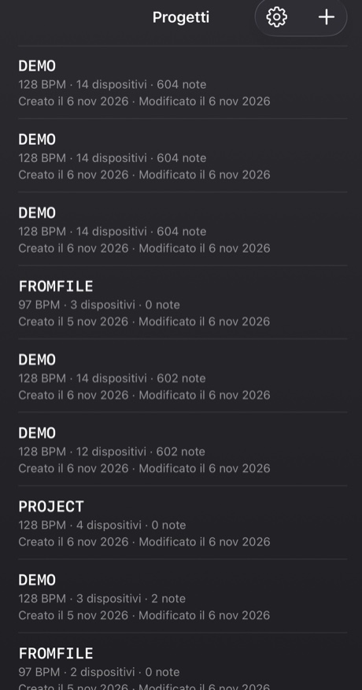</td>
<td align="center">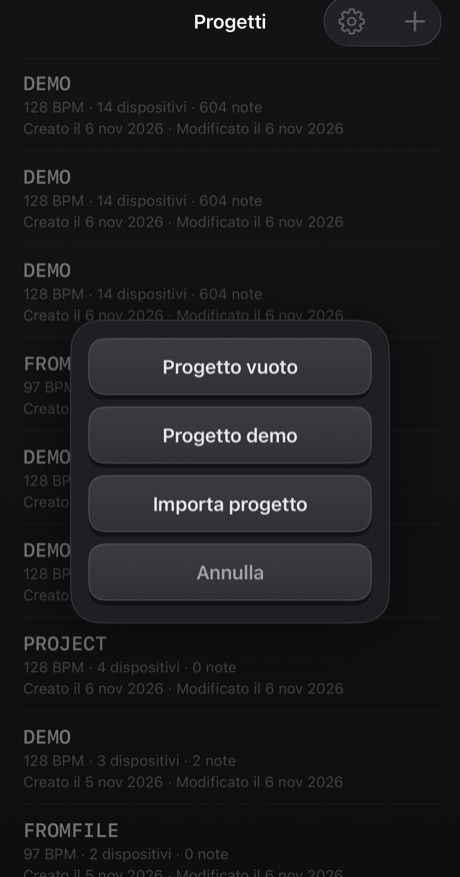</td>
</tr>
</table>

- Tocca un progetto per aprirlo. **Scorri** una riga (o tienila premuta) per **condividerla** o **eliminarla**; eliminare chiede sempre conferma.
- Il **+** crea un *Progetto vuoto* o un *Progetto demo*, oppure **importa** un progetto da un file. La demo è un buon punto di partenza: quattordici dispositivi che suonano un mashup di 40 battute.
- Tutto viene **salvato automaticamente**.

**Condividere** scrive un progetto, con i suoi suoni, in un unico file `.handbeat` e apre il foglio di condivisione: mandalo con AirDrop o per posta, oppure tienilo in File come backup. Aprire uno di questi file in Handbeat lo **aggiunge** come nuovo progetto e non tocca mai i tuoi.

**Esportare l’audio** è il pulsante di salvataggio sul display. Genera **l’intero progetto, tutti i dispositivi mixati**, in **WAV** o **M4A** (lo scegli nelle Impostazioni), più veloce del tempo reale. Con CHAIN attiva ottieni l’intera chain, altrimenti un passaggio del pattern corrente. Il pulsante è grigio quando non c’è niente da ascoltare.

## Impostazioni

Progetti → l’ingranaggio. **Lingua** cambia i menu subito (la groovebox stessa, con i suoi tasti, le manopole e i nomi dei dispositivi, resta in inglese in tutte le lingue, come le etichette di un apparecchio hardware). Ci sono quattro **temi**, ognuno in Scuro, Chiaro o *Sistema*: **Classic**, **iClassic** (plastica lucida e una ruota click), **Contrast** (piatto, nero o bianco puro) e **Aero** (gel e vetro). Ogni tema ha anche la sua **icona dell’app**. **Vibrazione** e **Suggerimenti visivi** attivano o disattivano i tocchi e le texture e i segni delle pagine. **Introduzione** rifà il tour guidato su un nuovo progetto demo. La prima volta che apri Handbeat il tour parte da solo su una demo, e la croce nell’angolo lo chiude.

---

# Dispositivi

Un **dispositivo** è uno strumento del tuo progetto. Aggiungine uno toccando un pad vuoto nel mixer. Sono elencati nello stesso ordine del selettore. Tutti sono 16 tracce × 16 step, quindi STEP, REC, pattern, chain ed esportazione funzionano allo stesso modo ovunque. Cambiano il suono, i pad, le due manopole e i due tasti accanto a **REC**.

I **dispositivi a note** (Bass, Acid, Vocal, Pluck, Pad, Chip) condividono la stessa disposizione dei pad, come un piano roll: **il pad 05 è la tonica** (la nota «di casa»), i pad sopra sono più acuti, quelli sotto più gravi. La manopola **SCALE** decide cosa *sono* gli step (vedi [Scale](#scales)). Gli step che disegni sono salvati come numeri di pad, quindi cambiare scala suona la *stessa melodia in una scala nuova*.

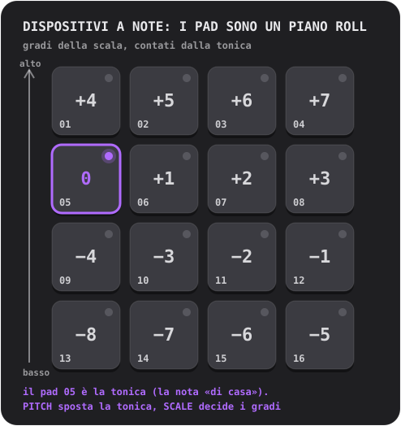

## Drums

Una batteria completa: **16 suoni, uno per pad**.

- **Manopole:** **PITCH** (da −6 a +6 semitoni, l’intero kit) e **FILTER** (un passa-basso: 10 è tutto aperto, più in basso rende il kit più cupo).
- **Tasti:** **S** e **M** (solo e mute) per il suono selezionato.
- **Suoni propri:** uno per pad.

**Prova così:** tocca i pad su SOUND per scoprire cosa c’è dove. Scegli la cassa, premi STEP e accendi 01, 05, 09 e 13: una cassa su ogni beat, il battito cardiaco della house. Aggiungi un clap su 05 e 13 e gli hi-hat sugli step in mezzo.

Un **hi-hat chiuso** taglia un **hi-hat aperto**, come nella realtà, quindi non risuonano mai uno sull’altro.

Vuoi saperne di più?

**I tre tamburi che contano**

La **cassa** (kick) è il colpo grave che ti fa muovere la testa. Il **rullante** (snare) o il **clap** è lo schiocco, di solito sui beat 2 e 4 (step 05 e 13), il **backbeat**. L’**hi-hat** è il tic-tic-tic che dà la velocità al groove: ottavi (uno step sì e uno no) o sedicesimi (ogni step). La cassa su ogni beat è il **four on the floor**; cassa su 01 e 11 con rullante su 05 e 13 è un breakbeat classico.

**Dentro la macchina**

Ogni suono incluso è fatto da zero per Handbeat: generato da uno script, niente preso in prestito da nessuno.

## Sampler

**Un suono tagliato in 16 slice uguali**, una per pad. Metti le slice in ordine e il suono si riascolta com’era; riordinale e l’hai remixato.

- **Manopole:** **PITCH** (accelera o rallenta ogni slice) e **FILTER**.
- **Tasti:** **MONO / POLY** (MONO: una nuova slice taglia quelle che ancora suonano) e **REVERSE** (ogni slice al contrario).
- **Suono proprio:** registra fino a **30 secondi** o importa un file. La prima colonna del display è **SLICE**.

Senza un tuo suono, suona un **break integrato**: quattro battute di breakbeat a 128 BPM, quindi ogni slice è un beat. Per ascoltarlo com’era, metti le slice da 1 a 4 sugli step 01, 05, 09, 13 del pattern 1, le slice da 5 a 8 nel pattern 2, e così via per quattro pattern concatenati.

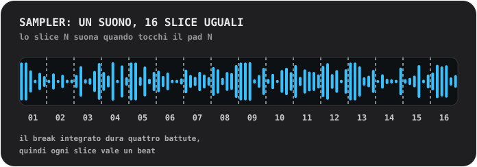

Vuoi saperne di più?

**Tagliare un break**

Un **break** è un tratto di batteria da sola. Tagliarlo a pezzi e riordinarli è uno dei trucchi più vecchi del beatmaking: è così che un solo loop diventa cento beat. Prova a spostare la slice 3 sul primo step, a raddoppiare la slice 2, a metterne qualcuna al contrario.

**Dentro la macchina**

Una slice suona *così com’è*: mai stirata per adattarsi al tempo, per questo il break si incastra a 128. Ogni slice entra in 4 ms ed esce in 10 ms, quindi le slice non scattano mai.

## Bass

Un basso profondo e rotondo. **Una nota alla volta**; le note sono *tenute* (vedi sotto).

- **Manopole:** **PITCH** e **SCALE**.
- **Tasti:** **FILTER** (arrotonda il timbro) e **SUB** (una seconda voce un’ottava sotto, mai filtrata, così il grave resta quando il filtro si chiude).

**Note tenute.** Sui dispositivi che tengono (Bass, Acid, Pad, Chip), step normali consecutivi su un pad sono **un’unica nota lunga**. Un vuoto la chiude, uno **step con accento la riavvia** e una **stanghetta di battuta chiude ogni nota**. Tocca un pad e la nota dura quanto il tuo dito.

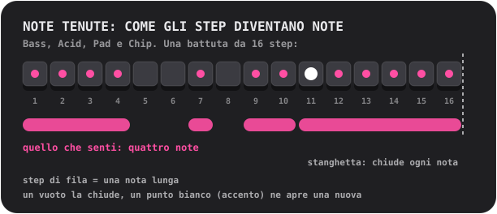

Vuoi saperne di più?

**Cosa fa il basso**

Il basso suona la **tonica**: la nota su cui si costruisce un accordo, il pavimento armonico di un brano. Si incastra con la cassa. Comincia semplice: una nota lunga e grave sul primo step, poi aggiungi una seconda nota, un po’ di ritmo, un salto d’ottava.

**Perché un basso può suonare forte sull’altoparlante del telefono**

L’altoparlante di un telefono non riesce a riprodurre note davvero gravi; la tonica a 110 Hz del Bass esce appena. Ma il tuo orecchio completa una nota grave mancante quando sente le sue armoniche («la fondamentale mancante»). Il Bass è una sinusoide robusta con morbide armoniche gravi proprio per questo: un vero basso in cuffia *e* sull’altoparlante.

## Acid

<table>
<tr>
<td align="center"> PITCH e SCALE</td>
<td align="center"> premi 2ND: CUTOFF e RESO</td>
</tr>
</table>

La linea di basso gorgogliante e stridula dell’acid house di fine anni 80: un’onda a dente di sega attraverso un **filtro risonante** che si apre e si chiude a ogni nota.

- **Tasti:** **2ND** (inverte le manopole) e **ARP**.
- **Manopole, prima pagina:** **PITCH** e **SCALE**. **Seconda pagina (2ND):** **CUTOFF** (quanto è scuro il filtro all’inizio) e **RESO** (quanto risuona; più risonanza, più «squelch»).
- Le note sono **tenute**, come sul Bass.

Due cose sono sempre attive: lo **slide** (ogni nota scivola alla sua altezza dalla nota precedente) e l’**accento**. Uno step **con accento** (ACC in STEP) apre di più il filtro e suona più forte. Il trucco di questo suono: **concatena step con qualche accento e gira CUTOFF mentre suona.**

**ARP** fa percorrere a una nota tenuta la propria altezza, la terza, la quinta e l’ottava, un sedicesimo alla volta.

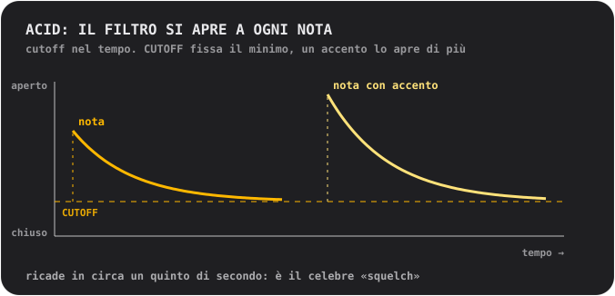

Vuoi saperne di più?

**Cos’è un filtro**

Un **filtro** lascia passare certe frequenze e ne blocca altre. Un filtro **passa-basso** blocca gli acuti: chiuso, il suono è cupo e ovattato; aperto, è brillante. Il **cutoff** è il punto in cui comincia a bloccare. La **risonanza** esalta le frequenze proprio al cutoff, dando quel «wow» quasi vocale. Spazzare il cutoff con molta risonanza è il suono di tanta musica elettronica.

**Da dove viene questo suono**

Acid è un omaggio a una scatolina argentata di bassi che, per caso, definì un intero genere negli anni ’80. Era nata per far finta di avere un basso a chitarristi solitari, e nessuno la comprò per quello. Chi la comprò lo stesso scoprì che un’onda a dente di sega, un filtro risonante e una nota che scivola non suonavano come nient’altro.

**Dentro la macchina**

Il filtro si apre di due ottave e mezza all’inizio di ogni nota e ricade in circa 0,18 secondi (lo «squelch»); un accento lo apre di un’altra ottava e mezza; lo slide dura 80 millisecondi.

## Vocal

Una voce registrata suonata sui pad a diverse altezze, attraverso uno dei **dieci stili**. Canta, di’ una parola, batti le mani, fischia: quello che registri diventa lo strumento.

- **Manopole:** **STYLE** (il display mostra il nome dello stile mentre giri) e **SCALE**. Non c’è la manopola PITCH: la scala e il pad della tonica decidono l’altezza.
- **Tasti:** **MONO / POLY** (MONO è l’impostazione predefinita, così le parole non si sovrappongono) e **REVERSE**.
- **La tua voce:** registra fino a **10 secondi**. Finché non lo fai, suona una breve **frase integrata**: una registrazione della voce dell’autore.

Gli stili:
- **01 NATURAL**: com’è stata registrata.
- **02 ROBOT**: metallico, con una sua altezza.
- **03 VOCODER**: un robot che *canta*, nella tonalità del pad che suoni.
- **04 CHOIR**: quattro copie di te che ondeggiano lentamente.
- **05 RADIO**: stretto e croccante, come un piccolo vecchio altoparlante.
- **06 LO-FI**: schiacciato e granuloso, come un vecchio sampler.
- **07 CAVE**: una grande sala con eco e una lunga coda.
- **08 GLITCH**: tagliato in grani e balbettato. **Ogni colpo suona un taglio casuale diverso**.
- **09 ALIEN**: un anello metallico ondeggiante.
- **10 CHORD**: la tua voce più una terza maggiore e una quinta sopra: ogni pad suona un accordo.

Uno stile viene applicato in background un attimo dopo che la manopola si ferma, quindi se la giri velocemente attraverso diversi stili viene calcolato solo quello su cui ti fermi.

Vuoi saperne di più?

**L’altezza, e perché una voce acuta suona piccola**

La voce viene riprodotta **più veloce per salire** e **più lenta per scendere**, come accelerando un nastro. Una voce su un pad acuto diventa sottile e squillante, su un pad grave profonda e lenta. È il suono del sampling. Per le melodie, registra qualcosa di breve e lascia che SCALE ti tenga in tonalità.

**Gli stili all’interno**

**VOCODER** divide la voce in dieci bande, misura quanto è forte ciascuna e usa i valori per modellare un’onda a dente di sega ronzante: una tecnica degli anni ’70 per i dischi con voci da robot. **ROBOT** e **ALIEN** usano la **modulazione ad anello**, che moltiplica la voce per un tono, il vecchio trucco dietro le voci da robot della fantascienza. **CHORD** è un accordo *maggiore* qualunque sia la scala: nelle scale minori alcuni pad stoneranno, il che può essere un pregio.

## Pluck

Un breve suono pizzicato suonato a sedici altezze. Il dispositivo melodico più semplice e diretto.

- **Manopole:** **PITCH** (scegli la tonalità) e **SCALE** (12 scale, vedi [Scale](#scales); il nome compare sul display mentre giri).
- **Tasti:** **MONO / POLY** (MONO: una nuova nota taglia le altre) e **REVERSE** (il primo terzo di secondo suona al contrario, così la nota gonfia fino al suo attacco).
- **Suono proprio:** uno, suonato a ogni altezza, fino a 10 secondi.

Un consiglio: passa a una scala **pentatonica** (05 o 06) e tocca i pad a caso. È molto difficile suonare una nota sbagliata.

Vuoi saperne di più?

**Le scale**

Una **scala** è un menu di note che suonano bene insieme. Un pianoforte ha dodici note per ottava; una scala ne sceglie una manciata. **Maggiore** suona luminosa e allegra, **minore** triste o seria. Le scale **pentatoniche** hanno solo cinque note, quindi non ce n’è nessuna sbagliata. La **cromatica** ti dà *ogni* semitono: libera, ed è facile suonare male. La **tonica** è la nota di casa della scala; in Handbeat è il pad 05, e PITCH la sposta in un’altra tonalità.

**Dentro la macchina**

Il pluck è un solo sample, suonato più veloce o più lento per cambiare altezza, quindi cambia anche di durata, come sulle vecchie tastiere a campioni. I pad non si allontanano troppo dalla tonica di proposito: un sample suonato molto più veloce diventa sottile, molto più lento rimbomba.

## Pad

I pad, le scale e le manopole del Pluck, ma la nota è **tenuta**: un suono morbido, che brilla lentamente e dura quanto vuoi.

- **Manopole:** **PITCH** e **SCALE**.
- **Tasti:** **MONO / CHORD** (CHORD suona una triade su ogni pad) e **STEADY / RISE** (RISE fa gonfiare una nota tenuta da piano a pieno).
- Le note sono **tenute**, come sul Bass. Suono proprio: uno, in loop senza giunture, fino a 10 secondi.

Riempi più step di fila su un pad per un accordo lungo, lascia un vuoto per chiuderlo, aggiungi un accento per avviarne uno nuovo. RISE su una nota che copre più step è una rapida salita.

Vuoi saperne di più?

**Cos’è un accordo**

Un **accordo** sono tre o più note suonate insieme. Il più semplice, una **triade**, è la tonica, la nota due gradi sopra nella scala e la nota quattro gradi sopra. Attiva CHORD e ogni pad diventa una triade della scala che hai scelto: non serve teoria per avere accordi che stanno bene insieme.

**Dentro la macchina**

Il suono del pad dura un secondo e va in loop senza giunture. Due parziali sommessi, un hertz sopra e sotto ciascuno degli altri, creano il lento luccichio.

## Chip

Il suono dell’era a 8 bit: le onde delle vecchie console di gioco e dei computer di casa.

- **Manopole:** **PITCH** e **SCALE**.
- **Tasti:** **TRI / PULSE** (l’onda) e **VIB** (un vibrato delicato).
- Le note sono **tenute**, come sul Bass. Nessun suono tuo: le onde *sono* lo strumento.

L’**onda triangolare** è morbida, vuota, simile a un flauto e disegnata a gradini grossi. L’**onda a impulso** è un ronzio stretto e nasale, il classico suono da melodia principale. Il pad della tonica del Chip è **un tono intero più alto** rispetto agli altri dispositivi, di proposito.

**Gli accordi sul Chip ronzano e fremono, ed è autentico.** Tieni premuti due pad e trillano; tienine premuti tre e fremono. Apri la scatola per scoprire perché.

Vuoi saperne di più?

**Polifonia a turni rapidi**

I chip sonori delle vecchie console di gioco e dei computer di casa suonavano **una sola nota alla volta per canale**. Per ottenere accordi da un canale, i programmatori lo facevano passare tra le note dell’accordo *velocissimo*, così l’orecchio le sente insieme, con un colore ronzante e arpeggiato. È il suono degli anni ’80.

Il Chip fa esattamente questo: tutti i pad che tieni premuti su uno step condividono **una sola voce** che dà a ogni nota un **turno di 1/60 di secondo**. Una **nota singola** suona stabile, senza alcun turno.

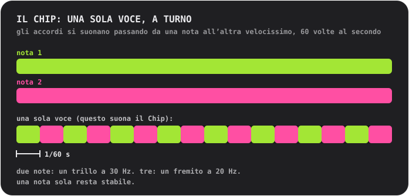

**Le onde**

La **triangolare** è costruita come l’originale: 4 bit (16 livelli), 32 gradini per ciclo, che sale a scalini. L’**onda a impulso** è accesa per un quarto del ciclo (un’onda con «duty cycle del 25%»).

## Scale

Per Pluck, Pad, Bass, Acid, Vocal e Chip. Gira **SCALE** e il display mostra il numero e il nome.

- **01 Chromatic**: ogni semitono. L’impostazione predefinita.
- **02 Major**: luminosa, allegra.
- **03 Natural minor**: triste, seria, gran parte del pop e della musica elettronica.
- **04 Harmonic minor**: drammatica, un po’ orientale.
- **05 Minor pentatonic**: cinque note. Rock, blues, la scelta sicura.
- **06 Major pentatonic**: cinque note luminose. Folk, campane.
- **07 Blues**: pentatonica minore più la «blue note».
- **08 Dorian**: minore con una spinta. Funky, jazzistica.
- **09 Phrygian**: scura, spagnoleggiante.
- **10 Lydian**: sognante e fluttuante.
- **11 Mixolydian**: maggiore con un tocco blues.
- **12 Whole tone**: fluttuante, irrisolta, senza nessuna nota di casa.

---

# Contatti

Hai trovato un bug? Hai un’idea, una domanda o qualcosa da dire su come suona? Mi farà piacere sentirla. Handbeat è fatto da una sola persona, quindi una risposta può richiedere un po’ di tempo, ma il tuo messaggio verrà letto.

📩 **[handbeat.contact@gmail.com](mailto:handbeat.contact@gmail.com)**

**Stai segnalando un bug?** Aiuta molto se includi:

1. **Cosa è successo**, e cosa ti aspettavi invece.
2. **Come farlo succedere di nuovo**: i passaggi che hai fatto.
3. **La versione della tua app** (Impostazioni → *Versione*), il modello del tuo iPhone o iPad e la tua versione di iOS.
4. **Il tuo progetto**, se riguarda un suono o un pattern specifico: Progetti → scorri la riga → *Condividi*, e allega il file `.handbeat`. Così posso aprire esattamente quello che avevi.

Idee per nuove funzioni e mail del tipo «vorrei che potesse...» sono altrettanto benvenute.

---

# Supporto

Handbeat è fatto da una sola persona. Se ti rende felice e vuoi dire grazie, puoi:

**Oppure assumimi.** Ho costruito io questa app e, se ti serve qualcosa di simile, possiamo parlarne: [www.linkedin.com/in/fofonovav](https://www.linkedin.com/in/fofonovav)

---

*Questo testo è stato tradotto da un’IA e può contenere errori.*
