# Handbeat ガイド

[ガイド](#guide) · [デバイス](#devices) · [お問い合わせ](#contact) · [応援する](#support)

Handbeat は iPhone と iPad のためのグルーヴボックスです。16個のパッド、たくさんのデバイス、ひとつのテンポ、ひとつのトランスポート。タップして、ビートを描いて、小節をつなげて1曲に。それだけです。アカウントも、間違った遊び方もありません。

このページは詳しい説明です。最初から最後まで読む必要はありません。まずはアプリをいじってみて、気になったことがあればここに戻ってきてください。

---

# ガイド

## 画面

画面の上部が**ディスプレイ**です。ここにあるものは全部触れます。

| | |
|---|---|
|  | **マイク。** 自分のサウンドを録音します。[自分だけのサウンド](#your-own-sounds)を見てください。 |
|  | **書き出し。** プロジェクト全体をオーディオファイルとして保存します。 |
|  | **メニュー。** プロジェクトと設定です。 |
|  | **TAP。** 曲に合わせてタップすると、Handbeat がテンポを割り出します。拍ごとに脈打つようにも光ります。 |
|  | **ACC。** アクセントです。[ビートを描く](#drawing-a-beat-step)を見てください。 |
|  | **矢印。** デバイスのサウンド（またはノート）を順に切り替えます。 |

- **名前バー**にはデバイスの名前が出ます（ミキサーではプロジェクト名）。鉛筆をタップすると名前を変えられます。8文字までです。
- **BPM** はテンポです。上下にドラッグします（64〜256）。**SWG** はスウィングで、あとで説明します。
- **2列の数字**は2つの数値を表示します。何を示すかはページによって変わります。ドラムなら *SOUND* と *PATTERN* などです。
- **2つのノブ。** 上下にドラッグします。**ノブをダブルタップ**するとデフォルト値に戻ります。回している間、ディスプレイが正確な値と名前を表示します。

パッド、キー、ノブはどれも、スマホのちょっとした振動で応えます（設定の*バイブレーション*でオフにできます）。そのコントロールが音楽を大きく変えるほど、振動も強くなります。

各ページには、パッドとそのページを開くキーに控えめな**テクスチャ**があり、ひと目で今どこにいるか分かります。LIVE FXは線、SOUNDは点、STEPは縦の列、PATTERNは四角です。DEVICEページにはテクスチャがなく、代わりにパッドにデバイスごとの小さなマークが付きます。これらはすべて、設定の「ビジュアルヒント」でオフにできます。

もっと知りたい方へ

**テンポとスウィング**

**BPM** は *beats per minute*、1分あたりの拍数です。60なら1秒に1拍で、のんびりした散歩のペース。ハウスは120〜130あたり、ドラムンベースは170前後です。Handbeat は128から始まります。たいていのジャンルに合う、使いやすいテンポだからです。

**スウィング**は、ビートをわざと「引きずる」ようにします。ふつう、1小節の16ステップは等間隔です。スウィングをかけると、1つおきのステップが少し遅れて、グルーヴが行進ではなく弾むようになります。SWG は **500**（ストレート）から **750**（最大）まで。**667** あたりが定番の3連シャッフルです。ハイハットで試してみてください。

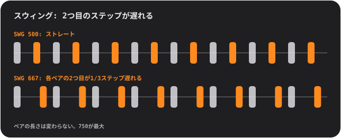

## パッドとページ

パッドは常に4×4のグリッドで、01〜16の番号が付いています。上段のキーで**ページ**を切り替えます。ページによってパッドの役割が決まります。

<table>
<tr>
<td align="center"> <b>SOUND</b> 演奏: 各パッドが自分のサウンドを鳴らす</td>
<td align="center"> <b>STEP</b> 描く: 各パッドが16ステップのひとつ</td>
<td align="center"> <b>PATTERN</b> 選ぶ: 各パッドがパターンのひとつ</td>
</tr>
</table>

### ビートを描く (STEP)

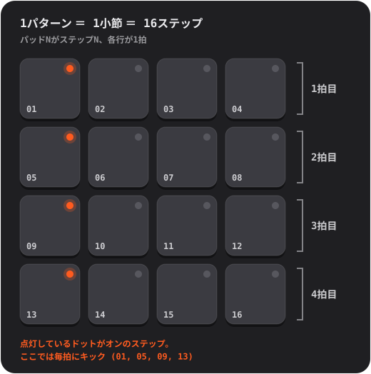

1. **SOUND** で、プログラムしたいパッドをタップします。それが選択中のサウンドになります。
2. **STEP** を押して、パッドをタップしながらステップをオン・オフします。ドットが点灯していればそのステップはオンです。
3. **PLAY** を押します。パッドの上をやわらかな光が走ります。これがプレイヘッドです。再生中も編集を続けられます。

**アクセント。** **ACC** を押してからステップをタップすると、そのステップがアクセント（より大きく、はっきりした音）になります。ACC は1回タップすると自動でオフに戻ります。アクセント付きのステップをもう一度タップすると解除されます。

もっと知りたい方へ

**ステップシーケンサーとは**

時間を同じ長さの区切りに切り分けたものが**ステップ**です。サウンドごとに、どのステップで鳴らすかを決めます。4ステップで1**拍**（足でリズムを取るひと踏み）、4拍で1**小節**になります。Handbeat のパターンはちょうど1小節で、小節はループします。ポップ、ハウス、ヒップホップの多くは、こうした小節を重ねたり変化させたりして作られています。

### ライブ録音 (REC)

**REC** を押して、SOUND ページでパッドを演奏します。トランスポートが止まっていれば Handbeat が自動で動かし、あなたの演奏を*いちばん近い* 16分音符のステップに置きます。多少ずれた指でもちゃんとリズムに乗ります。**オーバーダブ**なので、すでにあるものは残ります。終えるには **STOP**（PLAY キー）を押します。取り消しはありません。いらないステップは STEP でオフにしてください。

ノートを保持するデバイス（Bass、Acid、Pad、Chip）では、タッチの長さも記録されます。

### 光の読み方

- パッドの**ドット**は、そのパッドが*何であるか*を示します。消灯は空、薄く点灯は「何かある」、点灯はアクティブ（選択中のサウンド、オンのステップ、現在のパターン）、明るい点灯は際立つもの（アクセント、チェーンの最新の小節）です。**点滅**は「小節の終わりを待っている」という意味です。
- パッドの**リング**は、*今まさに*鳴っているものを示します。
- **暗くなった**パッドは無音です（ミュート中、または別のものがソロ）。触れば鳴ります。
- **キーを囲むリング**は、そのモードがオンという意味です。

## キー

| | |
|---|---|
|   | **S と M** は2つの*コンテキストキー*で、デバイスとページに応じて変わります。ドラムでは、選択中のサウンドの**ソロ**と**ミュート**です。ほかのデバイスはここに独自のキーを置きます。[デバイス](#devices)を見てください。 |
|   | PATTERN ページでは **COPY** と **ERASE** になります。 |
|  | **REC** はライブ録音です。 |
|  | **PLAY** はすべてを同じクロックで動かします。再生中は停止の四角に変わり、停止して*先頭に戻ります*。電話、アラーム、イヤホンの抜けでも音楽は止まります。そのときはもう一度 PLAY を押してください。 |
|  | **CHAIN** はパターンをつなげて曲にします。オンの間は青いリングが付きます。 |
|  | **RACK** は、いまのデバイスとミキサーを切り替えます。 |

ミュートとソロが効くのは*シーケンサー*が鳴らす音だけです。自分で触れたパッドは必ず鳴ります。

## パターンとチェーン

**パターン**は1小節、16ステップです。パターンは**16個**あり、*各パターンにはすべてのデバイスのステップが入っています*。パターン03のドラム、ベース、メロディはすべて03の中にあります。

**PATTERN** ページでパッドをタップするとパターンを選べます。音楽が鳴っている間は、切り替えは小節の終わりまで待ち、その間パッドが**点滅**します。

- **COPY**、次にパッド: 再生中のパターンをそのパッドにコピーします。
- **ERASE**、次にパッド: そのパターンを消去します。
- キーをもう一度押すか、ページを離れるとキャンセルされます。

### チェーン: パターンは1小節、チェーンは1曲

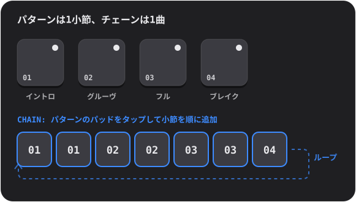

**CHAIN** をオンにして、パターンのパッドをタップします。タップするたびにチェーンの最後に**1小節が追加**されます（最大99小節、繰り返しOK）。再生はチェーンを小節ごとに進み、最後まで行くと最初に戻ります。終わらせるには CHAIN をオフにします。最後に触れたパターンが単独で鳴ります。

もっと知りたい方へ

**ループから曲を組み立てるには**

ダンスミュージックの多くは**繰り返しと変化**でできています。うまくいくループを用意して、レイヤーを足したり引いたりしながら、聴き手に曲が育ち、呼吸する感覚を与えます。たとえば、音数の少ない**イントロ**、安定した**グルーヴ**、すべてが鳴る**フル**のセクション、音が引いていく**ブレイク**、そして最後の拍に入れて「次が来るよ」と耳に知らせるドラムの**フィル**。Handbeat ではそれぞれが1つのパターンで、CHAIN がそれらを順番に並べます。

## ミキサー (RACK)

いちばん右のキーで、デバイスと**ミキサー**を切り替えます。ミキサーは、同じ4×4のボードが別の帽子をかぶったものです。プロジェクトは**必ずミキサーで開きます**。

<table>
<tr>
<td align="center"> <b>DEVICE</b> あなたのデバイス</td>
<td align="center"> <b>空のパッド</b> 新しいデバイスを選ぶ</td>
<td align="center"> <b>PATTERN</b> パターン全体のコピーと消去</td>
</tr>
</table>

**DEVICE** ページでは、各パッドがひとつのスロットです。1つのプロジェクトに最大**16台のデバイス**を入れられます。

- **「＋」のパッドをタップ**するとデバイスを追加できます（パッドが選べる種類に変わり、それぞれにマークが付きます）。
- **マーク。** 各パッドにはデバイスの小さなマークが付きます。ドラムの皮（Drums）、波形（Sampler）、ゆっくりした波（Bass）、のこぎり波（Acid）、マイク（Vocal）、消えていく弦（Pluck）、立ち上がるエンベロープ（Pad）、矩形波（Chip）です。
- **使用中のパッドをタップ**すると選択します。鳴っている間はリングが光ります。**RACK** でそのデバイス自身の画面に移れます。
- **SOLO / MUTE** は選択中のデバイスに効きます。 **TRASH** でデバイスを削除できます。押して、デバイスのパッドをタップし、確認します。
- **DEV VOL** は選択中のデバイスのレベル、**MAIN VOL** はミックス全体の音量です。5がニュートラルな中央です。
- ミキサーの **PATTERN** ページでは、COPY と ERASE が*すべてのデバイスを含む*パターン全体に効きます。

## ライブエフェクト

**LIVE FX** ページには、パッドに16個のエフェクトが4行×4列で並んでいます。**パッドを押している間エフェクトが鳴り、離すと止まります。**エフェクトは約0.1秒でフェードインし、約0.25秒でフェードアウトするので、プツッという音は出ません。好きなだけ同時に押さえられます。これは**パフォーマンス用**です。このページの内容は保存されず、エフェクトは**書き出しには含まれません**。

**トーン**
- **LP**: 音をこもらせます（ローパス）。
- **HP**: 音を細くします（ハイパス）。
- **SWEEP**: 低音から高音へ駆け上がるフィルターで、ちょうど小節の終わりに到達します。
- **ROBOT**: ミックス全体がひとつの音程で鳴ります。

**空間**（離したあとも余韻が続きます）
- **ECHO**: 付点8分音符で繰り返します。
- **DUB**: 毎拍繰り返し、より暗く荒くなります。
- **VOID**: 部屋の響きです。
- **FLANGE**: ジェット機のように渦を巻く音です。

**ループとホールド**
- **STUT 1/8**、**STUT 1/16**、**STUT 1/32**: スタッター（どもり）。鳴っているステップが繰り返されます。
- **FREEZE**: 音をなめらかで安定した質感のまま保持します。

**DJ トランジション**
- **SCRATCH**: 直前の半拍の上で針を前後に引きずります。
- **REVERSE**: 1拍遅れの音楽を逆再生します。
- **HALF SPEED**: すべてを1オクターブ下げて遅くします。
- **RISER**: ノイズが盛り上がり、ちょうど小節の終わりでピークに達し、離した瞬間に切れます。これが「ドロップ」です。

もっと知りたい方へ

**曲の中でエフェクトを使うには**

エフェクトは調味料であって、主菜ではありません。定番の使い方はこうです。セクションの最後の小節のあいだ **RISER** を押さえ、次のセクションの1拍目で離す。セクションが終わるあいだ **LP** を押さえ、離して新しいセクションを弾けさせる。**STUT** を1拍だけ触って、鳴っているものをどもるドラムロールに変える。フレーズの最後のひと打ちに短い **ECHO** を足して、次の小節まで響かせる。

**内部のしくみ**

エフェクトはミックス全体にかかります。すべてのデバイスを足したあと、メインボリュームとリミッターの前です。STUT は、パッドに触れた瞬間にシーケンサーがいるステップを取り込むので、手前の無音ではなく*ノート*が繰り返されます。

## 自分だけのサウンド

**自分のサウンド**を鳴らせます。マイクで録音するか、オーディオファイルを読み込みます。独自の波形で作られている Chip と Acid 以外のデバイスは、すべて自分のサウンドを持てます。

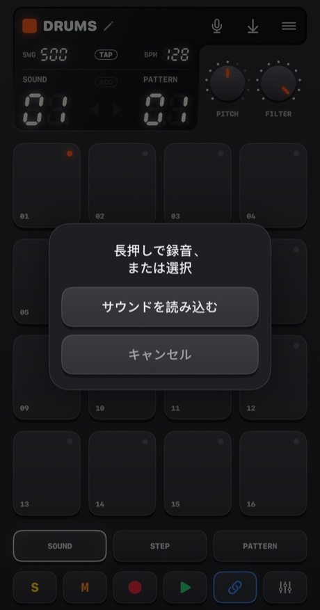

- **マイクを長押し**（4分の1秒より少し長く）すると録音します。離すと終了します。パッドが赤くなり、音楽は止まり（マイクが拾ってしまうため）、ディスプレイが秒数を数えます。
- **タップ**すると選択肢が出ます。**サウンドを読み込む**、または**内蔵サウンド**（元のサウンドに戻す。デバイスに独自のサウンドがあるときに表示）です。

サウンドの行き先はデバイスによって変わります。
- **Drums**: 1パッドに1サウンド。**先にパッドを選んでから、ボタンを長押ししてください。**
- **Sampler**: 最大**30秒**の1つのサウンドを、16個の均等なスライスに分割します。
- **Pluck、Pad、Bass、Vocal**: 最大**10秒**の1つのサウンドを、パッドごとに違う音程で鳴らします。録音したものが*ルート音*（パッド05）になります。

Handbeat は、サウンドの前後の無音を自動で切り詰めます。無音の録音は保存されません。

**ファイルの読み込み**は WAV、AIFF、M4A、MP3 などに対応しています。ドラムは複数のファイルを受け取り、選択中のパッドから名前順に1パッドに1つずつ割り当てます。長い1つのファイルは**無音の部分で分割**されます（4分の1秒の無音で次のサウンドが始まります）。ほかのデバイスは最初のファイルを使います。サウンドはプロジェクトの中に保存され、プロジェクトと一緒に移動します。

初回は、Handbeat がマイクを使ってよいか iOS が確認します。「許可しない」を選んだ場合は、ボタンから設定に移動できます。

もっと知りたい方へ

**サンプリングとは**

**サンプル**は、楽器として使う録音のことです。サンプリングは、ヒップホップやハウスをはじめ、数えきれないものの中心にあります。音を録って、鳴らして、速くしたり遅くしたり、切り刻んだりします。サンプルを**速く**再生すると高く短くなり、**遅く**再生すると低く長くなります。テープを早回しするのと同じです。こうして1つの録音が、鍵盤ひとつ分になります。

## プロジェクト、共有、書き出し

**メニュー**ボタンで**プロジェクト**が開きます（音楽は止まり、保存されます）。

<table>
<tr>
<td align="center">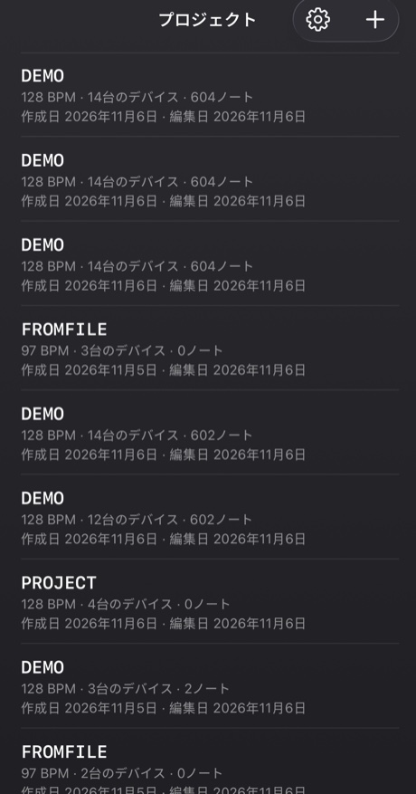</td>
<td align="center">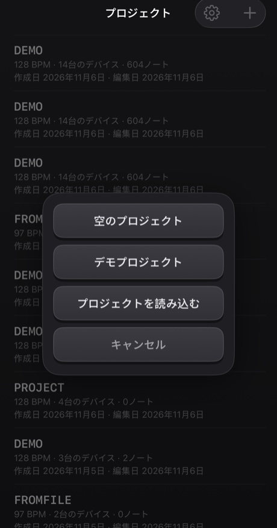</td>
</tr>
</table>

- プロジェクトをタップすると開きます。行を**スワイプ**（または長押し）すると**共有**または**削除**できます。削除の前には必ず確認が出ます。
- **+** で*空のプロジェクト*または*デモプロジェクト*を作成するか、ファイルからプロジェクトを**読み込み**ます。デモは始めるのにおすすめです。14台のデバイスが40小節のマッシュアップを演奏します。
- すべて**自動で保存**されます。

**共有**は、プロジェクトを独自のサウンドごと1つの `.handbeat` ファイルに書き出し、共有シートを開きます。AirDrop やメールで送るか、バックアップとして「ファイル」に保存できます。そのファイルを Handbeat で開くと、新しいプロジェクトとして**追加**され、既存のプロジェクトには触れません。

**オーディオの書き出し**は、ディスプレイの保存ボタンです。**プロジェクト全体、全デバイスをミックス**して、**WAV** または **M4A**（設定で選択）にリアルタイムより速く書き出します。CHAIN がオンならチェーン全体、オフなら現在のパターンを1回再生した分です。聴くものがないときはボタンがグレーになります。

## 設定

プロジェクト → 歯車。**言語**はメニューを即座に切り替えます（グルーヴボックス本体は、キー、ノブ、デバイス名も含めて、ハードウェアのラベルのようにどの言語でも英語のままです）。**テーマ**は4種類で、それぞれダーク、ライト、*システム*があります。**Classic**、**iClassic**（光沢のあるプラスチックとクリックホイール）、**Contrast**（フラットで、真っ黒または真っ白）、**Aero**（ジェルとガラス）です。テーマごとに専用の**アプリアイコン**もあります。**バイブレーション**と**ビジュアルヒント**は、タップの振動と、ページのテクスチャやマークをオン・オフします。**はじめに**は、新しいデモプロジェクトでガイドツアーをもう一度行います。Handbeatを初めて開くと、デモの上でツアーが自動で始まり、角の×で閉じられます。

---

# デバイス

**デバイス**は、プロジェクトの中の楽器です。ミキサーで空のパッドをタップして追加します。ここでは選択画面と同じ順番で並べています。どれも16トラック × 16ステップなので、STEP、REC、パターン、チェーン、書き出しはどのデバイスでも同じように使えます。違うのは、サウンド、パッド、2つのノブ、そして **REC** の隣の2つのキーです。

**音程のあるデバイス**（Bass、Acid、Vocal、Pluck、Pad、Chip）は、ピアノロールのような同じパッド配置を共有します。**パッド05がルート音**（基準になる音）で、それより上のパッドは高く、下のパッドは低くなります。**SCALE** ノブがステップの*意味*を決めます（[スケール](#scales)を見てください）。描いたステップはパッド番号として保存されるので、スケールを変えると*同じメロディが新しいスケールで*鳴ります。

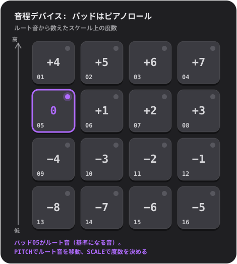

## Drums

完全なドラムキット: **16サウンド、1パッドに1つ**。

- **ノブ:** **PITCH**（−6〜+6半音、キット全体）と **FILTER**（ローパス。10で全開、下げるとキットがこもります）。
- **キー:** 選択中のサウンドの **S** と **M**（ソロとミュート）。
- **自分のサウンド:** 1パッドに1つ。

**試してみて:** SOUND でパッドをタップして、何がどこにあるか探してみましょう。キックを見つけたら STEP を押して 01、05、09、13 をオンにします。毎拍にキックが入る、ハウスの鼓動です。05 と 13 にクラップ、その間のステップにハイハットを足してみてください。

**クローズドハイハット**は**オープンハイハット**を止めます。本物と同じで、2つが重なって鳴り続けることはありません。

もっと知りたい方へ

**大事な3つのドラム**

**キック**（kick）は、頭を揺らしたくなる低い一撃です。**スネア**（snare）や**クラップ**は鋭い破裂音で、たいてい2拍目と4拍目（ステップ05と13）に入ります。これが**バックビート**です。**ハイハット**は、グルーヴの速さを決めるチッチッチッという音で、8分音符（1ステップおき）や16分音符（毎ステップ）で刻みます。毎拍のキックは**フォー・オン・ザ・フロア**と呼ばれます。01と11にキック、05と13にスネアは、古典的なブレイクビートです。

**内部のしくみ**

内蔵サウンドはすべて Handbeat のためにゼロから作りました。スクリプトで生成したもので、誰かから借りたものはありません。

## Sampler

**1つのサウンドを16個の均等なスライスに切り分け**、1パッドに1つずつ割り当てます。スライスを順番に並べれば元のサウンドどおりに鳴り、並べ替えればリミックスになります。

- **ノブ:** **PITCH**（各スライスを速く、または遅くします）と **FILTER**。
- **キー:** **MONO / POLY**（MONO: 新しいスライスが、まだ鳴っているスライスを切ります）と **REVERSE**（各スライスを逆再生）。
- **自分のサウンド:** 最大**30秒**を録音するか、ファイルを読み込みます。ディスプレイの1列目は **SLICE** です。

自分のサウンドがないときは**内蔵ブレイク**を鳴らします。128 BPM のブレイクビート4小節で、1スライスがちょうど1拍です。元どおりに聴くには、スライス1〜4をパターン1のステップ 01、05、09、13 に、スライス5〜8をパターン2に、というふうに4つのつなげたパターンで並べます。

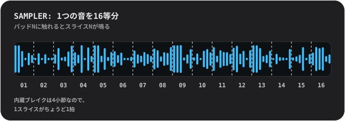

もっと知りたい方へ

**ブレイクを切り刻む**

**ブレイク**は、ドラムだけが鳴っている部分のことです。それを細かく切って並べ替えるのは、ビートメイキングの最も古いテクニックのひとつで、1つのループが100通りのビートになります。スライス3を最初のステップに移す、スライス2を2回鳴らす、いくつかを逆再生にする、などを試してみてください。

**内部のしくみ**

スライスは*そのまま*鳴ります。テンポに合わせて引き伸ばすことはないので、ブレイクは128でぴったり合います。各スライスは4ミリ秒でフェードイン、10ミリ秒でフェードアウトするので、プツッという音は出ません。

## Bass

深くて丸いベースです。**一度に1音**で、ノートは*保持*されます（下を見てください）。

- **ノブ:** **PITCH** と **SCALE**。
- **キー:** **FILTER**（音色を丸くします）と **SUB**（1オクターブ下の2つ目の声。フィルターがかからないので、フィルターを閉じても低音が残ります）。

**保持されるノート。** 保持するデバイス（Bass、Acid、Pad、Chip）では、同じパッドの連続した通常のステップが**1つの長いノート**になります。途切れると終わり、**アクセント付きのステップで再び始まり**、**小節線ですべてのノートが終わります**。パッドに触れている間は、指を離すまでノートが続きます。

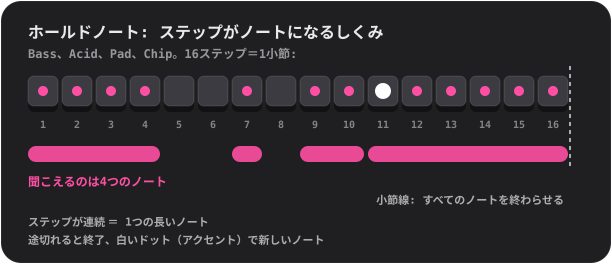

もっと知りたい方へ

**ベースの役割**

ベースは**ルート音**を弾きます。コードの土台になる音で、曲の和声の床にあたります。キックとかみ合うのがポイントです。まずはシンプルに、1ステップ目に低くて長い音を1つ。そこから2つ目の音、少しのリズム、オクターブのジャンプを足していきましょう。

**スマホのスピーカーでもベースが大きく聞こえる理由**

スマホのスピーカーは本物の低音を出せません。Bass の110 Hzのルート音はほとんど出てきません。それでも耳は、倍音を聞くと足りない低音を補って感じ取ります（「ミッシング・ファンダメンタル」）。Bass が力強いサイン波とやわらかい低次倍音でできているのはこのためです。ヘッドホンでも、スピーカーでも、ちゃんとしたベースに聞こえます。

## Acid

<table>
<tr>
<td align="center"> PITCH と SCALE</td>
<td align="center"> 2ND を押す: CUTOFF と RESO</td>
</tr>
</table>

80年代後半のアシッドハウスの、うねるようなベースライン。ノコギリ波が**レゾナンスフィルター**を通り、ノートごとに開いたり閉じたりします。

- **キー:** **2ND**（ノブを切り替えます）と **ARP**。
- **ノブ、1ページ目:** **PITCH** と **SCALE**。**2ページ目 (2ND):** **CUTOFF**（フィルターがどれだけ暗い状態から始まるか）と **RESO**（どれだけ鳴くか。レゾナンスが高いほど、うねりが強くなります）。
- ノートは Bass と同じく**保持**されます。

常にオンの要素が2つあります。**スライド**（各ノートが前のノートから自分の音程へ滑ります）と**アクセント**です。**アクセント付き**のステップ（STEP で ACC）は、フィルターをより大きく開き、音も大きくなります。この音のコツは、**アクセントをいくつか混ぜてステップをつなぎ、鳴らしながら CUTOFF を回すこと**です。

**ARP** は、保持したノートに自分の音程、3度、5度、オクターブを、16分音符ずつ順番にたどらせます。

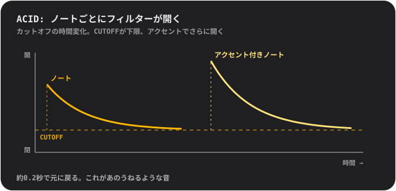

もっと知りたい方へ

**フィルターとは**

**フィルター**は、特定の周波数を通し、ほかを遮ります。**ローパス**フィルターは高音を遮ります。閉じていると音はこもって鈍く、開くと明るくなります。**カットオフ**は遮り始める位置です。**レゾナンス**はカットオフ付近の周波数を強調し、声のような「ワウ」という響きを生みます。レゾナンスを高くしてカットオフを動かすのは、多くのエレクトロニックミュージックの音そのものです。

**この音の由来**

Acid は、1980年代に偶然ひとつのジャンルを決定づけた、小さな銀色のベースマシンへのオマージュです。ひとりで練習するギタリストにベースギターの代わりを提供するために作られたもので、その目的では誰も買いませんでした。それでも買った人たちは、ノコギリ波、レゾナンスフィルター、滑るノートの組み合わせが、ほかのどんな音とも違うことに気づいたのです。

**内部のしくみ**

フィルターは各ノートの頭で2.5オクターブ開き、約0.18秒で元に戻ります（あのうねり）。アクセントはさらに1.5オクターブ開きます。スライドは80ミリ秒です。

## Vocal

録音した1つの声を、パッドごとに違う音程で、**10種類のスタイル**のどれかを通して鳴らします。歌う、言葉を言う、手を叩く、口笛を吹く。録音したものが何でも楽器になります。

- **ノブ:** **STYLE**（回している間、ディスプレイにスタイル名が出ます）と **SCALE**。PITCH ノブはありません。音程は、スケールとルートのパッドが決めます。
- **キー:** **MONO / POLY**（MONO がデフォルトなので、言葉が重なりません）と **REVERSE**。
- **あなたの声:** 最大**10秒**まで録音できます。録音するまでは、短い**内蔵フレーズ**が鳴ります。作者自身の声の録音です。

スタイル:
- **01 NATURAL**: 録音したまま。
- **02 ROBOT**: 金属的で、独自の音程を持ちます。
- **03 VOCODER**: *歌う*ロボット。弾いているパッドのキーで歌います。
- **04 CHOIR**: ゆっくり揺れる4人分のあなた。
- **05 RADIO**: 狭くてカリッとした、小さな古いスピーカーのような音。
- **06 LO-FI**: つぶれてざらついた、古いサンプラーのような音。
- **07 CAVE**: 長い余韻のある、大きく響く部屋。
- **08 GLITCH**: 粒状に刻まれて、どもります。**ヒットごとに違うランダムなカットで鳴ります**。
- **09 ALIEN**: 揺れる金属的なリング。
- **10 CHORD**: あなたの声に、その上の長3度と5度を足します。すべてのパッドがコードを鳴らします。

スタイルは、ノブが止まって少し経ってからバックグラウンドで適用されます。いくつも素早く回して通り過ぎた場合は、止めたスタイルだけが処理されます。

もっと知りたい方へ

**音程と、高い声が小さく聞こえる理由**

声は、**高くするには速く**、**低くするには遅く**再生されます。テープを早回しするのと同じです。高いパッドでは声が細く甲高くなり、低いパッドでは深くゆっくりになります。これがサンプリングの音です。メロディを作るなら、短いものを録音して、SCALE にキーを守ってもらいましょう。

**スタイルの内部**

**VOCODER** は声を10のバンドに分け、それぞれの大きさを測り、その値でうなるノコギリ波を形づくります。ロボットの声のレコードのために1970年代に使われた技術です。**ROBOT** と **ALIEN** は**リングモジュレーション**を使います。声にトーンを掛け合わせる、SF のロボット声の古い手口です。**CHORD** はスケールにかかわらず*長調*のコードです。短調系のスケールでは一部のパッドがぶつかりますが、それも味になります。

## Pluck

短い撥弦サウンドを16の音程で鳴らします。いちばんシンプルで直接的なメロディ用デバイスです。

- **ノブ:** **PITCH**（キーを選びます）と **SCALE**（12種類のスケール。[スケール](#scales)を見てください。回している間、ディスプレイに名前が出ます）。
- **キー:** **MONO / POLY**（MONO: 新しいノートがほかのノートを切ります）と **REVERSE**（最初の約3分の1秒を逆再生するので、ノートがアタックに向かって膨らみます）。
- **自分のサウンド:** 1つ。すべての音程で鳴り、最大10秒。

コツ: **ペンタトニック**スケール（05か06）に切り替えて、パッドを適当にタップしてみてください。外れた音を弾くほうが難しいくらいです。

もっと知りたい方へ

**スケール**

**スケール**は、一緒に鳴らすとよく響く音のメニューです。ピアノには1オクターブに12の音がありますが、スケールはそのうちのいくつかを選びます。**メジャー**は明るく楽しげに、**マイナー**は悲しげだったり真面目だったりします。**ペンタトニック**スケールは5音しかないので、悪い音がありません。**クロマチック**は*すべて*の半音をくれます。自由ですが、外しやすくもあります。**ルート音**はスケールの「ホーム」の音で、Handbeat ではパッド05です。PITCH で別のキーに移せます。

**内部のしくみ**

Pluck は1つのサンプルを、音程を変えるために速く、または遅く再生しています。そのため音程と一緒に長さも変わります。昔のサンプリング鍵盤と同じです。パッドがルートから離れすぎないのは意図的です。サンプルをずっと速くすると細くなり、ずっと遅くするとこもってしまうからです。

## Pad

Pluck と同じパッド、スケール、ノブですが、ノートが**保持**されます。やわらかく、ゆっくりきらめく音が、好きなだけ続きます。

- **ノブ:** **PITCH** と **SCALE**。
- **キー:** **MONO / CHORD**（CHORD はすべてのパッドで3和音を鳴らします）と **STEADY / RISE**（RISE は保持したノートを小さい音から最大まで膨らませます）。
- ノートは Bass と同じく**保持**されます。自分のサウンド: 1つ。つなぎ目なくループし、最大10秒。

同じパッドで複数のステップを連続して埋めると長いコードになり、途切れると終わり、アクセントを入れると新しいコードが始まります。複数のステップにまたがるノートに RISE を使うと、手早く盛り上げられます。

もっと知りたい方へ

**コードとは**

**コード**は、3つ以上の音を同時に鳴らしたものです。いちばん簡単な**3和音**は、ルート音、スケール上で2段上の音、4段上の音です。CHORD をオンにすると、すべてのパッドが選んだスケールの3和音になります。理論を知らなくても、ちゃんと合うコードが手に入ります。

**内部のしくみ**

Pad のサウンドは1秒の長さで、つなぎ目なくループします。ほかの各音の1ヘルツ上と下にある2つの静かな部分音が、ゆっくりしたきらめきを作ります。

## Chip

8ビット時代のサウンド。昔のゲーム機やホームコンピューターの波形です。

- **ノブ:** **PITCH** と **SCALE**。
- **キー:** **TRI / PULSE**（波形）と **VIB**（やわらかいビブラート）。
- ノートは Bass と同じく**保持**されます。自分のサウンドはありません。波形そのものが楽器だからです。

**三角波**は、やわらかく、うつろで、フルートのような音で、粗い階段状に描かれています。**パルス波**は細く鼻にかかったブザーのような音で、定番のリードサウンドです。Chip のルートパッドは、ほかのデバイスより**全音ひとつ高い**位置にあります。これは意図したものです。

**Chip のコードはブンブン震えますが、それが本物です。**2つのパッドを押さえるとトリルし、3つ押さえると震えます。理由はボックスを開いて確かめてください。

もっと知りたい方へ

**素早い交代によるポリフォニー**

昔のゲーム機やホームコンピューターのサウンドチップは、**1つのチャンネルで一度に1音**しか鳴らせませんでした。1チャンネルでコードを作るために、プログラマーはコードの音の間を*とても速く*切り替えました。耳にはそれらが一緒に聞こえ、ブンブンとアルペジオ混じりの独特の色が生まれます。これが80年代のサウンドです。

Chip はまさにそれをしています。1つのステップで押さえているパッドは**1つの声**を共有し、その声が各ノートに**1/60秒ずつの順番**を与えます。**1音だけ**のときは順番交代なしで、安定して鳴ります。

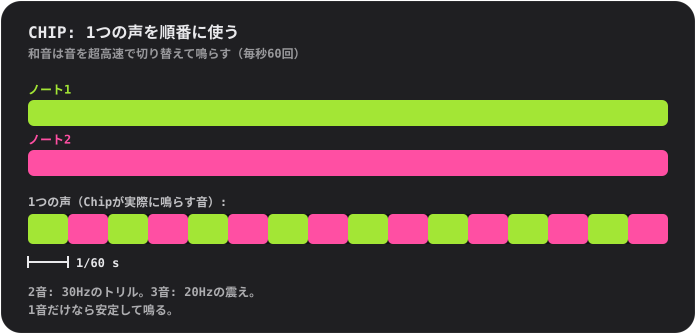

**波形**

**三角波**は本物と同じ作りです。4ビット（16段階）、1周期に32ステップで、階段状に上っていきます。**パルス波**は周期の4分の1だけオンです（「デューティ比25%」の波）。

## スケール

Pluck、Pad、Bass、Acid、Vocal、Chip 用です。**SCALE** を回すと、ディスプレイに番号と名前が出ます。

- **01 Chromatic**: すべての半音。デフォルトです。
- **02 Major**: 明るく楽しげ。
- **03 Natural minor**: 悲しげで真面目。ポップやエレクトロニックの多くがこれです。
- **04 Harmonic minor**: ドラマチックで、少し東洋風。
- **05 Minor pentatonic**: 5音。ロック、ブルース、安全な選択。
- **06 Major pentatonic**: 明るい5音。フォーク、鐘の音。
- **07 Blues**: マイナーペンタトニックに「ブルーノート」を足したもの。
- **08 Dorian**: 持ち上がるようなマイナー。ファンキー、ジャジー。
- **09 Phrygian**: 暗くてスペイン風。
- **10 Lydian**: 夢見心地でふわふわ。
- **11 Mixolydian**: ブルース寄りのメジャー。
- **12 Whole tone**: ふわふわして解決しない、ホームの音がまったくないスケール。

---

# お問い合わせ

バグを見つけた？ アイデアや質問、サウンドの感想がある？ ぜひ聞かせてください。Handbeat は1人で作っているので、返信に少し時間がかかるかもしれませんが、メッセージは必ず読みます。

📩 **[handbeat.contact@gmail.com](mailto:handbeat.contact@gmail.com)**

**バグを報告するとき**は、次の内容を書いてもらえるととても助かります。

1. **何が起きたか**と、**本来どうなると思っていたか**。
2. **再現の手順**: 実際に行った操作。
3. **アプリのバージョン**（設定 → *バージョン*）、お使いの iPhone または iPad のモデル、iOS のバージョン。
4. **プロジェクト**: 特定のサウンドやパターンに関することなら、プロジェクト → 行をスワイプ → *共有* から `.handbeat` ファイルを添付してください。あなたが使っていた状態をそのまま開けます。

機能のアイデアや「こんなことができたら」というメールも大歓迎です。

---

# 応援する

Handbeat は1人で作っています。気に入って、お礼を伝えたいと思ったら、こちらからどうぞ。

**または、私を雇ってください。**このアプリを作ったのは私です。似たものを作りたいなら、ぜひご相談ください: [www.linkedin.com/in/fofonovav](https://www.linkedin.com/in/fofonovav)

---

*このテキストは AI によって翻訳されたもので、誤りが含まれている可能性があります。*
