# Handbeat 가이드

[가이드](#guide) · [기기](#devices) · [문의](#contact) · [후원](#support)

Handbeat는 iPhone과 iPad를 위한 그루브박스예요. 패드 16개, 다양한 기기, 하나의 템포, 하나의 트랜스포트. 탭하고, 비트를 그리고, 마디를 이어서 한 곡으로 만들면 끝이에요. 계정도, 틀린 연주법도 없어요.

이 페이지는 자세한 버전이에요. 처음부터 끝까지 읽을 필요는 없어요. 먼저 앱을 이것저것 눌러 보다가 궁금한 게 생기면 돌아오세요.

---

# 가이드

## 화면

화면 맨 위가 **디스플레이**예요. 여기 있는 건 전부 만져 볼 수 있어요.

| | |
|---|---|
|  | **마이크.** 나만의 사운드를 녹음해요. [나만의 사운드](#your-own-sounds)를 보세요. |
|  | **내보내기.** 프로젝트 전체를 오디오 파일로 저장해요. |
|  | **메뉴.** 프로젝트와 설정이에요. |
|  | **TAP.** 노래에 맞춰 두드리면 Handbeat가 템포를 찾아내요. 박마다 함께 깜빡이기도 해요. |
|  | **ACC.** 액센트예요. [비트 그리기](#drawing-a-beat-step)를 보세요. |
|  | **화살표.** 기기의 사운드(또는 노트)를 차례로 넘겨요. |

- **이름 막대**에는 기기 이름이 나와요(믹서에서는 프로젝트 이름). 연필을 탭하면 이름을 바꿀 수 있어요. 최대 8자예요.
- **BPM**은 템포예요. 위아래로 드래그하세요(64~256). **SWG**는 스윙이고, 아래에서 설명해요.
- **숫자 두 열**은 숫자 두 개를 보여 줘요. 무엇을 뜻하는지는 페이지에 따라 달라요. 드럼이라면 *SOUND*와 *PATTERN* 같은 식이에요.
- **노브 두 개.** 위아래로 드래그하세요. **노브를 두 번 탭**하면 기본값으로 돌아가요. 돌리는 동안 디스플레이에 정확한 값과 이름이 표시돼요.

패드, 키, 노브는 모두 휴대폰의 작은 진동으로 반응해요(설정의 *진동*에서 끌 수 있어요). 음악을 많이 바꾸는 컨트롤일수록 진동도 세져요.

페이지마다 패드와 그 페이지를 여는 키에 은은한 **질감**이 있어서 지금 어디에 있는지 한눈에 알 수 있어요. LIVE FX는 선, SOUND는 점, STEP은 세로 줄, PATTERN은 사각형이에요. DEVICE 페이지에는 질감이 없고, 대신 패드마다 기기를 나타내는 작은 표시가 있어요. 이 모든 것은 설정의 *시각 힌트*에서 끌 수 있어요.

더 알고 싶다면?

**템포와 스윙**

**BPM**은 *beats per minute*, 분당 박자 수예요. 60이면 1초에 한 박, 느긋한 산책 속도예요. 하우스는 120~130 근처, 드럼 앤 베이스는 170 정도예요. Handbeat는 128에서 시작해요. 거의 모든 장르에 잘 맞는 속도거든요.

**스윙**은 일부러 비트를 '절룩이게' 만들어요. 보통 한 마디의 16개 스텝은 간격이 똑같아요. 스윙을 걸면 스텝 하나걸러 하나가 조금 늦게 오고, 그루브가 행진하는 대신 통통 튀어요. SWG는 **500**(스트레이트)에서 **750**(최대)까지예요. **667** 근처에서는 클래식한 셋잇단 셔플이 나와요. 하이햇에 걸어 보세요.

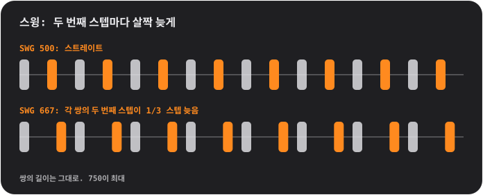

## 패드와 페이지

패드는 언제나 4×4 격자이고 01부터 16까지 번호가 있어요. 맨 위 줄의 키로 **페이지**를 바꾸면, 그 페이지가 패드의 역할을 정해요.

<table>
<tr>
<td align="center"> <b>SOUND</b> 연주: 패드마다 자기 사운드가 나요</td>
<td align="center"> <b>STEP</b> 그리기: 패드 하나가 16스텝 중 하나예요</td>
<td align="center"> <b>PATTERN</b> 고르기: 패드 하나가 패턴 하나예요</td>
</tr>
</table>

### 비트 그리기 (STEP)

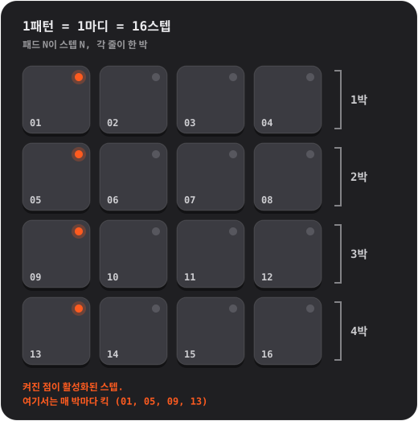

1. **SOUND**에서 프로그래밍할 패드를 탭하세요. 그 패드가 선택된 사운드가 돼요.
2. **STEP**을 누르고 패드를 탭해서 스텝을 켜고 꺼요. 점이 켜져 있으면 그 스텝이 켜진 거예요.
3. **PLAY**를 누르세요. 부드러운 빛이 패드 위를 달려요. 이게 플레이헤드예요. 재생 중에도 계속 편집할 수 있어요.

**액센트.** **ACC**를 누르고 스텝을 탭하면 그 스텝이 액센트(더 크고 또렷한 타격)가 돼요. ACC는 한 번 탭하면 저절로 꺼져요. 액센트가 걸린 스텝을 다시 탭하면 해제돼요.

더 알고 싶다면?

**스텝 시퀀서란**

시간을 같은 길이로 잘게 나눈 조각이 **스텝**이에요. 사운드마다 어느 스텝에서 소리를 낼지 정해요. 스텝 네 개가 한 **박**(발을 한 번 구르는 길이), 네 박이 한 **마디**예요. Handbeat의 패턴은 정확히 한 마디이고, 한 마디는 반복 재생돼요. 팝, 하우스, 힙합 대부분이 이런 마디를 쌓고 바꿔 가며 만들어져요.

### 실시간 녹음 (REC)

**REC**를 누르고 SOUND 페이지에서 패드를 연주하세요. 트랜스포트가 멈춰 있었다면 Handbeat가 자동으로 시작하고, 연주한 소리를 *가장 가까운* 16분음표 스텝에 놓아 줘요. 손이 조금 어긋나도 박자에 맞아요. **오버더브**라서 이미 있던 건 그대로 남아요. 끝내려면 **STOP**(PLAY 키)을 누르세요. 되돌리기는 없어요. 필요 없는 스텝은 STEP에서 꺼 주세요.

노트를 길게 잡는 기기(Bass, Acid, Pad, Chip)에서는 터치를 유지한 길이도 함께 녹음돼요.

### 불빛 읽는 법

- 패드의 **점**은 그 패드가 *무엇인지* 알려 줘요. 꺼져 있으면 비어 있음, 흐리면 '여기 뭔가 있음', 켜져 있으면 활성(선택된 사운드, 켜진 스텝, 현재 패턴), 밝으면 눈에 띄는 것(액센트, 체인에서 가장 최근 마디)이에요. **깜빡이는** 점은 '마디가 끝나길 기다리는 중'이에요.
- 패드의 **링**은 *지금 바로* 울리는 소리를 알려 줘요.
- **어두워진** 패드는 소리가 꺼진 상태예요(뮤트됐거나, 다른 패드가 솔로예요). 그래도 터치하면 소리가 나요.
- **키를 둘러싼 링**은 그 모드가 켜져 있다는 뜻이에요.

## 키

| | |
|---|---|
|   | **S와 M**은 두 개의 *컨텍스트 키*로, 기기와 페이지에 따라 바뀌어요. 드럼에서는 선택한 사운드의 **솔로**와 **뮤트**예요. 다른 기기는 여기에 자기만의 키를 둬요. [기기](#devices)를 보세요. |
|   | PATTERN 페이지에서는 **COPY**와 **ERASE**가 돼요. |
|  | **REC**는 실시간 녹음이에요. |
|  | **PLAY**는 모든 걸 하나의 클록으로 시작해요. 재생 중에는 정지 사각형이 되어 멈추고 *처음으로 되돌려요*. 전화, 알람, 이어폰 분리로도 음악이 멈춰요. 그럴 땐 PLAY를 다시 누르세요. |
|  | **CHAIN**은 패턴을 이어서 한 곡으로 만들어요. 켜져 있는 동안은 파란 링이 둘러져요. |
|  | **RACK**은 지금 있는 기기와 믹서를 오가요. |

뮤트와 솔로는 *시퀀서*가 연주하는 소리에만 영향을 줘요. 직접 터치한 패드는 항상 소리가 나요.

## 패턴과 체인

**패턴**은 한 마디, 16스텝이에요. 패턴은 **16개**이고, *각 패턴에는 모든 기기의 스텝이 들어 있어요*. 패턴 03의 드럼, 베이스, 멜로디는 모두 03 안에 있어요.

**PATTERN** 페이지에서 패드를 탭해 패턴을 고르세요. 음악이 재생 중이면 전환은 마디 끝까지 기다리고, 그동안 패드가 **깜빡여요**.

- **COPY**, 그다음 패드: 재생 중인 패턴을 그 패드에 복사해요.
- **ERASE**, 그다음 패드: 그 패턴을 지워요.
- 키를 다시 누르거나 페이지를 벗어나면 취소돼요.

### 체인: 패턴은 한 마디, 체인은 한 곡

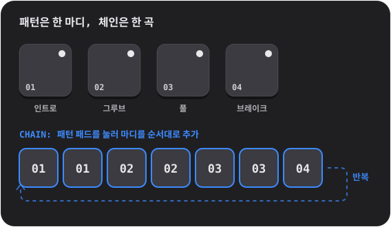

**CHAIN**을 켜고 패턴 패드를 탭하세요. 탭할 때마다 체인 끝에 **한 마디가 추가**돼요(최대 99마디, 반복 가능). 재생은 체인을 마디 단위로 따라가고 끝나면 다시 처음부터 시작해요. 끝내려면 CHAIN을 끄세요. 마지막으로 터치한 패턴이 혼자 재생돼요.

더 알고 싶다면?

**루프로 곡을 만드는 법**

댄스 음악 대부분은 **반복과 변화**예요. 잘 어울리는 루프를 하나 잡고, 레이어를 더하고 빼면서 듣는 사람이 곡이 자라고 숨 쉬는 걸 느끼게 해요. 소리가 듬성한 **인트로**, 안정적인 **그루브**, 모든 게 켜진 **풀** 구간, 소리가 빠지는 **브레이크**, 그리고 마지막 박에서 귀에게 '곧 새로운 게 온다'고 알려 주는 드럼 **필**이 있어요. Handbeat에서는 이 하나하나가 패턴이고, CHAIN이 순서대로 놓아 줘요.

## 믹서 (RACK)

맨 오른쪽 키는 기기와 **믹서**를 오가요. 믹서는 같은 4×4 보드가 다른 모자를 쓴 거예요. 프로젝트는 **항상 믹서에서 열려요**.

<table>
<tr>
<td align="center"> <b>DEVICE</b> 내 기기들</td>
<td align="center"> <b>빈 패드</b> 새 기기를 골라요</td>
<td align="center"> <b>PATTERN</b> 패턴 전체 복사와 지우기</td>
</tr>
</table>

**DEVICE** 페이지에서는 패드 하나가 슬롯 하나예요. 프로젝트에 최대 **16개 기기**를 넣을 수 있어요.

- **플러스가 있는 패드를 탭**하면 기기를 추가해요(패드가 고를 수 있는 종류로 바뀌고, 종류마다 표시가 있어요).
- **표시.** 패드마다 기기를 나타내는 작은 표시가 있어요. 드럼 헤드(Drums), 파형(Sampler), 느린 파도(Bass), 톱니파(Acid), 마이크(Vocal), 잦아드는 현(Pluck), 커지는 엔벨로프(Pad), 사각파(Chip)예요.
- **사용 중인 패드를 탭**하면 선택돼요. 연주하는 동안 링이 켜져요. **RACK**을 누르면 그 기기의 전용 화면으로 넘어가요.
- **SOLO / MUTE**는 선택한 기기에 적용돼요.  **TRASH**는 기기를 삭제해요. 누르고, 기기의 패드를 탭하고, 확인하세요.
- **DEV VOL**은 선택한 기기의 레벨, **MAIN VOL**은 믹스 전체의 볼륨이에요. 5가 중립 가운데예요.
- 믹서의 **PATTERN** 페이지에서는 COPY와 ERASE가 *모든 기기가 담긴* 패턴 전체에 적용돼요.

## 라이브 이펙트

**LIVE FX** 페이지에는 패드마다 이펙트가 16개, 4줄 × 4개로 있어요. **패드를 누르고 있는 동안 이펙트가 울리고, 떼면 멈춰요.** 이펙트는 약 0.1초에 걸쳐 들어오고 약 0.25초에 걸쳐 나가서, 딱딱 끊기는 소리가 나지 않아요. 원하는 만큼 동시에 누를 수 있어요. 이건 **퍼포먼스용**이에요. 이 페이지의 내용은 저장되지 않고, 이펙트는 **내보내기에 포함되지 않아요**.

**톤**
- **LP**: 소리를 먹먹하게 해요(로패스).
- **HP**: 소리를 얇게 해요(하이패스).
- **SWEEP**: 저음에서 고음으로 올라가는 필터로, 마디가 끝나는 바로 그 순간에 도착해요.
- **ROBOT**: 믹스 전체가 하나의 음높이로 울려요.

**공간** (손을 뗀 뒤에도 여운이 남아요)
- **ECHO**: 점8분음표로 반복해요.
- **DUB**: 매 박마다 반복하고, 더 어둡고 거칠어져요.
- **VOID**: 방의 울림이에요.
- **FLANGE**: 제트기처럼 소용돌이치는 소리예요.

**루프와 홀드**
- **STUT 1/8**, **STUT 1/16**, **STUT 1/32**: 스터터(더듬기). 지금 재생 중인 스텝이 반복돼요.
- **FREEZE**: 소리를 부드럽고 일정한 질감으로 붙잡아 둬요.

**DJ 전환**
- **SCRATCH**: 직전 반 박 위에서 바늘을 앞뒤로 긁어요.
- **REVERSE**: 한 박 늦은 음악을 거꾸로 재생해요.
- **HALF SPEED**: 모든 걸 한 옥타브 낮추며 느리게 해요.
- **RISER**: 노이즈가 차오르다가 마디가 끝나는 바로 그 순간 정점에 이르고, 손을 떼면 뚝 끊겨요. 이게 '드롭'이에요.

더 알고 싶다면?

**곡에서 이펙트 쓰는 법**

이펙트는 양념이지 주 요리가 아니에요. 대표적인 동작은 이래요. 구간의 마지막 마디 내내 **RISER**를 누르고 있다가 다음 구간의 첫 박에서 떼기. 구간이 끝나는 동안 **LP**를 누르고 있다가 떼서 새 구간이 터져 나오게 하기. **STUT**를 한 박만 건드려서 재생 중인 소리를 더듬는 드럼 롤로 바꾸기. 프레이즈의 마지막 타격에 짧은 **ECHO**를 더해서 다음 마디로 울려 넘기기.

**안쪽 이야기**

이펙트는 모든 기기를 더한 뒤, 메인 볼륨과 리미터 앞에서 믹스 전체에 걸려요. STUT는 패드를 터치한 순간 시퀀서가 서 있는 스텝을 가져오기 때문에, 그 앞의 무음이 아니라 *노트*가 반복되는 소리가 들려요.

## 나만의 사운드

**나만의** 사운드를 연주할 수 있어요. 마이크로 녹음하거나 오디오 파일을 불러오세요. 자체 파형으로 만들어진 Chip과 Acid를 뺀 모든 기기가 자기 사운드를 가질 수 있어요.

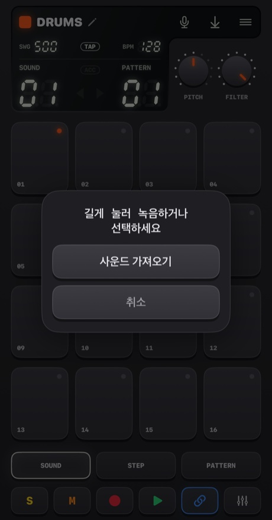

- **마이크를 길게 눌러서**(4분의 1초보다 조금 더) 녹음하세요. 떼면 끝나요. 패드가 빨갛게 변하고, 음악이 멈추고(마이크가 들어 버리니까요), 디스플레이가 초를 세어요.
- **탭**하면 선택지가 나와요. **사운드 가져오기** 또는 **내장 사운드**(원래 사운드로 되돌리기. 기기에 자기 사운드가 있을 때 표시돼요)예요.

사운드가 어디로 가는지는 기기마다 달라요.
- **Drums**: 패드마다 사운드 하나. **먼저 패드를 고른 다음, 버튼을 길게 누르세요.**
- **Sampler**: 최대 **30초**의 사운드 하나를 균등한 슬라이스 16개로 잘라요.
- **Pluck, Pad, Bass, Vocal**: 최대 **10초**의 사운드 하나를 패드마다 다른 음높이로 연주해요. 녹음한 소리가 *루트 음*, 즉 패드 05가 돼요.

Handbeat는 사운드 앞뒤의 무음을 잘라 줘요. 무음 녹음은 저장되지 않아요.

**파일 가져오기**는 WAV, AIFF, M4A, MP3 같은 형식을 지원해요. 드럼은 여러 파일을 받아서, 선택한 패드부터 이름순으로 패드마다 하나씩 넣어요. 긴 파일 하나는 **무음 구간에서 잘려요**(4분의 1초의 무음이 다음 사운드의 시작이에요). 다른 기기는 첫 번째 파일을 사용해요. 사운드는 프로젝트 안에 저장되고 프로젝트와 함께 이동해요.

처음에는 iOS가 Handbeat에 마이크 사용을 허용할지 물어봐요. 허용하지 않았다면 버튼이 설정으로 안내해 줘요.

더 알고 싶다면?

**샘플링이란**

**샘플**은 악기처럼 쓰는 녹음이에요. 샘플링은 힙합과 하우스, 그리고 수많은 음악의 심장이에요. 소리를 녹음해서 재생하고, 빠르게 하고, 느리게 하고, 잘게 잘라요. 샘플을 **빠르게** 재생하면 더 높고 짧아지고, **느리게** 재생하면 더 낮고 길어져요. 테이프를 빨리 감을 때와 똑같아요. 그렇게 녹음 하나가 건반 하나가 돼요.

## 프로젝트, 공유, 내보내기

**메뉴** 버튼을 누르면 **프로젝트**가 열려요(음악이 멈추고 저장돼요).

<table>
<tr>
<td align="center">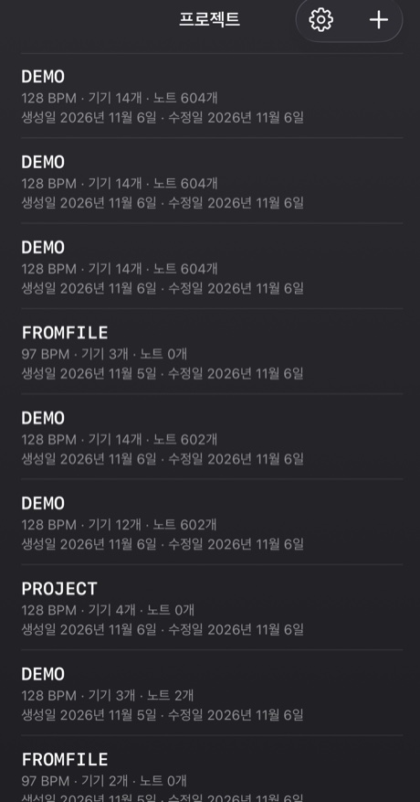</td>
<td align="center">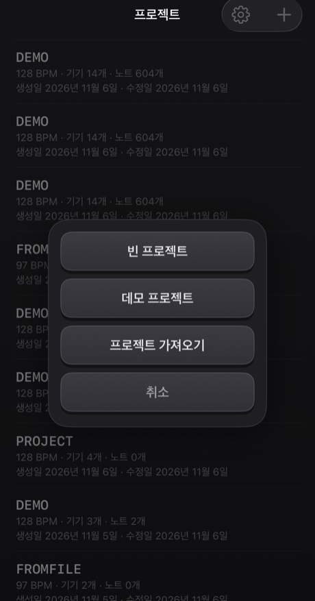</td>
</tr>
</table>

- 프로젝트를 탭하면 열려요. 줄을 **스와이프**(또는 길게 누르기)하면 **공유**하거나 **삭제**할 수 있어요. 삭제는 항상 한 번 더 물어봐요.
- **+**로 *빈 프로젝트*나 *데모 프로젝트*를 만들거나, 파일에서 프로젝트를 **가져와요**. 데모는 시작하기 좋아요. 기기 14대가 40마디짜리 매시업을 연주해요.
- 모든 건 **자동으로 저장**돼요.

**공유**는 프로젝트를 자체 사운드와 함께 `.handbeat` 파일 하나로 만들어 공유 시트를 열어요. AirDrop이나 메일로 보내거나, 백업으로 파일 앱에 보관하세요. 그 파일을 Handbeat에서 열면 새 프로젝트로 **추가**되고, 기존 프로젝트는 건드리지 않아요.

**오디오 내보내기**는 디스플레이의 저장 버튼이에요. **프로젝트 전체, 모든 기기를 믹스해서** **WAV** 또는 **M4A**(설정에서 선택)로 실시간보다 빠르게 만들어 줘요. CHAIN이 켜져 있으면 체인 전체, 아니면 현재 패턴을 한 번 재생한 분량이에요. 들을 게 없을 때는 버튼이 회색이에요.

## 설정

프로젝트 → 톱니바퀴. **언어**는 메뉴를 바로 바꿔 줘요(그루브박스 자체는 키, 노브, 기기 이름까지 하드웨어의 라벨처럼 어느 언어에서나 영어로 남아요). **테마**는 네 가지이고, 각각 다크, 라이트, *시스템*이 있어요. **Classic**, **iClassic**(반짝이는 플라스틱과 클릭 휠), **Contrast**(평면적이고 순수한 검정 또는 흰색), **Aero**(젤과 유리)예요. 테마마다 전용 **앱 아이콘**도 있어요. **진동**과 **시각 힌트**는 탭 진동과 페이지의 질감과 표시를 켜고 꺼요. **소개**는 새 데모 프로젝트에서 가이드 투어를 다시 해요. Handbeat를 처음 열면 데모에서 투어가 저절로 시작되고, 모서리의 ×로 닫을 수 있어요.

---

# 기기

**기기**는 프로젝트 안의 악기예요. 믹서에서 빈 패드를 탭해서 추가하세요. 여기서는 선택 화면과 같은 순서로 나열했어요. 모든 기기가 16트랙 × 16스텝이라서 STEP, REC, 패턴, 체인, 내보내기는 어디서나 똑같이 동작해요. 다른 건 사운드, 패드, 노브 두 개, 그리고 **REC** 옆의 키 두 개예요.

**음정 기기**(Bass, Acid, Vocal, Pluck, Pad, Chip)는 피아노 롤처럼 같은 패드 배치를 공유해요. **패드 05가 루트 음**(기준이 되는 음)이고, 그 위의 패드는 더 높고 아래의 패드는 더 낮아요. **SCALE** 노브가 스텝의 *뜻*을 정해요([스케일](#scales)을 보세요). 그린 스텝은 패드 번호로 저장되기 때문에, 스케일을 바꾸면 *같은 멜로디가 새 스케일로* 연주돼요.

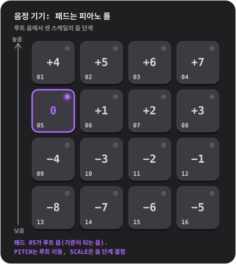

## Drums

완전한 드럼 키트: **사운드 16개, 패드마다 하나**.

- **노브:** **PITCH**(−6~+6 반음, 키트 전체)와 **FILTER**(로패스: 10이 완전히 열린 상태, 낮출수록 키트가 먹먹해져요).
- **키:** 선택한 사운드의 **S**와 **M**(솔로와 뮤트).
- **나만의 사운드:** 패드마다 하나.

**이렇게 해 보세요:** SOUND에서 패드를 탭해서 뭐가 어디 있는지 찾아보세요. 킥을 찾았으면 STEP을 누르고 01, 05, 09, 13을 켜세요. 매 박마다 킥이 나오는, 하우스의 심장 박동이에요. 05와 13에 클랩을, 그 사이 스텝에 하이햇을 더해 보세요.

**닫힌 하이햇**은 **열린 하이햇**을 끊어요. 진짜 악기처럼요. 그래서 둘이 겹쳐서 울리는 일은 없어요.

더 알고 싶다면?

**중요한 세 가지 드럼**

**킥**(kick)은 고개를 끄덕이게 만드는 낮은 쿵 소리예요. **스네어**(snare)나 **클랩**은 날카로운 타격으로, 보통 2박과 4박(스텝 05와 13)에 들어가요. 이게 **백비트**예요. **하이햇**은 그루브의 속도를 정하는 칙칙칙 소리로, 8분음표(스텝 하나걸러 하나)나 16분음표(매 스텝)로 쳐요. 매 박마다 킥은 **포 온 더 플로어**라고 해요. 01과 11에 킥, 05와 13에 스네어는 고전적인 브레이크비트예요.

**안쪽 이야기**

내장 사운드는 전부 Handbeat를 위해 처음부터 만들었어요. 스크립트로 생성했고, 누구에게서도 빌려 오지 않았어요.

## Sampler

**하나의 사운드를 균등한 슬라이스 16개로 잘라서** 패드마다 하나씩 줘요. 슬라이스를 순서대로 놓으면 원래대로 재생되고, 순서를 바꾸면 리믹스가 돼요.

- **노브:** **PITCH**(각 슬라이스를 빠르게 또는 느리게)와 **FILTER**.
- **키:** **MONO / POLY**(MONO: 새 슬라이스가 아직 울리는 슬라이스를 끊어요)와 **REVERSE**(각 슬라이스를 거꾸로).
- **나만의 사운드:** 최대 **30초**까지 녹음하거나 파일을 가져와요. 디스플레이의 첫 번째 열은 **SLICE**예요.

자기 사운드가 없으면 **내장 브레이크**를 연주해요. 128 BPM의 브레이크비트 4마디라서 슬라이스 하나가 한 박이에요. 원래대로 들으려면 슬라이스 1~4를 패턴 1의 스텝 01, 05, 09, 13에, 슬라이스 5~8을 패턴 2에, 이런 식으로 이어 붙인 패턴 네 개에 놓으세요.

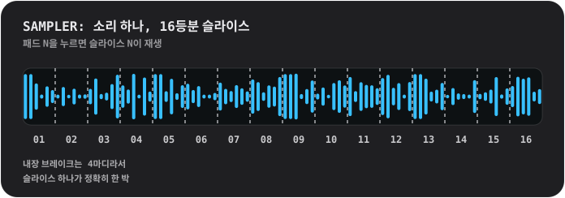

더 알고 싶다면?

**브레이크 잘게 쪼개기**

**브레이크**는 드럼만 나오는 구간이에요. 이걸 조각내서 순서를 바꾸는 건 비트 메이킹에서 가장 오래된 기술 중 하나예요. 루프 하나가 백 가지 비트가 되는 방법이죠. 슬라이스 3을 첫 스텝으로 옮기거나, 슬라이스 2를 두 번 넣거나, 몇 개를 거꾸로 돌려 보세요.

**안쪽 이야기**

슬라이스는 *있는 그대로* 재생돼요. 템포에 맞춰 늘이지 않기 때문에 브레이크는 128에서 딱 맞아요. 슬라이스는 4ms 동안 들어오고 10ms 동안 나가서 딱딱 끊기는 소리가 나지 않아요.

## Bass

깊고 둥근 베이스예요. **한 번에 한 음**이고, 노트는 *홀드*돼요(아래를 보세요).

- **노브:** **PITCH**와 **SCALE**.
- **키:** **FILTER**(음색을 둥글게)와 **SUB**(한 옥타브 아래의 두 번째 소리로, 필터가 걸리지 않아서 필터를 닫아도 저음이 남아요).

**홀드되는 노트.** 홀드하는 기기(Bass, Acid, Pad, Chip)에서는 한 패드의 연속된 일반 스텝이 **하나의 긴 노트**가 돼요. 빈 스텝이 있으면 끝나고, **액센트가 있는 스텝에서 다시 시작**하며, **마디선에서 모든 노트가 끝나요**. 패드를 터치하고 있으면 손가락을 떼기 전까지 노트가 이어져요.

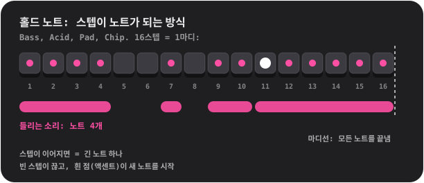

더 알고 싶다면?

**베이스가 하는 일**

베이스는 **루트 음**을 연주해요. 코드가 쌓이는 기준이 되는 음이고, 곡의 화성적인 바닥이에요. 킥과 맞물려요. 간단하게 시작해 보세요. 첫 스텝에 길고 낮은 음 하나, 그다음에 두 번째 음, 약간의 리듬, 옥타브 점프를 더해 가요.

**휴대폰 스피커에서도 베이스가 크게 들리는 이유**

휴대폰 스피커는 진짜 저음을 낼 수 없어요. Bass의 110Hz 루트 음은 거의 나오지 않아요. 그런데 귀는 배음을 들으면 빠진 저음을 스스로 채워서 느껴요('빠진 기음'). Bass가 힘 있는 사인파에 부드러운 낮은 배음을 얹은 이유예요. 이어폰에서도, 스피커에서도 제대로 된 베이스로 들려요.

## Acid

<table>
<tr>
<td align="center"> PITCH와 SCALE</td>
<td align="center"> 2ND를 누르면: CUTOFF와 RESO</td>
</tr>
</table>

80년대 후반 애시드 하우스의 꾸르륵거리며 우는 베이스 라인이에요. 톱니파가 **레조넌스 필터**를 지나고, 노트마다 필터가 열렸다 닫혀요.

- **키:** **2ND**(노브를 전환)와 **ARP**.
- **노브, 첫 페이지:** **PITCH**와 **SCALE**. **두 번째 페이지(2ND):** **CUTOFF**(필터가 얼마나 어둡게 시작하는지)와 **RESO**(얼마나 크게 울리는지. 레조넌스가 높을수록 더 꾸르륵거려요).
- 노트는 Bass처럼 **홀드**돼요.

항상 켜져 있는 건 두 가지예요. **슬라이드**(각 노트가 앞 노트에서 자기 음높이로 미끄러져요)와 **액센트**예요. **액센트가 있는** 스텝(STEP에서 ACC)은 필터를 더 크게 열고 더 크게 울려요. 이 사운드의 비결은 **액센트를 몇 개 섞어서 스텝을 이은 다음, 연주하면서 CUTOFF를 돌리는 것**이에요.

**ARP**는 홀드한 노트가 자기 음높이, 3도, 5도, 옥타브를 16분음표 간격으로 차례로 지나가게 해요.

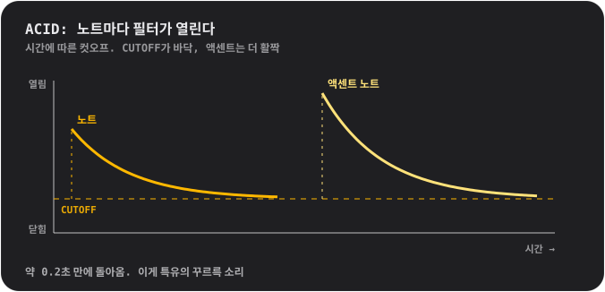

더 알고 싶다면?

**필터란**

**필터**는 어떤 주파수는 통과시키고 어떤 주파수는 막아요. **로패스** 필터는 고음을 막아요. 닫혀 있으면 소리가 먹먹하고 둔하고, 열려 있으면 밝아요. **컷오프**는 막기 시작하는 지점이에요. **레조넌스**는 컷오프 바로 근처의 주파수를 강조해서 사람 목소리 같은 '와우' 소리를 내요. 레조넌스를 높인 채로 컷오프를 쓸어 올리는 건 많은 일렉트로닉 음악의 소리 그 자체예요.

**이 소리는 어디서 왔을까**

Acid는 1980년대에 우연히 하나의 장르를 정의해 버린 작고 은색인 베이스 상자에 보내는 헌사예요. 혼자 연습하는 기타리스트에게 베이스 기타 흉내를 내 주려고 만든 물건이었는데, 아무도 그 용도로는 사지 않았어요. 그래도 그걸 산 사람들은 톱니파, 레조넌스 필터, 미끄러지는 노트의 조합이 다른 어떤 소리와도 다르다는 걸 알게 됐어요.

**안쪽 이야기**

필터는 노트가 시작될 때 2.5옥타브 열렸다가 약 0.18초 만에 돌아와요(꾸르륵하는 그 느낌). 액센트는 거기서 1.5옥타브 더 열어요. 슬라이드는 80밀리초예요.

## Vocal

녹음한 목소리 하나를 패드마다 다른 음높이로, **열 가지 스타일** 중 하나를 거쳐 연주해요. 노래하고, 말하고, 박수 치고, 휘파람 불어 보세요. 녹음한 건 뭐든 악기가 돼요.

- **노브:** **STYLE**(돌리는 동안 디스플레이에 스타일 이름이 나와요)과 **SCALE**. PITCH 노브는 없어요. 음높이는 스케일과 루트 패드가 정해요.
- **키:** **MONO / POLY**(MONO가 기본이라서 말이 서로 겹치지 않아요)와 **REVERSE**.
- **내 목소리:** 최대 **10초**까지 녹음해요. 녹음하기 전에는 짧은 **내장 문구**가 나와요. 제작자 본인의 목소리를 녹음한 거예요.

스타일:
- **01 NATURAL**: 녹음한 그대로.
- **02 ROBOT**: 금속성이고 자기만의 음높이가 있어요.
- **03 VOCODER**: *노래하는* 로봇. 연주하는 패드의 키로 노래해요.
- **04 CHOIR**: 천천히 흔들리는 네 명의 나.
- **05 RADIO**: 좁고 바삭한, 작고 낡은 스피커 같은 소리.
- **06 LO-FI**: 찌그러지고 거칠거칠한, 오래된 샘플러 같은 소리.
- **07 CAVE**: 긴 여운이 있는, 크게 울리는 방.
- **08 GLITCH**: 알갱이로 잘려서 더듬거려요. **히트마다 다른 무작위 컷으로 재생돼요**.
- **09 ALIEN**: 일렁이는 금속성 링.
- **10 CHORD**: 내 목소리에 위로 장3도와 5도를 더해요. 모든 패드가 코드를 연주해요.

스타일은 노브가 멈추고 잠시 뒤에 백그라운드에서 적용돼요. 여러 개를 빠르게 지나쳐 돌리면 멈춘 스타일만 처리돼요.

더 알고 싶다면?

**음높이, 그리고 높은 목소리가 작게 들리는 이유**

목소리는 **높이려면 더 빠르게**, **낮추려면 더 느리게** 재생돼요. 테이프를 빨리 감을 때와 같아요. 높은 패드에서는 목소리가 가늘고 째지고, 낮은 패드에서는 깊고 느려져요. 이게 샘플링의 소리예요. 멜로디를 만들 거라면 짧은 걸 녹음하고, SCALE이 키를 지켜 주게 하세요.

**스타일의 안쪽**

**VOCODER**는 목소리를 열 개의 대역으로 나누고, 각 대역이 얼마나 큰지 재서 윙윙거리는 톱니파의 모양을 만들어요. 로봇 목소리 음반을 위해 1970년대에 쓰던 기법이에요. **ROBOT**과 **ALIEN**은 **링 모듈레이션**을 써요. 목소리에 톤을 곱하는 건데, SF 속 로봇 목소리의 오래된 수법이에요. **CHORD**는 스케일과 상관없이 *장조* 코드예요. 단조 계열 스케일에서는 일부 패드가 부딪히는데, 그것도 매력일 수 있어요.

## Pluck

짧게 튕기는 사운드 하나를 열여섯 가지 음높이로 연주해요. 가장 단순하고 직접적인 멜로디 기기예요.

- **노브:** **PITCH**(키를 고름)와 **SCALE**(스케일 12가지, [스케일](#scales)을 보세요. 돌리는 동안 디스플레이에 이름이 나와요).
- **키:** **MONO / POLY**(MONO: 새 노트가 다른 노트를 끊어요)와 **REVERSE**(처음 3분의 1초가 거꾸로 재생되어서, 노트가 어택을 향해 부풀어 올라요).
- **나만의 사운드:** 하나. 모든 음높이에서 연주되고, 최대 10초.

팁: **펜타토닉** 스케일(05나 06)로 바꾸고 패드를 아무렇게나 탭해 보세요. 틀린 음을 치는 게 더 어려워요.

더 알고 싶다면?

**스케일**

**스케일**은 함께 울렸을 때 잘 어울리는 음의 메뉴예요. 피아노에는 한 옥타브에 열두 음이 있는데, 스케일은 그중 몇 개를 골라요. **메이저**는 밝고 즐겁게, **마이너**는 슬프거나 진지하게 들려요. **펜타토닉** 스케일은 음이 다섯 개뿐이라서 나쁜 음이 없어요. **크로매틱**은 *모든* 반음을 줘요. 자유롭지만 어긋나기도 쉬워요. **루트 음**은 스케일의 '집'이 되는 음이에요. Handbeat에서는 패드 05이고, PITCH가 다른 키로 옮겨 줘요.

**안쪽 이야기**

Pluck은 하나의 샘플을 음높이를 바꾸려고 더 빠르게 또는 더 느리게 재생해요. 그래서 길이도 함께 변해요. 옛날 샘플링 건반과 같아요. 패드가 루트에서 너무 멀리 가지 않는 건 일부러예요. 샘플을 많이 빠르게 하면 가늘어지고, 많이 느리게 하면 웅웅거리거든요.

## Pad

Pluck과 같은 패드, 스케일, 노브인데, 노트가 **홀드**돼요. 부드럽고 천천히 반짝이는 소리가 원하는 만큼 이어져요.

- **노브:** **PITCH**와 **SCALE**.
- **키:** **MONO / CHORD**(CHORD는 패드마다 3화음을 연주해요)와 **STEADY / RISE**(RISE는 홀드한 노트를 작은 소리에서 최대까지 부풀려요).
- 노트는 Bass처럼 **홀드**돼요. 나만의 사운드: 하나. 이음매 없이 루프되고, 최대 10초.

한 패드에서 스텝을 여러 개 연속으로 채우면 긴 코드가 되고, 빈 스텝을 두면 끝나고, 액센트를 넣으면 새 코드가 시작돼요. 스텝 여러 개에 걸친 노트에 RISE를 쓰면 빠르게 분위기를 끌어올릴 수 있어요.

더 알고 싶다면?

**코드란**

**코드**는 세 개 이상의 음을 함께 연주하는 거예요. 가장 단순한 **3화음**은 루트 음, 스케일에서 두 단 위의 음, 네 단 위의 음이에요. CHORD를 켜면 모든 패드가 고른 스케일의 3화음이 돼요. 이론을 몰라도 잘 어울리는 코드가 나와요.

**안쪽 이야기**

Pad의 사운드는 1초 길이이고 이음매 없이 루프돼요. 다른 각 음의 1헤르츠 위와 아래에 있는 조용한 부분음 두 개가 느린 반짝임을 만들어요.

## Chip

8비트 시대의 사운드예요. 옛날 게임기와 홈컴퓨터의 파형이에요.

- **노브:** **PITCH**와 **SCALE**.
- **키:** **TRI / PULSE**(파형)와 **VIB**(부드러운 비브라토).
- 노트는 Bass처럼 **홀드**돼요. 나만의 사운드는 없어요. 파형 자체가 악기예요.

**삼각파**는 부드럽고 속이 빈, 플루트 같은 소리로, 굵은 계단 모양으로 그려져 있어요. **펄스파**는 좁고 코맹맹이 같은 윙윙거림으로, 전형적인 리드 사운드예요. Chip의 루트 패드는 다른 기기보다 **온음 하나 더 높아요**. 일부러 그렇게 했어요.

**Chip의 코드는 윙윙거리고 떨리는데, 그게 진짜예요.** 패드 두 개를 누르면 트릴이 되고, 세 개를 누르면 떨려요. 이유는 상자를 열어서 확인해 보세요.

더 알고 싶다면?

**빠른 교대로 만드는 폴리포니**

옛날 게임기와 홈컴퓨터의 사운드 칩은 **채널 하나당 한 번에 한 음**만 낼 수 있었어요. 채널 하나로 코드를 만들려고, 프로그래머들은 코드의 음들 사이를 *아주 빠르게* 오가게 했어요. 그러면 귀에는 그 음들이 함께 들리고, 윙윙거리는 아르페지오 같은 독특한 색깔이 나와요. 80년대의 소리예요.

Chip이 정확히 그렇게 해요. 한 스텝에서 누르고 있는 모든 패드가 **하나의 목소리**를 나눠 쓰고, 그 목소리가 각 노트에 **1/60초씩 차례**를 줘요. **한 음**만 있을 때는 차례 없이 안정적으로 울려요.

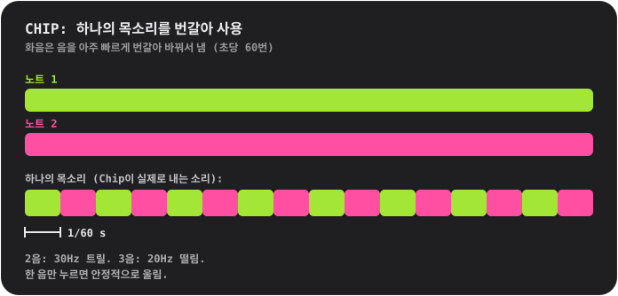

**파형**

**삼각파**는 진짜와 똑같이 만들었어요. 4비트(16단계), 한 주기에 32스텝으로 계단처럼 올라가요. **펄스파**는 한 주기의 4분의 1만 켜져 있어요('듀티 25%' 파형).

## 스케일

Pluck, Pad, Bass, Acid, Vocal, Chip에서 써요. **SCALE**을 돌리면 디스플레이에 번호와 이름이 나와요.

- **01 Chromatic**: 모든 반음. 기본값이에요.
- **02 Major**: 밝고 즐거워요.
- **03 Natural minor**: 슬프고 진지해요. 팝과 일렉트로닉 대부분이 이거예요.
- **04 Harmonic minor**: 드라마틱하고 살짝 동양적이에요.
- **05 Minor pentatonic**: 음 다섯 개. 록, 블루스, 안전한 선택이에요.
- **06 Major pentatonic**: 밝은 음 다섯 개. 포크, 종소리.
- **07 Blues**: 마이너 펜타토닉에 '블루 노트'를 더한 거예요.
- **08 Dorian**: 들뜬 느낌의 마이너. 펑키하고 재즈 같아요.
- **09 Phrygian**: 어둡고 스페인풍이에요.
- **10 Lydian**: 꿈결처럼 둥둥 떠다녀요.
- **11 Mixolydian**: 블루지한 느낌이 있는 메이저예요.
- **12 Whole tone**: 둥둥 뜨고 해결되지 않아요. '집' 음이 아예 없어요.

---

# 문의

버그를 찾았나요? 아이디어, 질문, 아니면 소리에 대해 하고 싶은 말이 있나요? 꼭 듣고 싶어요. Handbeat는 한 사람이 만들고 있어서 답장이 조금 늦을 수 있지만, 보내 주신 메시지는 반드시 읽어요.

📩 **[handbeat.contact@gmail.com](mailto:handbeat.contact@gmail.com)**

**버그를 제보할 때**는 이런 내용을 알려 주시면 큰 도움이 돼요.

1. **무슨 일이 일어났는지**, 그리고 **원래는 어떻게 되길 기대했는지**.
2. **다시 재현하는 방법**: 따라 한 단계들.
3. **앱 버전**(설정 → *버전*), 사용 중인 iPhone 또는 iPad 모델, iOS 버전.
4. **프로젝트**: 특정 사운드나 패턴과 관련된 문제라면, 프로젝트 → 줄 스와이프 → *공유*로 `.handbeat` 파일을 첨부해 주세요. 쓰고 계시던 그대로 열어 볼 수 있어요.

기능 아이디어나 "이런 게 되면 좋겠어요" 같은 메일도 똑같이 환영이에요.

---

# 후원

Handbeat는 한 사람이 만들고 있어요. 마음에 들어서 고맙다는 말을 전하고 싶다면, 이렇게 할 수 있어요.

**아니면 저를 고용하세요.** 이 앱을 만든 사람이 저예요. 비슷한 걸 만들고 싶다면 이야기해 봐요: [www.linkedin.com/in/fofonovav](https://www.linkedin.com/in/fofonovav)

---

*이 글은 AI가 번역했으며 오류가 있을 수 있습니다.*
