# Guia do Handbeat

[Guia](#guide) · [Dispositivos](#devices) · [Contato](#contact) · [Apoio](#support)

O Handbeat é uma groovebox para o seu iPhone e o seu iPad: dezesseis pads, um monte de dispositivos, um único andamento, um único transporte. Você toca, desenha uma batida e encadeia os compassos até virar uma música. É só isso. Sem contas, sem jeito errado de tocar.

Esta página é a versão longa. Você não precisa ler de cima a baixo: mexa no app primeiro e volte quando alguma coisa te deixar curioso.

---

# Guia

## A tela

A parte de cima da tela é o **display**. Tudo o que está nele é para tocar.

| | |
|---|---|
|  | **Microfone.** Grave seus próprios sons, veja [Seus próprios sons](#your-own-sounds). |
|  | **Exportar.** Salva o projeto inteiro como um arquivo de áudio. |
|  | **Menu.** Seus projetos e os ajustes. |
|  | **TAP.** Toque nele junto com uma música e o Handbeat descobre o andamento. Ele também pulsa a cada tempo. |
|  | **ACC.** Acento, veja [Desenhando uma batida](#drawing-a-beat-step). |
|  | **Setas.** Passam pelos sons (ou notas) de um dispositivo. |

- **A faixa do nome** mostra o nome do dispositivo (no mixer, o do projeto). Toque no lápis para renomear, com até 8 caracteres.
- **BPM** é o andamento: arraste para cima e para baixo (de 64 a 256). **SWG** é o swing, veja abaixo.
- **As duas colunas de dígitos** mostram dois números; o que eles dizem depende da página, por exemplo *SOUND* e *PATTERN* numa bateria.
- **Dois knobs.** Arraste para cima e para baixo. **Toque duas vezes num knob** para voltar ao valor padrão. Enquanto você gira um, o display mostra o valor exato e o nome dele.

Cada pad, tecla e knob responde com uma batidinha do celular (dá para desligar nos Ajustes, em *Vibração*). Quanto mais um controle muda a música, mais forte é a batidinha.

Quer saber mais?

**Andamento e swing**

**BPM** quer dizer *beats por minuto*, batidas por minuto. 60 é uma batida por segundo, uma caminhada tranquila. O house fica em torno de 120 a 130, o drum and bass perto de 170. O Handbeat começa em 128 porque serve para quase tudo.

O **swing** faz a batida «mancar» de propósito. Normalmente os 16 passos de um compasso são igualmente espaçados. Com swing, um passo sim, outro não chega um pouquinho atrasado, e o groove balança em vez de marchar. O SWG vai de **500** (reto) a **750** (o extremo); perto de **667** você tem o clássico shuffle de tercina. Experimente nos hi-hats.

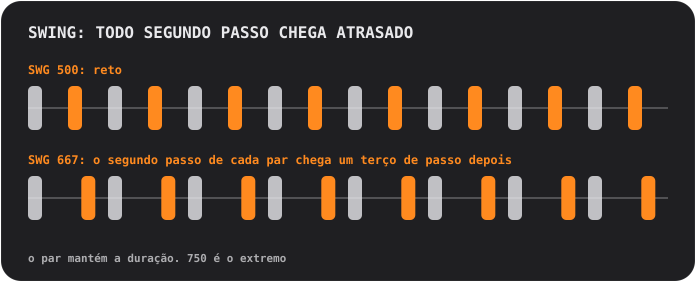

## Pads e páginas

Os pads são sempre uma grade de 4×4, numerada de 01 a 16. A fileira de cima das teclas troca a **página**, que decide o que os pads fazem:

<table>
<tr>
<td align="center"> <b>SOUND</b> tocar: cada pad toca o seu próprio som</td>
<td align="center"> <b>STEP</b> desenhar: cada pad é um dos 16 passos</td>
<td align="center"> <b>PATTERN</b> escolher: cada pad é um padrão</td>
</tr>
</table>

### Desenhando uma batida (STEP)

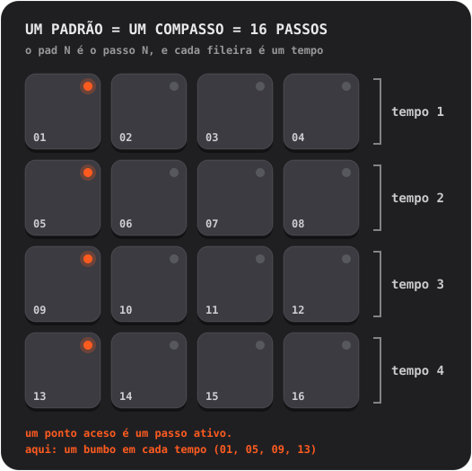

1. Em **SOUND**, toque no pad que você quer programar. Ele vira o som selecionado.
2. Aperte **STEP** e toque nos pads para ligar e desligar passos. Um ponto aceso significa que o passo está ligado.
3. Aperte **PLAY**. Um brilho suave corre pelos pads: é o cabeçote de reprodução. Continue editando enquanto toca.

**Acentos.** Aperte **ACC** e depois toque num passo: ele vira um acento, uma batida mais forte e marcada. O ACC se desliga sozinho depois de um toque. Toque de novo num passo acentuado para limpá-lo.

Quer saber mais?

**O que é um sequenciador de passos**

O tempo é cortado em fatias iguais chamadas **passos**. Para cada som, você decide em quais passos ele toca. Quatro passos formam um **tempo** (uma batida do pé), quatro tempos formam um **compasso**. Cada padrão do Handbeat é exatamente um compasso, e um compasso toca em loop. Quase todo pop, house e hip-hop é construído com compassos assim, empilhados e variados.

### Gravando ao vivo (REC)

Aperte **REC** e toque pads na página SOUND. O Handbeat inicia o transporte se ele estava parado e coloca suas batidas no passo de semicolcheia *mais próximo*, então um dedo meio desleixado ainda cai no tempo. Ele faz **overdub**: o que já está lá fica. Aperte **STOP** (a tecla PLAY) para terminar. Não existe desfazer: desligue em STEP os passos que não quiser.

Nos dispositivos que seguram notas (Bass, Acid, Pad, Chip), a duração do seu toque também é gravada.

### Lendo as luzes

- O **ponto** de um pad diz o que o pad *é*: apagado é vazio, fraco significa «tem algo aqui», aceso significa ativo (o som selecionado, um passo ligado, o padrão atual), brilhante se destaca (um acento, o compasso mais novo de uma cadeia). Um ponto **piscando** significa «esperando o fim do compasso».
- O **anel** de um pad diz o que está tocando *agora mesmo*.
- Um pad **esmaecido** está em silêncio (mutado, ou outro está em solo). Ele ainda toca quando você encosta nele.
- Um **anel em volta de uma tecla** significa que um modo está ligado.

## Teclas

| | |
|---|---|
|   | **S e M** são as duas *teclas de contexto*; elas mudam com o dispositivo e a página. Numa bateria, são **solo** e **mute** do som selecionado. Outros dispositivos colocam aqui as suas próprias teclas, veja [Dispositivos](#devices). |
|   | Na página PATTERN elas viram **COPY** e **ERASE**. |
|  | **REC** grava ao vivo. |
|  | **PLAY** inicia tudo no mesmo relógio. Enquanto toca, é um quadrado de parar: ele para *e volta ao início*. Uma ligação, um alarme ou um fone desconectado também param a música; aperte PLAY de novo. |
|  | **CHAIN** liga padrões numa música. Fica com um anel azul enquanto está ligada. |
|  | **RACK** alterna entre o dispositivo em que você está e o mixer. |

Mute e solo só afetam o que o *sequenciador* toca. Um pad que você toca com o dedo sempre faz som.

## Padrões e cadeias

Um **padrão** é um compasso, 16 passos. Você tem **16 padrões**, e *cada padrão guarda os passos de todos os dispositivos*: a bateria, o baixo e a melodia do padrão 03 estão todos no 03.

Na página **PATTERN**, toque num pad para escolher um padrão. Enquanto a música toca, a troca espera o fim do compasso, e o pad **pisca** até acontecer.

- **COPY**, depois um pad: copia o padrão que está tocando para ele.
- **ERASE**, depois um pad: limpa aquele padrão.
- Aperte a tecla de novo, ou saia da página, para cancelar.

### Cadeia: um padrão é um compasso, uma cadeia é uma música

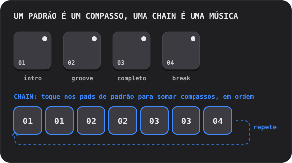

Ligue a **CHAIN** e toque em pads de padrão: cada toque **adiciona um compasso** ao fim da cadeia (até 99 compassos, repetições permitidas). A reprodução segue a cadeia compasso a compasso e recomeça. Desligue a CHAIN para encerrá-la; o último padrão que você tocou passa a tocar sozinho.

Quer saber mais?

**Como músicas são construídas com loops**

Quase toda música de pista é **repetição com mudanças**. Você pega um loop que funciona e vai somando e tirando camadas para quem ouve sentir a música crescer e respirar: uma **intro** enxuta, um **groove** firme, uma parte **completa** com tudo ligado, um **break** em que as coisas somem e um **fill** de bateria no último tempo que avisa aos ouvidos «vem coisa nova». No Handbeat, cada um desses é um padrão, e a CHAIN coloca todos em ordem.

## O mixer (RACK)

A última tecla alterna entre o seu dispositivo e o **mixer**, o mesmo tabuleiro de 4×4 com outro chapéu. Um projeto **sempre abre no mixer**.

<table>
<tr>
<td align="center"> <b>DEVICE</b> seus dispositivos</td>
<td align="center"> <b>Pad vazio</b> escolha um dispositivo novo</td>
<td align="center"> <b>PATTERN</b> copiar e apagar padrões inteiros</td>
</tr>
</table>

Na página **DEVICE**, cada pad é um espaço: até **16 dispositivos** por projeto.

- **Toque num pad vazio** para adicionar um dispositivo (os pads viram os tipos que você pode escolher).
- **Toque num pad ocupado** para selecioná-lo. O anel dele acende enquanto toca. **RACK** pula para a tela dele.
- **SOLO / MUTE** valem para o dispositivo selecionado.  **TRASH** apaga um: aperte, toque no pad do dispositivo e confirme.
- **DEV VOL** é o nível do dispositivo selecionado, **MAIN VOL** o volume da mixagem inteira. 5 é o meio neutro.
- Na página **PATTERN** do mixer, COPY e ERASE valem para o padrão inteiro *com todos os dispositivos dentro*.

## Efeitos ao vivo

A página **LIVE FX** tem dezesseis efeitos nos pads, quatro fileiras de quatro. **Segure um pad para tocar o efeito, solte para parar.** Os efeitos entram em um décimo de segundo e saem em um quarto, então nada estala. Segure quantos quiser. Eles são para **se apresentar**: nada nesta página é salvo, e os efeitos **não entram na exportação**.

**Timbre**
- **LP**: abafa o som (passa-baixas).
- **HP**: afina o som (passa-altas).
- **SWEEP**: um filtro que sobe dos graves aos agudos e chega exatamente quando o compasso acaba.
- **ROBOT**: a mixagem inteira soa numa única altura.

**Espaço** (continuam soando depois que você solta)
- **ECHO**: repete em colcheias pontuadas.
- **DUB**: repete a cada tempo, mais escuro e mais sujo.
- **VOID**: uma sala.
- **FLANGE**: um sopro giratório de avião a jato.

**Loop e retenção**
- **STUT 1/8**, **STUT 1/16**, **STUT 1/32**: gaguejos. O passo que está tocando se repete.
- **FREEZE**: congela o som numa textura suave e constante.

**Transições de DJ**
- **SCRATCH**: uma agulha arrastada para a frente e para trás sobre o último meio tempo.
- **REVERSE**: a música, um tempo atrás, de trás para a frente.
- **HALF SPEED**: desacelera tudo uma oitava para baixo.
- **RISER**: uma subida de ruído que atinge o pico exatamente no fim do compasso e corta quando você solta: o «drop».

Quer saber mais?

**Usando efeitos numa música**

Efeito é tempero, não é o prato. Os movimentos clássicos: segure **RISER** durante o último compasso de uma parte e solte no primeiro tempo da próxima; segure **LP** enquanto uma parte termina e solte para a nova explodir; toque um **STUT** por um tempo para transformar o que estiver tocando num rufar gaguejado; coloque um **ECHO** curto na última batida de uma frase para ela ecoar no compasso seguinte.

**Por dentro**

Os efeitos agem sobre a mixagem inteira, depois que todos os dispositivos são somados e antes do volume principal e do limitador. Um STUT pega o passo em que o sequenciador está quando você toca o pad, então você ouve a *nota* se repetir e não o silêncio de antes dela.

## Seus próprios sons

Você pode tocar **seus próprios** sons: grave com o microfone ou carregue arquivos de áudio. Todo dispositivo pode ter os seus, exceto o Chip e o Acid, que se baseiam nas próprias ondas.

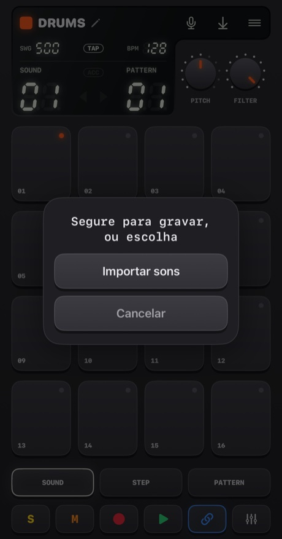

- **Segure o microfone** (um pouco mais de um quarto de segundo) para gravar. Solte para terminar. Os pads ficam vermelhos, a música para (o microfone a ouviria) e o display conta os segundos.
- **Toque nele** para escolher: **Importar sons** ou **Sons integrados** (voltar aos originais; aparece quando o dispositivo tem sons próprios).

Para onde o som vai depende do dispositivo:
- **Drums**: um som por pad. **Escolha o pad primeiro e depois segure o botão.**
- **Sampler**: um som de até **30 segundos**, cortado em 16 fatias iguais.
- **Pluck, Pad, Bass, Vocal**: um som de até **10 segundos**, tocado em cada pad numa altura diferente. O que você grava é a *nota raiz*, o pad 05.

O Handbeat apara o silêncio em volta do seu som. Uma gravação silenciosa não é guardada.

**Importar arquivos** aceita WAV, AIFF, M4A, MP3 e afins. Uma bateria aceita vários, um por pad na ordem dos nomes, a partir do pad selecionado. Um arquivo longo é **cortado nas pausas** (um quarto de segundo de silêncio começa o próximo som). Qualquer outro dispositivo pega o primeiro arquivo. Os sons ficam salvos dentro do projeto e viajam com ele.

Na primeira vez, o iOS pergunta se o Handbeat pode usar o microfone. Se você disse não, o botão leva você aos Ajustes.

Quer saber mais?

**O que é sampling**

Um **sample** é uma gravação usada como instrumento. O sampling é o coração do hip-hop, do house e de mil outras coisas: você grava um som e depois o dispara, acelera, desacelera, corta em pedaços. Toque um sample **mais rápido** e ele fica mais agudo e mais curto, **mais devagar** e fica mais grave e mais longo, exatamente como acelerar uma fita. Assim uma gravação vira um teclado inteiro.

## Projetos, compartilhamento e exportação

O botão de **menu** abre os **Projetos** (ele para a música e salva).

<table>
<tr>
<td align="center">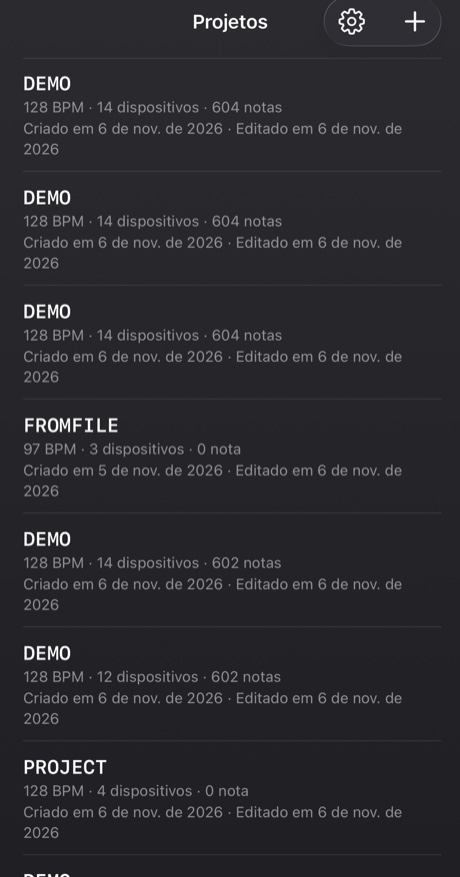</td>
<td align="center">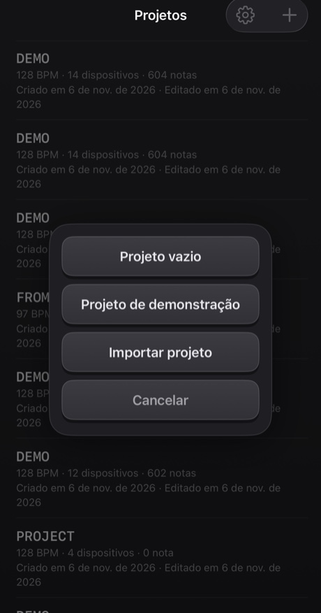</td>
</tr>
</table>

- Toque num projeto para abri-lo. **Deslize** uma linha (ou mantenha pressionada) para **compartilhar** ou **excluir**; excluir sempre pergunta antes.
- O **+** cria um *Projeto vazio* ou um *Projeto de demonstração*, ou **importa** um de um arquivo. A demo é um bom lugar para começar: quatorze dispositivos tocando um mashup de 40 compassos.
- Tudo é **salvo automaticamente**.

**Compartilhar** grava um projeto, com os próprios sons, num único arquivo `.handbeat` e abre a folha de compartilhamento: mande por AirDrop ou e-mail, ou guarde no app Arquivos como backup. Abrir um arquivo desses no Handbeat o **adiciona** como projeto novo e nunca mexe nos seus.

**Exportar áudio** é o botão de salvar no display. Ele renderiza o **projeto inteiro, com todos os dispositivos mixados**, em **WAV** ou **M4A** (você escolhe nos Ajustes), mais rápido que em tempo real. Com a CHAIN ligada, você recebe a cadeia toda; senão, uma passada do padrão atual. O botão fica cinza quando não há nada para ouvir.

## Ajustes

Projetos → a engrenagem. **Idioma** troca os menus na hora (a groovebox em si, com suas teclas, knobs e nomes de dispositivos, fica em inglês em todos os idiomas, como os rótulos de um aparelho de hardware). Há quatro **temas**, cada um em Escuro, Claro ou *Sistema*: **Classic**, **iClassic** (plástico brilhante e uma roda de clique), **Contrast** (chapado, preto ou branco puro) e **Aero** (gel e vidro). Cada tema também tem o seu próprio **ícone do app**.

---

# Dispositivos

Um **dispositivo** é um instrumento do seu projeto. Adicione um tocando num pad vazio no mixer. Eles aparecem na mesma ordem do seletor. Todos têm 16 pistas × 16 passos, então STEP, REC, padrões, cadeias e exportação funcionam igual em todos. O que muda é o som, os pads, os dois knobs e as duas teclas ao lado do **REC**.

Os **dispositivos de notas** (Bass, Acid, Vocal, Pluck, Pad, Chip) compartilham o mesmo layout de pads, como um piano roll: **o pad 05 é a nota raiz** (a nota «de casa»), os pads acima são mais agudos, os abaixo mais graves. O knob **SCALE** decide o que os passos *são* (veja [Escalas](#scales)). Os passos que você desenha são guardados como números de pad, então trocar a escala toca a *mesma melodia numa escala nova*.

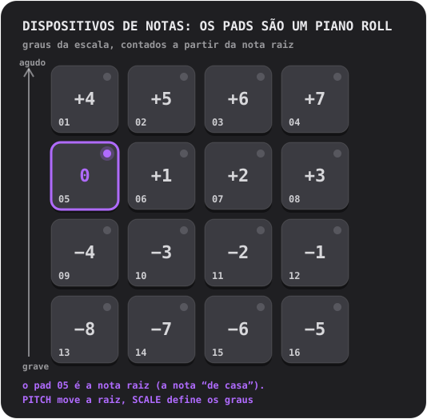

## Drums

Uma bateria completa: **16 sons, um por pad**.

- **Knobs:** **PITCH** (de −6 a +6 semitons, a bateria toda) e **FILTER** (um passa-baixas: 10 é totalmente aberto, mais baixo abafa a bateria).
- **Teclas:** **S** e **M** (solo e mute) do som selecionado.
- **Sons próprios:** um por pad.

**Experimente:** toque nos pads em SOUND para descobrir o que está onde. Escolha o bumbo, aperte STEP e ligue 01, 05, 09 e 13: um bumbo em cada tempo, o coração do house. Ponha uma palma em 05 e 13 e hi-hats nos passos do meio.

Um **hi-hat fechado** corta um **hi-hat aberto**, como no instrumento de verdade, então os dois nunca soam um por cima do outro.

Quer saber mais?

**Os três tambores que importam**

O **bumbo** (kick) é a batida grave que faz você balançar a cabeça. A **caixa** (snare) ou a **palma** (clap) é o estalo, normalmente nos tempos 2 e 4 (passos 05 e 13), o **backbeat**. O **hi-hat** é o tique-tique-tique que marca a velocidade do groove: colcheias (um passo sim, outro não) ou semicolcheias (todo passo). Um bumbo em cada tempo é o **four on the floor**; bumbo em 01 e 11 com caixa em 05 e 13 é um breakbeat clássico.

**Por dentro**

Todo som incluído é feito do zero para o Handbeat: gerado por um script, sem nada emprestado de ninguém.

## Sampler

**Um som cortado em 16 fatias iguais**, uma por pad. Coloque as fatias em ordem e o som toca como era; reorganize e você o remixou.

- **Knobs:** **PITCH** (acelera ou desacelera cada fatia) e **FILTER**.
- **Teclas:** **MONO / POLY** (MONO: uma fatia nova corta as que ainda soam) e **REVERSE** (cada fatia de trás para a frente).
- **Som próprio:** grave até **30 segundos** ou importe um arquivo. A primeira coluna do display é **SLICE**.

Sem um som seu, ele toca um **break integrado**: quatro compassos de breakbeat a 128 BPM, então cada fatia é um tempo. Para ouvi-lo como era, ponha as fatias 1 a 4 nos passos 01, 05, 09, 13 do padrão 1, as fatias 5 a 8 no padrão 2, e assim por quatro padrões encadeados.

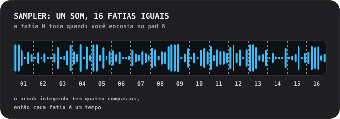

Quer saber mais?

**Picotando um break**

Um **break** é um trecho de bateria sozinha. Cortá-lo em pedaços e reorganizar é um dos truques mais antigos de beatmaking: é assim que um único loop vira cem batidas. Experimente mover a fatia 3 para o primeiro passo, dobrar a fatia 2, tocar algumas de trás para a frente.

**Por dentro**

Uma fatia toca *do jeito que é*: nunca esticada para caber no andamento, por isso o break encaixa a 128. Cada fatia entra em 4 ms e sai em 10 ms, então elas nunca estalam.

## Bass

Um baixo fundo e redondo. **Uma nota por vez**; as notas são *sustentadas* (veja abaixo).

- **Knobs:** **PITCH** e **SCALE**.
- **Teclas:** **FILTER** (arredonda o timbre) e **SUB** (uma segunda voz uma oitava abaixo, nunca filtrada, para o grave ficar quando o filtro fecha).

**Notas sustentadas.** Nos dispositivos que sustentam (Bass, Acid, Pad, Chip), passos comuns consecutivos num pad são **uma única nota longa**. Uma pausa a encerra, um **passo com acento a inicia de novo** e uma **linha de compasso encerra todas as notas**. Toque num pad e a nota dura enquanto o seu dedo ficar.

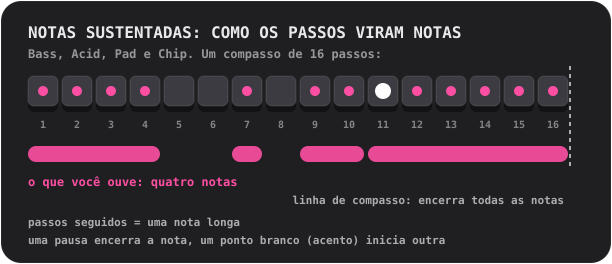

Quer saber mais?

**O que o baixo faz**

O baixo toca a **nota raiz**: a nota sobre a qual o acorde é construído, o chão harmônico de uma música. Ele se encaixa com o bumbo. Comece simples: uma nota longa e grave no primeiro passo, depois some uma segunda nota, um pouco de ritmo, um salto de oitava.

**Por que um baixo pode soar alto no alto-falante do celular**

O alto-falante de um celular não toca notas graves de verdade; a raiz de 110 Hz do Bass mal sai. Mas o seu ouvido completa uma nota grave que falta quando ouve os harmônicos dela («a fundamental ausente»). O Bass é uma senoide forte com harmônicos graves suaves exatamente por isso: um baixo de verdade no fone *e* no alto-falante.

## Acid

<table>
<tr>
<td align="center"> PITCH e SCALE</td>
<td align="center"> aperte 2ND: CUTOFF e RESO</td>
</tr>
</table>

A linha de baixo borbulhante e esganiçada do acid house do fim dos anos 80: uma onda dente de serra através de um **filtro ressonante** que abre e fecha a cada nota.

- **Teclas:** **2ND** (troca os knobs) e **ARP**.
- **Knobs, primeira página:** **PITCH** e **SCALE**. **Segunda página (2ND):** **CUTOFF** (quão escuro o filtro começa) e **RESO** (quanto ele ressoa; mais ressonância, mais «squelch»).
- As notas são **sustentadas**, como no Bass.

Duas coisas estão sempre ligadas: o **slide** (cada nota desliza até a sua altura a partir da nota anterior) e o **acento**. Um passo **com acento** (ACC em STEP) abre mais o filtro e toca mais forte. O segredo desse som: **encadeie passos com alguns acentos e gire o CUTOFF enquanto toca.**

O **ARP** faz uma nota sustentada percorrer a própria altura, a terça, a quinta e a oitava, uma semicolcheia por vez.

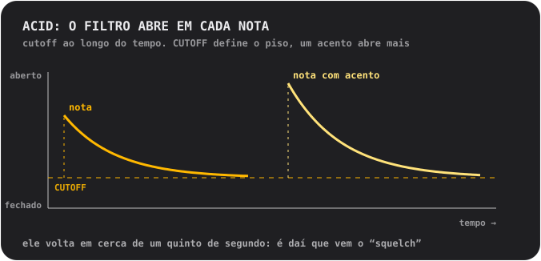

Quer saber mais?

**O que é um filtro**

Um **filtro** deixa passar algumas frequências e bloqueia outras. Um filtro **passa-baixas** bloqueia os agudos: fechado, o som fica abafado e sem brilho; aberto, fica brilhante. O **cutoff** é o ponto em que ele começa a bloquear. A **ressonância** reforça as frequências bem no cutoff, o que dá aquele «uau» quase vocal. Varrer o cutoff com muita ressonância é o som de boa parte da música eletrônica.

**De onde vem esse som**

O Acid é uma homenagem a uma caixinha prateada de baixo que, por acidente, definiu um gênero inteiro nos anos 1980. Ela foi feita para imitar um baixo para guitarristas solitários, e ninguém a comprou para isso. Quem a comprou mesmo assim descobriu que uma onda dente de serra, um filtro ressonante e uma nota deslizando soavam como nada mais.

**Por dentro**

O filtro abre duas oitavas e meia no começo de cada nota e volta a cair em cerca de 0,18 segundo (o «squelch»); um acento o abre mais uma oitava e meia; o slide dura 80 milissegundos.

## Vocal

Uma voz gravada tocada nos pads em alturas diferentes, por meio de um de **dez estilos**. Cante, diga uma palavra, bata palmas, assobie: o que você gravar vira o instrumento.

- **Knobs:** **STYLE** (o display mostra o nome do estilo enquanto você gira) e **SCALE**. Não existe knob PITCH: a escala e o pad raiz decidem a altura.
- **Teclas:** **MONO / POLY** (MONO é o padrão, para as palavras não se atropelarem) e **REVERSE**.
- **Sua voz:** grave até **10 segundos**. Até lá, ele toca uma breve **frase integrada**: uma gravação da própria voz do autor.

Os estilos:
- **01 NATURAL**: como foi gravado.
- **02 ROBOT**: metálico, com altura própria.
- **03 VOCODER**: um robô que *canta*, na tonalidade do pad que você toca.
- **04 CHOIR**: quatro cópias suas balançando devagar.
- **05 RADIO**: estreito e crocante, como um alto-falante velho e pequeno.
- **06 LO-FI**: esmagado e granulado, como um sampler antigo.
- **07 CAVE**: uma sala enorme com eco e cauda longa.
- **08 GLITCH**: cortado em grãos e gaguejado. **Cada batida toca um corte aleatório diferente**.
- **09 ALIEN**: um anel metálico oscilante.
- **10 CHORD**: sua voz mais uma terça maior e uma quinta acima: cada pad toca um acorde.

Um estilo é aplicado em segundo plano um instante depois que o knob para, então se você girar rápido por vários, só o último é calculado.

Quer saber mais?

**A altura, e por que uma voz aguda soa pequena**

A voz é tocada **mais rápido para subir** e **mais devagar para descer**, como acelerar uma fita. Uma voz num pad agudo fica fina e esganiçada, num pad grave fica funda e lenta. É o som do sampling. Para melodias, grave algo curto e deixe o SCALE manter você na tonalidade.

**Os estilos por dentro**

O **VOCODER** divide a voz em dez bandas, mede o quão alta cada uma está e usa isso para moldar uma onda dente de serra zumbindo: uma técnica dos anos 1970 para discos com voz de robô. **ROBOT** e **ALIEN** usam **modulação em anel**, multiplicando a voz por um tom, o velho truque por trás das vozes de robô da ficção científica. O **CHORD** é um acorde *maior* qualquer que seja a escala: em escalas menores alguns pads vão destoar, o que pode ser uma vantagem.

## Pluck

Um som curto de corda dedilhada tocado em dezesseis alturas. O dispositivo melódico mais simples e direto.

- **Knobs:** **PITCH** (você escolhe a tonalidade) e **SCALE** (12 escalas, veja [Escalas](#scales); o nome aparece no display enquanto você gira).
- **Teclas:** **MONO / POLY** (MONO: uma nota nova corta as outras) e **REVERSE** (o primeiro terço de segundo toca de trás para a frente, então a nota vai crescendo até o ataque).
- **Som próprio:** um, tocado em todas as alturas, de até 10 segundos.

Dica: mude para uma escala **pentatônica** (05 ou 06) e toque pads ao acaso. É muito difícil errar uma nota.

Quer saber mais?

**Escalas**

Uma **escala** é um cardápio de notas que soam bem juntas. Um piano tem doze notas por oitava; uma escala escolhe um punhado delas. **Maior** soa brilhante e alegre, **menor** triste ou sério. As escalas **pentatônicas** têm só cinco notas, então não existe nota ruim. A **cromática** dá a você *todo* semitom: liberdade total, e fácil de soar errado. A **nota raiz** é a nota de casa da escala; no Handbeat é o pad 05, e o PITCH a leva para outra tonalidade.

**Por dentro**

O pluck é um único sample, tocado mais rápido ou mais devagar para mudar a altura, então muda de duração junto, como nos velhos teclados de samples. Os pads não se afastam muito da raiz de propósito: um sample bem mais rápido fica fino, bem mais lento fica grave e abafado.

## Pad

Os pads, escalas e knobs do Pluck, mas a nota é **sustentada**: um som macio, que brilha devagar e dura o quanto você quiser.

- **Knobs:** **PITCH** e **SCALE**.
- **Teclas:** **MONO / CHORD** (CHORD toca uma tríade em cada pad) e **STEADY / RISE** (RISE faz uma nota sustentada crescer do fraco ao pleno).
- As notas são **sustentadas**, como no Bass. Som próprio: um, em loop sem emenda, de até 10 segundos.

Preencha vários passos seguidos num pad para um acorde longo, deixe uma pausa para encerrá-lo, ponha um acento para iniciar outro. O RISE numa nota que cobre vários passos é uma subida rápida.

Quer saber mais?

**O que é um acorde**

Um **acorde** é um conjunto de três ou mais notas tocadas juntas. O mais simples, uma **tríade**, é a nota raiz, a nota duas posições acima na escala e a nota quatro posições acima. Ligue o CHORD e cada pad vira uma tríade da escala que você escolheu: não precisa de teoria para ter acordes que combinam.

**Por dentro**

O som do pad tem um segundo e toca em loop sem emenda. Dois parciais suaves, um hertz acima e abaixo de cada um dos outros, criam o brilho lento.

## Chip

O som da era dos 8 bits: as ondas dos antigos consoles de jogos e computadores domésticos.

- **Knobs:** **PITCH** e **SCALE**.
- **Teclas:** **TRI / PULSE** (a onda) e **VIB** (um vibrato suave).
- As notas são **sustentadas**, como no Bass. Sem sons próprios: as ondas *são* o instrumento.

A **onda triangular** é suave, oca, parecida com uma flauta e desenhada em degraus grossos. A **onda de pulso** é um zumbido estreito e anasalado, o clássico som de melodia principal. O pad raiz do Chip fica **um tom inteiro acima** dos outros dispositivos, de propósito.

**Acordes no Chip zumbem e tremulam, e isso é autêntico.** Segure dois pads e eles trinam; segure três e eles tremulam. Abra a caixinha para descobrir por quê.

Quer saber mais?

**Polifonia por revezamento rápido**

Os chips de som dos antigos consoles de jogos e computadores domésticos tocavam **uma nota por vez em cada canal**. Para tirar acordes de um canal, os programadores o alternavam entre as notas do acorde *muito rápido*, de modo que o ouvido as escuta juntas, com um colorido zumbido e arpejado. É o som dos anos 80.

O Chip faz exatamente isso: todos os pads que você segura num passo compartilham **uma única voz** que dá a cada nota um **turno de 1/60 de segundo**. Uma **nota sozinha** toca firme, sem turnos.

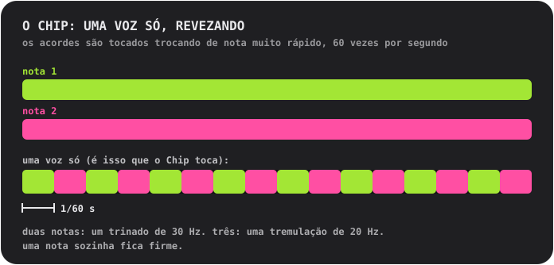

**As ondas**

A **triangular** é construída como a de verdade: 4 bits (16 níveis), 32 degraus por ciclo, subindo em escadinha. A **de pulso** fica ligada um quarto do ciclo (uma onda de «ciclo de trabalho de 25%»).

## Escalas

Para Pluck, Pad, Bass, Acid, Vocal e Chip. Gire o **SCALE** e o display mostra o número e o nome.

- **01 Chromatic**: todo semitom. O padrão.
- **02 Major**: brilhante, alegre.
- **03 Natural minor**: triste, séria, a maior parte do pop e da música eletrônica.
- **04 Harmonic minor**: dramática, com um ar oriental.
- **05 Minor pentatonic**: cinco notas. Rock, blues, a escolha segura.
- **06 Major pentatonic**: cinco notas brilhantes. Folk, sinos.
- **07 Blues**: pentatônica menor mais a «blue note».
- **08 Dorian**: menor com um impulso. Funky, jazzística.
- **09 Phrygian**: escura, espanhola.
- **10 Lydian**: sonhadora e flutuante.
- **11 Mixolydian**: maior com um quê de blues.
- **12 Whole tone**: flutuante, sem resolução, sem nenhuma nota de casa.

---

# Contato

Achou um bug? Tem uma ideia, uma pergunta ou algo a dizer sobre o som? Vou adorar ouvir. O Handbeat é feito por uma pessoa só, então uma resposta pode demorar um pouco, mas a sua mensagem será lida.

📩 **[handbeat.contact@gmail.com](mailto:handbeat.contact@gmail.com)**

**Vai relatar um bug?** Ajuda muito se você incluir:

1. **O que aconteceu** e o que você esperava que acontecesse.
2. **Como fazer acontecer de novo**: os passos que você seguiu.
3. **A versão do seu app** (Ajustes → *Versão*), o modelo do seu iPhone ou iPad e a sua versão do iOS.
4. **Seu projeto**, se for sobre um som ou padrão específico: Projetos → deslize a linha → *Compartilhar* e anexe o arquivo `.handbeat`. Assim eu abro exatamente o que você tinha.

Ideias de recursos e e-mails do tipo «queria que desse para...» são igualmente bem-vindos.

---

# Apoio

O Handbeat é feito por uma pessoa só. Se ele te deixa feliz e você quer agradecer, você pode:

**Ou me contrate.** Eu fiz este app e, se você precisa de algo parecido, a gente pode conversar: [www.linkedin.com/in/fofonovav](https://www.linkedin.com/in/fofonovav)

---

*Este texto foi traduzido por IA e pode conter erros.*
