# Руководство по Handbeat

[Руководство](#guide) · [Устройства](#devices) · [Контакты](#contact) · [Поддержать](#support)

Handbeat — это грувбокс для твоих iPhone и iPad: шестнадцать пэдов, целая куча устройств, один темп, один транспорт. Ты нажимаешь, рисуешь бит и склеиваешь такты в песню. Вот и всё. Никаких аккаунтов, никакого неправильного способа играть.

Эта страница — длинная версия. Читать её сверху вниз не обязательно: сначала потыкай в приложение, а возвращайся, когда что-то озадачит.

---

# Руководство

## Экран

Верхняя часть экрана — это **дисплей**. Здесь можно трогать всё.

| | |
|---|---|
|  | **Микрофон.** Записывай собственные звуки, см. [Твои собственные звуки](#your-own-sounds). |
|  | **Экспорт.** Сохраняет весь проект в аудиофайл. |
|  | **Меню.** Твои проекты и настройки. |
|  | **TAP.** Постукивай по нему в такт песне, и Handbeat определит темп. Он ещё и пульсирует на каждой доле. |
|  | **ACC.** Акцент, см. [Рисуем бит](#drawing-a-beat-step). |
|  | **Стрелки.** Перебирают звуки (или ноты) устройства. |

- **Полоса с названием** показывает имя устройства (на микшере — имя проекта). Коснись карандаша, чтобы переименовать, до 8 символов.
- **BPM** — это темп: тяни вверх и вниз (от 64 до 256). **SWG** — свинг, о нём ниже.
- **Две колонки цифр** показывают два числа; что именно, зависит от страницы, например *SOUND* и *PATTERN* на ударной установке.
- **Две ручки.** Тяни их вверх и вниз. **Дважды коснись ручки**, чтобы вернуть её к значению по умолчанию. Пока ты крутишь одну из них, дисплей показывает её точное значение и название.

Каждый пэд, клавиша и ручка отвечает лёгким толчком телефона (отключается в Настройках, в разделе *Вибрация*). Чем сильнее элемент меняет музыку, тем крепче толчок.

У каждой страницы есть неяркая **текстура** на пэдах и на клавише, которая её открывает, чтобы ты видел, где находишься, с одного взгляда: линии для LIVE FX, точки для SOUND, колонки для STEP и квадраты для PATTERN. У страницы DEVICE её нет, вместо неё на пэдах маленький знак каждого устройства. Всё это отключается в настройках, в разделе *Визуальные подсказки*.

Хочешь узнать больше?

**Темп и свинг**

**BPM** значит *beats per minute*, ударов в минуту. 60 — это один удар в секунду, неторопливая прогулка. Хаус звучит где-то на 120–130, драм-н-бейс около 170. Handbeat стартует со 128, потому что это подходит почти ко всему.

**Свинг** нарочно заставляет бит «прихрамывать». Обычно 16 шагов такта идут через равные промежутки. Со свингом каждый второй шаг приходит чуть позже, и грув пружинит, а не марширует. SWG идёт от **500** (ровно) до **750** (предел); около **667** получается классический триольный шаффл. Попробуй на хай-хэтах.

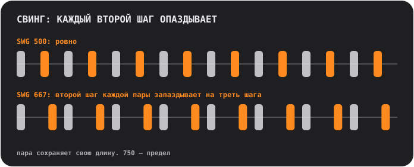

## Пэды и страницы

Пэды всегда образуют сетку 4×4 с номерами от 01 до 16. Верхний ряд клавиш переключает **страницу**, а она решает, что делают пэды:

<table>
<tr>
<td align="center"> <b>SOUND</b> играть: каждый пэд играет свой звук</td>
<td align="center"> <b>STEP</b> рисовать: каждый пэд — один из 16 шагов</td>
<td align="center"> <b>PATTERN</b> выбирать: каждый пэд — паттерн</td>
</tr>
</table>

### Рисуем бит (STEP)

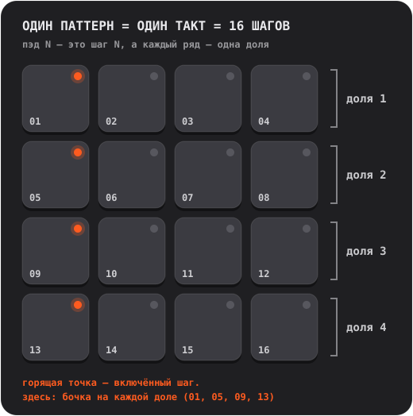

1. На странице **SOUND** коснись пэда, который хочешь запрограммировать. Он станет выбранным звуком.
2. Нажми **STEP** и касайся пэдов, чтобы включать и выключать шаги. Горящая точка значит, что шаг включён.
3. Нажми **PLAY**. По пэдам побежит мягкая вспышка: это плейхед. Можно продолжать редактировать, пока всё играет.

**Акценты.** Нажми **ACC**, затем коснись шага: он станет акцентом, более громким и выразительным ударом. ACC сам выключается после одного касания. Коснись шага с акцентом ещё раз, чтобы убрать его.

Хочешь узнать больше?

**Что такое шаговый секвенсор**

Время нарезается на равные ломтики, которые называются **шагами**. Для каждого звука ты решаешь, на каких шагах он играет. Четыре шага образуют **долю** (один удар ногой по полу), четыре доли образуют **такт**. Каждый паттерн в Handbeat — это ровно один такт, и такт зацикливается. Из таких тактов, сложенных стопкой и слегка изменённых, собрана большая часть попа, хауса и хип-хопа.

### Запись вживую (REC)

Нажми **REC** и играй пэдами на странице SOUND. Handbeat запустит транспорт, если он стоял, и положит твои удары на *ближайший* шаг шестнадцатой, так что чуть неточный палец всё равно попадёт в такт. Это **овердаб**: то, что уже есть, остаётся. Чтобы закончить, нажми **STOP** (клавиша PLAY). Отмены нет: ненужные шаги выключай на странице STEP.

На устройствах, которые держат ноты (Bass, Acid, Pad, Chip), записывается и длина твоего касания.

### Как читать огоньки

- **Точка** пэда говорит, чем пэд *является*: погашена — пусто, тусклая — «здесь что-то есть», горит — активен (выбранный звук, включённый шаг, текущий паттерн), яркая — выделяется (акцент, самый новый такт цепочки). **Мигающая** точка значит «ждёт конца такта».
- **Кольцо** пэда говорит, что играет *прямо сейчас*.
- **Приглушённый** пэд молчит (заглушён или включено соло на другом). Но если коснуться, он всё равно сыграет.
- **Кольцо вокруг клавиши** значит, что режим включён.

## Клавиши

| | |
|---|---|
|   | **S и M** — две *контекстные клавиши*; они меняются вместе с устройством и страницей. На ударной установке это **соло** и **мьют** для выбранного звука. Другие устройства кладут сюда свои клавиши, см. [Устройства](#devices). |
|   | На странице PATTERN они становятся **COPY** и **ERASE**. |
|  | **REC** пишет вживую. |
|  | **PLAY** запускает всё по единым часам. Пока идёт воспроизведение, это квадрат остановки: он останавливает *и перематывает в начало*. Звонок, будильник или выдернутые наушники тоже останавливают музыку; нажми PLAY снова. |
|  | **CHAIN** сцепляет паттерны в песню. Пока включена, обведена синим кольцом. |
|  | **RACK** переключает между устройством, в котором ты находишься, и микшером. |

Мьют и соло влияют только на то, что играет *секвенсор*. Пэд, которого ты коснулся сам, звучит всегда.

## Паттерны и цепочки

**Паттерн** — это один такт, 16 шагов. У тебя **16 паттернов**, и *каждый паттерн хранит шаги всех устройств*: ударные, бас и мелодия паттерна 03 лежат в 03.

На странице **PATTERN** коснись пэда, чтобы выбрать паттерн. Пока музыка играет, смена ждёт конца такта, а пэд **мигает**, пока она не произойдёт.

- **COPY**, затем пэд: копирует играющий паттерн на него.
- **ERASE**, затем пэд: очищает этот паттерн.
- Чтобы отменить, нажми клавишу ещё раз или покинь страницу.

### Цепочка: паттерн — это такт, цепочка — это песня

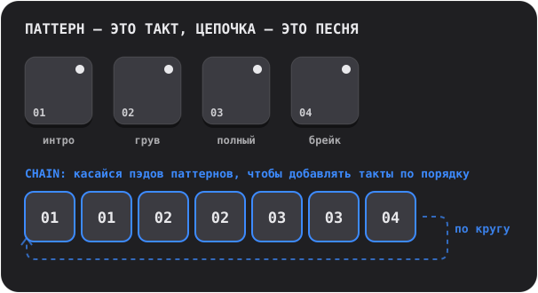

Включи **CHAIN** и касайся пэдов паттернов: каждое касание **добавляет такт** в конец цепочки (до 99 тактов, повторы разрешены). Воспроизведение идёт по цепочке такт за тактом и начинается заново. Выключи CHAIN, чтобы закончить; последний тронутый паттерн заиграет сам по себе.

Хочешь узнать больше?

**Как из лупов строятся песни**

Почти вся танцевальная музыка — это **повторение с изменениями**. Берёшь луп, который работает, и добавляешь или убираешь слои, чтобы слушатель чувствовал, как всё растёт и дышит: разреженное **интро**, ровный **грув**, **полная** секция, где включено всё, **брейк**, где всё уходит, и **филл** на ударных в последней доле, который сообщает ушам: «сейчас будет что-то новое». В Handbeat каждый из них — один паттерн, а CHAIN выстраивает их по порядку.

## Микшер (RACK)

Последняя клавиша переключает между твоим устройством и **микшером** — той же доской 4×4, только в другой шляпе. Проект **всегда открывается на микшере**.

<table>
<tr>
<td align="center"> <b>DEVICE</b> твои устройства</td>
<td align="center"> <b>Пустой пэд</b> выбери новое устройство</td>
<td align="center"> <b>PATTERN</b> копировать и стирать паттерны целиком</td>
</tr>
</table>

На странице **DEVICE** каждый пэд — это слот: в проекте может быть до **16 устройств**.

- **Коснись пэда с плюсом**, чтобы добавить устройство (пэды превратятся в виды устройств, из которых можно выбрать, у каждого свой знак).
- **Знаки.** На каждом пэде маленький знак его устройства: мембрана барабана (Drums), форма волны (Sampler), медленная волна (Bass), пила (Acid), микрофон (Vocal), затухающая струна (Pluck), нарастающая огибающая (Pad) или прямоугольная волна (Chip).
- **Коснись занятого пэда**, чтобы выбрать его. Его кольцо загорается, пока устройство играет. **RACK** перескакивает на его собственный экран.
- **SOLO / MUTE** действуют на выбранное устройство.  **TRASH** удаляет устройство: нажми, коснись его пэда, подтверди.
- **DEV VOL** — уровень выбранного устройства, **MAIN VOL** — громкость всего микса. 5 — нейтральная середина.
- На странице **PATTERN** микшера COPY и ERASE действуют на весь паттерн *вместе со всеми устройствами в нём*.

## Живые эффекты

На странице **LIVE FX** шестнадцать эффектов на пэдах, четыре ряда по четыре. **Удерживай пэд, чтобы играть эффект, отпусти, чтобы остановить.** Эффекты нарастают за десятую долю секунды и затихают за четверть, поэтому ничего не щёлкает. Удерживай сколько хочешь сразу. Они созданы для **выступления**: ничего на этой странице не сохраняется, а эффекты **не попадают в экспорт**.

**Тембр**
- **LP**: приглушает звук (фильтр низких частот).
- **HP**: делает его тоньше (фильтр высоких частот).
- **SWEEP**: фильтр, который поднимается от баса к верхам и приходит ровно к концу такта.
- **ROBOT**: весь микс звенит на одной высоте.

**Пространство** (звучат и после того, как ты отпустил)
- **ECHO**: повторяет через восьмую с точкой.
- **DUB**: повторяет на каждой доле, темнее и грязнее.
- **VOID**: комната.
- **FLANGE**: закручивающийся шум реактивного самолёта.

**Петля и удержание**
- **STUT 1/8**, **STUT 1/16**, **STUT 1/32**: заикание. Играющий шаг повторяется.
- **FREEZE**: замораживает звук в мягкую ровную текстуру.

**DJ-переходы**
- **SCRATCH**: игла, которую тянут вперёд-назад по последней половине доли.
- **REVERSE**: музыка на одну долю позади, задом наперёд.
- **HALF SPEED**: замедляет всё на октаву вниз.
- **RISER**: нарастающий шум, который достигает пика ровно в конце такта и обрывается, как только ты отпускаешь: тот самый «дроп».

Хочешь узнать больше?

**Эффекты в песне**

Эффекты — это приправа, а не блюдо. Классические приёмы: удерживай **RISER** весь последний такт секции и отпусти на первой доле следующей; удерживай **LP**, пока секция заканчивается, и отпусти, чтобы новая взорвалась; коснись **STUT** на одну долю, чтобы превратить то, что играет, в заикающуюся дробь; добавь короткий **ECHO** на последний удар фразы, чтобы она дозвучала в следующий такт.

**Внутри**

Эффекты работают на всём миксе: после того как сложены все устройства, и до общей громкости и лимитера. STUT берёт шаг, на котором стоит секвенсор в момент касания пэда, так что ты слышишь повтор *ноты*, а не тишины перед ней.

## Твои собственные звуки

Ты можешь играть **собственными** звуками: записывай их микрофоном или загружай аудиофайлы. Свои звуки можно у любого устройства, кроме Chip и Acid, которые построены на собственных волнах.

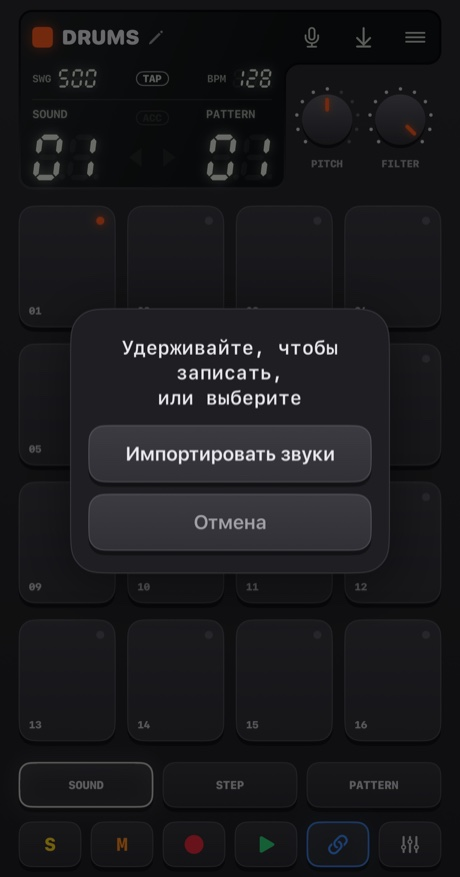

- **Удерживай микрофон** (чуть дольше четверти секунды), чтобы записать. Отпусти, чтобы закончить. Пэды станут красными, музыка остановится (микрофон бы её услышал), а дисплей будет считать секунды.
- **Коснись его**, чтобы выбрать: **Импортировать звуки** или **Встроенные звуки** (вернуться к оригиналам; пункт появляется, когда у устройства есть свои звуки).

Куда попадёт звук, зависит от устройства:
- **Drums**: по одному звуку на пэд. **Сначала выбери пэд, потом удерживай кнопку.**
- **Sampler**: один звук до **30 секунд**, нарезанный на 16 равных слайсов.
- **Pluck, Pad, Bass, Vocal**: один звук до **10 секунд**, который играет на каждом пэде на своей высоте. То, что ты запишешь, — это *основной тон*, пэд 05.

Handbeat обрезает тишину вокруг твоего звука. Запись без звука не сохраняется.

**Импорт файлов** принимает WAV, AIFF, M4A, MP3 и подобные. Ударная установка берёт несколько файлов: по одному на пэд в порядке их имён, начиная с выбранного пэда. Один длинный файл **режется по паузам** (четверть секунды тишины начинает следующий звук). Любое другое устройство берёт первый файл. Звуки сохраняются внутри проекта и путешествуют вместе с ним.

В первый раз iOS спросит, можно ли Handbeat пользоваться микрофоном. Если ты ответил «нет», кнопка отправит тебя в Настройки.

Хочешь узнать больше?

**Что такое сэмплирование**

**Сэмпл** — это запись, используемая как инструмент. Сэмплирование — сердце хип-хопа, хауса и тысячи других вещей: записываешь звук, потом запускаешь его, ускоряешь, замедляешь, режешь на куски. Играешь сэмпл **быстрее** — он становится выше и короче, **медленнее** — ниже и длиннее, точно как при ускорении плёнки. Так одна запись превращается в целую клавиатуру.

## Проекты, обмен и экспорт

Кнопка **меню** открывает **Проекты** (она останавливает музыку и сохраняет).

<table>
<tr>
<td align="center">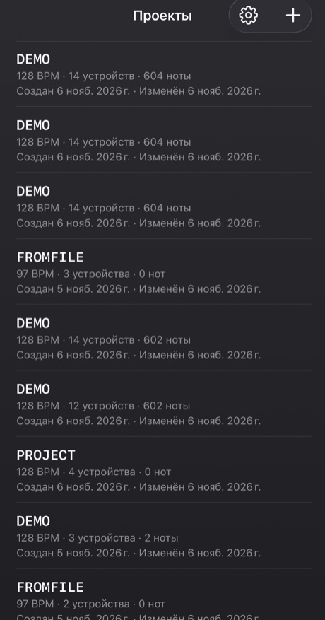</td>
<td align="center">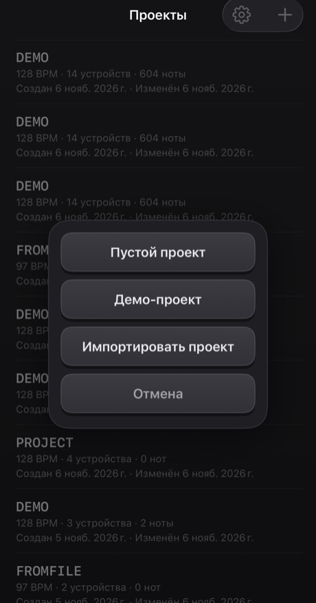</td>
</tr>
</table>

- Коснись проекта, чтобы открыть его. **Смахни** строку (или удерживай её), чтобы **поделиться** проектом или **удалить** его; удаление всегда переспрашивает.
- Кнопка **+** создаёт *Пустой проект* или *Демо-проект* или **импортирует** проект из файла. Демо — хорошее место для старта: четырнадцать устройств играют сорокатактовый мэшап.
- Всё **сохраняется автоматически**.

**Поделиться** записывает проект вместе с его собственными звуками в один файл `.handbeat` и открывает меню «Поделиться»: отправь по AirDrop или почте или сохрани в Файлах как резервную копию. Если открыть такой файл в Handbeat, он **добавится** как новый проект и никогда не тронет твои.

**Экспорт аудио** — это кнопка сохранения на дисплее. Она рендерит **весь проект, все устройства смикшированы**, в **WAV** или **M4A** (выбирается в Настройках) быстрее реального времени. При включённой CHAIN получишь всю цепочку, иначе — один проход текущего паттерна. Когда слушать нечего, кнопка серая.

## Настройки

Проекты → шестерёнка. **Язык** переключает меню сразу (сам грувбокс — клавиши, ручки и названия устройств — везде остаётся на английском, как надписи на железном приборе). Есть четыре **темы**, каждая в вариантах Тёмная, Светлая или *Системная*: **Classic**, **iClassic** (глянцевый пластик и клик-колесо), **Contrast** (плоская, чисто чёрная или белая) и **Aero** (гель и стекло). У каждой темы есть и своя **иконка приложения**. **Вибрация** и **Визуальные подсказки** включают и выключают отклик, а также текстуры и знаки страниц. **Обучение** проводит экскурсию заново на новом демо-проекте. При первом открытии Handbeat экскурсия начинается сама на демо, а крестик в её углу закрывает её.

---

# Устройства

**Устройство** — это инструмент в твоём проекте. Добавь его, коснувшись пустого пэда на микшере. Здесь они перечислены в том же порядке, что и в списке выбора. У всех по 16 дорожек × 16 шагов, поэтому STEP, REC, паттерны, цепочки и экспорт везде работают одинаково. Различаются звук, пэды, две ручки и две клавиши рядом с **REC**.

**Нотные устройства** (Bass, Acid, Vocal, Pluck, Pad, Chip) делят одну раскладку пэдов, как в пиано-ролле: **пэд 05 — основной тон** (нота-«дом»), пэды выше звучат выше, пэды ниже — ниже. Ручка **SCALE** решает, чем *являются* шаги (см. [Лады](#scales)). Шаги, которые ты рисуешь, хранятся как номера пэдов, поэтому смена лада играет *ту же мелодию в новом ладу*.

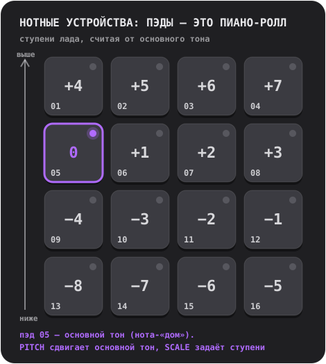

## Drums

Полная ударная установка: **16 звуков, по одному на пэд**.

- **Ручки:** **PITCH** (от −6 до +6 полутонов, на всю установку) и **FILTER** (фильтр низких частот: 10 — полностью открыт, меньше — установка звучит глуше).
- **Клавиши:** **S** и **M** (соло и мьют) для выбранного звука.
- **Свои звуки:** по одному на пэд.

**Попробуй так:** касайся пэдов на SOUND, чтобы найти, что где лежит. Найди бочку, нажми STEP и включи 01, 05, 09 и 13: бочка на каждой доле, сердцебиение хауса. Добавь клэп на 05 и 13, а хай-хэты — на шаги между ними.

**Закрытый хай-хэт** обрывает **открытый**, как у настоящего инструмента, так что они никогда не звенят друг поверх друга.

Хочешь узнать больше?

**Три барабана, которые важнее всего**

**Бочка** (kick) — низкий удар, от которого хочется кивать. **Малый барабан** (snare) или **клэп** — щелчок, обычно на долях 2 и 4 (шаги 05 и 13), это **бэкбит**. **Хай-хэт** — это тик-тик-тик, которое задаёт скорость грува: восьмые (каждый второй шаг) или шестнадцатые (каждый шаг). Бочка на каждой доле называется **four on the floor**; бочка на 01 и 11 с малым барабаном на 05 и 13 — классический брейкбит.

**Внутри**

Каждый встроенный звук сделан с нуля специально для Handbeat: сгенерирован скриптом, ничего не позаимствовано ни у кого.

## Sampler

**Один звук, нарезанный на 16 равных слайсов**, по одному на пэд. Расставь слайсы по порядку — звук сыграет как был; перемешай их — получится ремикс.

- **Ручки:** **PITCH** (ускоряет или замедляет каждый слайс) и **FILTER**.
- **Клавиши:** **MONO / POLY** (MONO: новый слайс обрывает ещё звучащие) и **REVERSE** (каждый слайс задом наперёд).
- **Собственный звук:** запиши до **30 секунд** или импортируй файл. Первая колонка дисплея — **SLICE**.

Без твоего звука он играет **встроенный брейк**: четыре такта брейкбита на 128 BPM, так что каждый слайс — это одна доля. Чтобы услышать его как был, поставь слайсы 1–4 на шаги 01, 05, 09, 13 паттерна 1, слайсы 5–8 — в паттерн 2, и так через четыре сцепленных паттерна.

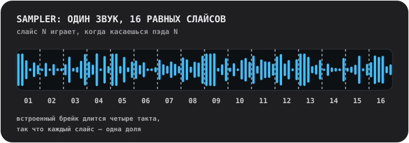

Хочешь узнать больше?

**Нарезка брейка**

**Брейк** — это отрывок, где играют одни барабаны. Нарезать его на куски и переставить — один из самых старых приёмов битмейкинга: так из одного лупа получается сотня битов. Попробуй поставить слайс 3 на первый шаг, удвоить слайс 2, пустить несколько задом наперёд.

**Внутри**

Слайс играется *как есть*: его никогда не растягивают под темп, поэтому брейк ложится на 128. Каждый слайс нарастает за 4 мс и затухает за 10 мс, так что слайсы не щёлкают.

## Bass

Глубокий круглый бас. **Одна нота за раз**; ноты *удерживаются* (см. ниже).

- **Ручки:** **PITCH** и **SCALE**.
- **Клавиши:** **FILTER** (скругляет тембр) и **SUB** (второй голос на октаву ниже, который никогда не фильтруется, так что низ остаётся, когда фильтр закрывается).

**Удерживаемые ноты.** На устройствах, которые удерживают ноты (Bass, Acid, Pad, Chip), несколько обычных шагов подряд на одном пэде — это **одна длинная нота**. Пауза обрывает её, **шаг с акцентом запускает её заново**, а **тактовая черта обрывает любую ноту**. Коснись пэда — нота длится, пока держишь палец.

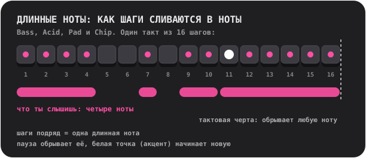

Хочешь узнать больше?

**Что делает бас**

Бас играет **основной тон**: ноту, на которой построен аккорд, гармонический пол песни. Он сцепляется с бочкой. Начни просто: одна длинная низкая нота на первом шаге, потом добавь вторую ноту, немного ритма, прыжок на октаву.

**Почему бас бывает громким на динамике телефона**

Динамик телефона не умеет играть настоящие низкие ноты; основной тон Bass на 110 Гц почти не слышен. Но ухо достраивает недостающую низкую ноту, когда слышит её обертоны («недостающая фундаментальная»). Bass — это мощная синусоида с мягкими низкими обертонами именно поэтому: настоящий бас и в наушниках, *и* на динамике.

## Acid

<table>
<tr>
<td align="center"> PITCH и SCALE</td>
<td align="center"> нажми 2ND: CUTOFF и RESO</td>
</tr>
</table>

Булькающая, визгливая басовая линия эйсид-хауса конца 80-х: пилообразная волна через **резонансный фильтр**, который открывается и закрывается на каждой ноте.

- **Клавиши:** **2ND** (переключает ручки) и **ARP**.
- **Ручки, первая страница:** **PITCH** и **SCALE**. **Вторая страница (2ND):** **CUTOFF** (насколько тёмным фильтр начинает) и **RESO** (насколько он звенит; больше резонанса — больше «бульканья»).
- Ноты **удерживаются**, как на Bass.

Две вещи включены всегда: **слайд** (каждая нота скользит к своей высоте от предыдущей) и **акцент**. **Шаг с акцентом** (ACC на STEP) открывает фильтр шире и играет громче. Секрет этого звука: **сцепи шаги с несколькими акцентами и крути CUTOFF, пока всё играет.**

**ARP** заставляет удерживаемую ноту пробегать собственную высоту, терцию, квинту и октаву, по одной шестнадцатой за раз.

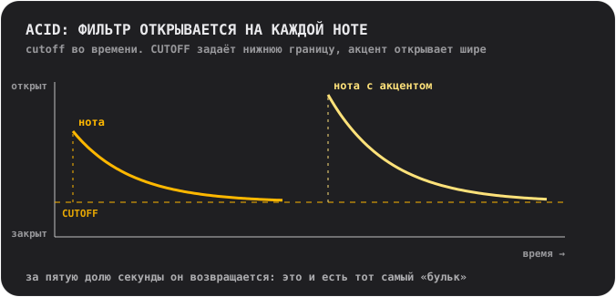

Хочешь узнать больше?

**Что такое фильтр**

**Фильтр** пропускает одни частоты и задерживает другие. **Фильтр низких частот** задерживает верхи: закрытый, он делает звук глухим и приглушённым; открытый — ярким. **Cutoff** — это место, где начинается задержка. **Резонанс** подчёркивает частоты прямо у cutoff, что даёт почти вокальное «вау». Прогон cutoff при высоком резонансе — это звук очень большой части электронной музыки.

**Откуда взялся этот звук**

Acid — дань уважения серебристой коробочке с басом, которая в 1980-х случайно определила целый жанр. Её сделали, чтобы изображать бас-гитару для одиноких гитаристов, и никто не покупал её ради этого. Те, кто всё-таки купил, обнаружили, что пилообразная волна, резонансный фильтр и скользящая нота не звучат ни на что другое.

**Внутри**

Фильтр открывается на две с половиной октавы в начале каждой ноты и возвращается примерно за 0,18 секунды (это и есть «бульк»); акцент открывает его ещё на полторы октавы; слайд длится 80 миллисекунд.

## Vocal

Одна записанная голосовая запись, сыгранная на пэдах на разной высоте, через один из **десяти стилей**. Пой, скажи слово, хлопни, свистни: то, что ты запишешь, становится инструментом.

- **Ручки:** **STYLE** (дисплей показывает название стиля, пока ты крутишь) и **SCALE**. Ручки PITCH нет: высоту выбирают лад и пэд основного тона.
- **Клавиши:** **MONO / POLY** (MONO по умолчанию, чтобы слова не накладывались друг на друга) и **REVERSE**.
- **Твой голос:** запиши до **10 секунд**. Пока записи нет, играет короткая **встроенная фраза**: запись собственного голоса автора.

Стили:
- **01 NATURAL**: как записано.
- **02 ROBOT**: металлический, со своей высотой.
- **03 VOCODER**: робот, который *поёт*, в тональности пэда, на котором ты играешь.
- **04 CHOIR**: четыре медленно покачивающиеся копии тебя.
- **05 RADIO**: узкий и хрустящий, как маленький старый динамик.
- **06 LO-FI**: сплющенный и зернистый, как старый сэмплер.
- **07 CAVE**: большой гулкий зал с длинным хвостом.
- **08 GLITCH**: нарезан на гранулы и заикается. **Каждый удар играет другую случайную нарезку**.
- **09 ALIEN**: дрожащее металлическое кольцо.
- **10 CHORD**: твой голос плюс большая терция и квинта сверху: каждый пэд играет аккорд.

Стиль применяется в фоне через мгновение после того, как ручка остановилась, так что если быстро прокрутить несколько, обработается только тот, на котором ты остановился.

Хочешь узнать больше?

**Высота звука и почему высокий голос кажется маленьким**

Голос проигрывается **быстрее, чтобы стать выше**, и **медленнее, чтобы стать ниже**, как при ускорении плёнки. На высоком пэде голос становится тонким и писклявым, на низком — глубоким и медленным. Так звучит сэмплирование. Для мелодий запиши что-нибудь короткое и пусть SCALE удерживает тебя в тональности.

**Стили изнутри**

**VOCODER** делит голос на десять полос, измеряет громкость каждой и использует её, чтобы лепить жужжащую пилообразную волну: техника 1970-х для пластинок с голосами роботов. **ROBOT** и **ALIEN** используют **кольцевую модуляцию**, то есть умножение голоса на тон, старый приём, который стоит за голосами роботов в научной фантастике. **CHORD** — это *мажорный* аккорд при любом ладе: в минорных ладах некоторые пэды будут конфликтовать, а это, возможно, фишка.

## Pluck

Один короткий щипковый звук, сыгранный на шестнадцати высотах. Самое простое и прямое мелодическое устройство.

- **Ручки:** **PITCH** (ты выбираешь тональность) и **SCALE** (12 ладов, см. [Лады](#scales); название появляется на дисплее, пока ты крутишь).
- **Клавиши:** **MONO / POLY** (MONO: новая нота обрывает остальные) и **REVERSE** (первая треть секунды играет задом наперёд, так что нота нарастает к своей атаке).
- **Свой звук:** один, играет на каждой высоте, до 10 секунд.

Совет: переключись на **пентатонический** лад (05 или 06) и тыкай в пэды как попало. Сфальшивить почти невозможно.

Хочешь узнать больше?

**Лады**

**Лад** — это меню нот, которые хорошо звучат вместе. На пианино двенадцать нот в октаве; лад выбирает из них несколько. **Мажор** звучит ярко и радостно, **минор** — грустно или серьёзно. У **пентатонических** ладов всего пять нот, так что плохих среди них нет. **Хроматика** даёт тебе *каждый* полутон: свободно, и легко сфальшивить. **Основной тон** — это нота-«дом» лада; в Handbeat это пэд 05, а PITCH переносит её в другую тональность.

**Внутри**

Pluck — это один сэмпл, сыгранный быстрее или медленнее, чтобы менять высоту, поэтому вместе с высотой меняется и длина, как на старых клавишах с сэмплами. Пэды нарочно не уходят слишком далеко от основного тона: сэмпл, сыгранный намного быстрее, становится тонким, намного медленнее — гулким.

## Pad

Пэды, лады и ручки как у Pluck, но нота **удерживается**: мягкий, медленно переливающийся звук, который идёт столько, сколько захочешь.

- **Ручки:** **PITCH** и **SCALE**.
- **Клавиши:** **MONO / CHORD** (CHORD играет трезвучие на каждом пэде) и **STEADY / RISE** (RISE заставляет удерживаемую ноту нарастать от тихой до полной).
- Ноты **удерживаются**, как на Bass. Свой звук: один, зациклен без шва, до 10 секунд.

Заполни несколько шагов подряд на одном пэде — получится длинный аккорд; оставь паузу, чтобы закончить его; добавь акцент, чтобы начать новый. RISE на ноте через несколько шагов — быстрый способ сделать нарастание.

Хочешь узнать больше?

**Что такое аккорд**

**Аккорд** — это три или больше нот, сыгранных вместе. Простейший, **трезвучие**, состоит из основного тона, ноты на две ступени выше по ладу и ноты на четыре ступени выше. Включи CHORD — и каждый пэд станет трезвучием выбранного лада: теория не нужна, аккорды всё равно подойдут друг к другу.

**Внутри**

Звук пэда длится одну секунду и зациклен без шва. Две тихие частичные гармоники, на герц выше и ниже каждой из остальных, создают медленное мерцание.

## Chip

Звук эпохи 8 бит: волны старых игровых приставок и домашних компьютеров.

- **Ручки:** **PITCH** и **SCALE**.
- **Клавиши:** **TRI / PULSE** (волна) и **VIB** (мягкое вибрато).
- Ноты **удерживаются**, как на Bass. Своих звуков нет: волны *и есть* инструмент.

**Треугольная волна** мягкая, полая, похожая на флейту, нарисованная крупными ступенями. **Импульсная волна** — узкое гнусавое жужжание, классический звук ведущей мелодии. Пэд основного тона у Chip нарочно стоит **на целый тон выше**, чем у остальных устройств.

**Аккорды на Chip жужжат и трепещут, и это по-настоящему.** Удерживай два пэда — они трелят; удерживай три — они трепещут. Открой коробочку, чтобы узнать почему.

Хочешь узнать больше?

**Полифония быстрой сменой**

Звуковые чипы старых игровых приставок и домашних компьютеров играли **одну ноту за раз на каждом канале**. Чтобы получить аккорды из одного канала, программисты *очень быстро* переключали его между нотами аккорда, так что ухо слышит их вместе, с жужжащим арпеджированным оттенком. Это звук 80-х.

Chip делает ровно это: все пэды, которые ты удерживаешь на одном шаге, делят **один голос**, который даёт каждой ноте **очередь в 1/60 секунды**. **Одна нота** играет ровно, без всяких очередей.

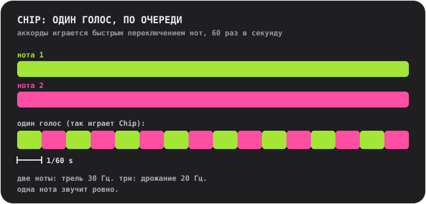

**Волны**

**Треугольник** устроен как настоящий: 4 бита (16 уровней), 32 ступени на цикл, поднимается лесенкой. **Импульсная волна** включена четверть цикла (волна со «скважностью 25 %»).

## Лады

Для Pluck, Pad, Bass, Acid, Vocal и Chip. Крути **SCALE**, и дисплей покажет номер и название.

- **01 Chromatic**: каждый полутон. По умолчанию.
- **02 Major**: яркий, радостный.
- **03 Natural minor**: грустный, серьёзный, большая часть попа и электронной музыки.
- **04 Harmonic minor**: драматичный, с лёгким восточным оттенком.
- **05 Minor pentatonic**: пять нот. Рок, блюз, надёжный выбор.
- **06 Major pentatonic**: пять ярких нот. Фолк, колокольчики.
- **07 Blues**: минорная пентатоника плюс «блюзовая нота».
- **08 Dorian**: минор с лёгкостью. Фанковый, джазовый.
- **09 Phrygian**: тёмный, испанский.
- **10 Lydian**: мечтательный и парящий.
- **11 Mixolydian**: мажор с блюзовым привкусом.
- **12 Whole tone**: парящий, неразрешённый, совсем без ноты-«дома».

---

# Контакты

Нашёл баг? Есть идея, вопрос или что-то, что хочется сказать о звучании? Буду рад услышать. Handbeat делает один человек, поэтому ответ может занять некоторое время, но твоё сообщение обязательно прочтут.

📩 **[handbeat.contact@gmail.com](mailto:handbeat.contact@gmail.com)**

**Сообщаешь о баге?** Очень поможет, если ты напишешь:

1. **Что произошло** и чего ты ожидал вместо этого.
2. **Как это повторить**: какие шаги ты сделал.
3. **Версию приложения** (Настройки → *Версия*), модель твоего iPhone или iPad и версию iOS.
4. **Твой проект**, если дело в конкретном звуке или паттерне: Проекты → смахни строку → *Поделиться* и приложи файл `.handbeat`. Так я смогу открыть именно то, что было у тебя.

Идеи новых функций и письма вроде «хотелось бы, чтобы можно было...» тоже очень приветствуются.

---

# Поддержать

Handbeat делает один человек. Если он делает тебя счастливым и ты хочешь сказать спасибо, можешь:

**Или найми меня.** Я сделал это приложение, и если тебе нужно что-то похожее, давай поговорим: [www.linkedin.com/in/fofonovav](https://www.linkedin.com/in/fofonovav)

---

*Этот текст переведён ИИ и может содержать ошибки.*
