# Handbeat uputstvo

[Uputstvo](#guide) · [Uređaji](#devices) · [Kontakt](#contact) · [Podrška](#support)

Handbeat je groovebox za tvoj iPhone i iPad: šesnaest padova, gomila uređaja, jedan tempo, jedan transport. Dodiruješ, crtaš bit i nižeš taktove u pesmu. To je to. Bez naloga, bez pogrešnog načina da se svira.

Ova stranica je duža verzija. Ne moraš da je čitaš od vrha do dna: prvo se igraj aplikacijom, a vrati se kad te nešto zbuni.

---

# Uputstvo

## Ekran

Gornji deo ekrana je **displej**. Sve na njemu možeš da dodirneš.

| | |
|---|---|
|  | **Mikrofon.** Snimaj sopstvene zvukove, pogledaj [Tvoji sopstveni zvukovi](#your-own-sounds). |
|  | **Izvoz.** Čuva ceo projekat kao audio fajl. |
|  | **Meni.** Tvoji projekti i podešavanja. |
|  | **TAP.** Kucaj po njemu uz pesmu i Handbeat će naći tempo. Takođe pulsira na svakoj dobi. |
|  | **ACC.** Akcenat, pogledaj [Crtanje bita](#drawing-a-beat-step). |
|  | **Strelice.** Prolaze kroz zvukove (ili note) uređaja. |

- **Traka sa imenom** nosi ime uređaja (na mikseru, ime projekta). Dodirni olovku da ga preimenuješ, do 8 znakova.
- **BPM** je tempo: vuci gore-dole (od 64 do 256). **SWG** je sving, o njemu niže.
- **Dve kolone cifara** pokazuju dva broja; šta znače zavisi od stranice, na primer *SOUND* i *PATTERN* na bubnjevima.
- **Dva regulatora.** Vuci ih gore-dole. **Dvaput dodirni regulator** da ga vratiš na podrazumevanu vrednost. Dok vrtiš jedan, displej pokazuje njegovu tačnu vrednost i ime.

Svaki pad, taster i regulator odgovara sitnim podrhtavanjem telefona (isključuje se u Podešavanjima, pod *Vibracija*). Što više neka kontrola menja muziku, to je podrhtavanje jače.

Želiš da znaš više?

**Tempo i sving**

**BPM** znači *beats per minute*, udaraca u minuti. 60 je jedan udarac u sekundi, miran korak. House se kreće oko 120 do 130, drum and bass blizu 170. Handbeat kreće od 128 jer odgovara skoro svemu.

**Sving** namerno čini da bit „šepa“. Obično je 16 koraka jednog takta ravnomerno raspoređeno. Uz sving, svaki drugi korak stiže malo kasnije, pa groove poskakuje umesto da maršira. SWG ide od **500** (ravno) do **750** (krajnost); oko **667** dobijaš klasični šafl u triolama. Probaj ga na hi-hatovima.

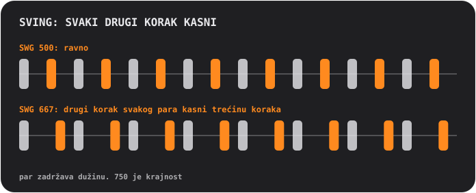

## Padovi i stranice

Padovi su uvek mreža 4×4, numerisana od 01 do 16. Gornji red tastera menja **stranicu**, a ona određuje šta padovi rade:

<table>
<tr>
<td align="center"> <b>SOUND</b> sviranje: svaki pad svira svoj zvuk</td>
<td align="center"> <b>STEP</b> crtanje: svaki pad je jedan od 16 koraka</td>
<td align="center"> <b>PATTERN</b> biranje: svaki pad je jedan patern</td>
</tr>
</table>

### Crtanje bita (STEP)

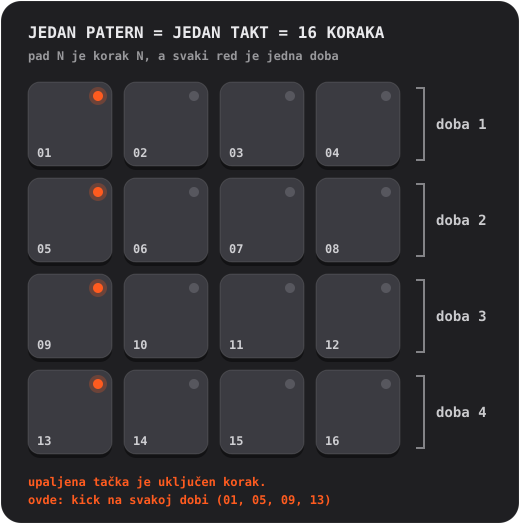

1. Na **SOUND** dodirni pad koji želiš da programiraš. On postaje izabrani zvuk.
2. Pritisni **STEP** i dodiruj padove da uključuješ i isključuješ korake. Upaljena tačka znači da je korak uključen.
3. Pritisni **PLAY**. Mekan blesak trči preko padova: to je plejhed. Možeš da nastaviš da menjaš dok svira.

**Akcenti.** Pritisni **ACC**, pa dodirni korak: on postaje akcenat, glasniji i naglašeniji udarac. ACC se sam isključi posle jednog dodira. Dodirni korak sa akcentom ponovo da ga obrišeš.

Želiš da znaš više?

**Šta je step sekvencer**

Vreme se seče na jednake kriške koje se zovu **koraci**. Za svaki zvuk odlučuješ na kojim koracima svira. Četiri koraka čine jednu **dobu** (jedan udarac stopalom), četiri dobe čine **takt**. Svaki patern u Handbeatu je tačno jedan takt, a takt se vrti u petlji. Većina popa, hausa i hip-hopa sagrađena je od ovakvih taktova, naslaganih i variranih.

### Snimanje uživo (REC)

Pritisni **REC** i sviraj padove na stranici SOUND. Handbeat pokreće transport ako nije radio i smešta tvoje udarce na *najbliži* korak šesnaestine, pa i malo traljav prst pogodi ritam. On radi **overdub**: ono što već postoji ostaje. Pritisni **STOP** (taster PLAY) da završiš. Nema poništavanja: nepoželjne korake isključi na STEP.

Na uređajima koji drže note (Bass, Acid, Pad, Chip) snima se i dužina tvog dodira.

### Čitanje svetala

- **Tačka** na padu kaže šta pad *jeste*: ugašena je prazan, slaba znači „ovde nešto ima“, upaljena znači aktivan (izabrani zvuk, uključen korak, trenutni patern), jaka se ističe (akcenat, najnoviji takt lanca). Tačka koja **trepće** znači „čeka kraj takta“.
- **Prsten** pada kaže šta svira *baš sada*.
- **Prigušen** pad je nem (utišan, ili je neki drugi na solou). I dalje svira kad ga dodirneš.
- **Prsten oko tastera** znači da je neki režim uključen.

## Tasteri

| | |
|---|---|
|   | **S i M** su dva *kontekstna tastera*; menjaju se sa uređajem i stranicom. Na bubnjevima su **solo** i **mute** za izabrani zvuk. Drugi uređaji ovde stavljaju svoje tastere, pogledaj [Uređaji](#devices). |
|   | Na stranici PATTERN postaju **COPY** i **ERASE**. |
|  | **REC** snima uživo. |
|  | **PLAY** pokreće sve na istom satu. Dok svira, to je kvadrat za stop: zaustavlja *i premotava*. Poziv, alarm ili isključene slušalice takođe zaustavljaju muziku; ponovo pritisni PLAY. |
|  | **CHAIN** povezuje paterne u pesmu. Ima plavi prsten dok je uključen. |
|  | **RACK** prebacuje između uređaja u kom si i miksera. |

Mute i solo utiču samo na ono što svira *sekvencer*. Pad koji sam dodirneš uvek daje zvuk.

## Paterni i lanci

**Patern** je jedan takt, 16 koraka. Imaš **16 paterna**, a *svaki patern drži korake svih uređaja*: bubnjevi, bas i melodija paterna 03 su svi u 03.

Na stranici **PATTERN** dodirni pad da izabereš patern. Dok muzika svira, promena čeka kraj takta, a pad **trepće** dok se to ne desi.

- **COPY**, pa pad: kopira patern koji svira na taj pad.
- **ERASE**, pa pad: briše taj patern.
- Ponovo pritisni taster, ili napusti stranicu, da otkažeš.

### Lanac: patern je takt, lanac je pesma

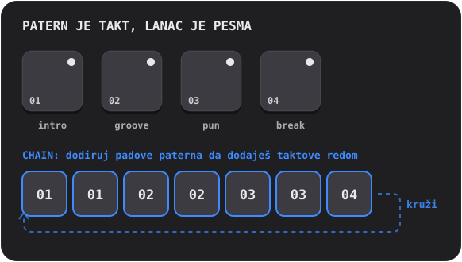

Uključi **CHAIN** i dodiruj padove paterna: svaki dodir **dodaje jedan takt** na kraj lanca (do 99 taktova, ponavljanja su dozvoljena). Reprodukcija prati lanac takt po takt i vrti se iznova. Isključi CHAIN da ga završiš; patern koji si poslednji dodirnuo svira sam.

Želiš da znaš više?

**Kako se pesme grade od petlji**

Skoro sva plesna muzika je **ponavljanje sa promenama**. Uzmeš petlju koja radi, pa dodaješ i oduzimaš slojeve da slušalac oseti kako raste i diše: oskudan **intro**, postojan **groove**, **pun** deo sa svim uključenim, **break** u kom stvari nestaju i bubnjarski **fill** u poslednjoj dobi koji ušima kaže „stiže nešto novo“. U Handbeatu je svaki od njih jedan patern, a CHAIN ih slaže redom.

## Mikser (RACK)

Poslednji taster prebacuje između tvog uređaja i **miksera**, iste table 4×4 sa drugim šeširom. Projekat se **uvek otvara na mikseru**.

<table>
<tr>
<td align="center"> <b>DEVICE</b> tvoji uređaji</td>
<td align="center"> <b>Prazan pad</b> izaberi novi uređaj</td>
<td align="center"> <b>PATTERN</b> kopiranje i brisanje celih paterna</td>
</tr>
</table>

Na stranici **DEVICE** svaki pad je jedno mesto: do **16 uređaja** u projektu.

- **Dodirni prazan pad** da dodaš uređaj (padovi postaju vrste koje možeš da izabereš).
- **Dodirni zauzet pad** da ga izabereš. Njegov prsten svetli dok svira. **RACK** skače na njegov sopstveni ekran.
- **SOLO / MUTE** deluju na izabrani uređaj.  **TRASH** briše uređaj: pritisni ga, dodirni pad uređaja, potvrdi.
- **DEV VOL** je nivo izabranog uređaja, **MAIN VOL** jačina celog miksa. 5 je neutralna sredina.
- Na stranici **PATTERN** miksera, COPY i ERASE deluju na ceo patern *sa svim uređajima u njemu*.

## Efekti uživo

Stranica **LIVE FX** ima šesnaest efekata na padovima, četiri reda po četiri. **Drži pad da sviraš efekat, pusti da ga zaustaviš.** Efekti ulaze za desetinu sekunde i izlaze za četvrtinu, pa ništa ne pucketa. Drži koliko god želiš. Namenjeni su **nastupu**: ništa na ovoj stranici se ne čuva, a efekti **nisu uključeni u izvoz**.

**Ton**
- **LP**: priguši zvuk (niskopropusni filter).
- **HP**: istanji ga (visokopropusni filter).
- **SWEEP**: filter koji se penje od basa do visina i stiže tačno kad se takt završi.
- **ROBOT**: ceo miks zvoni na jednoj visini.

**Prostor** (nastavljaju da zvuče posle puštanja)
- **ECHO**: ponavlja u osminama sa tačkom.
- **DUB**: ponavlja na svakoj dobi, tamnije i prljavije.
- **VOID**: soba.
- **FLANGE**: vrtložni šum mlaznog aviona.

**Petlja i držanje**
- **STUT 1/8**, **STUT 1/16**, **STUT 1/32**: mucanja. Korak koji svira se ponavlja.
- **FREEZE**: drži zvuk kao mekanu, ravnomernu teksturu.

**DJ prelazi**
- **SCRATCH**: igla koja se vuče napred-nazad preko poslednje polovine dobe.
- **REVERSE**: muzika, jednu dobu iza, unazad.
- **HALF SPEED**: usporava sve za oktavu naniže.
- **RISER**: šum koji se penje, dostiže vrhunac tačno na kraju takta i seče se čim pustiš: „drop“.

Želiš da znaš više?

**Efekti u pesmi**

Efekti su začin, a ne glavno jelo. Klasični potezi: drži **RISER** kroz poslednji takt jednog dela i pusti na prvoj dobi sledećeg; drži **LP** dok se deo završava pa pusti da novi eksplodira; dodirni **STUT** na jednu dobu da pretvoriš ono što svira u bubnjarsku rolnu koja muca; dodaj kratak **ECHO** na poslednji udarac fraze da odjekne u sledeći takt.

**Unutra**

Efekti rade nad celim miksom, pošto se saberu svi uređaji i pre glavne jačine i limitera. STUT uzima korak na kom je sekvencer kad dodirneš pad, pa čuješ kako se ponavlja *nota*, a ne tišina pre nje.

## Tvoji sopstveni zvukovi

Možeš da sviraš **sopstvene** zvukove: snimi ih mikrofonom ili učitaj audio fajlove. Svaki uređaj može da ih ima osim Chipa i Acida, koji su izgrađeni na sopstvenim talasima.

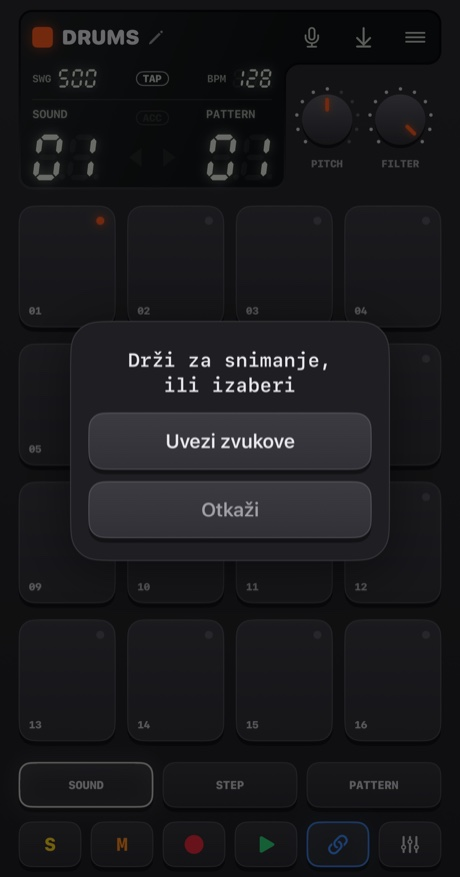

- **Drži mikrofon** (malo duže od četvrtine sekunde) da snimaš. Pusti da završiš. Padovi postaju crveni, muzika staje (mikrofon bi je čuo) i displej broji sekunde.
- **Dodirni ga** da izabereš: **Uvezi zvukove** ili **Ugrađeni zvukovi** (povratak na originale; pojavljuje se kad uređaj ima sopstvene zvukove).

Kuda zvuk ide zavisi od uređaja:
- **Drums**: jedan zvuk po padu. **Prvo izaberi pad, pa drži dugme.**
- **Sampler**: jedan zvuk do **30 sekundi**, isečen na 16 jednakih slajsova.
- **Pluck, Pad, Bass, Vocal**: jedan zvuk do **10 sekundi**, koji svira na svakom padu na drugoj visini. Ono što snimiš je *osnovni ton*, pad 05.

Handbeat odseca tišinu oko tvog zvuka. Snimak bez zvuka se ne čuva.

**Uvoz fajlova** prima WAV, AIFF, M4A, MP3 i slične. Bubnjevi primaju više njih, po jedan po padu redom po imenima, počevši od izabranog pada. Jedan dug fajl se **seče na pauzama** (četvrtina sekunde tišine počinje sledeći zvuk). Svaki drugi uređaj uzima prvi fajl. Zvukovi se čuvaju u projektu i putuju sa njim.

Prvi put iOS pita sme li Handbeat da koristi mikrofon. Ako si rekao ne, dugme te vodi u Podešavanja.

Želiš da znaš više?

**Šta je semplovanje**

**Sempl** je snimak korišćen kao instrument. Semplovanje je srce hip-hopa, hausa i hiljadu drugih stvari: snimiš zvuk pa ga pokreneš, ubrzaš, uspori, iseckaš na komade. Sviraš li sempl **brže**, postaje viši i kraći, **sporije**, postaje dublji i duži, baš kao kad ubrzaš traku. Tako se jedan snimak pretvara u celu klavijaturu.

## Projekti, deljenje i izvoz

Dugme **menija** otvara **Projekte** (zaustavlja muziku i čuva).

<table>
<tr>
<td align="center">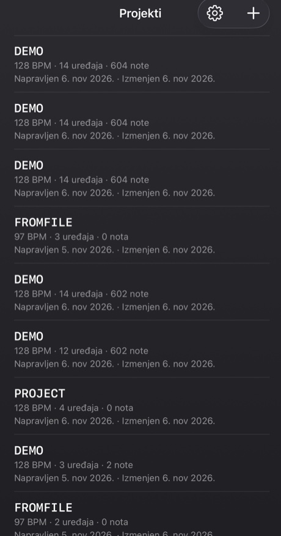</td>
<td align="center">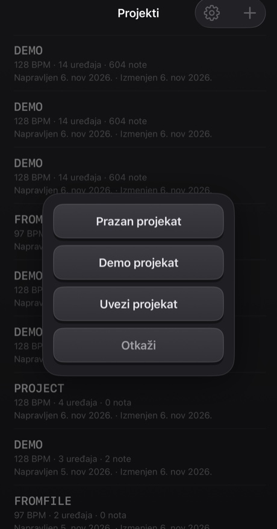</td>
</tr>
</table>

- Dodirni projekat da ga otvoriš. **Prevuci** red (ili ga drži) da ga **podeliš** ili **obrišeš**; brisanje uvek pita.
- Dugme **+** pravi *Prazan projekat* ili *Demo projekat*, ili **uvozi** projekat iz fajla. Demo je dobro mesto za početak: četrnaest uređaja svira mešavinu od 40 taktova.
- Sve se **čuva automatski**.

**Deljenje** upisuje projekat, sa njegovim sopstvenim zvukovima, u jedan `.handbeat` fajl i otvara list za deljenje: pošalji ga preko AirDropa ili mejlom, ili ga sačuvaj u Fajlovima kao rezervnu kopiju. Kad takav fajl otvoriš u Handbeatu, on se **dodaje** kao novi projekat i nikad ne dira tvoje.

**Izvoz audija** je dugme za čuvanje na displeju. Renderuje **ceo projekat, svi uređaji izmiksani**, u **WAV** ili **M4A** (biraš u Podešavanjima), brže od realnog vremena. Sa uključenim CHAIN-om dobijaš ceo lanac, inače jedan prolaz trenutnog paterna. Dugme je sivo kad nema šta da se čuje.

## Podešavanja

Projekti → zupčanik. **Jezik** menja menije odmah (sam groovebox, sa tasterima, regulatorima i imenima uređaja, ostaje na engleskom svuda, kao natpisi na hardverskom aparatu). Postoje četiri **teme**, svaka u varijanti Tamna, Svetla ili *Sistemska*: **Classic**, **iClassic** (sjajna plastika i klik točkić), **Contrast** (ravna, čisto crna ili bela) i **Aero** (gel i staklo). Svaka tema ima i sopstvenu **ikonicu aplikacije**.

---

# Uređaji

**Uređaj** je instrument u tvom projektu. Dodaj ga dodirom na prazan pad na mikseru. Navedeni su istim redom kao u izboru. Svi imaju 16 staza × 16 koraka, pa STEP, REC, paterni, lanci i izvoz svuda rade isto. Razlikuju se zvuk, padovi, dva regulatora i dva tastera pored **REC**.

**Notni uređaji** (Bass, Acid, Vocal, Pluck, Pad, Chip) dele isti raspored padova, kao piano roll: **pad 05 je osnovni ton** (nota „kuća“), padovi iznad su viši, padovi ispod niži. Regulator **SCALE** odlučuje šta koraci *jesu* (pogledaj [Skale](#scales)). Koraci koje crtaš čuvaju se kao brojevi padova, pa promena skale svira *istu melodiju u novoj skali*.

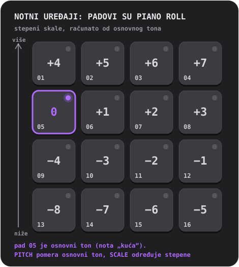

## Drums

Kompletan bubanj set: **16 zvukova, jedan po padu**.

- **Regulatori:** **PITCH** (od −6 do +6 polutonova, ceo set) i **FILTER** (niskopropusni: 10 je potpuno otvoren, niže prigušuje set).
- **Tasteri:** **S** i **M** (solo i mute) za izabrani zvuk.
- **Sopstveni zvukovi:** jedan po padu.

**Probaj ovo:** dodiruj padove na SOUND da nađeš šta je gde. Nađi kik, pritisni STEP i uključi 01, 05, 09 i 13: kik na svakoj dobi, otkucaj srca hausa. Dodaj klap na 05 i 13, a hi-hatove na korake između.

**Zatvoren hi-hat** seče **otvoren hi-hat**, kao na pravom instrumentu, pa nikad ne zvone jedan preko drugog.

Želiš da znaš više?

**Tri bubnja koja su važna**

**Kik** (kick) je duboki udarac zbog kog klimaš glavom. **Doboš** (snare) ili **klap** je prasak, obično na dobama 2 i 4 (koraci 05 i 13), **bekbit**. **Hi-hat** je tik-tik-tik koje određuje brzinu groovea: osmine (svaki drugi korak) ili šesnaestine (svaki korak). Kik na svakoj dobi je **four on the floor**; kik na 01 i 11 sa dobošem na 05 i 13 je klasičan brejkbit.

**Unutra**

Svaki ugrađeni zvuk je napravljen od nule za Handbeat: generisan skriptom, ništa pozajmljeno ni od koga.

## Sampler

**Jedan zvuk isečen na 16 jednakih slajsova**, po jedan za svaki pad. Poređaj slajsove redom i zvuk svira kakav je bio; premeštaj ih i remiksovao si ga.

- **Regulatori:** **PITCH** (ubrzava ili usporava svaki slajs) i **FILTER**.
- **Tasteri:** **MONO / POLY** (MONO: novi slajs seče one koji još zvuče) i **REVERSE** (svaki slajs unazad).
- **Sopstveni zvuk:** snimi do **30 sekundi** ili uvezi fajl. Prva kolona displeja je **SLICE**.

Bez tvog zvuka svira **ugrađeni brejk**: četiri takta brejkbita na 128 BPM, pa je svaki slajs jedna doba. Da ga čuješ kakav je bio, stavi slajsove 1 do 4 na korake 01, 05, 09, 13 paterna 1, slajsove 5 do 8 u patern 2, i tako kroz četiri povezana paterna.

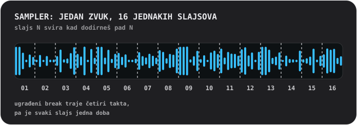

Želiš da znaš više?

**Seckanje brejka**

**Brejk** je deonica sa samim bubnjevima. Iseckati ga na komade i promešati ih jedan je od najstarijih trikova u pravljenju bitova: tako jedna petlja postaje stotinu bitova. Probaj da premestiš slajs 3 na prvi korak, da udvostručiš slajs 2, da nekoliko pustiš unazad.

**Unutra**

Slajs svira *onakav kakav jeste*: nikad se ne razvlači da stane u tempo, zato brejk pristaje na 128. Svaki slajs ulazi za 4 ms i izlazi za 10 ms, pa slajsovi nikad ne pucketaju.

## Bass

Dubok, okrugao bas. **Jedna nota odjednom**; note se *drže* (vidi niže).

- **Regulatori:** **PITCH** i **SCALE**.
- **Tasteri:** **FILTER** (zaokružuje ton) i **SUB** (drugi glas oktavu niže, nikad filtriran, pa dubina ostaje kad se filter zatvori).

**Držane note.** Na uređajima koji drže (Bass, Acid, Pad, Chip), uzastopni obični koraci na jednom padu su **jedna duga nota**. Pauza je završava, **korak sa akcentom je ponovo pokreće**, a **taktna crta završava svaku notu**. Dodirni pad i nota traje dokle god ti prst stoji.

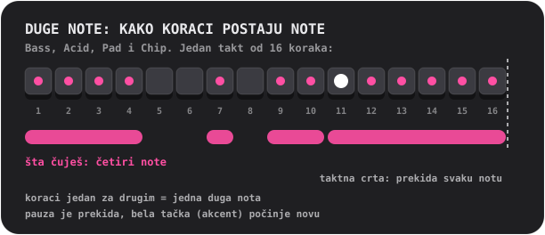

Želiš da znaš više?

**Šta radi bas**

Bas svira **osnovni ton**: notu na kojoj je izgrađen akord, harmonijski pod pesme. Uklapa se sa kikom. Počni jednostavno: jedna duga duboka nota na prvom koraku, pa dodaj drugu notu, malo ritma, skok za oktavu.

**Zašto bas može da zvuči glasno na zvučniku telefona**

Zvučnik telefona ne može da svira prave duboke note; osnovni ton Bassa od 110 Hz jedva izlazi. Ali tvoje uvo dopunjuje notu koja nedostaje kad čuje njene alikvote („nedostajući osnovni ton“). Bass je snažan sinus sa mekim dubokim alikvotima upravo zbog toga: pravi bas na slušalicama *i* na zvučniku.

## Acid

<table>
<tr>
<td align="center"> PITCH i SCALE</td>
<td align="center"> pritisni 2ND: CUTOFF i RESO</td>
</tr>
</table>

Bas linija koja bublja i cvili iz acid hausa kasnih 80-ih: testerasti talas kroz **rezonantni filter** koji se otvara i zatvara na svakoj noti.

- **Tasteri:** **2ND** (prebacuje regulatore) i **ARP**.
- **Regulatori, prva stranica:** **PITCH** i **SCALE**. **Druga stranica (2ND):** **CUTOFF** (koliko taman filter počinje) i **RESO** (koliko jako zvoni; više rezonance, više „squelcha“).
- Note se **drže**, kao na Bassu.

Dve stvari su uvek uključene: **slajd** (svaka nota klizi do svoje visine od prethodne note) i **akcenat**. **Korak sa akcentom** (ACC na STEP) otvara filter šire i svira glasnije. Trik ovog zvuka: **nizaj korake sa nekoliko akcenata i vrti CUTOFF dok svira.**

**ARP** tera držanu notu da prođe kroz sopstvenu visinu, tercu, kvintu i oktavu, po jednu šesnaestinu.

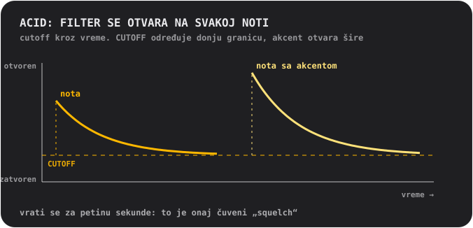

Želiš da znaš više?

**Šta je filter**

**Filter** propušta neke frekvencije, a druge blokira. **Niskopropusni** filter blokira visine: zatvoren, zvuk je mutan i prigušen; otvoren, svetao je. **Cutoff** je mesto gde počinje da blokira. **Rezonanca** pojačava frekvencije baš na cutoffu, što daje onaj skoro vokalni „wow“. Prelaženje cutoffom uz visoku rezonancu je zvuk velikog dela elektronske muzike.

**Odakle ovaj zvuk**

Acid je poklon srebrnoj kutijici za bas koja je slučajno definisala ceo žanr 1980-ih. Napravljena je da usamljenim gitaristima glumi bas gitaru, i niko je nije kupovao zbog toga. Oni koji su je ipak kupili otkrili su da testerasti talas, rezonantni filter i nota koja klizi ne zvuče ni kao šta drugo.

**Unutra**

Filter se na početku svake note otvara za dve i po oktave i vraća za oko 0,18 sekundi („squelch“); akcenat ga otvara još za oktavu i po; slajd traje 80 milisekundi.

## Vocal

Jedan snimljen glas koji svira na padovima na različitim visinama, kroz jedan od **deset stilova**. Pevaj, reci reč, pljesni, zviždi: ono što snimiš postaje instrument.

- **Regulatori:** **STYLE** (displej pokazuje ime stila dok vrtiš) i **SCALE**. Nema regulatora PITCH: skala i pad osnovnog tona određuju visinu.
- **Tasteri:** **MONO / POLY** (MONO je podrazumevan, da se reči ne gaze) i **REVERSE**.
- **Tvoj glas:** snimi do **10 sekundi**. Do tada svira kratku **ugrađenu frazu**: snimak glasa samog autora.

Stilovi:
- **01 NATURAL**: kako je snimljeno.
- **02 ROBOT**: metalan, sa sopstvenom visinom.
- **03 VOCODER**: robot koji *peva*, u tonalitetu pada koji sviraš.
- **04 CHOIR**: četiri kopije tebe koje se polako njišu.
- **05 RADIO**: uzak i hrskav, kao mali stari zvučnik.
- **06 LO-FI**: zgnječen i zrnast, kao stari sempler.
- **07 CAVE**: velika odjekujuća sala sa dugim repom.
- **08 GLITCH**: iseckan na zrna i mucav. **Svaki udarac svira drugačiji nasumični sečeni oblik**.
- **09 ALIEN**: metalni prsten koji se talasa.
- **10 CHORD**: tvoj glas plus velika terca i kvinta iznad: svaki pad svira akord.

Stil se primenjuje u pozadini trenutak pošto se regulator zaustavi, pa ako brzo prođeš kroz više njih, obrađuje se samo onaj na kom staneš.

Želiš da znaš više?

**Visina i zašto visok glas zvuči sitno**

Glas se pušta **brže da bi postao viši** i **sporije da bi postao dublji**, kao kad ubrzavaš traku. Glas na visokom padu postaje tanak i cvilav, na niskom dubok i spor. To je zvuk semplovanja. Za melodije snimi nešto kratko i pusti da te SCALE drži u tonalitetu.

**Stilovi iznutra**

**VOCODER** deli glas na deset opsega, meri koliko je koji glasan i time oblikuje zujući testerasti talas: tehnika iz 1970-ih za ploče sa robotskim glasovima. **ROBOT** i **ALIEN** koriste **prstenastu modulaciju**, množenje glasa tonom, stari trik iza robotskih glasova iz naučne fantastike. **CHORD** je *dur* akord bez obzira na skalu: u molskim skalama neki padovi će se tući, što može da bude prednost.

## Pluck

Jedan kratak trzani zvuk koji svira na šesnaest visina. Najjednostavniji i najdirektniji melodijski uređaj.

- **Regulatori:** **PITCH** (ti biraš tonalitet) i **SCALE** (12 skala, pogledaj [Skale](#scales); ime se pojavljuje na displeju dok vrtiš).
- **Tasteri:** **MONO / POLY** (MONO: nova nota seče ostale) i **REVERSE** (prva trećina sekunde svira unazad, pa nota nabuja do svog napada).
- **Sopstveni zvuk:** jedan, svira na svakoj visini, do 10 sekundi.

Savet: pređi na **pentatonsku** skalu (05 ili 06) i dodiruj padove nasumično. Veoma je teško odsvirati pogrešnu notu.

Želiš da znaš više?

**Skale**

**Skala** je jelovnik nota koje lepo zvuče zajedno. Klavir ima dvanaest nota u oktavi; skala bira šaku njih. **Dur** zvuči svetlo i veselo, **mol** tužno ili ozbiljno. **Pentatonske** skale imaju samo pet nota, pa nijedna nije loša. **Hromatska** ti daje *svaki* poluton: slobodno, i lako je odsvirati lažno. **Osnovni ton** je nota „kuća“ skale; u Handbeatu to je pad 05, a PITCH ga pomera u drugi tonalitet.

**Unutra**

Pluck je jedan sempl, pušten brže ili sporije da bi se promenila visina, pa se menja i dužina, kao na starim klavijaturama sa semplovima. Padovi nisu previše daleko od osnovnog tona namerno: sempl pušten mnogo brže postaje tanak, mnogo sporije bučan.

## Pad

Padovi, skale i regulatori kao kod Plucka, ali se nota **drži**: mekan, polako treperav zvuk koji traje koliko želiš.

- **Regulatori:** **PITCH** i **SCALE**.
- **Tasteri:** **MONO / CHORD** (CHORD svira trozvuk na svakom padu) i **STEADY / RISE** (RISE tera držanu notu da nabuja od tihe do pune).
- Note se **drže**, kao na Bassu. Sopstveni zvuk: jedan, zapetljan bez šava, do 10 sekundi.

Popuni više koraka zaredom na jednom padu za dug akord, ostavi pauzu da ga završiš, dodaj akcenat da počneš novi. RISE na noti kroz više koraka je brz način za nadogradnju.

Želiš da znaš više?

**Šta je akord**

**Akord** su tri ili više nota odsviranih zajedno. Najjednostavniji, **trozvuk**, je osnovni ton, nota dva stepena iznad u skali i nota četiri stepena iznad. Uključi CHORD i svaki pad postaje trozvuk izabrane skale: ne treba ti teorija da dobiješ akorde koji se slažu.

**Unutra**

Zvuk Pada traje jednu sekundu i vrti se bez šava. Dva tiha parcijala, hercu iznad i ispod svakog od ostalih, prave sporo treperenje.

## Chip

Zvuk ere 8 bita: talasi starih igraćih konzola i kućnih računara.

- **Regulatori:** **PITCH** i **SCALE**.
- **Tasteri:** **TRI / PULSE** (talas) i **VIB** (blag vibrato).
- Note se **drže**, kao na Bassu. Bez sopstvenih zvukova: talasi *jesu* instrument.

**Trouglasti talas** je mekan, šupalj, nalik flauti i nacrtan u krupnim stepenicama. **Pulsni talas** je uzano, nazalno zujanje, klasičan zvuk vodeće melodije. Pad osnovnog tona kod Chipa je namerno **ceo ton viši** nego kod ostalih uređaja.

**Akordi na Chipu zuje i trepere, i to je autentično.** Drži dva pada i oni trilaju; drži tri i trepere. Otvori kutiju da saznaš zašto.

Želiš da znaš više?

**Polifonija brzim smenama**

Zvučni čipovi starih igraćih konzola i kućnih računara svirali su **samo jednu notu odjednom po kanalu**. Da bi iz jednog kanala izvukli akorde, programeri su ga *veoma brzo* prebacivali između nota akorda, pa ih uvo čuje zajedno, sa zujećom, arpeđiranom bojom. To je zvuk 80-ih.

Chip radi upravo to: svi padovi koje držiš na jednom koraku dele **jedan glas** koji svakoj noti daje **red od 1/60 sekunde**. **Jedna nota** svira ravnomerno, bez ikakvih redova.

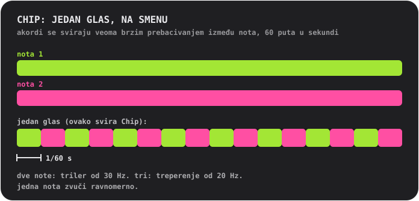

**Talasi**

**Trougao** je napravljen kao pravi: 4 bita (16 nivoa), 32 stepenika po ciklusu, penje se stepenicama. **Pulsni talas** je uključen četvrtinu ciklusa („25% duty“).

## Skale

Za Pluck, Pad, Bass, Acid, Vocal i Chip. Vrti **SCALE** i displej pokazuje broj i ime.

- **01 Chromatic**: svaki poluton. Podrazumevana.
- **02 Major**: svetla, vesela.
- **03 Natural minor**: tužna, ozbiljna, većina popa i elektronske muzike.
- **04 Harmonic minor**: dramatična, pomalo orijentalna.
- **05 Minor pentatonic**: pet nota. Rok, bluz, siguran izbor.
- **06 Major pentatonic**: pet svetlih nota. Folk, zvona.
- **07 Blues**: molska pentatonika plus „blue note“.
- **08 Dorian**: mol sa zamahom. Funky, džezerska.
- **09 Phrygian**: mračna, španska.
- **10 Lydian**: sanjiva i lebdeća.
- **11 Mixolydian**: dur sa bluz ivicom.
- **12 Whole tone**: lebdeća, nerazrešena, bez ikakve note „kuće“.

---

# Kontakt

Našao si grešku? Imaš ideju, pitanje ili nešto da kažeš o tome kako zvuči? Rado ću čuti. Handbeat pravi jedna osoba, pa odgovor može malo da potraje, ali tvoja poruka će biti pročitana.

📩 **[handbeat.contact@gmail.com](mailto:handbeat.contact@gmail.com)**

**Prijavljuješ grešku?** Mnogo pomaže ako navedeš:

1. **Šta se desilo** i šta si umesto toga očekivao.
2. **Kako da se desi ponovo**: korake koje si preduzeo.
3. **Verziju aplikacije** (Podešavanja → *Verzija*), model tvog iPhonea ili iPada i verziju iOS-a.
4. **Tvoj projekat**, ako se radi o određenom zvuku ili paternu: Projekti → prevuci red → *Podeli*, i priloži `.handbeat` fajl. Tako mogu da otvorim tačno ono što si imao.

Ideje za funkcije i mejlovi tipa „voleo bih da može...“ su isto tako dobrodošli.

---

# Podrška

Handbeat pravi jedna osoba. Ako te čini srećnim i želiš da kažeš hvala, možeš:

**Ili me angažuj.** Napravio sam ovu aplikaciju, a ako ti treba nešto slično, možemo da razgovaramo: [www.linkedin.com/in/fofonovav](https://www.linkedin.com/in/fofonovav)

---

*Ovaj tekst je preveo AI i može da sadrži greške.*
