# Handbeat 指南

[指南](#guide) · [设备](#devices) · [联系](#contact) · [支持](#support)

Handbeat 是一台为 iPhone 和 iPad 打造的 groovebox：十六个 pad、一大堆设备、一个速度、一个走带控制。你点一点，画出一段节拍，再把小节串起来，就是一首歌。就这么简单。没有账号，也没有“错误”的玩法。

这一页是详细版。不必从头读到尾：先随便点点 app，遇到不明白的再回来看。

---

# 指南

## 屏幕

屏幕上方是**显示屏**。上面的一切都可以触摸。

| | |
|---|---|
|  | **麦克风。** 录下你自己的声音，见[你自己的声音](#your-own-sounds)。 |
|  | **导出。** 把整个项目保存为音频文件。 |
|  | **菜单。** 你的项目和设置。 |
|  | **TAP。** 跟着一首歌点按它，Handbeat 就能找出速度。它也会在每一拍上闪动。 |
|  | **ACC。** 重音，见[画一段节拍](#drawing-a-beat-step)。 |
|  | **箭头。** 依次切换设备的声音（或音符）。 |

- **名称栏**显示设备的名称（在调音台上显示项目名称）。点按铅笔即可改名，最多 8 个字符。
- **BPM** 是速度：上下拖动即可（64 到 256）。**SWG** 是摇摆，下面会讲。
- **两列数字**显示两个数值，含义取决于页面，例如鼓组上是 *SOUND* 和 *PATTERN*。
- **两个旋钮。** 上下拖动。**双击旋钮**可恢复默认值。转动旋钮时，显示屏会显示它的精确数值和名称。

每个 pad、按键和旋钮都会用手机的一下轻微震动回应你（可在设置的*振动*里关闭）。一个控件对音乐的改变越大，震动就越重。

每个页面的 pad 和打开它的按键上都有淡淡的**纹理**，让你一眼就知道自己在哪：LIVE FX 是线条，SOUND 是圆点，STEP 是竖列，PATTERN 是方块。DEVICE 页面没有纹理，它的 pad 上是每台设备的小标记。这一切都可以在设置里的*视觉提示*中关闭。

想了解更多？

**速度与摇摆**

**BPM** 的意思是 *beats per minute*，每分钟的拍数。60 就是每秒一拍，像悠闲散步。House 大约在 120 到 130，drum and bass 接近 170。Handbeat 从 128 开始，因为它几乎适合所有风格。

**摇摆**（swing）会故意让节拍“一瘸一拐”。通常一个小节的 16 步间距是均匀的。加上摇摆后，每隔一步就会稍微晚一点到，律动就从“齐步走”变成“弹跳”。SWG 的范围是 **500**（直拍）到 **750**（极限）；在 **667** 附近就是经典的三连音 shuffle。可以先在踩镲上试试。

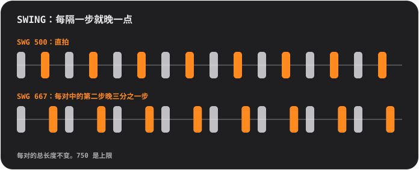

## Pad 与页面

Pad 永远是 4×4 的网格，编号从 01 到 16。最上面一排按键用来切换**页面**，页面决定 pad 的作用：

<table>
<tr>
<td align="center"> <b>SOUND</b> 演奏：每个 pad 播放自己的声音</td>
<td align="center"> <b>STEP</b> 绘制：每个 pad 是 16 步中的一步</td>
<td align="center"> <b>PATTERN</b> 选择：每个 pad 是一个 pattern（节奏型）</td>
</tr>
</table>

### 画一段节拍 (STEP)

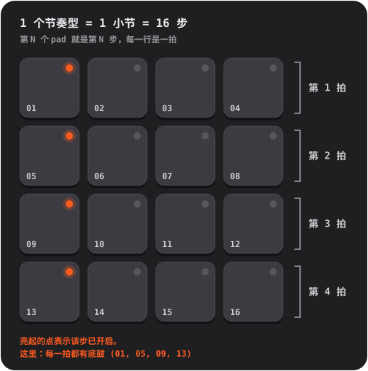

1. 在 **SOUND** 页面，点按你想编排的 pad，它就成为当前选中的声音。
2. 按下 **STEP**，点按 pad 来开启或关闭各步。亮着的点表示这一步已开启。
3. 按下 **PLAY**。一道柔和的亮光会掠过各个 pad：这就是播放头。播放时也可以继续编辑。

**重音。** 按下 **ACC**，再点按某一步：它会变成重音，也就是更响、更有力的一击。点按一次后 ACC 会自动关闭。再次点按带重音的步即可清除。

想了解更多？

**什么是步进音序器**

时间被切成长度相等的小块，叫作**步**。对于每个声音，你决定它在哪些步上发声。四步构成一**拍**（脚打一下拍子），四拍构成一**小节**。Handbeat 里的每个 pattern 正好是一个小节，而小节会循环播放。大部分流行、house 和嘻哈，都是由这样的小节叠加、变化而成。

### 现场录音 (REC)

按下 **REC**，在 SOUND 页面上弹奏 pad。如果走带当时没有运行，Handbeat 会自动启动，并把你的演奏落在*最近的* 16 分音符步上，所以手指稍微有点不准，也能踩在拍子上。它是**叠录**：已有的内容会保留。按下 **STOP**（也就是 PLAY 键）结束。没有撤销：不想要的步，到 STEP 里关掉即可。

在会保持音符的设备（Bass、Acid、Pad、Chip）上，你按住的时长也会被录下来。

### 读懂指示灯

- Pad 的**圆点**表示这个 pad *是什么*：熄灭是空的，暗淡表示“这里有内容”，常亮表示处于活动状态（选中的声音、已开启的步、当前 pattern），明亮表示突出（重音、链中最新的小节）。**闪烁**的点表示“在等小节结束”。
- Pad 的**光环**表示*此刻*正在发声的内容。
- **变暗**的 pad 是静音的（被静音，或者别的 pad 处于独奏）。不过你触摸它时仍会发声。
- **按键周围的光环**表示某个模式已开启。

## 按键

| | |
|---|---|
|   | **S 和 M** 是两个*情境键*，会随设备和页面而变。在鼓组上，它们是所选声音的**独奏**和**静音**。其他设备会把自己的按键放在这里，见[设备](#devices)。 |
|   | 在 PATTERN 页面上，它们会变成 **COPY** 和 **ERASE**。 |
|  | **REC** 用于现场录音。 |
|  | **PLAY** 让一切按同一个时钟开始。播放时它会变成停止方块：它会停止*并回到开头*。来电、闹钟或拔掉耳机也会让音乐停下；再按一次 PLAY 即可。 |
|  | **CHAIN** 把多个 pattern 串成一首歌。开启时带有蓝色光环。 |
|  | **RACK** 在你当前所在的设备和调音台之间切换。 |

静音和独奏只影响*音序器*播放的内容。你亲手触摸的 pad 总是会发声。

## Pattern 与链

一个 **pattern**（节奏型）就是一个小节，16 步。你有 **16 个 pattern**，而且*每个 pattern 都包含所有设备的步*：pattern 03 的鼓、贝斯和旋律，都在 03 里。

在 **PATTERN** 页面上，点按一个 pad 来选择 pattern。音乐播放时，切换会等到小节结束，在此之前那个 pad 会**闪烁**。

- **COPY**，然后点按一个 pad：把正在播放的 pattern 复制到那里。
- **ERASE**，然后点按一个 pad：清空那个 pattern。
- 再按一次该键，或离开这个页面，即可取消。

### 链：pattern 是一个小节，链就是一首歌

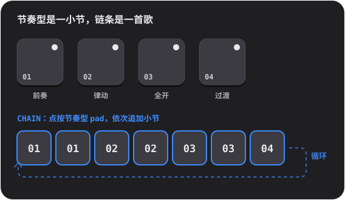

开启 **CHAIN**，然后点按 pattern 的 pad：每点一次，就会在链的末尾**增加一个小节**（最多 99 个小节，可以重复）。播放会按小节顺序走完整条链，然后回到开头循环。关闭 CHAIN 即可结束；你最后触摸的那个 pattern 会单独播放。

想了解更多？

**歌曲是怎样用循环搭起来的**

大多数舞曲都是**带变化的重复**。先选一个好用的循环，然后不断叠加或抽掉声部，让听的人感觉到音乐在生长、在呼吸：稀疏的**前奏**，稳定的**律动**，所有声部全开的**完整**段落，声音撤走的**过渡段**，还有最后一拍里的一小段鼓**过门**，它在告诉耳朵“新的东西要来了”。在 Handbeat 里，它们每一个都是一个 pattern，CHAIN 负责把它们按顺序排好。

## 调音台 (RACK)

最后一个按键会在你的设备和**调音台**之间切换，调音台就是同一块 4×4 的面板，换了一顶帽子。项目**总是在调音台上打开**。

<table>
<tr>
<td align="center"> <b>DEVICE</b> 你的设备</td>
<td align="center"> <b>空 pad</b> 选一个新设备</td>
<td align="center"> <b>PATTERN</b> 复制和清除整个 pattern</td>
</tr>
</table>

在 **DEVICE** 页面上，每个 pad 是一个槽位：一个项目最多可以放 **16 台设备**。

- **点按带加号的 pad** 来添加设备（pad 会变成可供选择的种类，每种都有自己的标记）。
- **标记。** 每个 pad 上有设备的小标记：鼓面（Drums）、波形（Sampler）、缓慢的波（Bass）、锯齿（Acid）、麦克风（Vocal）、渐弱的琴弦（Pluck）、渐强的包络（Pad）、方波（Chip）。
- **点按已占用的 pad** 来选中它。它发声时光环会亮起。**RACK** 会跳到它自己的界面。
- **SOLO / MUTE** 作用于选中的设备。 **TRASH** 用来删除设备：按下它，点按该设备的 pad，再确认。
- **DEV VOL** 是选中设备的音量，**MAIN VOL** 是整个混音的音量。5 是中性的中间位置。
- 在调音台的 **PATTERN** 页面上，COPY 和 ERASE 作用于整个 pattern，*包含其中的所有设备*。

## 现场效果

**LIVE FX** 页面的 pad 上有十六个效果，四行，每行四个。**按住 pad 就会播放效果，松开即停止。**效果大约在十分之一秒内渐入，在四分之一秒内渐出，所以不会有爆音。想按几个就按几个。它们是用来**现场演奏**的：这个页面上的任何内容都不会被保存，效果也**不会包含在导出里**。

**音色**
- **LP**：让声音变闷（低通）。
- **HP**：让声音变薄（高通）。
- **SWEEP**：一个从低音爬升到高音的滤波器，恰好在小节结束时到达。
- **ROBOT**：整个混音像是在同一个音高上共鸣。

**空间**（松开后仍会继续余响）
- **ECHO**：以附点八分音符重复。
- **DUB**：每拍重复，更暗、更脏。
- **VOID**：一个房间。
- **FLANGE**：像喷气式飞机一样旋转的呼啸声。

**循环与保持**
- **STUT 1/8**、**STUT 1/16**、**STUT 1/32**：结巴效果。正在播放的那一步会不断重复。
- **FREEZE**：把声音定格成一种柔和而稳定的质感。

**DJ 过渡**
- **SCRATCH**：在最后半拍上来回拖动唱针。
- **REVERSE**：晚一拍的音乐，倒着播放。
- **HALF SPEED**：把一切降低一个八度并放慢。
- **RISER**：一股不断攀升的噪声，恰好在小节结束时到达顶点，你一松手就戛然而止：这就是“drop”。

想了解更多？

**在歌曲里使用效果**

效果是调味料，不是主菜。经典用法有：在一个段落的最后一个小节里一直按住 **RISER**，在下一个段落的第一拍松开；在一个段落结束时按住 **LP**，松开让新的段落迸发出来；点一下 **STUT** 持续一拍，把正在播放的内容变成结巴的鼓点滚奏；在乐句的最后一击上加一小段 **ECHO**，让它的余音延续进下一个小节。

**内部原理**

效果作用在整个混音上，位于所有设备相加之后、主音量和限幅器之前。STUT 会取你触摸 pad 的那一刻音序器所在的那一步，所以你听到的是*音符*在重复，而不是它之前的静默。

## 你自己的声音

你可以演奏**你自己的**声音：用麦克风录下来，或者载入音频文件。除了以自身波形为基础的 Chip 和 Acid 之外，每台设备都可以拥有自己的声音。

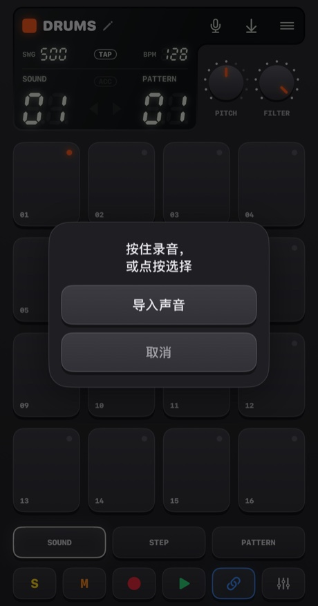

- **按住麦克风**按钮（比四分之一秒稍长一点）开始录音，松开即结束。pad 会变红，音乐会停止（麦克风会把它录进去），显示屏会数秒。
- **点按它**可以选择：**导入声音**，或**内置声音**（回到原始声音；当设备有自己的声音时才会出现）。

声音去哪里取决于设备：
- **Drums**：每个 pad 一个声音。**先选 pad，再按住按钮。**
- **Sampler**：一个最长 **30 秒**的声音，被切成 16 个等长切片。
- **Pluck、Pad、Bass、Vocal**：一个最长 **10 秒**的声音，在每个 pad 上以不同的音高演奏。你录下的是*根音*，也就是 pad 05。

Handbeat 会裁掉你声音前后的静默。无声的录音不会被保留。

**导入文件**支持 WAV、AIFF、M4A、MP3 等格式。鼓组可以接收多个文件，从选中的 pad 开始，按文件名顺序每个 pad 放一个。一个很长的文件会**在停顿处被切开**（四分之一秒的静默就会开启下一个声音）。其他设备使用第一个文件。声音保存在项目里，并随项目一起走。

第一次使用时，iOS 会询问 Handbeat 是否可以使用麦克风。如果你选了“不允许”，这个按钮会带你去设置。

想了解更多？

**什么是采样**

**采样**（sample）就是被当作乐器使用的一段录音。采样是嘻哈、house 和上千种音乐的核心：录下一个声音，然后触发它、加快、放慢、切碎。把一个采样**加速**播放，它会变高、变短；**放慢**播放，它会变低、变长，就像把磁带快转一样。就这样，一段录音变成了一整个键盘。

## 项目、分享与导出

**菜单**按钮会打开**项目**（它会停止音乐并保存）。

<table>
<tr>
<td align="center">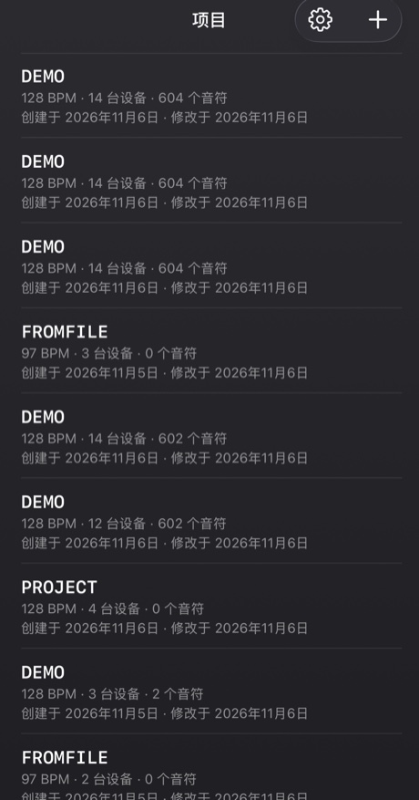</td>
<td align="center">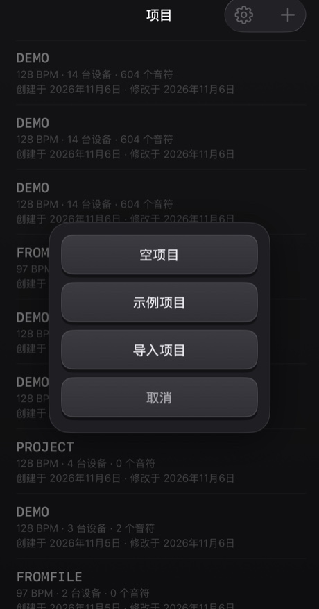</td>
</tr>
</table>

- 点按一个项目即可打开。在某一行上**滑动**（或长按），可以**分享**或**删除**它；删除时总会先确认。
- **+** 可以新建*空项目*或*示例项目*，也可以从文件**导入**项目。示例是个很好的起点：十四台设备在演奏一首 40 小节的混搭曲。
- 一切都会**自动保存**。

**分享**会把项目连同它自己的声音写成一个 `.handbeat` 文件，并打开分享面板：用 AirDrop 或邮件发送，或者作为备份存进“文件”。在 Handbeat 里打开这样的文件，会把它**添加**为一个新项目，绝不会改动你已有的项目。

**导出音频**就是显示屏上的保存按钮。它会把**整个项目、所有设备混合后**渲染成 **WAV** 或 **M4A**（在设置中选择），速度比实时更快。开启 CHAIN 时导出整条链，否则导出当前 pattern 播放一遍的内容。当没有可听的内容时，按钮会变灰。

## 设置

项目 → 齿轮。**语言**会立即切换菜单（groovebox 本身的按键、旋钮和设备名称在所有语言里都保持英文，就像硬件机器上的标签）。有四种**主题**，每种都有深色、浅色或*系统*三种：**Classic**、**iClassic**（光亮的塑料质感和点击式滚轮）、**Contrast**（扁平，纯黑或纯白）和 **Aero**（凝胶与玻璃）。每种主题还有自己的 **App 图标**。**振动**和**视觉提示**可以开关点按反馈，以及页面的纹理和标记。**新手引导**会在一个新的演示项目上重新进行引导。第一次打开 Handbeat 时，引导会自动在演示项目上开始，点角落的 × 可以退出。

---

# 设备

**设备**就是你项目里的一件乐器。在调音台上点按一个空 pad 就可以添加。它们的排列顺序与选择器里的一致。所有设备都是 16 条轨道 × 16 步，所以 STEP、REC、pattern、链和导出在各处的用法都一样。不同的是声音、pad、两个旋钮，以及 **REC** 旁边的两个按键。

**音高设备**（Bass、Acid、Vocal、Pluck、Pad、Chip）共用同一种 pad 布局，就像钢琴卷帘：**pad 05 是根音**（“主音”），它上面的 pad 更高，下面的 pad 更低。**SCALE** 旋钮决定这些步*是什么音*（见[音阶](#scales)）。你画的步是以 pad 编号保存的，所以切换音阶会让*同一段旋律在新的音阶里*响起。

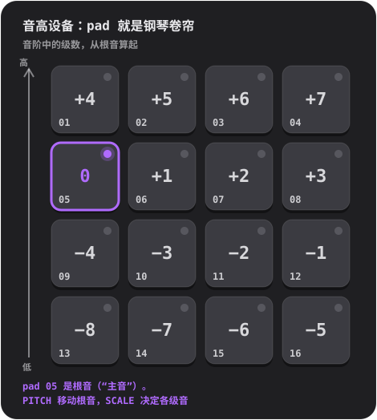

## Drums

一套完整的鼓组：**16 个声音，每个 pad 一个**。

- **旋钮：** **PITCH**（−6 到 +6 个半音，作用于整套鼓）和 **FILTER**（低通：10 是完全打开，调低会让鼓组变闷）。
- **按键：** 所选声音的 **S** 和 **M**（独奏和静音）。
- **自有声音：** 每个 pad 一个。

**试试这个：** 在 SOUND 页面点按各个 pad，找找什么声音在哪里。找到底鼓后按下 STEP，开启 01、05、09 和 13：每一拍都有底鼓，这就是 house 的心跳。在 05 和 13 上加一个拍手声，在它们之间的步上加踩镲。

**闭合踩镲**会切断**开放踩镲**，就像真的乐器一样，所以两者不会叠在一起持续响。

想了解更多？

**最重要的三种鼓**

**底鼓**（kick）是让你点头的低沉重击。**军鼓**（snare）或**拍手声**（clap）是清脆的一响，通常落在第 2 拍和第 4 拍（第 05 步和 13 步），也就是 **backbeat**。**踩镲**（hi-hat）是嗒嗒嗒的声音，决定律动的快慢：八分音符（隔一步一响）或十六分音符（每一步一响）。每拍一个底鼓叫作 **four on the floor**；在 01 和 11 放底鼓、在 05 和 13 放军鼓，则是经典的 breakbeat。

**内部原理**

每一个内置声音都是为 Handbeat 从零开始制作的：由脚本生成，没有借用任何人的东西。

## Sampler

**一个声音被切成 16 个等长的切片**，每个 pad 一个。把切片按顺序排好，声音就会按原样播放；把它们重新排列，你就完成了一次重混。

- **旋钮：** **PITCH**（加快或放慢每个切片）和 **FILTER**。
- **按键：** **MONO / POLY**（MONO：新的切片会切断仍在发声的切片）和 **REVERSE**（每个切片倒放）。
- **自有声音：** 最长可录 **30 秒**，或导入一个文件。显示屏的第一列是 **SLICE**。

如果没有你自己的声音，它会播放一段**内置 break**：128 BPM 的四个小节 breakbeat，所以每个切片正好是一拍。想按原样听到它，就把切片 1 到 4 放在 pattern 1 的第 01、05、09、13 步，把切片 5 到 8 放进 pattern 2，依此类推，用四个相连的 pattern 走完。

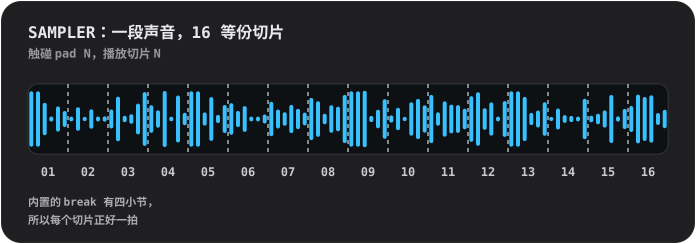

想了解更多？

**切碎一段 break**

**break** 是只有鼓的一段。把它切成碎片再重新排序，是制作节拍最古老的招数之一：一个循环就这样变成了一百种节拍。试试把切片 3 移到第一步，把切片 2 重复一次，把其中几个倒放。

**内部原理**

切片是*原样*播放的：从不为了适应速度而拉伸，所以这段 break 在 128 时正好合拍。每个切片在 4 毫秒内渐入、10 毫秒内渐出，因此切片之间不会出现爆音。

## Bass

一个深沉、圆润的贝斯。**一次只发一个音**；音符会被*保持*（见下文）。

- **旋钮：** **PITCH** 和 **SCALE**。
- **按键：** **FILTER**（让音色变圆润）和 **SUB**（低一个八度的第二个声部，从不被滤波，所以滤波器关上时低频依然保留）。

**保持的音符。** 在会保持音符的设备（Bass、Acid、Pad、Chip）上，同一个 pad 上连续的普通步会合成**一个长音**。出现空档就会结束，**带重音的步会重新开始**，**小节线会结束所有音符**。触摸 pad 时，音符会持续到你的手指离开为止。

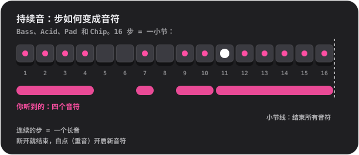

想了解更多？

**贝斯是做什么的**

贝斯演奏的是**根音**：和弦所建立的那个音，也是一首歌在和声上的地板。它与底鼓咬合在一起。从简单的开始：在第一步上放一个长而低的音，然后再加第二个音、一点节奏、一个八度跳进。

**为什么贝斯在手机喇叭上也可以很响**

手机喇叭播不出真正的低音；Bass 110 Hz 的根音几乎出不来。但你的耳朵在听到泛音时，会自动补上缺失的低音（所谓“缺失的基音”）。Bass 正是因此被做成强劲的正弦波，加上柔和的低次泛音：无论是耳机还是喇叭，听起来都是像样的贝斯。

## Acid

<table>
<tr>
<td align="center"> PITCH 和 SCALE</td>
<td align="center"> 按下 2ND：CUTOFF 和 RESO</td>
</tr>
</table>

80 年代末 acid house 里那种咕噜咕噜、尖利的贝斯线：锯齿波穿过一个**共振滤波器**，它在每个音符上打开又关上。

- **按键：** **2ND**（切换旋钮）和 **ARP**。
- **旋钮，第一页：** **PITCH** 和 **SCALE**。**第二页（2ND）：** **CUTOFF**（滤波器起始时有多暗）和 **RESO**（共振有多强；共振越多，咕噜感越强）。
- 音符和 Bass 一样会被**保持**。

有两样东西始终开启：**滑音**（每个音符都从上一个音符滑向自己的音高）和**重音**。**带重音**的步（在 STEP 里用 ACC）会把滤波器开得更大，声音也更响。这个声音的诀窍：**把几个带重音的步串起来，一边播放一边转动 CUTOFF。**

**ARP** 会让一个被保持的音符依次走过它自己的音高、三度、五度和八度，每次一个十六分音符。

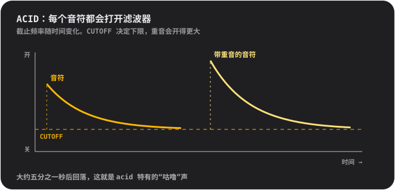

想了解更多？

**什么是滤波器**

**滤波器**会让某些频率通过，把另一些挡住。**低通**滤波器挡住高频：关上时，声音发闷、被捂住；打开时，声音明亮。**截止频率**（cutoff）是它开始挡住声音的位置。**共振**会加强截止频率附近的频率，从而带来那种近似人声的“哇”声。在高共振下扫动截止频率，是大量电子音乐的标志性声音。

**这个声音从哪里来**

Acid 是对一台银色小贝斯盒的致敬，它在 20 世纪 80 年代无意间定义了整个流派。它原本是为孤独的吉他手模拟贝斯吉他而做的，没人为此买它。而买了它的人发现，锯齿波、共振滤波器和滑动的音符，听起来和别的任何东西都不一样。

**内部原理**

滤波器在每个音符开头会打开两个半八度，并在大约 0.18 秒内回落（那股咕噜劲）；重音会再多开一个半八度；滑音时长为 80 毫秒。

## Vocal

一段录下来的人声，在各个 pad 上以不同音高演奏，并经过**十种风格**中的一种处理。唱一段、说个词、拍拍手、吹口哨：你录下的任何东西都会变成乐器。

- **旋钮：** **STYLE**（转动时显示屏会显示风格名称）和 **SCALE**。没有 PITCH 旋钮：音高由音阶和根音 pad 决定。
- **按键：** **MONO / POLY**（默认是 MONO，这样字词不会互相叠在一起）和 **REVERSE**。
- **你的声音：** 最长可录 **10 秒**。在录之前，它会播放一小段**内置短句**：那是作者本人的一段录音。

风格：
- **01 NATURAL**：原样录音。
- **02 ROBOT**：带金属感，有自己的音高。
- **03 VOCODER**：一个会*唱歌*的机器人，唱的是你所弹 pad 的调。
- **04 CHOIR**：四个缓缓摇摆的你。
- **05 RADIO**：窄而酥脆，像一只旧的小喇叭。
- **06 LO-FI**：被压扁、颗粒感十足，像一台老采样器。
- **07 CAVE**：一个回声很大的大房间，带长长的尾音。
- **08 GLITCH**：被切成颗粒并结巴。**每一击都会播放不同的随机切法**。
- **09 ALIEN**：摇曳的金属环音。
- **10 CHORD**：你的声音再加上其上方的大三度和五度：每个 pad 都弹出一个和弦。

风格会在旋钮停下后片刻于后台应用，所以如果你快速转过好几个，只有最后停下的那个会被处理。

想了解更多？

**音高，以及为什么高音的人声听起来很小**

人声是**加快播放变高**、**放慢播放变低**的，就像把磁带快转一样。高音 pad 上的人声会变得又细又尖，低音 pad 上的则深沉缓慢。这就是采样的声音。想做旋律的话，录一小段短的，让 SCALE 帮你保持在调内。

**风格的内部原理**

**VOCODER** 把人声分成十个频段，测量每个频段的响度，再用它去塑造一个嗡嗡作响的锯齿波：这是 20 世纪 70 年代为机器人声唱片发明的技术。**ROBOT** 和 **ALIEN** 使用**环形调制**，也就是把人声与一个音调相乘，是科幻片里机器人声的老把戏。**CHORD** 无论什么音阶都是*大*和弦：在小调音阶里，有些 pad 会产生冲突，这也可以是一种特色。

## Pluck

一个短促的拨弦声，在十六个音高上演奏。最简单、最直接的旋律设备。

- **旋钮：** **PITCH**（由你选调）和 **SCALE**（12 种音阶，见[音阶](#scales)；转动时名称会显示在显示屏上）。
- **按键：** **MONO / POLY**（MONO：新音符会切断其他音符）和 **REVERSE**（最初约三分之一秒倒放，所以音符会向它的起音膨胀）。
- **自有声音：** 一个，在每个音高上演奏，最长 10 秒。

小提示：切换到**五声**音阶（05 或 06），随便点按 pad。想弹错都很难。

想了解更多？

**音阶**

**音阶**就是一份“放在一起好听的音符”的菜单。钢琴一个八度有十二个音；音阶从中挑出一小把。**大调**听起来明亮欢快，**小调**听起来悲伤或严肃。**五声**音阶只有五个音，所以没有难听的音。**半音阶**则给你*每一个*半音：自由，也很容易弹错。**根音**是这个音阶的“家”，在 Handbeat 里就是 pad 05，PITCH 会把它移到另一个调。

**内部原理**

Pluck 是一个采样，通过加快或放慢播放来改变音高，所以长度也会跟着变，就像老式采样键盘那样。各 pad 刻意不离根音太远：采样快得太多会变细，慢得太多会变得沉闷。

## Pad

和 Pluck 一样的 pad、音阶和旋钮，但音符是**保持**的：一种柔和、缓缓闪烁的声音，你想持续多久就持续多久。

- **旋钮：** **PITCH** 和 **SCALE**。
- **按键：** **MONO / CHORD**（CHORD 在每个 pad 上弹出一个三和弦）和 **STEADY / RISE**（RISE 让被保持的音符从轻到满逐渐增强）。
- 音符和 Bass 一样会被**保持**。自有声音：一个，无缝循环，最长 10 秒。

在一个 pad 上连续填几步，就是一个长和弦；留出空档就结束它；加一个重音就开始新的一个。给跨越多步的音符加上 RISE，是一种快速的推进方式。

想了解更多？

**什么是和弦**

**和弦**是三个或更多音符同时演奏。最简单的**三和弦**由根音、音阶里高两级的音和高四级的音组成。打开 CHORD，每个 pad 都会变成你所选音阶的三和弦：不懂理论，也能得到彼此契合的和弦。

**内部原理**

Pad 的声音长一秒，并且无缝循环。在其他每个分音上下各一赫兹处，有两个安静的分音，造就了缓慢的闪烁感。

## Chip

8 位时代的声音：老游戏机和家用电脑的波形。

- **旋钮：** **PITCH** 和 **SCALE**。
- **按键：** **TRI / PULSE**（波形）和 **VIB**（轻柔的颤音）。
- 音符和 Bass 一样会被**保持**。没有你自己的声音：波形*本身就是*乐器。

**三角波**柔和、空灵，像长笛，是用粗阶梯画出来的。**脉冲波**是一种窄而带鼻音的嗡鸣，是经典的主旋律声音。Chip 的根音 pad 刻意比其他设备**高一个全音**。

**Chip 上的和弦会嗡嗡作响并颤动，这才是正宗的味道。**按住两个 pad 它们就会颤音，按住三个就会抖动。打开下面的盒子，看看为什么。

想了解更多？

**靠快速轮流实现的复音**

老游戏机和家用电脑的声音芯片，**每个声道一次只能发一个音**。为了用一个声道弹出和弦，程序员会让它在和弦的各个音之间*飞快*地来回切换，于是你的耳朵会把它们听成同时发声，带着嗡嗡作响、类似琶音的色彩。这就是 80 年代的声音。

Chip 做的正是这件事：你在同一步上按住的所有 pad 共用**一个声部**，它给每个音符**1/60 秒的一轮**。**单独一个音**则稳定地发声，完全没有轮换。

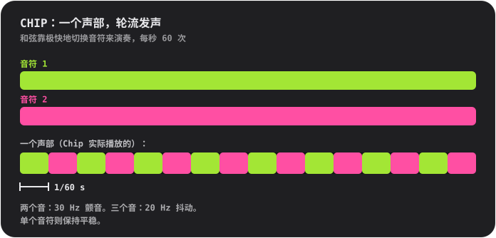

**波形**

**三角波**的构造与真品一样：4 位（16 个电平），每个周期 32 级，像阶梯一样爬升。**脉冲波**在周期的四分之一内处于开启状态（“25% 占空比”的波形）。

## 音阶

适用于 Pluck、Pad、Bass、Acid、Vocal 和 Chip。转动 **SCALE**，显示屏会显示编号和名称。

- **01 Chromatic**：每一个半音。默认值。
- **02 Major**：明亮、欢快。
- **03 Natural minor**：悲伤、严肃，大部分流行和电子音乐都用它。
- **04 Harmonic minor**：戏剧化，带一点东方味道。
- **05 Minor pentatonic**：五个音。摇滚、蓝调，稳妥的选择。
- **06 Major pentatonic**：五个明亮的音。民谣、钟声。
- **07 Blues**：小调五声音阶加上“蓝调音”。
- **08 Dorian**：带一点提升感的小调。放克、爵士。
- **09 Phrygian**：暗沉，西班牙风味。
- **10 Lydian**：如梦似幻、飘浮。
- **11 Mixolydian**：带点蓝调棱角的大调。
- **12 Whole tone**：飘浮、不解决，完全没有“家”的音。

---

# 联系

发现了 bug？有想法、问题，或者想聊聊它的声音？我很想听到。Handbeat 由一个人制作，所以回复可能要等一会儿，但你的消息一定会被看到。

📩 **[handbeat.contact@gmail.com](mailto:handbeat.contact@gmail.com)**

**要报告 bug 吗？**如果能附上下面这些信息，会很有帮助：

1. **发生了什么**，以及你本来期望发生什么。
2. **如何重现**：你做过的步骤。
3. **你的 App 版本**（设置 → *版本*）、你的 iPhone 或 iPad 型号，以及 iOS 版本。
4. **你的项目**，如果问题与某个具体的声音或 pattern 有关：项目 → 在该行上滑动 → *分享*，并附上 `.handbeat` 文件。这样我就能打开你当时的原样内容。

功能想法，以及“要是能……就好了”这类邮件，同样欢迎。

---

# 支持

Handbeat 由一个人制作。如果它让你开心，你也想说声谢谢，可以：

**或者雇用我。**这个 app 是我做的，如果你需要做类似的东西，我们可以聊聊：[www.linkedin.com/in/fofonovav](https://www.linkedin.com/in/fofonovav)

---

*此文本由 AI 翻译，可能包含错误。*
